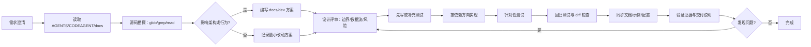
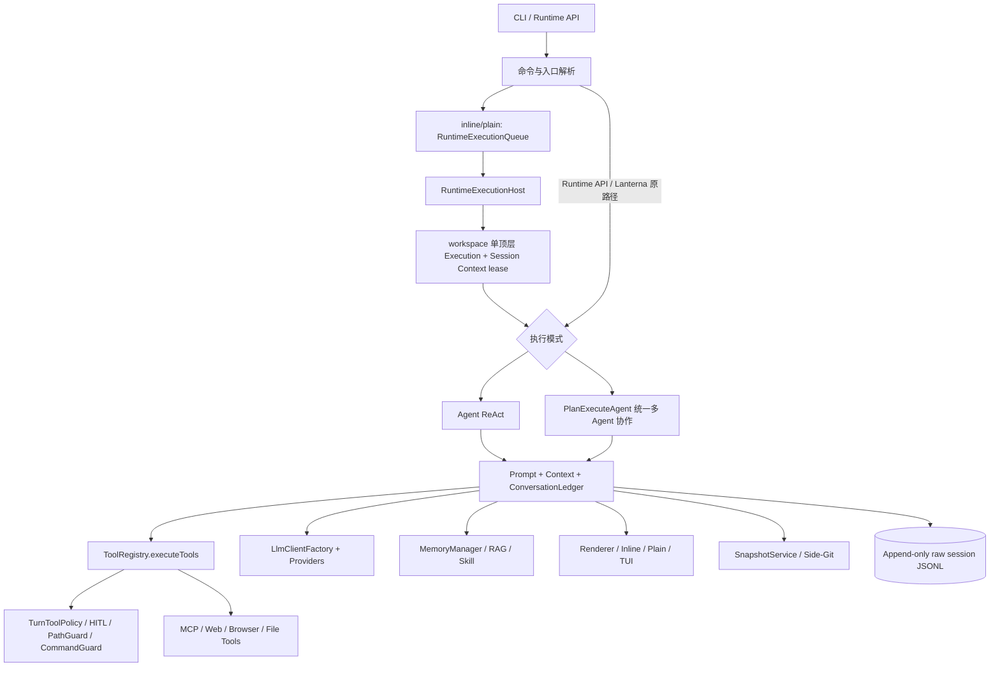
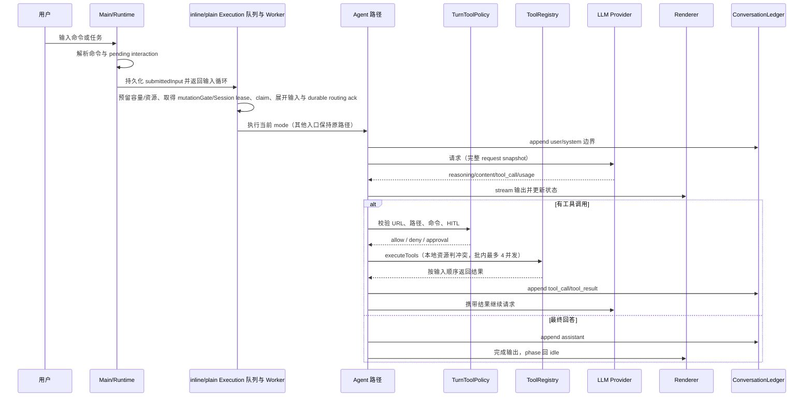

# CodeAgent 项目开发指南

本文件是仓库中 Agent 和新线程的首读入口。它约束开发流程、架构边界和交付质量；详细实现说明见 [docs/implementation/01-runtime-and-agent-foundation.md](docs/implementation/01-runtime-and-agent-foundation.md)。

## 1. 信息优先级与项目快照

信息冲突时按以下顺序判断：代码实际行为 > AGENTS.md > CODEAGENT.md > README.md > ROADMAP.md > CLAUDE.md。ROADMAP.md 只表示演进方向，不代表已交付。

CodeAgent 是面向商业使用的 Java 17+ Agent CLI，对标 Claude Code。默认 inline/plain 终端的普通顶层任务先由 Mode Router 在 ReAct 与统一多 Agent 协作的 Plan-and-Execute 之间选择；`/react` 与 `/plan` 提供单轮显式覆盖，Plan 路径的人工计划门与步骤自动评审串联生效。两条路径共享 ToolRegistry、Memory、Snapshot、Policy、Renderer 等基础设施。核心模块位于 src/main/java/com/codeagent/，测试位于 src/test/java/。

## 2. 开发流程（最高优先级）

### 2.1 强制生命周期

任何非纯文字回答的代码、配置或文档变更，都必须经过以下生命周期。小修复可以缩短文档，但不能跳过验证和交付检查。



执行要求：

1. 先读相关文档，再读源码；源码是真相。不得仅凭 README 或旧计划猜测行为。
2. 先定义目标、非目标、影响面和验收标准；需求含糊时先澄清，不得自行扩大范围。
3. 涉及新增能力、跨模块协作、协议/命令/数据格式、持久化、并发或安全策略时，默认创建 `docs/dev/{需求名}.md`，并在实现前完成方案评审。一个实现任务最多新建这一份开发文档；设计、实施计划、任务拆分、测试矩阵、实施记录和验收清单必须合并在同一文件中。
4. 实现遵循“测试先行、最小改动、依赖方向单向”。每完成一个边界就运行对应测试。
5. 完成前必须执行验证命令、检查 git diff/git diff --check，并在回复中给出真实命令和结果；未经验证不得声称“已修复/已完成”。

### 2.2 方案文档模板

```markdown
# {需求名}
## 1. 背景、目标与非目标
## 2. 现状分析（源码证据、已知约束）
### 2.1 架构位置
### 2.2 数据/状态模型
### 2.3 核心时序与失败路径
## 3. 方案设计
### 3.1 接口与数据结构
### 3.2 策略、安全、并发与恢复
### 3.3 兼容性、迁移与回滚
## 4. 实现任务与测试矩阵
## 5. 验收清单
```

方案至少包含一张适合问题的 Mermaid 图：模块关系用 graph，事件交互用 sequenceDiagram，状态变化用 stateDiagram-v2，步骤决策用 flowchart。图必须和文字、代码保持一致；不画装饰性图。

该 docs/dev 方案文档同时是该任务唯一的设计与实施文档。执行任何 skill、Plan Mode 或其他工作流时，都只能更新这份文档中的对应章节，不得再创建独立的 implementation plan、execution plan、task plan 或同义文档。若已有 `docs/dev` 文档能够承载本次任务，应直接更新已有文档，不得为了编号、阶段或工具流程重复建文档。只有用户明确要求拆分文档时，才允许例外。

## 3. 系统架构与依赖铁律



架构铁律：

| 边界 | 必须 | 禁止 |
|---|---|---|
| 入口层 | 解析命令、建立 Terminal/LineReader/Renderer、注入上下文 | 在主交互路径新增裸 System.out.println |
| Agent 层 | 通过统一执行入口、维护发送视图与 ledger 边界 | 手写工具 for-loop、绕过策略或账本 |
| Tool 层 | 所有工具经 executeTools()，结果保持原始顺序 | 工具自行扩大 URL/路径授权 |
| Policy/HITL | 先策略拒绝，再询问人工；记录 AuditLog | 让用户批准已被策略拒绝的请求 |
| LLM 层 | 通过 LlmClientFactory 和统一 retry/usage 约定 | 在 Agent 中直接拼 HTTP 请求 |
| Renderer | 输出优先走 Renderer.stream()；inline 用 printAbove | 用 Display/CLEAR_TO_EOS 覆盖 transcript |
| Ledger/Memory | 原始消息 append-only；短期上下文仅为发送视图 | 改写旧 JSONL、自动保存长期记忆 |

依赖方向：入口 → Agent/Plan → Tool/Policy/LLM/Memory → 基础设施。底层不得反向依赖 CLI 或 Renderer；共享行为应抽到已有接口，而不是在两条路径中复制实现。

## 4. 关键请求时序



上下文接近阈值时，先使用 RequestSnapshotFactory + ContextTokenTracker 预测；触发压缩后通过 ParentConversationContext 对 Parent Session 做 durable compaction，保留最近 3 个 user 轮次及 tool 边界。SessionProjection 同时维护 Provider Surface 与 Top-level Conversation View：前者是 ReAct 实际发送上下文，后者只保留 ReAct/Plan 的顶层用户请求、最终结果和压缩摘要，供 Planner 做跨模式多轮理解。

## 5. 功能改造的标准落点

1. prompt/：先更新输入、输出、上下文和权限契约。
2. model/ 或对应领域包：定义不可变数据结构、状态和序列化格式。
3. policy/、hitl/、history/：评估安全、审计、恢复和持久化影响。
4. 领域实现：复用 ToolRegistry、MemoryManager、SnapshotService 等既有接口。
5. Main.java / CliCommandParser.java：若改命令，必须同步测试和 README；仅涉及全局规则时同步 AGENTS。
6. llm/*Client.java / LlmClientFactory.java：若改 provider，必须同步 .env.example、契约测试和文档。
7. docs/dev 与架构文档：实现后更新行为、限制和图示。

## 6. 必须遵守的运行时约束

本节只保留影响全局开发的边界；队列时序、数据库 schema、Provider 支持、检索参数和后台维护细节见对应模块文档。

- inline/plain 顶层任务先持久化再执行，同 workspace 串行；普通运行中直接输入进入队列。pending 审批/计划评审时先完成当前交互，非法回答不得批准或入队；不保留 /task add。CLI 是唯一终端输入所有者。
- 可信宿主显式注册 workspace，Session 状态独占；共享资源显式租约，未知非局部副作用拒绝并行。执行器未停止不得释放所有权，退出保留非终态执行用于恢复；headless 不隐式启动 MCP 或索引维护，外部命令不具备容器级隔离。
- ReAct 与 Plan 共享顶层语义和基础设施，Task 使用独立上下文。历史、模型输出和子任务内容不能产生当前轮权限。
- Planner、Router、Reviewer 统一使用结构化校验；修复不得扩大权限，评审失败或证据不足不能猜测批准、通过任务或解锁后继。实际命令和真实退出状态是执行证据，跳过测试、dry-run 或掩盖失败不算通过。
- 工具经 executeTools()，结果保持输入顺序；资源冲突由本地确定性规则判断，审批可改参调用保守独占，不能在并行区新增可改参审批。授权链固定为 TurnToolPolicy → HitlToolRegistry → ToolRegistry → PathGuard/CommandGuard；CLI/TUI 与 Java Workspace Runtime 的 HITL 始终启用，不提供全局关闭入口，具体会话批准仍遵循既有规则；策略拒绝不得换工具或 Provider 绕过。
- URL 授权只来自顶层用户原文或成功搜索的可信结构化结果；摘要、reasoning、普通工具输出不能授权。项目外路径和符号链接逃逸不能通过资源展开获得授权。
- 原始 session JSONL append-only，发送视图与原始账本分离；长期记忆只在用户明确要求或 /save 时写入，不自动提取或确认。禁止泄露 raw session、工具参数/结果、图片 payload、Memory 正文和 secret。
- 精确定位用 glob/grep/read，关键判断和修改前读取当前源码；RAG 不替代实时定位，不自动全库回填，远程 Embedding 必须取得当前项目的显式授权。
- 配置经 config 层统一读取，保持既定优先级；Provider 必须明确选择，不按其他密钥自动切换，未经验证的 usage 不标记可信，禁止回显密钥。
- 系统数据统一经 CodeAgentPaths 派生，默认 ~/.codeagent，仅 codeagent.home / CODEAGENT_HOME 整体覆盖；生产路径不得自行拼 user.home 或恢复旧模块独立目录配置。用户任务产物属于 workspace；测试使用隔离目录并恢复属性，不写真实用户系统目录。
- Side-Git 独立于系统 Git；恢复前创建快照并经 HITL/AuditLog。系统数据须排除在索引和项目快照之外，不宣称第三方进程所有副作用都位于统一根。

相关实现按需阅读：

- [运行时、队列、Session 与配置](docs/implementation/01-runtime-and-agent-foundation.md)
- [工具、策略与恢复](docs/implementation/02-tools-policy-and-recovery.md)
- [上下文、Memory 与 RAG](docs/implementation/03-context-memory-and-retrieval.md)
- [MCP 与 Web](docs/implementation/04-mcp-and-web-integration.md)
- [浏览器安全](docs/implementation/05-browser-session-and-guard.md)
- [Skill 与 Prompt](docs/implementation/06-skills-and-prompt-assembly.md)
- [终端渲染与输入](docs/implementation/07-terminal-rendering-and-input.md)
- [Runtime API](docs/implementation/08-runtime-api.md)
- [验证与评测](docs/implementation/09-verification-and-evaluation.md)

## 7. 命令与文档联动门禁

新增、删除或修改 /xxx 时必须同时检查：Main.java、CliCommandParser.java、相关 parser/completer、测试、README；仅涉及全局规则时更新 AGENTS。未知斜杠命令必须在 CLI 层报错，不能回退给 Agent。

改工具集时必须同步 ToolRegistry、Agent/Plan/SubAgent 提示词、HITL/Policy、审计和测试。修改 PipelineOptions 预设语义时，必须同步 /plan 的入口接线、MainPlanAgentFactoryTest 及相关运行时实现文档；涉及全局约束时同步本文档第 6 节。改 MCP、Web、Browser、Memory、Prompt、Renderer 时，分别同步对应包、配置示例、文档和回归测试。

## 8. 验证矩阵

```text
命令解析：mvn test -Dtest=CliCommandParserTest,PlanReviewInputParserTest,MainInputNormalizationTest
工具/策略：mvn test -Dtest=ToolRegistryTest,TurnToolPolicyTest,ApprovalPolicyTest
LLM/结构化输出：mvn test -Dtest=StructuredJsonExecutorTest,StructuredOutputRequestTest,ExecutionModeRouterTest,PlannerTest,ReviewResponseParserTest,SubAgentStepReviewerTest
计划/多 Agent：mvn test -Dtest=ExecutionPlanTest,PlanStateStoreTest,PlannerTest,PlanExecuteAgentTest,PlanExecuteRecoveryTest,PlanConversationReconcilerTest,MainPlanAgentFactoryTest,StepBriefingTest,SubAgentStepReviewerTest,TaskWorkspaceDiffTrackerTest,TaskReviewDiffTest,TaskEvidenceCollectorTest,DeterministicEvidenceGateTest,PlanDiffEvidenceIntegrationTest,PipelineOptionsTest,SideGitManagerTest
Memory/RAG：mvn test -Dtest=MemoryManagerTest,ConversationHistoryCompactorTest,VectorStoreTest,CodeIndexTest
MCP/Web：mvn test -Dtest=McpSchemaSanitizerTest,JsonRpcClientTest,NetworkPolicyTest,WebFetcherTest
TUI：mvn test -Pphase16-smoke
常规回归：mvn test -Pquick
全量：mvn test -DskipTests=false
构建：mvn clean package
```

## 9. 交付检查清单

- [ ] 需求目标、非目标、影响文件和验收标准明确。
- [ ] 已读取相关 docs 与源码，并在方案中记录证据。
- [ ] 方案含架构图、核心时序图或状态/流程图，且与实现一致。
- [ ] 数据结构、prompt、权限、并发、错误、恢复和兼容性已评估。
- [ ] 测试先行或补齐；针对性测试、mvn test -Pquick 和必要的全量测试已执行。
- [ ] git diff --check 通过，未修改无关代码，未提交 .env、API Key、target/ 或 raw session。
- [ ] 命令、工具、provider、MCP、Memory、Renderer 等联动文档已同步。
- [ ] 最终回复包含改动摘要、验证命令/结果、已知限制和后续风险。

## 10. 协作准则

使用中文沟通；大规模重构先进入 Plan Mode；优先最小化、可回滚的改动；遇到不确定的协议或安全边界先停下来核对代码和测试。长期记忆只在用户明确要求或执行 /save 时写入，不自动提取事实；同义重复与明确更新必须走统一写入关系解析，不能仅凭 embedding 相似度覆盖旧事实。形成稳定协作规则时更新本文件，具体实现细节补充到 docs/implementation/01-runtime-and-agent-foundation.md。

### 分支、提交与文档约束

- 正常情况下实现功能时，应从最新的 `main` 创建新的功能分支并在该分支开发；默认不使用 Git worktree。只有用户明确要求，或确有隔离开发的必要并已说明原因时，才可创建 worktree；属于当前任务的非危险操作无需另行征求同意。
- 从远端主分支创建功能/修复/文档分支时，必须使用 `git switch --no-track -c <分支名> origin/main` 或等效的不继承上游方式；`origin/main` 只作为起点，不得成为该分支的 upstream。首次推送前允许无 upstream；建立后必须是同名远端分支。
- 创建或切换开发分支后，以及每次提交/推送前，必须核对 `git branch --show-current`、`git status --short --branch` 和 upstream（`git rev-parse --abbrev-ref --symbolic-full-name '@{upstream}'`）。当前分支为 `main`、upstream 指向 `origin/main` 或其他非同名分支时，不得继续功能提交/推送；先纠正本地分支或取消错误 upstream，再重新检查。取消 upstream 不代表已经撤销远端改动。
- 用户授权“提交”只允许本地 commit；授权“推送功能分支”只允许更新同名远端分支，均不隐含直接更新远端 `main`。功能变更应先推送功能分支，再经 Pull Request 合并；未经用户明确指定远端 `main` 及具体操作，不得向其直接推送、回滚或改写历史。
- 推送必须使用明确的远端和目标 ref：`git push --set-upstream origin HEAD:refs/heads/<当前功能分支名>`（后续推送也明确使用同一目标 ref）。禁止依赖默认 upstream、push.default、IDE 默认目标或使用裸 `git push` / `git push origin`。推送前执行同目标的 `git push --dry-run origin HEAD:refs/heads/<当前功能分支名>`，核对实际目标；分支、upstream、授权范围或目标 ref 不一致时停止推送，不得猜测。
- 推送后核对远端同名分支的提交 SHA；普通功能推送还须确认远端 `main` 未被本次操作更新。发现误推时先报告事实和修复方案，不得自行执行远端撤销或强制推送；修复必须取得覆盖具体目标和操作的明确授权。
- 未经用户明确允许，不得代替用户执行 `git commit`、`git push`、创建 Pull Request 或合并分支。完成改动后应保留为未提交状态，并向用户报告变更与验证结果。
- 编写项目开发文档时，必须遵守本文件规定的流程、模板、证据和图示要求；开发方案及实现说明统一放在 `docs/dev/` 目录，不得自行放置到其他目录。新建 `docs/dev/` 文档前先检查该目录已有编号，以当前最大编号加一作为新编号，使用两位数字前缀（如 `42-...` 后新建 `43-...`）；不得复用缺失编号或另起编号序列。若本任务已有可承载文档，应更新原文档，不为编号顺延而重复新建。
- 开发方案必须详尽到实现者无需重新猜测关键设计即可直接依文档实施和验收：记录源码勘探基线及相关文件/类型/方法证据，明确目标、非目标、模块边界、接口与数据结构、状态迁移、关键时序、权限与资源边界、并发和锁顺序、失败路径、恢复行为、兼容/迁移/回滚策略；将工作拆成有依赖顺序的实现任务，逐项列出预期文件落点、先写的测试、验证命令及可观察的通过条件。验收项应可判定，不能只写“实现功能”“测试通过”等泛化描述。源码或外部条件尚不能确定时，明确记录待核实项、验证方式和继续实施的门槛，不得把假设写成既定事实。
- 每个实现任务最多维护一份对应的 `docs/dev` 文档，方案与实施内容不得拆成两个文件。其他 skill、系统化工作流或工具模板如建议额外创建计划文档，以本条为准：将所需内容合并进现有任务文档，不得新增重复文档。用户明确要求多个文档时除外。

### 任务持续授权与权限请求

- 用户提出任务即授权执行该任务范围内直至完成所需的非危险操作；授权在任务期间持续有效，不因阶段切换、测试失败、修复重试或上下文压缩而失效。应主动推进到验证和交付完成，不得反复询问是否继续。
- 读取与检索、修改代码/配置/文档、运行测试与回归、构建、诊断、检查 diff，以及必要的依赖准备等常规操作，无需再次征求用户同意。测试验证是任务执行的一部分，必须直接执行，不得以等待用户批准测试为由停下。
- 危险操作及 `git commit`、`git push`、创建 Pull Request、合并分支等提交与发布变更的操作，必须取得用户明确授权；已有授权覆盖同一操作及范围时，不重复请求。危险操作包括可能丢失用户数据或未提交改动的删除、覆盖、强制重置、历史改写，以及影响生产环境或泄露敏感信息的操作；常规可回滚编辑和清理可再生构建产物不因涉及写入或删除就自动视为危险操作。
- 本节约束开发 Agent 的协作方式，不修改 CodeAgent 产品自身的 Policy/HITL 行为，也不能覆盖运行环境强制的沙盒、网络或工具权限限制。普通操作先在已有权限内执行；确需升级权限时，使用环境规定的审批机制并说明具体受限资源及原因，不再叠加聊天确认，也不得绕过限制。

### 独立判断与证据纪律

- 不以迎合用户为目标；对需求、方案和结论进行独立判断，发现不合理之处应直接指出。
- 明确区分已验证事实、合理推测和主观建议；不把推测写成事实，不把偏好伪装成结论。
- 涉及数字、人物、版本、外部行为或关键结论时，尽量核对源码、测试、官方文档或其他可追溯来源，并说明证据边界。
- 与用户意见不一致时，说明不同意的依据、潜在风险和至少一种替代解释或可行方案；不要只给结论，不做无依据的反驳。
- 主动提醒可能被忽略的变量、隐性成本、兼容性影响、失败路径、样本偏差和确认偏误；信息不足时明确说明不确定性及需要补证的内容。

## 11. 本文件的维护边界

- 开发流程、方案模板、设计评审要求、交付检查和协作授权是本文件的核心规范，不能以精简篇幅为由删除或降低要求。清理冗余应优先清理模块实现细节和同义重复；修改用户明确制定的规范须有相应授权。
- 仅长期开发规则、全局架构/安全边界或阅读入口变化时更新 AGENTS；普通功能、命令或配置行为变化不自动要求更新本文件。
- 不向本文件追加 Provider 支持矩阵、检索公式、预算/周期、SQL/schema、具体锁时序、修复经过、评测结果或临时方案。模块实现更新 docs/implementation，任务设计与实施记录更新对应 docs/dev，使用说明更新 README，演进状态更新 ROADMAP。
- 新增规则前检查是否已有对应条款；优先修改原条款，不不断追加同义要求。跨入口只同步必要的规则变化，不为每次功能改造复制实现正文。
- 若“实现细节”同时包含安全或架构约束，保留约束本身并链接详细说明，不随细节一并删除。
