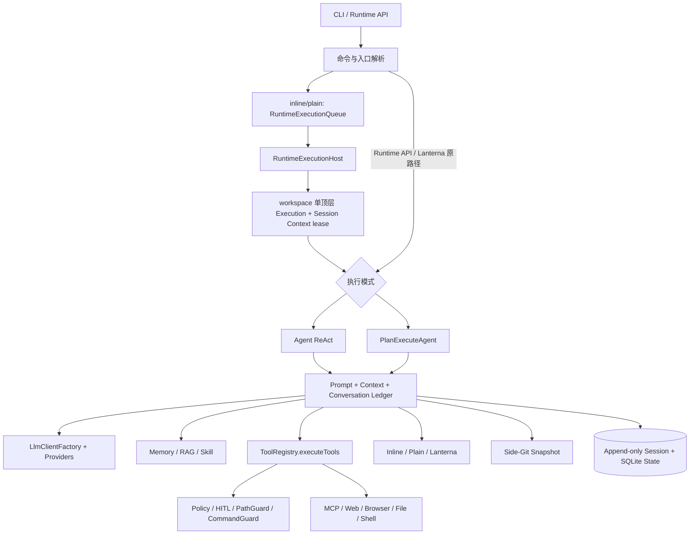

# CodeAgent

[](https://openjdk.org/)
[](https://maven.apache.org/)

面向真实代码库的 Java Agent CLI。CodeAgent 在终端中理解项目、规划任务、调用工具、修改代码并验证结果，同时把权限、安全、会话恢复和上下文管理放在同一套运行时里。

inline/plain CLI 的普通顶层任务会先持久化到本地 Execution 队列，再由无工具 Mode Router 自动选择 ReAct 或多 Agent 协作的 Plan-and-Execute；也可以使用 `/react`、`/plan` 对单轮任务进行显式覆盖。当前任务运行期间仍可继续输入，后续消息会按 Session 序号排队。

> CodeAgent 仍在快速演进。源码与测试是行为真相，路线图只表示后续方向。

## 为什么选择 CodeAgent

- **自动选择执行模式**：简单任务走 ReAct，复杂任务进入 Plan DAG，无需每次手工判断。
- **面向工程任务**：内置文件、代码搜索、命令执行、Web、浏览器、Memory、RAG 和 MCP 工具。
- **统一多 Agent 协作**：Planner 拆解 DAG，Worker 执行，Reviewer 审查；支持依赖调度、冲突感知和失败重试。
- **可靠结构化输出**：Planner、Mode Router、Reviewer 对 JSON contract 做确定性本地校验，格式不合法时最多自动修复一次；已验证的 Provider 还会使用原生 JSON mode / JSON Schema。
- **可恢复的长任务**：会话事件追加写入，Plan 状态持久化到 SQLite，中断后可从 Task 边界继续。
- **本地优先的代码理解**：精确定位优先使用 glob、grep 和文件读取，语义检索默认使用进程内 Qwen3 FP32（1024 维），模型需预先安装。
- **明确的安全边界**：工具调用经过策略、HITL、路径和命令防护；危险操作写入脱敏审计日志。
- **可扩展运行时**：支持 MCP、项目/用户级 Skill、Prompt 覆盖、Runtime API。
- **终端原生体验**：默认 inline 流式界面，保留 transcript，并提供状态栏、折叠工具块和行内 diff。

## 运行要求

必需：

- Java 17 或更高版本
- 至少一个受支持 Provider 的 API Key

从源码构建时还需要 Git、Maven；使用 Windows 分发 ZIP 时不需要源码、Maven 或 `.env`。

可选：

- `ripgrep`：加速 `grep_code`；未安装时自动回退
- Node.js / `npx`：运行默认的 Chrome DevTools MCP
- Chrome：使用浏览器自动化或复用登录态

## 快速开始

### Windows 安装包用户

解压完整 Windows 分发 ZIP，在解压目录执行：

```powershell
powershell -NoProfile -ExecutionPolicy Bypass -File .\install-codeagent.ps1
```

安装器验证 Java 17+，将启动器和 JAR 放入用户数据根的 `bin/`、`lib/`，并将 `bin` 加入当前用户 PATH。找不到 Java 时可以追加 `-JavaHome "C:\Path\To\jdk-17"`；不需要管理员权限。关闭正在运行的 CodeAgent 后可重复执行同一安装命令升级，已有配置、会话和模型会保留。

重新打开终端，进入希望处理的项目目录：

```powershell
cd D:\Projects\my-project
codeagent
```

缺少模型配置时会进入首次向导：选择服务商、模型及可选地址，隐藏输入 API Key，再选择测试连接或暂不测试并保存。之后在其他项目目录输入同一命令，使用该目录作为工作区并复用用户设置。启动器不会切换到安装目录。

```powershell
codeagent config       # 独立配置，不要求已有 API Key
codeagent --help
codeagent --version
```

正常启动不会自动测试连接。主动测试会向所选服务商发送一个短请求，可能产生少量费用；不发送项目内容。密钥保存在当前用户权限保护的本机 `config.json` 中，本版本不加密，不能分享该文件。不要在命令参数里填写密钥。

配置需在支持隐藏输入的交互终端执行。管道、重定向或 `serve` 缺少配置时会立即失败并提示配置入口，不会读取管道正文作为密钥。会话内 `/config` 也可修改，保存后重启生效；运行任务或等待审批时不能打开配置。

### 从源码构建

```bash
git clone https://github.com/zgjdev/Code-Agent.git
cd Code-Agent
```

```bash
mvn clean package
java -jar target/codeagent-1.0-SNAPSHOT.jar
```

`mvn clean package` 默认跳过测试。首次启动同样可以使用向导；也可以先运行 `java -jar target/codeagent-1.0-SNAPSHOT.jar config`。Windows 源码用户可执行 `powershell -NoProfile -ExecutionPolicy Bypass -File scripts/install-codeagent.ps1 -JarPath target/codeagent-1.0-SNAPSHOT.jar` 安装全局命令。首期全局安装脚本仅支持 Windows；其他平台可用 Java/JAR 入口。

维护者打包命令为 `powershell -NoProfile -File scripts/package-distribution.ps1 -LicensePath <许可文本路径>`，默认读取当前 POM 版本的构建 JAR，输出 `target/codeagent-<版本>-windows.zip`。仓库尚无正式 LICENSE 时必须先由维护者提供，打包脚本不会选择或编造许可。ZIP 采用明确白名单，不包含源码、`.env*`、用户配置或历史。

### 现有环境配置兼容

已有 `.env` 或环境变量配置可以继续使用，不必迁移；它们是可选入口，不会打包进 JAR。示例见 [.env.example](.env.example)。只使用显式所选 Provider，不按其他家的密钥自动切换。`CODEAGENT_PROVIDER`（或 `-Dcodeagent.provider`）覆盖 JSON 默认项；未设置时使用 JSON 或 `glm`。向导会提示来源覆盖，保存默认项不会改写环境变量。

功能配置读取顺序为 Java `-D` 参数 > 进程环境变量 > 项目 `.env` > 用户 `~/.env` > 默认值；Provider 与 Embedding 字段保留 `config.json` 显式值优先的规则。项目 `.env` 的空值遮蔽用户同名值，不展开变量或解析尾部注释。旧 `MOONSHOT_*`/`XFYUN_*` 别名不会越过 canonical 空赋值回退。环境密钥不会自动复制到 JSON。高级配置说明见 [运行时与配置文档](docs/implementation/01-runtime-and-agent-foundation.md)。

手动卸载时关闭 CodeAgent，从用户 PATH 移除安装的 `bin` 条目，只删除 `bin/codeagent.cmd` 与 `lib/codeagent.jar`；保留配置、会话和模型。不要递归删除整个数据根。

启动后可以直接描述任务：

```text
分析这个项目的认证流程，并指出可能的越权路径

为订单服务增加幂等校验，补充测试并更新文档

查找最近一次构建失败的根因，只分析，不修改文件
```

## 执行模式

### 自动路由

默认 inline/plain 终端中的普通顶层输入会先经过 Mode Router：

- Router 只读取原始用户输入和 Parent Session 的顶层对话。
- Router 不注册工具，也不会执行文件、命令或网络操作。
- 输出严格限制为 `REACT` 或 `PLAN`。
- 非取消性失败回退 ReAct；取消或线程中断终止当前 Turn。

Lanterna TUI、Runtime API目前不接入自动路由。

### ReAct

适合定位问题、解释代码、局部修改和可在连续工具反馈中完成的任务。

```text
/react 修复用户查询为空时的异常，并补充回归测试
```

只输入 `/react` 时，下一条任务强制使用 ReAct；覆盖仅对一轮生效。

### Plan-and-Execute

适合跨模块改造、多步骤交付和需要并行协作的复杂任务。

```text
/plan 重构会话恢复机制，保持兼容并补充迁移测试
```

Plan 路径包含：

- Planner 生成任务 DAG
- 人工确认计划
- Conflict-Aware Selector 对可并行任务分批
- Worker 使用独立 task-local 上下文执行
- 确定性证据门禁和 Reviewer 自动评审
- 失败重试、重新规划与 SQLite checkpoint

写任务的 Reviewer 会收到验收标准、真实命令证据，以及从 Task 初始版本到最终结果的 unified diff。持久化 Plan 的有界旧正文保存在 Side-Git 独立对象中，SQLite 只保存路径、SHA-256 和快照引用。patch 超过 48 KiB、二进制变更或恢复时旧正文不可用，会标记“未验证”并阻止后继任务。Reviewer 保持无工具权限。

命令证据按真实退出码判断；非零退出、超时和启动失败不能算作测试通过。相同测试/构建命令重跑后以最新结果为准，不同命令的失败不会被其他命令成功掩盖。命令成功不等同于测试覆盖充分，仍需 Reviewer 按验收标准判断。

使用 `/plan resume` 继续当前 Session 的未完成计划，使用 `/plan abandon` 显式放弃。

inline/plain CLI 的 `/plan resume` 会将旧版、尚未绑定 Execution 的活动 Plan 收养到统一队列；已绑定 Execution 的计划随对应任务恢复。恢复保留已完成节点，从未完成的 Task 边界继续，不保证工具副作用恰好执行一次。

## 核心能力

### 代码与终端工具

内置工具覆盖：

- 文件读取、写入和目录浏览
- glob、精确代码搜索和语义辅助检索
- Shell 命令执行与项目创建
- Web 搜索与正文抓取
- 浏览器连接状态管理
- Skill 加载、长期记忆保存和 Side-Git 恢复
- MCP 动态工具

同一轮产生多个工具调用时，CodeAgent 会根据工具名和实际参数在本地推导资源 claim，将冲突调用按原顺序分批；无冲突批次最多并行 4 个调用，并按原始顺序把结果回灌模型。Plan DAG 还会根据 Task 的显式资源声明避免把写冲突任务放进同一批次。

每批完成后会重新解析剩余调用的资源，路径冲突包含硬链接。可能由人工审批修改参数的调用独占执行批次，统一 Web 调用也会检查实际 MCP 后端的审批需求，防止改写目标后与相邻调用竞争；无需审批或已自动放行的调用仍可按资源并行。

### 代码检索与 RAG

CodeAgent 把实时确定性工具与索引式 RAG 分开：

1. `glob_files` 定位候选文件。
2. `grep_code` 精确查找符号和文本。
3. `read_file` 获取必要上下文。
4. `search_code` 在描述模糊时组合 SQLite FTS5 + BM25 关键词检索与 Qwen3 + cosine 语义检索。

词法层规范化中英文、identifier 和 camelCase；查询过滤通用问句词，优先返回全部词项匹配的 BM25 候选，不足时补充任一词项匹配候选并去重。语义层默认使用 Qwen3-Embedding-0.6B ONNX FP32（1024 维）。双路融合统一保留语义候选原序，每四位补充一条关键词候选，不按标识符形状切换优先级。共同命中合并来源，按 chunk 去重，每文件最多三条。字符预算先保留首条，后续优先装入完整片段，再按剩余容量截断暂存片段。Graph 已退出 RAG 融合；符号和关系索引继续服务 `/graph` 与结构地图。远程 Embedding 只有在用户对当前项目和 Provider 明确授权后才会启用，拒绝或故障会自动降级且不影响 FTS。`grep_code` 继续直接搜索当前磁盘，并在 ripgrep 不可用时回退到 Java 实现，不会被 `search_code` 自动调用。

检索还会利用剩余字符预算补充同文件的相关实现：先保留原主片段与顺序，再从扩大的语义候选池中为每个已选文件追加最多两个完整片段，结果标为 `context` 并注明行范围。`search_code` 将预算内正文完整交给 Agent；`/search` 保留简短预览。此优化复用原模型与索引，不需要安装额外重排模型。两个入口均默认 Top10/16000 正文字符，与固定评测配置一致；`search_code` 仍可显式指定 `top_k`（1–30），正文预算保持16000字符。评测数字衡量正文证据覆盖，不等同于最终回答准确率。

首次使用语义检索前，在 PowerShell 执行 `./scripts/install-qwen3-model.ps1`，显式下载并校验固定版本的三个模型文件（约 2.41 GB，未打入 JAR）。默认存放于统一数据根下的 `models/qwen3-embedding-0.6b/c25a394dd583836952667c12f008335071b3f43d`（未配置时为 `~/.codeagent/models/...`），可通过 `embedding.localModelDirectory` 或 `EMBEDDING_LOCAL_MODEL_DIR` 指定目录。已有文件可用 `-SourceDirectory <目录>` 离线安装。运行时不联网下载，模型缺失或校验失败仅关闭语义召回，关键词检索仍可用；安装后通过 `/embedding local` 重配，后台自动补齐向量。旧索引保留 FTS，只回填新向量空间。需要回滚时配置 `embedding.mode=local`、`embedding.provider=bge`；长期记忆仍使用 BGE。实验与实施证据见 [模型迁移文档](docs/dev/26-qwen3-embedding-migration.md)。

混合问题按目标和已有线索协作：例如“看一下 store.save()”先实时定位并读取；“保存失败的事务和异常处理”可用 RAG 寻找相关机制。`search_code.query`保留行为描述，`lexical_query`可提供来自问题或已读取源码的词法软线索，不限制语义候选范围；中文夹杂驼峰名称、点号调用等也会自动提取线索。词法线索最多占一半候选池，其余保留原问题关键词补充。RAG 不自动调用 grep，检索请求本身不触发全库回填。

交互式 CLI（inline/plain/TUI）默认在后台维护代码索引：启动时 Hash 校准，保存后去抖更新词法，再异步补齐向量；监听失效或漏事件由每300秒校准兜底。首次启动自动建立词法索引，后续启动复用已有数据并增量更新；模型仍需显式预装。检索诊断 `maintenance_state` 展示更新/补齐状态，`idle` 不保证全库实时新鲜。Runtime API 和 headless 入口不启动后台维护，由宿主显式调用底层索引接口。

部分文件扫描失败时，保留失败诊断及旧索引，正常文件继续补向量；不完整扫描不执行全局缺失删除。向量任务发现源文件过期或读取失败时会安排该路径的词法刷新，避免反复处理旧版本。

可在 `~/.codeagent/config.json` 设置：

```json
{"autoIndex":{"enabled":true,"debounceMillis":1500,"maxDebounceMillis":10000,"reconcileIntervalSeconds":300}}
```

将 `enabled` 设为 `false` 可关闭自动维护，仅查询已有索引。后台不弹远程授权、不下载模型；缺失或故障保留词法索引。队列有界，退出后停止维护，重启重新对账。设计、并发与平台边界见 [40-索引自动维护](docs/dev/40-automatic-code-index-maintenance.md)。

返回结果的`file_freshness`只核对候选文件：`verified`表示检查时内容hash与本次返回片段所绑定的索引版本相同，同进程后台刷新不会用新索引版本验证旧正文；`changed`/`missing`/`unavailable`表示需回到当前源码确认，旧行号不能直接用于修改。`index_empty`表示当前项目没有已索引chunk，不证明项目没有答案；空结果仍带诊断。关键结论和修改前使用`read_file`核实当前实现，避免重复收集相同正文。协作设计与分层评测见 [38-code-search-rag-coordination.md](docs/dev/38-code-search-rag-coordination.md)。

```text
/search 处理请求重试和 Retry-After 的实现
/graph PlanExecuteAgent
```

### 持久化会话与上下文

- 原始会话以 append-only JSONL 保存到 `~/.codeagent/history/sessions/`。
- inline/plain 启动后空闲等待，不自动附着会话；第一条普通任务输入才创建新会话。
- Provider Surface 和 Top-level Conversation View 分离维护。
- ReAct 与 Plan 共享顶层语义连续性，但不共享 Task transcript 或隐式权限。
- 上下文接近预算时自动压缩，也可以手动执行 `/compact`。

inline/plain CLI 由 Session Context Registry 管理每个 Session 的 Agent、上下文和 writable 会话句柄。启动先冻结旧的排队和中断任务，等待用户继续；选择会话、浏览历史和 `/new` 不执行或取消这些任务。源或目标会话正在执行、有可调度任务或等待审批时拒绝切换；共享运行态正被其他 Session 使用时也会拒绝切换。退出会停止当前执行并保留可恢复的非终态任务。Lanterna 全屏和 Runtime HTTP API 保留各自原入口，不具备此处的 Host 等待门及会话选择器保证。

常用命令：

```text
/sessions
/resume [last|<session-id>]
/new
/clear
/compact
/export
```

`/resume` 打开当前工作区的父会话选择器，每页 20 项；输入编号选择，`n`/`p` 翻页，`? 搜索词` 本地搜索，`cancel` 取消。`/resume last` 选择最近可安全恢复的非空会话，`/resume <id>` 指定会话。选择后按每页 30 条显示 Plan/ReAct 顶层历史；`n` 或 Enter 继续，`all` 主动展开 clear 前历史，`cancel` 停止显示并保留已选会话。浏览每行按一次 Enter 提交，也可用 `q` 或 Ctrl+C 取消。超长消息分块显示；浏览不会把等待中的输入伪装成已执行对话。`/sessions` 只显示摘要，`/new` 明确创建新会话。

选择历史后，直接输入新问题即可开始新一轮；询问进度会结合保存的执行、计划和任务状态回答，不调用工具，也不自动继续旧任务。明确要求继续时，先保存本轮请求与确认，再调度原 Execution；已绑定的 Plan 保持原计划和已完成节点，恢复的子任务读取其对应的旧子会话完整消息组，并遵守本次继续请求中的约束。历史工具结果仅供参考，仍需重新验证。

`/plan resume` 明确继续当前会话已绑定的未完成 Plan，`/plan abandon` 关闭该 Plan、对应原 Execution 和对话轮，其他等待任务保留。没有绑定原 Execution 的旧版 Plan 会给出说明，当前不自动迁移。审批和计划评审优先接收输入；若浏览历史期间出现审批，浏览会取消，输入交给当前审批。

`codeagent.session.resume` 与 `CODEAGENT_SESSION_RESUME` 已弃用；配置后只显示本地提示，不自动恢复会话或执行任务。

### Memory、项目规则与 Skill

项目规则按以下位置加载：

- `CODEAGENT.md` 或 `.codeagent/CODEAGENT.md`：可提交的团队规则
- `CODEAGENT.local.md` 或 `.codeagent/CODEAGENT.local.md`：本地覆盖

长期记忆不会自动从普通对话中提取。只有用户明确要求记住/更新，或执行 `/save` 时才会写入。同义重复只刷新确认时间，用户明确改变旧偏好/事实时旧记忆保留为 superseded 历史，新事实成为 active。文本与时间持久化在 `~/.codeagent/memory/memory.db`，每条记忆独立行写入；SQLite 使用 WAL + 事务处理并发写入，旧 `long_term_memory.json` 首次升级时一次性迁移。

检索采用 Jieba 预分词的 FTS5/BM25 与本地 BGE 双路召回，通过 RRF 合并排名，再按最后确认时间衰减。BGE 向量按需生成并持久化到同一数据库，正文或模型版本变化时重算；重启可复用有效向量，模型不可用时使用词法结果。每次从合格候选中按 token 预算选择最多 10 条完整记忆，过长条目跳过并尝试后续候选。实现边界见 [长期记忆核心升级](docs/dev/23-long-term-memory-hybrid-retrieval.md#12-持久化向量与-rrf-核心升级2026-10-18)。

```text
/memory
/memory list
/memory search <关键词>
/save <事实>
/save --global <事实>
```

Skill 按“内置 < 用户级 < 项目级”的优先级加载：

```text
src/main/resources/skills/
~/.codeagent/skills/<name>/
<project>/.codeagent/skills/<name>/
```

```text
/skill list
/skill show <name>
/skill on <name>
/skill off <name>
/skill reload
```

### MCP 与浏览器

CodeAgent 支持 MCP stdio 和 Streamable HTTP：

- 用户级配置：`~/.codeagent/mcp.json`
- 项目级配置：`.codeagent/mcp.json`
- 项目配置按 server 名覆盖用户配置

最小配置示例：

```json
{
  "mcpServers": {
    "chrome-devtools": {
      "command": "npx",
      "args": ["-y", "chrome-devtools-mcp@latest", "--isolated=true"]
    },
    "remote": {
      "url": "https://mcp.example.com/v1",
      "headers": {
        "Authorization": "Bearer ${REMOTE_TOKEN}"
      }
    }
  }
}
```

支持 `${PROJECT_DIR}`、`${HOME}` 和 `${VAR}` 展开。MCP 工具统一命名为 `mcp__{server}__{tool}`，并经过与内置工具相同的策略、审批和审计链。

交互式 CLI 启动时会同时启动已启用的 stdio/HTTP MCP Server。首屏默认最多等待 8 秒；尚未完成的 Server 保持 `starting` 并在后台继续初始化，可通过 `/mcp` 和 `/mcp logs <name>` 查看。Runtime API/后台 headless 任务不会单独创建 MCP Server Manager，因此不能依赖只存在于 MCP 的后端。

```text
/mcp
/mcp restart <name>
/mcp logs <name>
/mcp resources <name>
/mcp prompts <name>
```

浏览器默认使用隔离 profile。需要访问当前 Chrome 登录态时：

```text
/browser connect
/browser tabs
/browser disconnect
```

shared 模式不会自动取得任意标签页的操作权限；敏感页面上的点击、填写和脚本执行仍需单步审批。

### Web 访问

模型只会看到 `web_search` 和 `web_fetch`。所有模型默认调用 AnySearch MCP 的 `search` / `extract`；连接失败、超时、HTTP 5xx 或服务未就绪时，各自最多降级一次到 Step MCP 的 `web_search` / `web_fetch`。认证、额度、业务错误、策略/HITL拒绝及取消不触发降级。SearchProvider 和 direct HTTP 门面已移除。

默认无需配置后端，等价于：

```json
{"webTools":{"search":{"backend":"auto","onUnavailable":"step"},"fetch":{"backend":"auto","onUnavailable":"step"}}}
```

显式 `backend=mcp` 可指定对应 AnySearch 或 Step 工具；`onUnavailable=fail` 禁止降级，旧 `default` 是 `step` 兼容别名。旧 provider/direct 或自定义 Web MCP 配置返回迁移错误。旧 SEARCH_PROVIDER/SERPAPI_KEY/SEARXNG_URL 不再参与搜索；GLM_API_KEY 仍用于 LLM。

交互式 CLI 默认内置 `anysearch`；`ANYSEARCH_API_KEY` 可选，无密钥使用受限匿名访问。设置 `STEP_API_KEY` 后内置 `step_search`，通过普通 API MCP 地址 `https://api.stepfun.com/v1/mcp/web_search/mcp` 提供搜索和抓取降级。用户/项目 `mcp.json` 的同名配置优先，包括 disabled。两家原始 Web 工具保留内部注册，不发给模型；没有 MCP Manager 的 Runtime/headless 入口返回不可用。不自动注册账户或更换密钥。

AnySearch 搜索返回标题、链接和摘要，专用解析器仅在完整包络校验后发布结果 URL；Step 仅接受 MCP `structuredContent.results[].url`。摘要链接、异常格式和抓取正文不生成授权。AnySearch 的 Markdown 契约改变会停止授信；完整格式伪造仍是已知风险。抓取按 `max_chars` 本地截断正文。

抓取继续校验请求 URL 的协议与私网地址，审批改参后再次校验。页面请求由远程 MCP 服务发出，本地无法约束其重定向或验证远端 DNS；`max_chars` 约束返回给模型的正文，不是网络响应上限。Chrome DevTools MCP 保留独立浏览器能力。

URL 授权只来自：

- 顶层用户原文中的 URL
- 成功 `web_search` 返回的结构化 URL

搜索摘要、网页正文、普通工具输出和模型回复中的链接不会自动获得新的访问权限。

### 图片输入

支持终端粘贴图片和显式引用：

```text
@image:file:///absolute/path/to/image.png
@image:relative/path.png
```

图片会在发送前进行格式识别、透明背景处理、尺寸限制和压缩。不支持图片输入的 Provider 会保留文字上下文并省略图片 payload。

### Runtime API 与统一执行队列

inline/plain CLI 的普通输入、`/react <任务>` 和 `/plan <任务>` 共用本地 SQLite `runtime_executions` 队列。`/task` 现在是统一 Execution 的查询与控制兼容入口：

```text
/task
/task cancel <execution-id>
/task log <execution-id>
```

当前 CLI workspace 的顶层 Execution 严格串行；Plan 内部仍可按资源声明并行执行最多 4 个无冲突 DAG 节点。`/cancel` 取消当前 RUNNING Execution。Java 进程内 `RuntimeExecutionHost` 可显式注册多个独立 workspace，在有界池中并行执行，默认并发数为 2，可设置为 1～4；同一 workspace 与同一 Session 仍各自串行。CLI 只注册启动目录，没有切换或注册其他目录的命令。Lanterna TUI、Runtime HTTP API 暂未接入 Host。

Java 宿主入口位于 `com.codeagent.runtime.execution`：构造 `RuntimeExecutionHost(RuntimeExecutionStore, RuntimeExecutionOptions, ExecutionEventSink)`，调用 `registerWorkspace(Path, WorkspaceRuntimeFactory)`、`createSession(WorkspaceKey)` 或 `attachSession(WorkspaceKey, String)`、`start()`，再通过 `submit(String sessionId, String input, ExecutionMode override)` 提交。交互回答使用 `respond(WorkspaceKey, String executionId, String interactionId, String action, String text)`；结束时 `close()`。`RuntimeExecutionOptions.defaults()` 为 2。`DefaultWorkspaceRuntimeFactory(RuntimeExecutionStore, SessionStore, Function<WorkspaceIdentity,LlmClient>)` 接入真实 Agent/ToolRegistry/账本，但 headless 不自动启动 MCP Manager 或后台索引。宿主 API 是可信控制面，目录必须预先注册；共享 Git common-dir 整轮串行，其他非局部副作用必须有明确资源租约。外部命令不受容器级隔离。设计、迁移与恢复边界见 [多工作区执行调度方案](docs/dev/42-multi-workspace-execution-scheduling.md)。

Agent 运行时可以直接输入下一条任务并回车。新任务排队等待，开始执行时读取前序任务完成后的最新 Session 上下文；它不会中途修改正在运行的任务。等待 HITL 审批或 Plan 人工评审时，普通输入作为当前交互的回答处理，无效审批输入不会变成任务；须先完成当前审批或评审，再提交新任务。等待交互期间，`/react`、`/plan` 新任务入口也会被拒绝；查询与取消命令仍按原规则可用。

实现与恢复限制见 [统一后台执行运行时](docs/dev/31-unified-background-execution-runtime.md)。

Runtime API 仅监听 loopback，并强制要求 API Key：

```bash
CODEAGENT_RUNTIME_API_KEY=your_local_api_key \
  java -jar target/codeagent-1.0-SNAPSHOT.jar serve --http --port 8080
```

主要端点：

- `POST /v1/threads`
- `POST /v1/threads/{id}/turns`
- `GET /v1/threads/{id}/events`

## Provider

| Provider | 配置前缀 | `/model` 示例 | 备注 |
|---|---|---|---|
| GLM | `GLM_*` | `/model glm-5.1` | 支持 GLM 多模态模型 |
| DeepSeek | `DEEPSEEK_*` | `/model deepseek` | 支持 reasoning 回传 |
| 腾讯混元 | `HUNYUAN_*` | `/model hunyuan` | 默认 TokenHub OpenAI-compatible 接口 |
| StepFun | `STEP_*` | `/model step` | 可配置普通或 Plan 通道 |
| Kimi / Moonshot | `KIMI_*` / `MOONSHOT_*` | `/model kimi` | 支持 reasoning 回传 |
| FreeLLMAPI | `FREELLMAPI_*` | `/model freellmapi` | 默认连接本地兼容网关 |
| 讯飞星辰 MaaS | `XFYUN_MAAS_*` | `/model xfyun` | 支持 MaaS modelId 和 LoRA ID |
| Agnes AI | `AGNES_*` | `/model agnes` | OpenAI-compatible |

Provider、模型和地址可通过 `codeagent config` 或空闲时 `/config` 管理；密钥仅使用隐藏输入。`/config provider ...` 保留非密钥字段更新，旧 `--api-key` 参数被拒绝。GLM、DeepSeek 地址由客户端确定，其他地址覆盖仍按原 Provider 协议执行，不代表支持任意新 Provider。远端地址要求 HTTPS，loopback 本地服务可以使用 HTTP；不接受带 userinfo、query 或 fragment 的地址。不要提交真实配置或密钥。

## 安全模型

工具执行链固定为：

```text
TurnToolPolicy → HitlToolRegistry → ToolRegistry → PathGuard / CommandGuard
```

- 策略拒绝先于人工审批，用户不能批准已经被策略拒绝的调用。
- 交互式 CLI、TUI 与 Java Workspace Runtime 的 HITL 始终启用，支持批准、拒绝、跳过和修改参数，不再提供全局启停开关。只读工具不要求审批，用户显式批准的会话内工具/server 范围可继续自动通过。
- 写文件、执行命令、创建项目、恢复快照以及 MCP 工具会进入审计链。
- 路径防护阻止项目外写入和符号链接逃逸。
- URL 来源、浏览器 tab 所有权和敏感页面操作都有独立约束。
- Side-Git 快照与系统 Git 分离，恢复前先创建 pre-restore 快照。

```text
/policy
/audit [N]
/snapshot
/restore <N>
```

> 本地 Agent CLI 不是容器或虚拟机沙箱。HITL 始终启用，人工批准仍须通过路径、命令与轮次策略检查。

## 数据目录

默认系统数据统一保存在一个根目录中：Windows 为 `%USERPROFILE%\.codeagent`，macOS/Linux 为 `~/.codeagent`。位置与启动所在盘、当前项目无关。

只保留整体覆盖设置 `CODEAGENT_HOME`（Java 属性 `-Dcodeagent.home` 优先），其余系统目录都从根目录派生。配置留空使用默认根；支持 `~/...`，Windows 自定义路径必须含盘符或完整 UNC 共享名，例如 `D:/CodeAgentData`。修改后重启。用户级配置、MCP、Prompt、Skill 和模型默认安装也跟随这个根；项目级配置仍从项目读取。

旧 `CODEAGENT_LOG_DIR`、`CODEAGENT_AUDIT_DIR`、`CODEAGENT_MEMORY_DIR`、`CODEAGENT_SNAPSHOT_DIR`、`CODEAGENT_PLAN_DIR`、`CODEAGENT_TASK_DIR`、`CODEAGENT_RUNTIME_DIR`、`CODEAGENT_HISTORY_FILE` 及对应 Java 路径属性（包括 `codeagent.rag.dir`）已停用。旧目录不会自动删除或合并；如需迁移，请停止所有实例后整体复制数据到所选根目录，再设置 `CODEAGENT_HOME`，保留原目录作为备份。

下表以默认根 `~/.codeagent` 为例：

| 路径 | 内容 |
|---|---|
| `~/.codeagent/config.json` | Provider、模型与 Web Tool 路由配置 |
| `~/.codeagent/history/` | 持久化会话与事件日志 |
| `~/.codeagent/plans/plans.db` | Plan DAG checkpoint |
| `~/.codeagent/memory/memory.db` | 长期记忆事实、生命周期状态及可重建的词法/向量检索数据 |
| `~/.codeagent/tasks/tasks.db` | inline/plain CLI 的统一 Runtime Execution 队列；旧 `runtime_tasks` 只迁移为 legacy row |
| `~/.codeagent/snapshots/` | Side-Git 快照 |
| `~/.codeagent/logs/` | 运行日志 |
| `~/.codeagent/audit/` | 危险工具审计 JSONL |
| `~/.codeagent/skills/` | 用户级 Skill |
| `~/.codeagent/skills-cache/` | 内置 Skill 解压缓存 |
| `~/.codeagent/rag/` | 代码索引与远程 Embedding 授权记录 |
| `~/.codeagent/runtime/locks/` | 工作区所有权锁与共享资源锁 |
| `~/.codeagent/runtime/runtime.db` | Runtime HTTP API 数据 |
| `~/.codeagent/cache/` | 剪贴板图片与 npm 缓存 |
| `~/.codeagent/tmp/` | JVM/SQLite/MCP/命令的常规临时文件 |
| `~/.codeagent/reports/better-harness/<workspace-hash>/` | Better Harness 报告 |
| `~/.codeagent/models/` | 显式安装的默认本地模型 |
| `~/.codeagent/exports/` | 会话导出 |

`/better-harness` 报告也保存到统一根；`--inline` 不持久化。根目录位于项目内部时，自动索引和 Side-Git 排除它，防止递归收录系统数据；数据根不能是当前工作区或其父目录。

CodeAgent 为子进程设置 `TMP`、`TEMP`、`TMPDIR` 和 npm 缓存，并把 JVM/SQLite 临时目录指向根下 `tmp/`。这是常规文件位置约定，外部程序仍可写它自己的固定位置，用户任务文件和显式指定的输出不会被强行重定向。测试默认状态使用 `target/test-data`，测试夹具使用隔离临时目录。

raw session、日志和导出可能包含敏感内容，请勿提交或公开复制。

## 架构概览



依赖方向遵循：入口 → Agent/Plan → Tool/Policy/LLM/Memory → 基础设施。两条执行路径共享工具、策略、上下文、快照和渲染基础设施。

## 常用命令

| 类别 | 命令 |
|---|---|
| 模式 | `/react [任务]`、`/plan [任务]`、`/plan resume`、`/plan abandon` |
| 会话 | `/sessions`、`/resume [last\|<id>]`、`/new`、`/clear`、`/compact`、`/export` |
| 模型 | `/model [provider或model]`、`/config`、`/context` |
| 安全 | `/policy`、`/audit [N]`、`/snapshot`、`/restore <N>` |
| 代码理解 | `/search <查询>`、`/graph <类名>` |
| Memory | `/memory`、`/memory list`、`/memory search <词>`、`/save [--global] <事实>` |
| MCP/浏览器 | `/mcp`、`/mcp logs <name>`、`/browser connect`、`/browser tabs` |
| Skill | `/skill list`、`/skill show <name>`、`/skill on|off <name>` |
| 执行队列 | `/task`、`/task cancel <execution-id>`、`/task log <execution-id>` |
| 其他 | `/init`、`/cancel`、`/history clear`、`/better-harness`、`/exit` |

输入 `/` 后可通过终端补全查看完整命令和说明。未知斜杠命令会在 CLI 层报错，不会作为普通任务发送给模型。

## 渲染器

默认使用 inline renderer：

```dotenv
CODEAGENT_RENDERER=inline
```

其他模式：

```dotenv
CODEAGENT_RENDERER=plain
CODEAGENT_RENDERER=lanterna
CODEAGENT_NO_STATUSBAR=true
NO_COLOR=1
```

inline/plain 是普通顶层任务自动路由的主要入口；Lanterna 保留为可选全屏 TUI。

## 项目结构

```text
src/main/java/com/codeagent/
├── agent/       ReAct、PlanExecuteAgent、SubAgent
├── cli/         CLI 入口、命令解析与交互接线
├── context/     请求快照与上下文预算
├── history/     Session ledger、projection 与恢复
├── llm/         Provider 客户端与统一工厂
├── mcp/         MCP 协议、传输、resources 与通知
├── memory/      长期记忆和压缩
├── plan/        DAG、调度、评审与持久化
├── policy/      安全策略与审计
├── rag/         索引、检索与 Embedding
├── render/      inline/plain 渲染器
├── runtime/     统一执行队列、交互 Broker 与 Runtime API
├── skill/       Skill 发现、加载和状态
├── snapshot/    Side-Git 快照
├── tool/        工具注册与统一执行入口
├── tui/         Lanterna TUI
└── web/         搜索与正文抓取

src/main/resources/
├── prompts/     分层系统提示词
└── skills/      内置 Skill

src/test/java/   自动化测试
docs/
├── implementation/  核心实现过程（9篇）
├── dev/             功能改造、实验与验收记录
└── superpowers/     历史工作流记录
```

## 开发与验证

```bash
# 常规快速回归
mvn test -Pquick

# 完整测试
mvn test -DskipTests=false

# TUI 冒烟测试
mvn test -Pphase16-smoke

# 构建可运行 JAR（默认跳过测试）
mvn clean package
```

提交改动前请阅读 [AGENTS.md](AGENTS.md)。它定义了架构边界、开发生命周期、验证矩阵和文档联动要求。

## 进一步阅读

核心实现过程按从零搭建的依赖顺序整理为九篇：

1. [运行时与Agent基础](docs/implementation/01-runtime-and-agent-foundation.md)
2. [工具、安全与恢复](docs/implementation/02-tools-policy-and-recovery.md)
3. [上下文、记忆与检索](docs/implementation/03-context-memory-and-retrieval.md)
4. [MCP与Web接入](docs/implementation/04-mcp-and-web-integration.md)
5. [浏览器会话与隔离](docs/implementation/05-browser-session-and-guard.md)
6. [Skill与Prompt装配](docs/implementation/06-skills-and-prompt-assembly.md)
7. [终端渲染与输入](docs/implementation/07-terminal-rendering-and-input.md)
8. [Runtime API](docs/implementation/08-runtime-api.md)
9. [验证与评测](docs/implementation/09-verification-and-evaluation.md)

各次功能改造、实验和验收保留在 [docs/dev](docs/dev/)。

- [第三方组件声明](THIRD_PARTY_NOTICES.md)

## 贡献

欢迎通过 Issue 或 Pull Request 参与。提交前请确保：

- 行为与源码、测试和文档保持一致。
- 新命令同步更新 parser、completer、测试和文档。
- 工具仍通过统一策略与执行入口。
- 不提交 `.env`、API Key、运行日志、raw session 或构建产物。
- 根据改动范围运行相应验证，并在 PR 中记录真实结果。

## License

当前仓库尚未提供项目级 `LICENSE` 文件。在许可证明确之前，请勿假设代码可以被任意复制、修改或再分发。第三方组件信息见 [THIRD_PARTY_NOTICES.md](THIRD_PARTY_NOTICES.md)。
