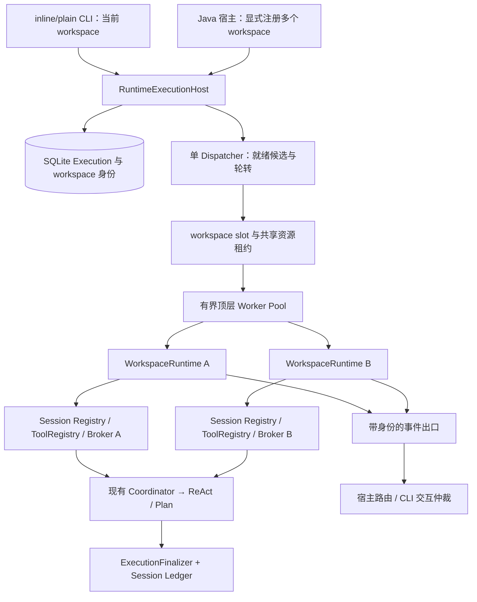
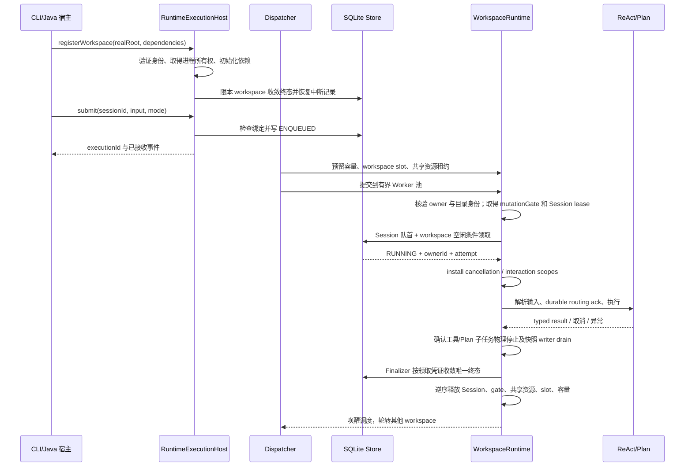

# 多工作区持久化执行调度设计与实施方案

> 状态：实现与自动化验收完成；设计日期：2026-10-10，验收日期：2026-10-11。用户于 2026-10-11 授权在 `feature/multi-workspace-execution-scheduling` 按修改逻辑分批提交，未推送。手工终端、外部服务与平台验证边界见第 6 节。

## 1. 背景、目标与非目标

### 1.1. 需求与设计结论

本次任务把调度策略落实为可复用的 Java 宿主能力。对外能力说明以实际入口和第 6 节已通过的验证为限。

Session 是对话因果顺序与上下文所有权的单位，workspace 是代码修改、验证及快照的顶层互斥单位。调度规则如下：

| 场景 | 目标行为 | 用户可见结果 |
|---|---|---|
| 同 Session 的多个 Execution | 按 ordinal FIFO，前序非终态时后序不能领取 | 已排队，等待本会话前序任务 |
| 不同 Session、同 workspace | 顶层 Execution 串行 | 已排队，等待该工作区当前任务 |
| 不同 Session、独立 workspace | 在宿主容量内并行 | 分别执行，事件按身份归属 |
| workspace 不同但使用已知共享可写资源 | 取得对应资源租约后执行，冲突时排队 | 等待共享资源 |
| 路径身份冲突、Session 绑定错误、权限拒绝 | 拒绝提交或注册，不执行副作用 | 返回明确错误 |
| 另一活跃进程已拥有该 workspace | 拒绝本进程注册；不接管、不恢复对方任务 | 工作区由另一运行时占用 |

同 workspace 忙碌属于正常排队，不作为执行失败，也不新增“忙则失败”命令。领取顺序保证 Session FIFO；不同 Session 间采用确定性候选顺序及工作区轮转，不承诺全局严格 FIFO。

目标：

1. 一个 Runtime 宿主可以显式注册多个独立 workspace，以有界 Worker Pool 执行任务；初始默认并发数为 2，可配置为 1～4。
2. 同 Session 最多一个 RUNNING，同 workspace 最多一个顶层 RUNNING；Plan 内部和工具层现有最多 4 路并行保持各自语义。
3. Session 固定绑定一个 workspace，创建后不能靠新请求切换目录；新 workspace 使用新 Session。
4. 并发 Execution 之间隔离工具可变绑定、权限、记忆写入者、诊断、取消、审批与输出；恢复只作用于本宿主已取得所有权的 workspace。
5. 保留 SQLite 状态事实、追加式 Session 日志、Execution/Plan 身份和原有策略链；取消、关闭及恢复不能提前释放仍有副作用的执行资源。
6. 用真实生产宿主接线的测试证明两个 workspace 同时执行，不能只用线程池中的两个空 Runnable 宣称完成。

非目标：分布式调度、跨机器 lease、任意同 workspace 顶层并行、自动创建 worktree、外部副作用 exactly-once、自动故障转移到另一活跃进程、无限后台驻留、优先级/抢占/死信队列、全系统事务。

首期入口范围：提供可复用的 **Java Runtime 宿主 API**，inline/plain CLI 作为只注册当前 workspace 的适配器。Java 宿主可注册两个 workspace、建立各自 Session 并提交任务，是多工作区能力的实际使用入口。现有 HTTP `/v1/threads`、Lanterna 入口保持原契约；本设计不把 HTTP thread 默认为 Session，不新增 `/workspace` 命令，也不宣称现有 HTTP API 已获得新保证。后续网络接入必须另行明确 thread/Session 绑定、审批回答和事件协议；后续实现与验收也继续更新本方案，除非用户明确要求拆分。

### 1.2. 方案比较与取舍

| 方案 | 收益 | 代价/缺口 | 决策 |
|---|---|---|---|
| 保持全局单 Worker | 对当前单 workspace CLI 简单可靠 | 多 workspace 宿主中独立任务互相阻塞 | 作为并发数为 1 的兼容模式 |
| 只按 Session FIFO，其他任务直接并行 | 调度逻辑简单 | 同目录文件、快照、工具绑定和审批冲突 | 不采用 |
| Session FIFO + workspace slot + 有界池 | 独立项目并行，同目录修改有明确边界 | 需要上下文隔离、资源所有权与恢复迁移 | 采用 |

不会通过移除全局锁直接启用并行。先建立每个 workspace 的完整依赖与生命周期，再收窄锁，最后接入调度池。

## 2. 现状分析：源码证据与已知约束

初始勘探基线为 `6e12880`；下表记录基线约束。当前分支的实现状态与修订证据见第 6 节，不能把此表当作当前源码快照。

| 边界 | 当前实现证据 | 改造含义 |
|---|---|---|
| 调度器 | [WorkspaceAwareExecutionScheduler](../../src/main/java/com/codeagent/runtime/execution/WorkspaceAwareExecutionScheduler.java) 构造器固定 Path，start 使用单线程，并先调用 recoverStaleRunning | 多 workspace 不能简单增加线程数；启动恢复必须先取得所有权 |
| SQLite | [RuntimeExecutionStore](../../src/main/java/com/codeagent/runtime/execution/RuntimeExecutionStore.java) schema v1；workspace 是绝对规范化字符串；workspace 和 Session 各有 RUNNING 部分唯一索引 | 保留两个唯一性约束；补真实目录身份、持有者及领取代次 |
| Session Registry | [SessionExecutionContextRegistry](../../src/main/java/com/codeagent/runtime/execution/SessionExecutionContextRegistry.java) 用单个 leasedSessionId 禁止跨 Session 同时取得 lease | 首期按 workspace 创建 Registry，保留各 Registry 内的单 writable lease |
| Session Factory | [SessionExecutionContextFactory](../../src/main/java/com/codeagent/runtime/execution/SessionExecutionContextFactory.java) 固定 workspace，恢复 writable SessionHandle | 可以复用为 workspace 局部工厂，不改为从全局 cwd 推导 |
| 工具绑定 | [Agent](../../src/main/java/com/codeagent/agent/Agent.java) 的 activateSharedToolContext 重绑 MemoryWriter、ContextProfile、Skill 等 | ToolRegistry 及这些可变绑定不能跨 workspace 共用 |
| CLI 接线 | [Main](../../src/main/java/com/codeagent/cli/Main.java) 使用 sharedRuntimeLock 包住执行；UI 当前 Session 与运行 Session 可以不同 | 互斥和配置变更限制下沉为 workspace 局部，UI 指针不变成资源所有者 |
| 交互 | [InteractionBroker](../../src/main/java/com/codeagent/runtime/interaction/InteractionBroker.java) 单 pending；已有 interactionId、executionId、sessionId | 独立 workspace 使用独立 Broker；单输出 surface 需仲裁多个请求 |
| 取消 | [CancellationContext](../../src/main/java/com/codeagent/runtime/CancellationContext.java) 已有 install/Scope，但底层为 InheritableThreadLocal | 复用线程池必须显式安装/清理 token，不依赖线程创建时继承 |
| 终态 | [ExecutionFinalizer](../../src/main/java/com/codeagent/runtime/execution/ExecutionFinalizer.java) 按 Execution 收敛 ledger 与 SQLite | 加领取代次校验，避免旧 attempt 迟到覆盖新状态 |
| HTTP | [RuntimeApiServer](../../src/main/java/com/codeagent/runtime/api/RuntimeApiServer.java) 为独立 TaskRunner/事件容器入口 | 不作为本次多 workspace 接线的捷径 |

### 2.1. 架构位置



依赖仍为入口适配器 → runtime/execution → Agent/Plan 与工具基础设施。Runtime 不引用 CLI 的 LineReader 或具体 Renderer；CLI 提供事件出口和交互适配，模型看不到内部调度接口。

### 2.2. 数据与状态模型

保留 `ENQUEUED/RUNNING/COMPLETED/FAILED/CANCELED` 五态以及 typed outcome。等待 slot、等待容量、等待共享资源均保持 ENQUEUED，不增加一套平行任务表。等待审批是 RUNNING Execution 的交互子状态。

当前持久化身份（schema v2）：

| 对象 | 字段 | 约束 |
|---|---|---|
| `runtime_workspaces` | `workspace_key`、`canonical_root`、`identity_version` | 同一真实目录映射一个持久化 key；不以用户输入路径字符串作唯一身份 |
| `runtime_session_bindings` | `session_id`、`workspace_key` | Session 一次绑定；与 SessionStore 元数据交叉核验 |
| `runtime_executions` 扩展 | `workspace_key`、`owner_id` | workspace_key 外键；领取时写 owner_id；原 workspace 保留作兼容显示与迁移来源 |
| 既有 `attempt` | 每次成功领取自增 | 与 executionId、ownerId 组成写入凭证；不可由调用方指定 |

保留同 Session RUNNING 唯一索引；workspace RUNNING 唯一索引改为针对 `workspace_key`。`legacy_unbound=1` 行仍不可领取。schema v2 的非 legacy 行未完成身份迁移时保持不可领取，并给出诊断，禁止把 NULL 当成不冲突。

`owner_id` 是每次宿主启动生成的新 UUID，不使用 PID 作为可复用的身份。SQL owner 记录不证明进程存活，操作系统文件锁才是本机活跃所有权的依据。

### 2.3. 核心时序与失败路径



Worker 池拒绝、取得 mutationGate/Session lease 失败发生在领取前，Execution 保持 ENQUEUED；领取后的异常按凭证和 Finalizer 契约收敛。不能使用一个迟到 Future 的异常覆盖后续 attempt。

## 3. 方案设计

### 3.1. 接口、职责和生产入口

下列类型位于 `src/main/java/com/codeagent/runtime/execution/`。示例摘录当前公开契约；为突出调用顺序，Host 方法省略 `synchronized` 与受检异常声明。

```java
record WorkspaceKey(String value) {}
record WorkspaceIdentity(WorkspaceKey key, Path canonicalRoot) {}
record ExecutionClaim(String executionId, String ownerId, int attempt) {}
record RuntimeExecutionOptions(int maxConcurrentExecutions) {}

interface ExecutionEventSink {
    void accept(RuntimeExecutionEvent event);
    default boolean supportsInteractions() { return false; }
}
// event 必含 workspaceKey、sessionId、executionId、kind；交互事件还含 interactionId。
record RuntimeExecutionEvent(WorkspaceKey workspaceKey, String sessionId,
                             String executionId, String kind, Object payload) {}

interface WorkspaceRuntimeFactory {
    WorkspaceRuntime create(WorkspaceIdentity identity, ExecutionEventSink sink)
            throws Exception;
}

// RuntimeExecutionHost implements AutoCloseable；省略同步修饰符及受检异常声明。
RuntimeExecutionHost(RuntimeExecutionStore store, RuntimeExecutionOptions options,
                     ExecutionEventSink sink);
RuntimeExecutionHost(RuntimeExecutionStore store, RuntimeExecutionOptions options,
                     ExecutionEventSink sink, Path locks);
WorkspaceIdentity registerWorkspace(Path root, WorkspaceRuntimeFactory factory);
void start();
String createSession(WorkspaceKey workspace);
void attachSession(WorkspaceKey workspace, String sessionId);
RuntimeExecution submit(String sessionId, String input, ExecutionMode override);
CancelRequestResult cancel(String executionId);
List<RuntimeExecution> list(WorkspaceKey workspace, int limit);
boolean respond(WorkspaceKey workspace, String executionId,
                String interactionId, String action, String text);
Optional<InteractionRequest> pending(WorkspaceKey workspace);
void unregisterWorkspace(WorkspaceKey workspace);
boolean safelyStopped();
void close();
```

`RuntimeExecutionOptions.defaults()` 返回并发数 2，构造器接受 1～4。`RuntimeExecutionHost` 构造时接受 Store、Options、事件出口和可选本机锁目录。宿主必须显式注册 workspace、创建或附加 Session 后调用 `start()`，再以 Session ID 提交；这是进程内可信控制面，不应直接暴露为任意路径的网络请求。

`WorkspaceRuntimeFactory` 返回完整生产依赖。当前 `DefaultWorkspaceRuntimeFactory(RuntimeExecutionStore, SessionStore, Function<WorkspaceIdentity,LlmClient>[, boolean hitlEnabled])` 为 headless 实现，创建真实 Agent、ToolRegistry、Broker、Session Registry、Coordinator 与 SnapshotService；不自动创建 MCP Manager 或后台代码索引，也拒绝后来出现的未声明 MCP/Browser 可变绑定。CLI 工厂复用 Main 已有 MCP、索引、Renderer 与交互依赖，不等同于 headless 默认工厂。资源敏感的自定义工厂须事先声明共享资源租约；未知外部副作用无法确定租约时拒绝多 workspace 并行。

`WorkspaceRuntime` 拥有身份、mutationGate、Session Registry、Broker、共享资源键和运行/关闭回调；Host 与 Scheduler 持有 owner lease、workspace slot 及隔离状态。Session 驱逐不能关闭 workspace 的索引或 MCP。

`RuntimeExecutionQueue` 保留单 workspace 兼容门面并委托 Host；`WorkspaceAwareExecutionScheduler` 同时保留旧构造器兼容路径和 Host 使用的多 workspace Dispatcher + 有界 Worker Pool。Main 仅注册启动目录，原普通输入与 `/task` 命令仍走该队列；CLI 没有切换或注册其他目录的命令。现有 HTTP Runtime API 与 Lanterna TUI 未接入 Host。

宿主注册前必须显式提供目录与依赖，不允许模型、MCP resource 或 submittedInput 触发新 workspace 注册。Java 宿主 API 为进程内可信控制面，不等同于对外开放任意路径的网络接口。

### 3.2. workspace 身份与独立性

`WorkspaceIdentityResolver` 与 owner 准入遵循以下规则：

1. 注册目录必须已存在，使用 `toRealPath()` 解析符号链接/junction；执行前再次核验真实身份。不存在、已被替换、无法核验时拒绝开始执行，不自动创建目录。
2. `WorkspaceKey` 使用 `ws_` + SHA-256(`canonicalRoot.toString()` 的 UTF-8 字节) 确定性生成；`toRealPath()` 提供规范路径，key 与 canonical root 写入 `runtime_workspaces`。已存在 key 必须核对 root 一致，摘要冲突时失败关闭。目录移动会形成新 key，必须显式迁移队列与绑定，不能自动认领旧身份。
3. 与已注册和持久化根目录用 `Files.isSameFile` 核对；Windows 大小写别名不得产生第二个身份，不能只用路径 lower-case 代替文件系统判断。
4. 同一真实根的别名归并到相同 key。同一宿主重复注册复用原 runtime；若配置不一致，拒绝隐式覆盖。
5. 不同注册根出现父子包含关系时拒绝后注册者，要求使用共同根；不把重叠目录当成可并行工作区。检查在注册协调锁下执行，跨进程也使用同一规则。
6. 不同 Git worktree 可能共享 Git common directory。通过固定只读 Git 命令解析并规范化 common dir，注册已知共享资源 key；此类 workspace 的顶层执行默认保守串行，直到具备 Git 操作级隔离。探测失败而无法判定独立性时拒绝并行注册，不能猜测为独立。
   当前默认工厂以 `git -C <root> rev-parse --git-common-dir` 取得真实路径，使用 `git:<common-dir>` 作覆盖整轮 Execution 的粗租约。正常非 Git 目录无此租约；存在异常 `.git` 元数据或探测失败时拒绝注册。
7. 独立目录不证明外部服务、端口或任意硬链接内容完全隔离。已知共享 Browser/profile、MCP 外部可写后端需资源租约；工具仍遵守现有 PathGuard/CommandGuard。禁止把 workspace 并行描述为容器级隔离或对任意命令副作用的隔离。

跨 workspace 并行前，Host 必须为每个可能产生副作用的进程级资源提供稳定的共享资源键。WorkspaceRuntimeFactory 在接纳任务前返回不可变资源键集合：Git 共享 common-dir 使用规范化 `git:<common-dir>`；Browser profile 使用稳定 profile 身份；MCP 后端使用配置声明的并发组。MCP 尚无可靠组身份时，保守使用全局 MCP 组，使相关调用串行。任何已启用的非 workspace 局部副作用资源若既没有可靠身份也没有 lease provider，则拒绝启用多 workspace 并行。资源键只用于内部协调，落盘锁名应使用哈希，避免暴露路径或配置。

### 3.3. 上下文、工具与资源所有权

首期选用“每个 workspace 一套可变执行基础设施”，避免为了性能先设计全局可变 ToolRegistry。

| 资源 | 所有者与共享规则 |
|---|---|
| SessionHandle、Agent、ParentConversationContext、MemoryManager、Skill buffer | Session 独占；workspace Registry 一次只租出一个可写上下文 |
| ToolRegistry/HitlToolRegistry、PathGuard、LspManager、SnapshotService | workspace 局部；Session 切换只重绑本 workspace 对象 |
| MCP Manager、stdio 子进程、动态工具注册 | CLI 现有实例只服务当前 workspace；headless 默认不创建。自定义多 workspace 工厂若启用，须为每个 workspace 独立接线并声明跨目录共享后端资源键 |
| Browser/profile、具有共享状态的 MCP 后端 | 显式声明共享资源 key，采用本机统一租约；无法提供隔离/租约时不允许多个 workspace 同时启用该共享实例 |
| 代码索引、自动维护服务、provider 生命周期 | workspace 拥有；headless 不隐式启动维护，现有显式授权不变 |
| 全局长期记忆数据库 | 继续使用既有逐条 SQLite 事务；项目 scope 随 Session 正确绑定；缓存不作为事实源 |
| LlmClient、HTTP 连接池、模型引擎 | 可变 provider/model 配置按 workspace/Session 固定；仅已确认线程安全且生命周期可引用计数的底层对象允许共享 |
| 终端/事件出口 | surface 所有；所有事件携带身份，后台 workspace 不改写当前 CLI 状态栏 |

无需把 `SessionExecutionContextRegistry.leasedSessionId` 改成全进程多租约：每个 workspace 都有自己的 Registry 即可并行。Main 原 `sharedRuntimeLock` 下沉到 `WorkspaceRuntime`；`/model`、`/config`、`/new` 等按对应 workspace 的既有控制策略操作，不能重绑另一 workspace 的依赖。

Plan 与工具层的取消/策略/交互 scope 在每次线程池任务开始时显式 install，并在 finally 恢复或清理；复用 Worker 时测试上一任务 token、权限、Session 身份均不泄漏。不得只依赖 InheritableThreadLocal。

### 3.4. 调度、容量与公平性

`maxConcurrentExecutions` 限制宿主内顶层 RUNNING 执行数，默认 2，合法范围 1～4；Java 宿主构造参数配置。CLI 首期仍只注册一个 workspace，因此可执行并发最多 1，不增加无实际作用的 CLI 配置项。未来增加外部配置时必须同步 `.env.example` 与配置测试。

Dispatcher 单线程维护已注册 ACTIVE workspace 的稳定轮转顺序。每轮每个 workspace 最多选取一个候选；忙碌或依赖未就绪的 workspace 立即跳过，不占 Worker 等待 slot。Worker 池仅接收已预留容量但尚未 claim 的 reservation，不把全部 SQLite 排队任务提前装入 executor 的无界内存队列。

领取步骤固定：

1. Dispatcher 非阻塞预留本宿主顶层容量、候选 workspace slot，并按资源 key 排序取得已声明共享资源租约；任一失败即释放并轮转。
2. Dispatcher 查询 ENQUEUED 候选，向有界 Worker Pool 提交 reservation；拒绝提交则释放 reservation，尚无 RUNNING 记录。
3. Worker 核验 owner 与目录身份，先取得 workspace mutationGate 和 Session lease；任一失败不 claim。随后 SQLite 短事务检查 workspace 注册/owner、Session 绑定、Session 最小非终态 ordinal、无 workspace RUNNING，成功才写 RUNNING、owner_id 和递增 attempt。
4. Durable claim 后安装 cancellation/interaction scope、写开始事件与 routing ack，执行 Coordinator。结束时等待工具/Plan 子任务物理停止和 post-turn snapshot drain，再由 Finalizer 收敛；失败按凭证进入恢复或隔离路径。
5. 逆序释放 Session lease、mutationGate、共享资源租约、slot 和容量，唤醒 Dispatcher。Finalizer 跨库失败时保持 QUARANTINED，不释放可能仍有副作用的资源。

规范锁序为：有界 worker 容量 → workspace slot → 按字典序取得共享资源 lease → workspace mutationGate → Session lease → SQLite 短领取事务。SQLite 事务内不得等待 Session lease、模型、工具或人工审批。

共享资源租约首期覆盖整个顶层 Execution，避免模型在执行中才发现共享 Browser/Git 依赖而发生锁升级死锁。较粗的租约会降低并行度，是首期明确取舍。等待 Plan/HITL 时继续占 workspace slot、共享租约和顶层容量，不先释放后恢复；所有 Worker 都等待交互时只接受新任务入队，不无限新增线程。

工作区轮转只防止可执行短任务持续抢占；不对无限长任务、长期等待审批承诺有界等待。全局并发数也不等于 LLM 请求总并发：Plan/工具层仍有内部并行，需要在容量测试中观测峰值，不能宣称最多 2 或 4 个网络请求。

### 3.5. SQLite 领取与 fencing

保留单 JDBC Connection 的统一访问门禁，事务内不做模型、MCP、文件扫描或等待人工。领取用短写事务和条件 UPDATE；多进程 SQLite 锁竞争采取有限重试，不能把一个 workspace 的锁等待延长成整个模型执行期。

终态、路由确认、已解析输入及恢复写入都必须携带 `ExecutionClaim`，关键条件形如：

```sql
UPDATE runtime_executions
SET status = ?, outcome = ?, result = ?, error = ?, finished_at = ?, updated_at = ?
WHERE id = ? AND status = 'running' AND owner_id = ? AND attempt = ?;
```

更新行数为 0 表示取消/终态/领取代次已变化，必须重新读取并按契约判断幂等或拒绝，不能直接报告写入成功。唯一索引作为最终保护，不替代领取条件。

`ExecutionFinalizer` 是 ledger/SQLite 终态唯一收敛入口。Scheduler 负责资源释放与异常转交，不能在 Finalizer 之外重复提交一个未经凭证校验的成功状态。append 前核对有效 claim，并在持有 workspace owner、slot 和 Session lease 期间完成收敛；跨库 crash 窗口继续按已有 envelope/Plan reconciliation 处理，不假设两个数据库和 JSONL 属于同一个事务。

### 3.6. 进程所有权与恢复

`WorkspaceOwnerLease` 采用本机 OS 文件锁，默认保存于 `~/.codeagent/runtime/locks/`，文件名由 workspace key 哈希生成；Host 构造器也可传入锁目录。同一机器可能操作相同 workspace/共享资源的所有宿主必须使用同一个规范锁目录；使用不同目录不构成互斥。自定义目录只适用于隔离测试或经过统一配置的宿主，不能用不同目录绕过现有 owner。

注册使用短期全局 catalog 文件锁，串行完成真实路径/重叠目录检查和 owner lock 获取；取得 workspace owner 后立即释放 catalog 锁，任务执行期间不持有全局锁。当前 catalog 保存 workspace key → canonical root；owner_id 存于运行时记录，不能靠 metadata 时间或 PID 决定存活。跨进程遇到旧 catalog 时探测对应 OS 锁；仍被持有即活跃，不得删除或接管。共享资源 key 也使用稳定哈希锁名，避免不同宿主各自创建内存锁导致失效。

workspace owner lock 从注册成功持有到安全 unregister；它和每次 Execution 的 workspace slot 是不同生命周期。一个宿主可拥有多个互不重叠的 workspace，其他宿主可拥有其他 workspace。只支持能提供可靠 OS 文件锁的本地锁目录；实现拒绝 FileStore.type 中已识别的 NFS/SMB/CIFS，并在加锁失败或无法稳定判断身份时拒绝注册，但类型检测不能证明所有网络挂载。自定义锁目录须由可信宿主核实为本地目录；未验证的网络目录不属于支持范围。不提供 heartbeat 超时强抢，也不提供跨机器分布式租约。

`verifyIdentity()` 比较再次解析的真实路径与目录身份。Java provider 给出 `fileKey` 时使用它；Windows provider 返回空值时，退化为 file store 名称与目录创建时间组合。该退化可发现普通目录替换，但不等价于稳定 inode/file ID：同卷且创建时间可复制或精度不足时可能漏判。此边界须在目标 Windows 文件系统上核验；不能据此宣称抵御恶意替换。

恢复顺序：取得 owner lock → 初始化并校验 workspace/Session 绑定 → 对该 workspace 先运行既有终态 envelope/Plan 收敛 → 仅对仍非终态的遗留 RUNNING 应用取消或重新入队 → 开始领取。已有取消意图优先收敛 CANCELED；没有取消意图才 ENQUEUED。新领取生成新 owner/attempt，旧回调不可更新。

不得扫描整个 tasks.db 把所有 RUNNING 重置。另一 workspace 即使出现在同一数据库，也只有取得其 owner lease 后才能恢复。DB 中 owner 字段缺失只说明需要迁移，不证明对应进程死亡。

这是单机、同一用户运行时目录内的协作机制，不承诺多机抢占、不同用户目录的互斥或数据库 fencing 能阻止任意外部命令副作用。

### 3.7. 审批、输出和权限

每个 workspace 保留独立 `InteractionBroker`。一次 workspace 顶层执行内沿用现有审批串行限制；不同 workspace 的请求可以同时 pending。Host 维护 `(workspaceKey, executionId, interactionId)` 到 Broker 的路由，回答必须完整匹配且执行仍有效，不能按“当前 UI Session”猜测目标。

一个终端 surface 一次展示一个请求，其余按到达顺序等待展示。普通文本只回答当前已展示 interaction；切换焦点不能把旧回答送给新任务。取消某 Execution 只移除它的等待项。待展示审批继续占用对应执行资源。无交互适配器的宿主，遇到需审批动作返回明确不可用/拒绝，不能自动批准；纯 ReAct 只读测试可在此模式运行，Plan 人工门不可绕过。

新增 surface 层 `InteractionPresentationQueue` 放在 `runtime/interaction/`，只依赖事件/响应接口；CLI adapter 负责显示与输入。不新增斜杠命令即可支持已展示请求的回答；Java 宿主可按完整身份显式 respond。

模型工具仍经 TurnToolPolicy → HitlToolRegistry → ToolRegistry → PathGuard/CommandGuard。workspace 注册、历史会话和其他 Execution 的搜索结果不产生本轮授权。MCP 动态更新只作用于所属 workspace，Web 降级不得跨越策略拒绝。输出必须附带身份，状态栏仅呈现当前 surface 选中的执行；禁止两个 workspace 共写无身份的 reasoning/tool delta。

### 3.8. 取消、关闭与资源释放

取消持久化 `cancel_requested_at` 后向当前 claim 的 token 传播。请求取消不等于任务已经停止：只有模型调用、工具批次和 Plan 子任务已退出，才能释放 slot 并开始同目录下一任务。不能单靠 `Future.cancel(true)` 返回值认定副作用已停止。

关闭 Host：停止注册/提交与新领取，进入 DRAINING，撤销对应交互并取消运行调用，等待子任务停止和快照 writer drain，完成终态/中断收敛，最后关闭 Session、workspace 资源与 owner lock。用户取消和宿主关闭保持不同原因；普通关闭的未完成工作留待恢复，不伪造成功或用户取消。

若线程/工具未能在关闭期限内停止，workspace 进入 QUARANTINED：保持 RUNNING/中断诊断和租约，不释放给后续任务，不销毁仍使用中的依赖。进程真正结束后 OS 锁释放，新宿主才可恢复。可控子进程应等待退出并核实取消；无法控制的脱离进程外部副作用在恢复时重新检查，不声称 exactly-once。

前序异步 post-turn snapshot 必须完成或明确失败后才允许该 workspace 的下一 Execution 开始，以免快照混入下一任务修改。快照失败记录独立诊断，不能把已成功业务写入改说成未发生。

### 3.9. 兼容性、迁移与回滚

1. schema v1 → v2 在维护窗口内迁移。当前 Store 在迁移前以 SQLite `VACUUM INTO` 建立带 UUID 名称的 `.bak` 一致性备份，覆盖 WAL 的已提交内容；新于受支持版本的 schema 直接拒绝。仍须确保所有旧版 CLI/Runtime 退出：旧版没有 owner lock，新锁无法证明它已停止；禁止新旧版本同时写同一运行时目录。
2. 迁移合并同一真实目录别名，保留 Execution ID、Session ordinal、submitted/resolved input、模式、Plan execution_id 和所有终态。身份无法解析的行保持不可领取，可由可信宿主通过 `RuntimeExecutionStore.unresolvedWorkspaceExecutions(limit)` 查询诊断。后续注册只回填所持 owner 对应目录，不顺带绑定其他重新出现但未注册的目录；不能静默绑定 cwd。注册时先按请求原路径与规范路径选择未绑定记录，再仅核查这些记录所属 Session 的所有旧记录；不解析无关工作区的路径。恢复的缺失别名应以该旧记录原路径显式注册，Host 将请求路径传给 Store 校验并回填。
3. 发现同 Session 跨 workspace 绑定，或别名合并导致多个遗留 RUNNING 冲突时，先回滚迁移并报告记录 ID，人工核实归属后再迁移；不丢弃行、不任意挑一个为成功。
4. 创建 workspace_key 部分唯一索引并通过数据校验后才替换旧 workspace 字符串索引；整个切换保持事务原子性。迁移可重入；连接 busy_timeout 沿用，若启用 WAL 必须同步备份/恢复对 WAL 的处理。
5. Main 和 RuntimeExecutionQueue 保持原调用兼容适配；原 CLI 一个 workspace 的行为、命令及权限不变。Java Host 多 workspace 是新增能力，不借此接通现有 HTTP/TUI。
6. 行为回退首先将宿主并发数设为 1，仍保留新身份和恢复保护。回退旧二进制必须停止全部宿主并恢复迁移前匹配的数据库备份；这样会失去备份后的队列状态，必须先处理并说明差异，不能直接删除新列“回滚”。

### 3.10. 设计评审

初始设计已自审，实施后进行了独立只读复审；复审发现及修订见第 6 节。以下为实现与后续变更需要保持的边界：

- 边界：Java Host 是明确的新多 workspace 使用入口，CLI 保持单目录；未把 HTTP/TUI 接入夹带进范围。
- 数据流：提交只落 Execution；取得 Session lease 后才展开输入、读取当前对话和进入 Agent；队列信息不成为授权来源。
- 并发：Session FIFO、workspace slot、owner lock、共享资源 lease、Worker 容量分别有职责；没有在持有全局 catalog/SQLite 锁时等待模型或人工。
- 恢复：启动必须先证明独占所有权；owner/attempt 防迟到状态写入，OS 锁防本机活跃进程被接管，两者不替代外部副作用校验。
- 风险：工作区身份与旧数据迁移、工具绑定拆分、审批输出归属、线程未停就释放租约是主要风险，均有指定测试。
- 取舍：默认顶层并发 2，审批占用容量，共享 Git/Browser 采用粗租约；允许降低吞吐以保持初期状态模型可验证。
- 验证：多 workspace 收益必须由真实 Host 接线展示；没有基准数据前不写吞吐提升、时延下降或线上成功率。

## 4. 实现任务与测试矩阵

### 4.1. 实施约束与步骤

实现时从最新 main 创建功能分支，默认不用 worktree；不得自动 commit/push。所有设计修订、红绿测试证据和验收结果继续写在本文。下面任务按依赖顺序推进，每项先补失败用例，再实现最小改动，最后运行对应测试并检查 diff；任务未满足退出条件不得开启多 workspace 并行开关。

| 任务 | 影响文件（相对仓库根） | 先写的失败测试及退出条件 |
|---|---|---|
| T1 身份与 schema v2 | 新增 `src/main/java/com/codeagent/runtime/execution/WorkspaceKey.java`、`WorkspaceIdentity.java`、`WorkspaceIdentityResolver.java`、`ExecutionClaim.java`；修改同包 `RuntimeExecution.java`、`RuntimeExecutionStore.java` | 新增同测试包 `WorkspaceIdentityResolverTest`、`RuntimeExecutionMigrationTest`；补 `RuntimeExecutionStoreTest`。路径别名同 key、真实目录校验、Session 错绑拒绝、v1 数据保留/无法归属时保持不可领取、迁移重开幂等、workspace/session 两个唯一索引及 workspace 外键通过 |
| T2 owner 与安全恢复 | 新增 execution 包 `WorkspaceOwnerLease.java`、`SharedExecutionResourceLeases.java`；修改 `ExecutionFinalizer.java`、`RuntimeExecutionStore.java` | 新增同测试包 `WorkspaceOwnerLeaseTest`、`ExecutionClaimRecoveryTest`；补 `ExecutionFinalizerTest`。用独立 JVM 验证锁排他、崩溃释放、跨 workspace 恢复隔离；终态与 ledger 两个写入窗口均可收敛，旧 attempt 不能结束新任务 |
| T3 事件与交互归属 | 新增同生产包 `ExecutionEventSink.java`、`RuntimeExecutionEvent.java`；新增 `src/main/java/com/codeagent/runtime/interaction/InteractionPresentationQueue.java`；修改该包 Broker handlers 与 `src/main/java/com/codeagent/cli/InteractionInputRouter.java` | 新增 `src/test/java/com/codeagent/runtime/interaction/InteractionPresentationQueueTest.java`；补 `InteractionBrokerTest`、`BrokerInteractionHandlersTest`。两个 workspace 同时请求、旧回答、错误 executionId、取消一个、无交互宿主均正确处理 |
| T4 workspace 局部依赖 | 新增同生产包 `WorkspaceRuntime.java`、`WorkspaceRuntimeFactory.java`、`DefaultWorkspaceRuntimeFactory.java`；修改 `SessionExecutionContextFactory.java`、`SessionExecutionContext.java`、`Agent.java` 与 `ToolRegistry.java` 的绑定/生命周期接线 | 新增同测试包 `WorkspaceRuntimeIsolationTest`；补 `SessionExecutionContextRegistryTest`、`SessionExecutionContextFactoryTest`。A/B 的 MemoryWriter、Skill、LSP、路径、配置和动态 MCP 更新互不污染，关闭 A 不关闭 B；资源键集合在准入前确定且未知副作用资源失败关闭 |
| T5 Dispatcher 与有界池 | 修改 `WorkspaceAwareExecutionScheduler.java`；新增同包 `RuntimeExecutionOptions.java`；核对 `src/main/java/com/codeagent/runtime/CancellationContext.java` 在所有异步边界的使用 | 扩展 `WorkspaceAwareExecutionSchedulerTest`。两个 workspace 同时 active，同目录不同 Session 仍为 1，容量上限、轮转、executor 拒绝、等待审批、取消、shutdown quarantine 都满足不变量 |
| T6 生产宿主与 CLI 适配 | 新增 execution 包 `RuntimeExecutionHost.java`；修改 `RuntimeExecutionQueue.java`、`src/main/java/com/codeagent/cli/Main.java`，复用 T4 工厂 | 新增 `RuntimeExecutionHostIntegrationTest`；补 `RuntimeExecutionQueueTest`、`MainSessionCommandTest`、`MainExecutionModeRoutingTest`。经真实 Host 创建两个 Session、执行实际 Agent/ToolRegistry 写入各自临时根，证明并行且无串绑；CLI 原路径通过 |
| T7 文档与整体验收 | 更新本文、`AGENTS.md`、`CODEAGENT.md`、`README.md`、`docs/implementation/01-runtime-and-agent-foundation.md`；按实际修改同步 02/04/07/08 实现说明；仅状态变化时更新 `ROADMAP.md` | 执行 4.3 节验证命令；手工验证 CLI 排队/审批/取消/重启。只有全部必需门禁通过才把本文状态改为已实现 |

新增测试统一位于 `src/test/java/com/codeagent/runtime/execution/`，表中明确指定其他目录的除外。引用的现有测试路径以仓库实际文件为准；不在实施中重新创建同义设计文档。

### 4.2. 验收断言与故障注入

| 编号 | 场景 | 必须观察的结果 |
|---|---|---|
| C1 | A1/A2 同 Session，B1 属另一 Session/同目录 | A2 在 A1 非终态期间始终 ENQUEUED；整个目录 active 峰值为 1 |
| C2 | A/B 独立目录，池容量 2 | 两者在 CountDownLatch 释放前均进入真实 runner；active 峰值为 2 |
| C3 | 三个独立目录，容量 2 | 第三个保持 ENQUEUED；容量释放后最终开始，无内存积压 RUNNING |
| C4 | A 目录持续新增任务，B 已有可运行任务 | 有空闲容量/下一轮转时 B 被领取，不因 A 队列非空而永久饥饿 |
| I1 | 路径大小写、symlink/junction 别名 | 同 key 或明确不支持，绝不同时执行；不支持的测试明确 skipped 而非通过 |
| I2 | 父子根、共享 Git common dir | 父子注册拒绝；共同 Git 元数据任务按共享资源串行 |
| P1 | A/B 使用不同 MemoryWriter、配置、MCP 工具 | 并发真实调用只触及各自绑定，结果/审计/事件身份正确 |
| P2 | A/B 同时审批，先取消 A | A 不能再被回答，B 可正常回答；无任何自动批准 |
| R1 | 另一进程持有 workspace owner | 注册失败且数据库状态原样保留，不调用 recoverStaleRunning |
| R2 | 在领取、routing ack、ledger end、SQLite terminal 处分别 crash | 仅所属目录收敛；无重复顶层 user、无错误重跑已终态 Plan |
| R3 | 重领后旧 attempt 回调完成 | 条件更新为 0，当前 attempt 及 ledger 不被旧结果覆盖 |
| X1 | cancel 与成功竞争；A 取消而 B 运行 | 遵循既有 Finalizer 裁决，B token 不受影响，无重复终态 |
| X2 | 工具忽略中断或 post snapshot 尚未完成 | 同目录后继不能开始；关闭超时保持 quarantine/lease |
| M1 | v1 别名冲突、Session 跨根、迁移中断 | 事务回滚、原始行完整、失败可诊断，重试幂等 |
| E1 | Java 宿主实际注册 A/B，CLI 只注册 A | 宿主多目录并行；CLI 行为兼容，不误 claim 未注册目录 |

并发测试使用 latch/barrier 和有限超时，不用固定 sleep 猜测已开始。Host 集成测试用可控 LlmClient 提供工具响应，执行真实 `write_file/read_file` 与真实临时 SQLite/SessionStore；另外让一个 workspace 进入 Plan，并验证依赖门禁和恢复路径不变。禁止把 mock 调度器的成功替代生产接线验证。

独立 JVM 锁测试通过 ProcessBuilder 启动专用测试 helper，只输出就绪标志和测试状态；在 finally 清理自己创建的进程。恢复测试禁止调用外部真实服务或读取用户 raw session。

### 4.3. 验证命令与记录门禁

以下命令是任务整体验收入口；哪些命令已运行应以第 6 节记录为准，不能由此清单推定通过。Java 17 环境下按边界分别运行：

```powershell
mvn test -DskipTests=false "-Dtest=WorkspaceIdentityResolverTest,RuntimeExecutionMigrationTest,RuntimeExecutionStoreTest"
mvn test -DskipTests=false "-Dtest=WorkspaceRuntimeIsolationTest,SessionExecutionContextRegistryTest,SessionExecutionContextFactoryTest,ToolRegistryTest,HitlToolRegistryTest"
mvn test -DskipTests=false "-Dtest=InteractionPresentationQueueTest,InteractionBrokerTest,BrokerInteractionHandlersTest,InteractionInputRouterTest"
mvn test -DskipTests=false "-Dtest=WorkspaceOwnerLeaseTest,ExecutionClaimRecoveryTest,ExecutionFinalizerTest,WorkspaceAwareExecutionSchedulerTest,CancellationContextTest"
mvn test -DskipTests=false "-Dtest=RuntimeExecutionHostRecoveryTest,ExecutionShutdownQuarantineTest,WorkspaceResourceLeaseTest"
mvn test -DskipTests=false "-Dtest=RuntimeExecutionHostIntegrationTest,RuntimeExecutionQueueTest,MainSessionCommandTest,MainExecutionModeRoutingTest,PlanExecuteRecoveryTest,MainPlanAgentFactoryTest,RuntimeApiServerTest"
mvn test -Pquick
mvn test -Pphase16-smoke
mvn test -DskipTests=false
mvn clean package
git diff --check
```

构建默认跳过测试，不能替代前面的显式测试命令。记录 tests/failures/errors/skipped、运行平台、JDK、跳过原因和实际命令；不沿用[旧统一执行调度文档](31-unified-background-execution-runtime.md)的历史数字证明新架构。

## 5. 验收清单

- [x] Java Host 可注册多个独立 workspace，真实 ReAct/Plan 依赖局部化。
- [x] 同 Session FIFO、同 workspace 顶层互斥、独立 workspace 有界并行均经并发测试证明。
- [x] 同目录忙碌排队；等价路径、嵌套根、Session 错绑及活跃外部 owner 按契约处理。
- [x] schema v2 迁移事务化、幂等，两个 RUNNING 唯一约束存在，旧数据无静默丢失。
- [x] 默认工厂的工具/Memory/Skill/路径/配置/取消 scope 局部化；未声明的外部 MCP/Browser 绑定失败关闭，自定义工厂遵守资源租约契约。
- [x] 多审批可 pending、单 surface 有序展示、回答身份核验、无交互宿主失败关闭。
- [x] owner lock 取得前不恢复；旧 claim 不能写路由、输入或终态；其他目录状态不被改写。
- [x] 子任务和快照未结束不释放 slot；关闭超时不会让后继进入仍有副作用的目录。
- [x] ReAct 与 Plan 的既有会话、URL/路径权限、证据门禁及节点恢复回归通过。
- [x] 现有 CLI、HTTP API、Lanterna 自动化兼容性验证完成，未夸大入口覆盖范围。
- [x] 针对性、quick、TUI smoke、全量测试与构建结果已记录，skipped 与失败有明确解释。
- [x] 源码与运行时文档同步；git diff --check 通过；实现未授权时不提交、不推送。

## 6. 实施记录

2026-10-11 分批提交前复核：尝试 `mvn clean test -Pquick`，clean 阶段因无法删除 `target/` 而失败，未执行测试。未终止或修改现有进程，改用仅修改 build directory 的临时 POM，执行 `mvn -f .tmp-commit-validation-pom.xml test -Pquick`，得到 1404 tests、0 failures、0 errors、18 skipped。本轮直接读取工具输出，未另建 `.tmp*.log`；临时 POM 与隔离构建目录在提交收尾时清理。

提交拆分为：①事件身份与交互回答归属；②子执行器与快照物理退出收敛；③工作区持久化调度、恢复保护、生产 Host 与 CLI 接线及测试；④设计、架构、README 与开发约束同步。第三批包含互相依赖的 Store/claim API、Scheduler、Host/Factory 与 CLI，避免拆出引用缺失 API 的中间提交。代码内容与提交前通过的 quick 验证一致；没有推送、创建 PR 或合并。

最终门禁环境：Windows 11，Oracle JDK `17.0.12+8-LTS-286`；测试命令显式设置 JAVA_HOME 为 `C:\Program Files\Java\jdk-17` 并调整 PATH，不使用系统默认 Java 8。

| 实际命令 | 结果 |
|---|---|
| `mvn -f .tmp-runtime-validation-pom.xml test -DskipTests=false "-Dtest=RuntimeExecutionMigrationTest,RuntimeExecutionHostRecoveryTest,RuntimeExecutionHostIntegrationTest,RuntimeExecutionStoreTest"` | 最后注册范围修订后 23 tests，0 failures，0 errors，0 skipped |
| `mvn -f .tmp-runtime-validation-pom.xml test -Pphase16-smoke` | 106 tests，0 failures，0 errors，0 skipped |
| `mvn -f .tmp-runtime-validation-pom.xml test -DskipTests=false` | 最终源码 1477 tests，0 failures，0 errors，24 skipped |
| `mvn -f .tmp-runtime-validation-pom.xml test -Pquick` | 最终源码 1404 tests，0 failures，0 errors，18 skipped |
| `mvn -f .tmp-runtime-validation-pom.xml clean package` | BUILD SUCCESS；项目默认跳过测试，此构建不替代上面的显式测试 |
| `git diff --check` | exit 0 |

打包生成的 shaded JAR 已复制到标准 `target/codeagent-1.0-SNAPSHOT.jar`，复制前后 SHA-256 一致，JAR 内容包含 Host、默认工厂与新调度器。临时 POM 和隔离验证目录在交付前清理；重新执行可用仓库原 POM 的对应 `mvn test ...` / `mvn clean package` 命令，并确保使用 Java 17、构建目录不被同时编译清理。

全量 24 skipped：15 项真实模型/provider usage/显式 RAG 评测开关未开启，6 项已有 stdio 测试禁用于 Windows，1 项符号链接用例因 Windows 权限不足中止，2 项旧 Plan/Reviewer 期望已由既有 fail-closed 语义替代而禁用。未启用这些外部评测，不将 skipped 计为执行通过，不刷新简历召回率。验证使用可控模型响应与真实临时 Agent/工具/SQLite/Session/Git worktree；未进行真实云模型、外部 MCP 服务或人工终端端到端验收。自定义 MCP/Browser 工厂仍须自行验证其声明的资源边界；Windows junction/恶意目录替换不在本次已验证保证内。

2026-10-11 复审修订：生产 runner/Finalizer 失败保持 RUNNING 并隔离 workspace，不由 Scheduler 另写竞争终态；Queue 的 find/cancel 及 Scheduler.cancel 拒绝外部 workspace。注销在调度 Entry 移除后立即标记不可提交，资源关闭失败保留注册与 owner，允许重试注销，禁止向已移除的 Entry 继续入队。新增故障注入用例已证明上述拒绝及重试路径。Dispatcher 仅以索引查询最早一条 ENQUEUED，不在每轮扫描中载入完整终态历史。

后续复审进一步发现：仅过滤回填写入仍会解析其他工作区路径。扩展注册回填用例，在 B/C 恢复目录后形成无关 Session 跨根冲突；RED 为 A 注册抛出 `Session has conflicting workspace roots: session-b`。修订 SQL 先限定目标未绑定记录，再关联必要的 Session 历史，保留相关冲突的失败关闭，不让无关目录阻断 A。首次 schema 迁移仍按维护窗口契约检查全库。

真实 Git worktree 测试在独立临时仓库中建立两个 checkout，经默认生产工厂推导相同 Git common-dir 资源键；容量为 2 时，B 保持 ENQUEUED，直至 A 释放整轮资源租约后才进入真实 Agent。该测试不修改项目 Git 历史。

最终边界定向验证：Windows / Java 17，`mvn -f .tmp-runtime-validation-pom.xml clean test -DskipTests=false "-Dtest=RuntimeExecutionMigrationTest,RuntimeExecutionHostRecoveryTest,RuntimeExecutionTaskCommandFormatterTest,RuntimeExecutionHostIntegrationTest,WorkspaceAwareExecutionSchedulerTest,ExecutionFinalizerTest,ExecutionClaimRecoveryTest,RepositoryEvaluationDatasetTest"`：23 tests，0 failures，0 errors，0 skipped。新增注册限定回填与注销失败用例分别先观察到断言失败再修正。旧 `/task` 测试补创建真实目录并在已注册但 claim 暂停时验证取消；RAG holdout 仅同步恢复方法由 public 改 private 的源码 marker，查询和 requiredText 不变，不重新宣称历史召回率。

验证构建使用临时 POM 副本，仅修改 build directory 为 `.tmp-runtime-validation-target`，其余依赖、插件、profiles 与项目 POM 一致，避免 IDE 和同时编译的 class 产物干扰。早期 quick 的 NoClassDefFound 错误在干净串行编译后消失；后一次 quick 唯一失败是上述旧 holdout marker，已在定向验证中通过。最终完整门禁结果记录在下文，临时 POM/目录交付前清理。

2026-10-10：依据 `6e12880` 基线创建本文并在 `feature/multi-workspace-execution-scheduling` 分支开始实施；现有统一执行调度文档保留其原有设计及实施记录。实现验收项按真实进度更新，不将未实现部分标为完成。

T1（workspace 身份与 schema v2）已实现：`WorkspaceIdentityResolver` 仅接受存在的真实目录，按规范路径 SHA-256 生成确定性 `WorkspaceKey`；SQLite 新增 workspace registry 与唯一 Session binding，Execution 持有 workspace_key/owner_id，workspace 和 Session RUNNING partial unique index 改按 workspace_key/session_id。v1 非 legacy 行仅在 workspace 可解析且该 Session 只映射一个真实 workspace 时回填；缺失/错绑身份的行保留原数据但 workspace_key 为空，不会被新 claim 查询选中。数据库连接启用外键校验。

T1 早期测试证据：新增 `WorkspaceIdentityResolverTest` 与 `RuntimeExecutionMigrationTest`，并扩展 `RuntimeExecutionStoreTest`；首次 RED 验证为 `RuntimeExecutionStoreTest#migratesExecutionIdentitySchemaToVersionTwo` 失败（实际 schema 1，预期 2）。随后执行 `mvn test -DskipTests=false "-Dtest=RuntimeExecutionMigrationTest,RuntimeExecutionStoreTest,WorkspaceIdentityResolverTest,RuntimeExecutionQueueTest,WorkspaceAwareExecutionSchedulerTest,TopLevelExecutionCoordinatorTest,ExecutionFinalizerTest"`，当时为 25 tests、0 failures、0 errors、0 skipped。此数字只属于早期 T1 范围，不能代替当前分支回归。

当前源码核对记录（2026-10-10）：`RuntimeExecutionHost` 已提供显式注册、Session 创建/附加、提交、取消、查询、完整 `(workspaceKey, executionId, interactionId)` 回答和安全关闭接口。`WorkspaceAwareExecutionScheduler` 是单 Dispatcher + 有界池；Dispatcher 先预留容量、workspace slot、共享资源租约，Worker 再取得 mutationGate/Session lease，最后执行短事务 claim。schema v2 有 workspace/session 绑定、owner/attempt fencing；迁移前 `VACUUM INTO` 生成 `.pre-v2-<UUID>.bak`，较新 schema 直接拒绝。owner 目录 catalog 和本机文件锁用于跨进程注册，Git common-dir 使用整轮粗租约。`DefaultWorkspaceRuntimeFactory` 为真实 headless Agent 接线，不启动 MCP Manager/后台索引，动态出现未声明的 MCP/Browser 可变绑定时拒绝 claim；CLI 在 Main 中复用已有依赖创建局部 Runtime，Host 只注册当前目录并设并发数 1。

交互与收敛：`InteractionPresentationQueue` 串行展示单 surface 的多 workspace 请求；Broker 和 Host 回答均核对完整身份。ToolRegistry/PlanExecuteAgent 在退出内部 executor 时使用 `ExecutorDrain.stopAndAwait` 等待物理终止，SnapshotService 通过 `runTurnAndDrain` 和 `drain` 等待 post-turn 写入。生产 Finalizer 跨库失败不会由 Scheduler 另写一个 SQL 终态；workspace 进入 QUARANTINED，并保留 slot、共享资源和 owner。CLI 关闭钩子、索引、MCP、Renderer 清理受 `safelyStopped()` 保护。

早期阶段曾取得 Host/Agent 写文件、ledger END 恢复及关闭超时隔离的 9 项定向验证；这些证据已由本节最终定向、quick、TUI smoke、全量与构建记录覆盖，不再用早期数字代表最终分支状态。
