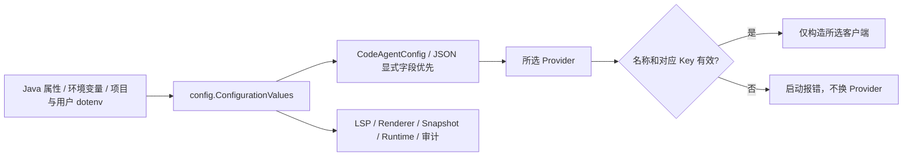

# 环境配置统一与示例清理

## 1. 背景、目标与非目标

用户要求：以 CODEAGENT_PROVIDER 选择一家 LLM，所有可直接配置的有效选项使用显式 KEY=value；密钥留空、布尔选项用 true/false，不靠注释开关；.env 与示例同步并保留现有密钥/自定义值。此前只清理示例，现在明确授权修改读取代码。

目标：统一读取项目/用户 dotenv；严格使用所选 Provider，选择无效或密钥缺失时报错且禁止换家；LSP、Renderer、Snapshot、Embedding、Session、MCP 超时、Runtime API/目录与审计实际读取 .env。Skill 仍由目录和 /skill 管理，autoIndex 仍使用 JSON。非目标：不新增 Skill 开关、不改执行调度/权限/存储 schema、不改模型 HTTP 协议、不提交或发布、不回显配置值。

## 2. 改造前基线分析（源码证据、已知约束）

### 2.1 架构位置

main 与 origin/main 0/0、干净工作区起始的 chore/clean-env-example 分支承载整个任务；已有示例、README 和本地 .env 修改，不重置或丢弃。已读 AGENTS、CODEAGENT、implementation/01、03、06、07、08 与实际配置源码。新增基础读取类放 config，底层不依赖 Main/Renderer/LLM。

CodeAgentConfig.load 读取 ~/.codeagent/config.json；defaultProvider 默认 glm。LlmClientFactory.createFromConfig 目前失败后依次试 8 家。Main 的交互式与 serve 启动都调用它；/model 使用 create(provider,config) 并保存 JSON。ProviderConfig JSON 值当前优先于环境变量。

### 2.2 数据/状态模型

CodeAgentConfig.EmbeddingConfig.applyEnvironment 保留 JSON 显式值优先；旧注入 load(Path,Map) 被测试用于隔离配置。Provider 别名在 LlmClientFactory.normalizeProvider。Provider 密钥可能存在 JSON、进程变量、项目或用户 .env，不得输出任何值。

Main 日志、AutoCompactionManager、McpConfigLoader 已读取 dotenv；RendererFactory/TerminalCapabilities/TuiBootstrap、LspManager/LspDiagnosticFormatter、SnapshotConfig、McpClient、Main session resume、DurableTaskManager.defaultDbPath、RuntimeThreadStore、RuntimeApiServer、AuditLog 目前只读系统属性/进程变量。TuiBootstrap 和工厂选择必须一致。终端探测 TERM/NO_COLOR、旧 TASK_WORKERS 与通用 Skill 目录不扩大为新 dotenv 配置。

### 2.3 核心时序与失败路径

CLI 在创建客户端与运行时前读取设置。新选择项覆盖 JSON 默认 Provider；没有新选择项时仍取 JSON defaultProvider 或 glm，但不再凭其他密钥自动换家。所选无密钥或非法名称在启动阶段显示明确静态错误，退出，不产生 LLM 请求。/model 仍可显式切换当前进程，下一次启动由 CODEAGENT_PROVIDER 决定。

## 3. 方案设计

### 3.1 接口与数据结构

新增 ConfigurationValues：静态 get(property,key,fallback)，优先级非空 Java 属性 > 非空进程变量 > 项目 .env > 用户 .env > 默认。UTF-8、读取简单 KEY=value、只忽略整行注释、保留 = 和 # 的值，不执行变量替换或 shell；首个同名赋值生效。dotenv 空值遮蔽用户 dotenv 的同名值后使用默认；Provider canonical 键显式为空时阻断旧环境别名，不意外继承用户密钥；空进程变量按既有语义不覆盖。无全局缓存或新线程；重复读取不承诺跨项原子快照。

提供 loadEnvironment(Map,Path,Path) 合并项目/用户 dotenv 与进程变量；生产 CodeAgentConfig.load 使用该 snapshot，并将 codeagent.provider 系统属性映射为 CODEAGENT_PROVIDER。保留 load(Path,Map) 作为隔离入口，不隐式读取真实 .env；在 @JsonIgnore 派生 map 中保存已传入环境，Provider 字段仍 JSON 优先、别名仍工作；工厂旧名回退只读取显式 JSON Key，环境别名仅由配置层解析（保留 MOONSHOT_、XFYUN_；其他历史原始别名环境键须迁移到标准变量名）。Embedding 环境 Key 存于 @JsonIgnore 派生字段，JSON apiKey 只序列化显式配置。新的选择项标准化 trim/lowercase，LLM 工厂验证 canonical/既有别名，不让 config 反向依赖 LLM。

LlmClientFactory.createFromConfig 只构造选定 Provider；未知/缺失选择与缺 key 使用异常提示（静态允许列表或已规范化的合法 Provider，不能含 secret）。Main 的启动适配捕获配置异常并返回失败，CLI/serve 均使用；create(provider,config) 继续服务显式切换且维持 null 契约。

### 3.2 策略、安全、并发与恢复

所有模块保留原系统属性优先、值解析/边界验证与默认值。运行时目录为空恢复已有默认目录，不创建示例 D:/ 路径。Runtime API 无密钥仍拒绝启动，仅监听 localhost；.env 是用户显式配置来源，不来自 Agent/MCP 输出，不作为 Turn 授权。MCP 插值仍用该实例 projectDir 和已有规则，不改项目目录。无锁顺序、线程、资源租约或持久化 schema 变更；不复制敏感值到文档或提交。

### 3.3 兼容性、迁移与回滚

行为变化：旧的缺默认 Key 时自动换家移除；旧只填一家 Key 的使用者应加 CODEAGENT_PROVIDER。JSON Provider/Embedding 显式值仍优先于对应 env 字段；选择项覆盖 JSON defaultProvider。旧 CODEAGENT_TUI 兼容代码保留但不展示。首次新 .env 激活原来被忽略的功能项，因此同步时只保留真实启用值与此前保存的原 active EMBEDDING_MODE；不能激活旧注释中的示例路径、密钥或 NO_STATUSBAR=true。空目录和默认布尔值保持原行为。回滚恢复本任务代码/示例，保留本地配置值，不能删除用户数据。

## 4. 实现任务与测试矩阵

使用 writing-plans、test-driven-development 与 executing-plans，内联按依赖实施；不创建额外计划，不创建 worktree、不提交或推送。

1. 读取层：先新增 ConfigurationValuesTest，覆盖优先级、项目覆盖用户、空项目值遮蔽、UTF-8、首个键/值含等号井号、缺文件；红灯后实现 ConfigurationValues。新增只隔离临时文件的集成测试，证明真实模块读 .env，不使用真实密钥。
2. Provider：先在 LlmClientFactoryTest 添加选定不同 Provider、所选缺 key 禁止 fallback、非法 Provider 不请求；CodeAgentProviderConfigTest 测试 CODEAGENT_PROVIDER 覆盖 JSON、别名/空值和 JSON 模型优先。红灯后修改 CodeAgentConfig/工厂及 Main CLI/serve 启动错误适配。
3. 消费者：先为 LSP 开关与上限、Renderer/TUI 一致性、Session 摘要、Snapshot 开关/目录、MCP 超时、Runtime API key/目录、Task 目录、Audit 目录、Embedding 默认与 JSON 优先补临时工作区集成用例。之后使用统一读取器，不改变各模块解析与默认。
4. 示例与本地迁移：Provider 选择项 + 全部密钥空值 + 默认模型；功能开关显式，路径覆盖留空。LSP/Skill/Session Memory 均保留短说明；本地敏感值只在内存对照，写前并发校验，写后恢复项逐值验证，不打印 diff .env。
5. 文档：更新 README 快速开始、AGENTS 配置约定、implementation/01 基础配置、03、07、08 相应边界，并在本文件记录实施/验证。
6. 验证：mvn test -DskipTests=false 指定新增及配置/LLM/LSP/Renderer/TUI/Snapshot/MCP/Runtime/Memory 用例，红绿结果明确；mvn test -Pquick；必要全量 mvn test -DskipTests=false；mvn clean package（默认跳过测试不作为测试证据）；git diff / git diff --check / git check-ignore .env。

## 5. 验收清单

- [x] 多家密钥同时存在时，只构造 CODEAGENT_PROVIDER 指定客户端；所选缺 key/名称无效不 fallback。
- [x] 统一优先级与空值规则有隔离临时文件测试，LSP/Renderer/TUI 等确实读取 dotenv。
- [x] Provider/Embedding JSON 显式配置与别名保持兼容，/model 仍可显式切换。
- [x] 示例所有可配置项显式赋值，无 PowerShell 模拟开关或弃用项；Skill 保留真实入口。
- [x] 本地所有既有密钥和真实自定义值保留，没有激活旧注释路径；.env 被 Git 忽略且不输出内容。
- [x] 文档同步，相关测试、quick、构建与差异检查有真实证据。

设计自审：config 层单向依赖；没有新增远端调用、权限通路、后台线程或自动密钥选择。测试与消费者覆盖示例所有新激活入口；CLI 与 serve 失败方式一致，旧格式迁移限制明确。

## 历史清理与本地同步记录

### 实施与验证记录

- 已删除 CODEAGENT_TUI 和 CODEAGENT_TASK_WORKERS 示例，以及旧 Web 变量提示。仍保留实验性压缩、Lanterna、快照、LSP、MCP、Runtime API 等有效功能。
- 20 个不同的仅进程变量名称改为 PowerShell 命令注释；已扫描剩余 dotenv 赋值，旧名称无残留、仅进程变量无 dotenv 赋值。
- 针对性：mvn test -DskipTests=false "-Dtest=CodeAgentEmbeddingConfigTest,AutoCompactionManagerTest,RendererFactoryTest,McpConfigLoaderTest"，26 项，0 失败、0 错误、0 跳过，BUILD SUCCESS。
- 回归：mvn test -Pquick，1404 项，0 失败、0 错误、18 跳过，BUILD SUCCESS；跳过不计为通过。
- git diff 与 git diff --check 已检查；仅 .env.example、README.md 与本方案发生改动，无格式错误。
- 未运行全量或真实 API/终端演练；本次无产品行为变更。

### 用户补充要求：继续精简

合并模型默认值与可选值说明，删除与 .env 无关的启动命令和大段功能说明；保留 Provider 选择所需的注释行、常用模型覆盖、Web 密钥和日志级别。不改 dotenv 解析器以支持行内注释，不在本任务扩大产品行为。精简后重新运行包含上述针对性配置测试的 quick，补充最终验证。

- 最终示例由首轮的 203 行缩为 44 行，保留 16 个赋值示例；已检查无赋值尾部注释、无启动命令。Provider 模型与地址示例保持原默认值。
- 最终状态重新执行 mvn test -Pquick：1404 项，0 失败、0 错误、18 跳过，BUILD SUCCESS（2026-10-12 11:37:17）；包含既有配置测试。git diff --check 通过。仅示例与文档变更，未执行全量或真实 Provider 联调。

### 用户纠正：精简说明不等于删除有效配置

上一轮只保留常用项，超出了原始删除弃用配置的范围。恢复仍有效的 LSP、Skill、Session Memory，以及一并移出的其他有效配置入口；每项只保留必要短注释。LSP 默认开启，最大诊断数默认 20，只读进程变量/系统属性。Session Memory 的 false 只关闭实验性增量摘要，不关闭稳定的完整自动摘要。Skill 使用目录、启用状态文件与 /skill 命令，无 dotenv 开关。恢复示例不改变运行时代码或用户 .env。重新执行包含相关测试的 quick 与差异检查。

- 已恢复 LSP 两项进程变量、Session Memory dotenv 开关及 Skill 目录/命令/状态文件说明；其他仍有效的 Embedding、渲染器、快照、会话恢复、MCP token、Runtime API、日志与审计入口也以短注释恢复。示例 115 行，仍小于首轮 203 行；无弃用变量恢复。
- 恢复后的最终验证：mvn test -Pquick，1404 项，0 失败、0 错误、18 跳过，BUILD SUCCESS（2026-10-12 13:12:54），包含 LSP、Skill、AutoCompactionManager 相关用例；git diff --check 通过。未运行真实 API 联调，产品代码与用户 .env 不变。

### 用户授权同步本地 .env

用户明确要求同步 .env；此前不读取/不修改用户配置的限制仅适用于示例清理，现在仅为本次同步读取配置，禁止输出正文或值。.env 已被 git check-ignore 确认忽略。将示例结构和短注释同步到本地文件，逐项保留已有启用赋值与可选值；弃用项不恢复。仅进程环境变量的原有值保留为注释，并注明不会从 dotenv 加载。写前核对文件未并发变更，写后在内存比较值与启用状态，不记录密钥、hash 或文件正文；不提交本地 .env。此次无需重复产品测试，以配置保真、Git 忽略及 diff 检查验收。

- 本地 .env 同步完成：11 个原启用配置值均保留，其中 10 项保持原始 dotenv 赋值，1 项仅读进程变量的设置改为 PowerShell 注释示例；其他可选值保留，弃用项移除。写前并发核对及写后内存值比较通过，未输出任何配置值。git check-ignore .env、git diff --check 与 git status 已核对，本地 .env 未进入可提交差异。本轮只同步本地配置与记录，不重复运行已通过的产品回归。

## 统一配置实施记录

- 首次测试编译发现新用例诊断构造参数顺序错误，按既有结构修正后再执行，未将编译错误计为行为红灯。
- 红灯：mvn test -DskipTests=false "-Dtest=DotEnvConfigurationIntegrationTest,CodeAgentProviderConfigTest,LlmClientFactoryTest"，25 项，13 失败、0 错误，复现所选缺 key 自动 fallback、selector 被忽略、模块不读 dotenv。首次隔离临时 home 触发日志 appender 占用临时文件，已把日志初始化放在 home 切换前，后续无清理错误。
- 首轮绿灯：配置/Provider/Embedding/压缩/Renderer/TUI 47 项，0 失败、0 错误、0 跳过。
- 扩展针对性：共享读取器/CLI/LLM/LSP/Renderer/TUI/MCP/Runtime/Audit/Memory，133 项，0 失败、0 错误、0 跳过。另补启动错误及环境 key 不落 JSON 的用例，由后续 quick 验证。
- 新 .env.example 有 52 个显式赋值，密钥均为空、目录留空、布尔值显式，无废弃配置或 PowerShell 模拟开关；Skill/autoIndex/Java 参数仍用既有入口。
- 本地同步私下验证保留 12 个设置值（包括新 Provider 选择与原 EMBEDDING_MODE），沿用现有 JSON 默认 Provider deepseek，未激活旧注释中的示例路径/密钥。配置值与原文件内容均未输出。

- 只读评审发现并经红灯验证：canonical 空 Key 经旧别名继承、Embedding 环境 Key 被保存到 JSON（7 项中 2 失败）；分离派生 Key 并阻断别名后相关 27 项全部通过。继续补工厂端到端旧别名用例，14 项中 1 失败，修复工厂仅对显式 JSON Key 回退。集成 dotenv 用例遇到同名非空进程变量时按前提跳过，读取优先级另有注入 map 测试。

- 补丁后增量 quick：mvn test -Pquick，1432 项，0 失败、0 错误、18 跳过，BUILD SUCCESS（2026-10-12 14:59:47）。
- 补丁后增量全量：mvn test -DskipTests=false，1505 项，0 失败、0 错误、24 跳过，BUILD SUCCESS（2026-10-12 15:09:46）。跳过项不计为通过；未做真实 API 联调。
- 结构验证：示例与本地均为 52 项、键顺序一致、示例无重复键/API Key 全空、无被注释的配置开关。git check-ignore .env 输出 .env；git diff --check 无输出、退出 0。

- 首次 mvn clean package 在删除 target 时失败，未将失败计为构建通过；读取残留目录和 Java 进程确认没有本任务测试仍在运行，未终止 IDE。重试已完成 clean 并进入全量源文件编译，继续验证构建结果。

- clean 后的源码编译暴露 Main 的 File import 仍有一处使用，恢复该 import；此前增量回归不能代替干净编译。再次 clean 遭遇同一 target 删除失败，不终止用户 IDE；继续执行 mvn package，已删除的 class 需重新完整编译，成功后重新运行 quick/全量。

- mvn package 完整重编译 376 个生产文件、265 个测试文件并生成 shaded JAR，BUILD SUCCESS（2026-10-12 15:14:30）；默认跳过测试，另行复跑 quick/全量，不将打包计为测试通过。clean 的 target 删除问题保留为环境限制，未停止用户 IDE。

- 完整重新编译后最终 quick：mvn test -Pquick，1432 项，0 失败、0 错误、18 跳过，BUILD SUCCESS（2026-10-12 15:17:33）；新增边界测试全部执行、未跳过。

- 完整重新编译后最终全量：mvn test -DskipTests=false，1505 项，0 失败、0 错误、24 跳过，BUILD SUCCESS（2026-10-12 15:20:01）。新增配置/Provider/工厂/启动用例均执行且通过；跳过项不计为通过。
- 最终交付：统一选择与 dotenv 读取、52 项显式示例及保密本地同步、文档已完成；未提交/推送。限制：mvn clean package 的 clean 阶段受 target 间歇删除失败影响；mvn package 已完整重编译与打包成功，后续 quick 和全量均通过。未执行真实 API 联调，旧只填 Key 的配置需新增 selector，JSON 显式字段仍优先。
