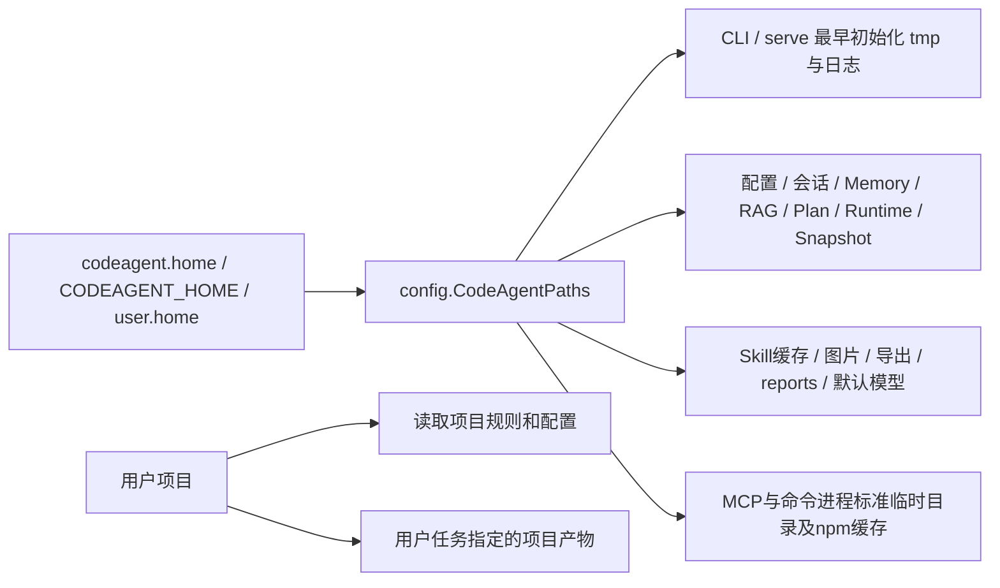

# 跨平台统一系统数据目录

## 1. 背景、目标与非目标

用户要求新建分支修复 Windows/macOS 运行数据散落问题，已确认默认使用用户主目录的 `~/.codeagent`，仅保留整体迁移入口 `CODEAGENT_HOME`（Java 属性 `codeagent.home` 优先）。分支 `fix/unified-codeagent-data-directory` 基于最新 origin/main `246d35a`，起始工作区干净，main 与 origin/main 0/0。

目标：CodeAgent 管理的配置、会话、记忆、索引、锁、日志、审计、快照、图片缓存、报告、模型默认安装和常规临时文件均派生自同一根目录；Windows 不把 `/Users/...`、`/tmp/...` 误解释为当前盘根目录；移除各模块独立存储目录配置；测试不再写盘根或真实用户数据。

非目标：不改变数据库 schema、恢复身份、权限/HITL、用户 workspace 和任务产物位置；不自动搬运、删除历史数据；不把任意外部命令/MCP 的文件副作用宣称为容器隔离；用户显式指定的只读模型输入及可信 Java 宿主注入存储路径保留。

## 2. 现状分析（源码证据、已知约束）

### 2.1 架构位置

已读 AGENTS、CODEAGENT、implementation/01、03、06、08、09 以及 docs/dev/43。Main.configureLogging 启动前建目录；CodeAgentConfig 静态缓存用户配置路径；Main 的 Skill、Session、export、history、MCP 各自拼 user.home。SnapshotConfig、AuditLog、DurableTaskManager、RuntimeThreadStore、PlanStateStore、LongTermMemory、CodeIndex、ToolRegistry 与 VectorStore 接受独立目录覆盖。PromptRepository、ProjectMemoryLoader、McpConfigLoader、SensitivePagePolicy、FileTreePane、ClipboardImage、ConversationSnapshot、RemoteEmbeddingConsentStore、InProcessQwen3EmbeddingProvider 各自固定 user.home。

### 2.2 数据/状态模型

默认既有布局保留：config.json、mcp.json、skills.json、history/{raw,sessions,input.history}、memory/memory.db、rag/{codebase-v2.db,codebase.db,remote-consents.json}、plans/plans.db、tasks/tasks.db、runtime/{runtime.db,locks}、snapshots/<项目hash>/<工作区hash>/.git、logs、audit、cache、skills-cache、exports、models。BetterHarnessRunner.writeDurableReport 当前写项目 .codeagent/better-harness/<run-id>；移至 root/reports/better-harness/<workspace-hash>/<run-id>，避免同名项目混用报告。

Windows 实查：本地 dotenv 日志使用 Unix 示例路径，D:/Users/yourname 下有日志；VectorStoreTest、CodeRetrieverTest 使用 /tmp/codeagent-test-rag*，VectorStore 构造调用 mkdirs，且不恢复属性。旧 CodeIndexTest 的 /tmp 路径已在历史提交删除。D:/proc/self/fd/1 来源未证实，本任务不删除该文件或伪称已定位。

### 2.3 核心时序与失败路径

CLI/serve 最先解析并初始化根目录和 root/tmp，设置日志路径、java.io.tmpdir、org.sqlite.tmpdir，然后加载配置、模型与 Runtime。根目录不允许相对路径或 Windows 缺盘符的根路径；非法值在创建目录前失败，不回退当前盘。模块读取统一解析器；构造时注入的 Path 仍是宿主明确授权。

## 3. 方案设计

### 3.1 接口与数据结构

新增 config.CodeAgentPaths，root() 使用 ConfigurationValues.get(codeagent.home,CODEAGENT_HOME,null)，默认 user.home/.codeagent；支持 ~/、~\\ 展开，必须为平台完整绝对路径且不能包含控制字符。resolve(relative) 只允许根下相对组件、不允许 .. 逃逸。无线程、无持久化 schema，无依赖 CLI/Renderer。

initialize() 在启动调用，先建立 root/tmp 与 root/logs，然后写规范化 codeagent.home、codeagent.log.dir、java.io.tmpdir、org.sqlite.tmpdir；同一进程根目录固定。configureProcessEnvironment(Map) 为启动的 MCP/命令进程设置 TMP、TEMP、TMPDIR 与 npm_config_cache 至 root 下（Windows 环境键不区分大小写）；不改 HOME/USERPROFILE，保留浏览器登录态和外部程序的用户身份。第三方程序可无视这些标准变量，不保证全部外部副作用收敛。

默认用户级配置、Prompt/Skill/忽略文件跟随根目录；项目只读覆盖配置仍在项目原处。保留显式 userHome/Path 注入 API 供测试/宿主，生产 Main 统一传 root 派生路径。移除生产独立目录键的消费，旧键不再扩大路径，也不作为自动迁移源。

### 3.2 策略、安全、并发与恢复

不新增 Tool、不扩大 PathGuard/URL 授权、不改变审批和 owner/claim/lease。只从可信配置解析 root，不来自模型文本。固定子目录保持原锁顺序和数据分库边界。目录/模型安装错误失败，不在另一目录偷偷回退；不得回显 dotenv 密钥。报告存储 hash 仅区分 workspace，不持久化额外源码。root 位于 workspace 内时须排除自动索引/快照的自身数据，避免递归采集；优先选择项目外目录并明确限制。

### 3.3 兼容性、迁移与回滚

默认 ~/.codeagent 原数据直接复用；旧独立 *_DIR、HISTORY_FILE 与对应 Java 属性停用并从 .env.example 移除，本地 .env 仅移除这些存储路径赋值，保留其余内容与密钥且不输出。非默认旧目录的数据保留原处，须先停止所有实例，再由用户整体复制到选定根目录；不自动合并活跃 SQLite、raw ledger 或快照。修改 CODEAGENT_HOME 需重启，模型安装脚本遵守同一根。回滚代码保留已有 root 内数据；新报告位置不会被旧版报告发现。

## 4. 实现任务与测试矩阵

采用 writing-plans、test-driven-development 内联实施；本文件合并方案、任务、实施和验收，不另建文档。实现验证后用户明确授权分批提交，按该授权执行本地 commit；不 push/PR。

1. 先补 UnifiedDataDirectoryTest：隔离 user.home/user.dir 和属性；旧 codeagent.*.dir、dotenv 路径不能改变默认库/缓存位置；指定 codeagent.home 后 Plan、Runtime、Snapshot、Audit、Memory、RAG consent、模型等跟随。用现有公共方法先取得行为红灯，再新增 CodeAgentPathsTest 覆盖默认、整体覆盖、空值遮蔽、~/、Windows root-relative/drive-relative、目录逃逸和子进程环境。
2. 新增 CodeAgentPaths，接入 Main 两种入口、动态 CodeAgentConfig load/save；Main MCP/history 以及会话、Skill/export 改成统一派生。保留测试/宿主显式 Path 注入边界。
3. 更新默认 Memory/RAG/Plan/Runtime/Snapshot/Audit、Prompt/MCP/Browser/TUI/image/model 路径。历史/模型/配置不缓存不同根目录。BetterHarness 报告加入 workspace hash，写到 root/reports。先用报告测试验证归属和 inline 零落盘。
4. StdioTransport 和 runNativeCommand 使用统一环境，SQLite/JVM 临时目录启动前初始化；安装脚本跨平台解析唯一 root，保留离线 SourceDirectory。路径非法无落盘测试。
5. 测试先修复 RAG /tmp 固定夹具为 @TempDir 并恢复 codeagent.home；其他旧目录配置测试转为 root 注入。Maven 测试默认 codeagent.home 指向 target/test-data，避免缺注入测试使用真实用户目录；主配置集成套件保留属性隔离并恢复。真实模型评测依赖原固定安装目录时须显式指定只读模型输入。
6. 同步 .env.example、README、AGENTS 与 implementation 中目录规则，私下清理本地旧目录赋值；记录验证与兼容限制。

验证命令（Java 17，显式 -DskipTests=false）：
- 新增配置/目录、CodeAgentHistoryTest、MainConfigBootstrapTest、MainSessionCommandTest、VectorStoreTest、CodeRetrieverTest、CodeIndexTest、BetterHarnessRunnerTest 的针对性红绿。
- Memory、Snapshot、MCP config/transport、Runtime、TUI history 的相关测试；mvn test -Pquick；mvn test -DskipTests=false；mvn clean package。
- git diff / git diff --check / git status，扫描生产独立目录配置和 user.home 拼接、测试固定 /tmp 写入；Windows 子进程元数据实测，macOS 仅条件测试/源码验证，不声称已在 macOS 执行。

## 5. 验收清单

- [x] 分支基于最新 main；实现验证阶段保留未提交，后续按用户明确授权分批本地提交。
- [x] 默认 Windows/macOS 均为 user.home/.codeagent，唯一整体覆盖项和优先级有测试。
- [x] 旧独立目录配置不再创建外部目录，Windows 无盘符路径在创建前拒绝。
- [x] 默认所有系统数据和报告派生统一 root；用户级配置覆盖跟随 root。
- [x] SQLite/JVM 和 MCP/命令的常规临时路径与 npm 缓存跟随 root，不改变进程用户身份。
- [x] RAG 测试不再使用 /tmp 固定目录，相关属性在测试后恢复。
- [x] 原默认历史/记忆/索引可复用，不自动搬运或删除用户数据。
- [x] 针对性、quick、必要全量、构建和 diff 检查有真实证据，平台限制明确。

设计自审：统一根与固定子目录不改变业务权限或 schema；旧目录停用是用户确认的兼容性变化；只读外部模型和任务产物属于明确非目标。若配置 root 位于 workspace 内，实施需核对 index/snapshot 排除，否则不能通过验收。

## 实施与验证记录

1. 原有默认存储测试先运行取得红灯：UnifiedDataDirectoryTest 的 3 项断言失败，证明旧模块目录设置可分散写入且整体 root 不生效。实现后统一入口覆盖默认数据库、用户级配置、会话、缓存、报告和模型目录；明确 Path 注入 API 保留。
2. Windows 独立 JVM 启动测试验证不同工作目录下仍使用用户根、项目 dotenv root 在初始化前生效、无盘符路径失败前不创建数据。日志探针在统一初始化之后首次调用 LoggerFactory，验证真实 logback 文件写入同一根；故意无效 provider 的 Main 启动本身尚不产生日志事件，断言 logs 目录而非未初始化 logger 的文件。
3. 实际 TUI history 保存测试暴露 Jackson writeValue(writer, ...) 提前关闭 writer 的旧问题；改为写入序列化字符串后追加换行，实际文件保存通过。
4. 独立评审发现数据根名 state[1]、#state 被解释为 gitignore 模式。新增参数化测试先得到 3 项中 2 项失败；SideGit 改为独立字面 dataRoot 与锚定转义的 Git 目录规则，Task diff 同样按字面 Path 排除。测试核对私有数据不在 baseline/index，state1 普通源码仍被收录；含空格目录也覆盖。索引与 Harness inventory 排除系统根；浏览器启动帮助派生 cache/chrome-profile。
5. 内置 Skill 缓存版本升级到 1.3.0，旧缓存重建以更新报告/站点经验目录说明。旧 .env 独立存储配置已定向清理，其余赋值逐项校验未变，不记录或展示敏感值。
6. 安装脚本 ResolveOnly 实测默认根和含空格整体根正确；Windows /Users/yourname 拒绝且不安装文件。无模型下载、无自动搬运或删除历史目录。
7. 初次 quick：1468 项，0 failure/0 error，19 skipped。初次全量：1543 项，2 failure（编译期间内置 Skill 版本变更造成常量与资源不一致）、1 error（Windows 超时子进程临时目录占用）。最终代码重新编译后，Skill 和超时测试均通过；针对性最终命令 mvn test -DskipTests=false -Dtest=UnifiedDataDirectoryTest,CodeAgentPathsTest,MainDataDirectoryStartupTest,MainBrowserCommandTest,BetterHarnessEvidenceCollectorTest,SkillBuiltinExtractorTest,TaskWorkspaceDiffTrackerTest,SideGitManagerTest,ToolRegistryTest：87 项，0 failure/0 error，1 skipped（POSIX 条件测试）。
8. 最终 mvn test -Pquick：1476 项，0 failure/0 error，19 skipped；最终 mvn test -DskipTests=false：1551 项，0 failure/0 error，25 skipped；mvn clean package：BUILD SUCCESS，生成 target/codeagent-1.0-SNAPSHOT.jar（项目默认构建跳过测试，前述全量显式执行）。git diff --check 已通过（仅 Windows 自动 CRLF 提示）；分支 main...origin/main 仍为 0/0，本次改动无提交。macOS 未实机执行；第三方程序可能忽略标准临时/缓存环境变量，不保证任意外部程序所有副作用都在根内。
9. 评审复核确认原 Important 与两项 Minor 均已解决，无新增 Critical/Important；已核对实际测试报告。
10. IDE 提示 DurableTaskManager 中 ConfigurationValues import 未使用：默认目录已改用 CodeAgentPaths，清理遗留导入；mvn compile 为 BUILD SUCCESS（增量检查无须重新编译），git diff --check 通过。本次仅清理导入，不改变运行行为，无须新增测试或重复全量回归。
11. 用户明确要求“分批提交当前修改”：按统一目录实现与回归测试、安装脚本与内置资源/配置示例、开发与使用文档三批本地提交。每批核对暂存文件和 git diff --cached --check，排除本地 .env、target、原始会话和敏感数据；不推送或创建 PR。
