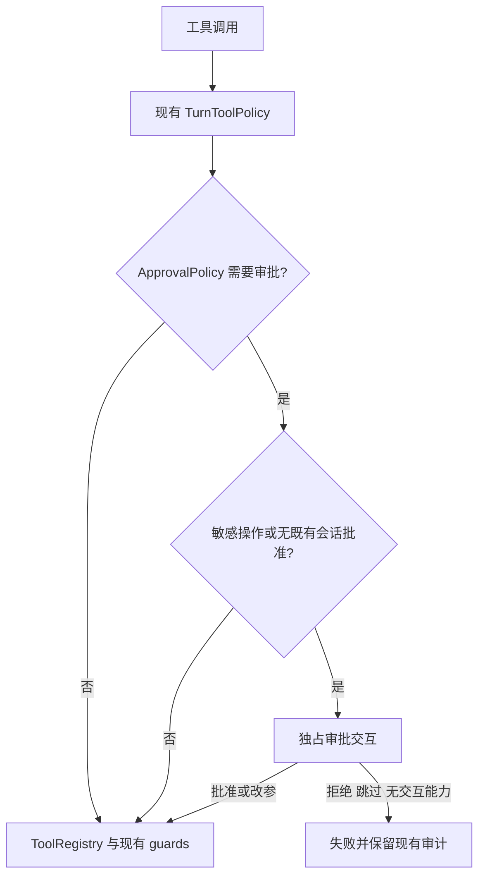

# HITL 始终启用并移除全局开关

## 1. 背景、目标与非目标

用户要求创建分支，删除 HITL 开关，始终启用人工审批。目标是所有使用 HitlToolRegistry 的 CLI、Lanterna 与 Java Workspace Runtime 都没有关闭审批的入口；危险工具继续按 ApprovalPolicy 判断，读取不额外审批。删除 `/hitl`、`/hitl on|off`、YOLO 与 Ctrl+Y 提示。保留显式按工具/server 的会话批准、拒绝、跳过、改参及敏感页面逐次审批。

非目标：不扩大危险工具集合，不改变 Plan 人工评审、策略授权、原始会话存储，不为独立 Runtime HTTP API 新增审批回答协议，不把基础 ToolRegistry 改为交互式注册表。实现完成后用户已授权分批本地提交，不推送。

## 2. 现状分析（源码证据、已知约束）

基线：origin/main 8a50799；工作区干净，从远端主分支以 no-track 创建 fix/always-enable-hitl。

### 2.1 架构位置

- Main.main 使用 TerminalHitlHandler(false)，再替换为 Renderer/Broker handler，传递启用状态。
- HitlHandler 暴露 isEnabled/setEnabled；Terminal、Renderer、Broker、Tui 和 Switchable 实现它们。
- HitlToolRegistry.executeToolOutput 在禁用时直接进入父类，requiresIsolatedExecution 也受启用位控制。
- DefaultWorkspaceRuntimeFactory 默认开启，但额外构造器可传 false。
- CliCommandParser、Main、ExecutionControlPolicy、TuiSessionController 提供开关命令；补全由 Main.slashCommandHints 驱动。
- BottomStatusBar 在两种格式化路径显示 YOLO/HITL 切换提示；Agent 仅为显示注入状态 supplier，StatusInfo 携带启用位。

### 2.2 数据/状态模型

删除 enabled 字段、构造器布尔参数、setter/getter、Agent supplier 以及 StatusInfo 中的 hitlEnabled。Switchable 仅表示交互实现可替换。保留 approvedAllByTool/server 集合和 clear 操作；不引入持久化数据或数据库迁移。

### 2.3 核心时序与失败路径



## 3. 方案设计

### 3.1 接口与数据结构

采用删除全局状态和绕过分支的方案；仅把默认 false 改为 true 会留下关闭通道，仅隐藏 UI 会留下 Java 调用旁路，因此均不采用。Handler 构造器只接收交互依赖；Workspace 工厂保留默认与注入 PlanStoreFactory 两种构造。StatusInfo 仅删除审批启用参数，其他 token/phase 字段不变。状态栏固定显示 HITL，启动信息固定标识始终启用。旧斜杠命令走 UNKNOWN_COMMAND，不能作为任务输入。

### 3.2 策略、安全、并发与恢复

沿用现有授权链、审计、敏感页面要求和改参后校验。需交互调用仍独占，显式预批准的无冲突调用可并行；批次选定后批准被撤销仍失败关闭。锁顺序、Broker 等待、取消和 Session lease 不变。无交互适配器的 Workspace 宿主继续 cancel/reject，不自动批准。仅删除开关状态，已有会话批准的清理与恢复契约保持。

### 3.3 兼容性、迁移与回滚

CLI 的旧 `/hitl*` 命令不再有效；文档、补全与帮助同步。内部 Java handler、状态 DTO 与工厂构造签名同步调整所有仓库调用者，不保留忽略 false 的兼容开关。没有配置或持久化迁移。回滚可整体撤回本任务 diff。

## 4. 实现任务与测试矩阵

1. 先修改 CliCommandParserTest，旧 HITL 命令预期 UNKNOWN_COMMAND；BottomStatusBarTest 断言固定 HITL 且无 YOLO/Ctrl+Y；HitlToolRegistryTest 验证新建注册表拒绝写入且无文件副作用。运行测试观察旧行为失败。
2. 删除 handler 启停 API、构造参数与 registry 禁用旁路；调整所有实现和测试替身。保留并运行拒绝、改参、敏感操作、预批准并行、批准撤销测试。
3. 删除 CLI/TUI 命令解析、执行、提示和补全；删除 Agent/StatusInfo 启用状态传递，更新所有状态构造调用与渲染断言。
4. 同步 README、ROADMAP、implementation/02、07 与 Workspace 相关说明；更新本文件实施证据。执行针对性测试、quick、phase16-smoke、构建及 diff 检查。

验证命令：

```powershell
mvn test -DskipTests=false "-Dtest=CliCommandParserTest,CodeAgentCompleterTest,HitlToolRegistryTest,TerminalHitlHandlerTest,RendererHitlHandlerTest,SwitchableHitlHandlerTest,ApprovalPolicyTest,BrokerInteractionHandlersTest,BottomStatusBarTest,RuntimeExecutionHostIntegrationTest,TaskEvidenceCollectorTest"
mvn test -Pquick
mvn test -Pphase16-smoke
mvn clean package
git diff --check
```

设计自审：接口依赖单向，无新授权来源、持久化和线程；删除全局开关覆盖所有 handler 实现及 Workspace 工厂；保留具体授权与基础 ToolRegistry 的边界。实现按上述顺序在当前会话执行。

## 5. 验收清单

- [x] 所有 HitlHandler 实现无启停状态，Workspace 工厂无关闭参数。
- [x] 未预批准的危险工具必须审批，拒绝时没有文件副作用；只读及显式预批准行为通过回归。
- [x] 旧 `/hitl*` 被解析为未知命令，CLI/TUI 帮助及补全不出现开关。
- [x] 状态栏只有固定 HITL，无 YOLO/Ctrl+Y；状态 DTO 无启用位。
- [x] 针对性测试、quick、终端 smoke、构建和 diff 检查有真实记录。
- [x] 变更留在功能分支，按用户授权分批本地提交，无 secret、raw session 或构建产物进入 diff。

### 实施记录

- 先调整命令、状态栏和工具审批测试；Maven 默认 JDK 8 导致目标 17 编译失败，随后在验证进程中显式选择本机 JDK 17。
- 红灯：`mvn test -DskipTests=false "-Dtest=CliCommandParserTest,BottomStatusBarTest,HitlToolRegistryTest"`，96 项，5 失败、0 错误，分别证明旧命令、禁用旁路与切换提示尚存在。
- 已按依赖方向移除 handler、工厂、Agent、StatusInfo 的全局状态；补充只读不审批、补全无旧命令与无宿主交互适配器不落盘断言。
- 上述针对性测试命令：176 项，0 失败、0 错误、0 跳过，BUILD SUCCESS。覆盖命令、补全、handler 决策、只读及预批准并行、批准撤销、敏感页面、状态栏、Workspace 无交互适配器与命令证据。
- 所有 Maven 验证临时设置 `JAVA_HOME=C:\Program Files\Java\jdk-17` 并将其 bin 放在当前验证进程 PATH 首位，不修改用户永久环境配置。
- 只读代码评审指出 ROADMAP 仍描述默认关闭与运行时切换；核对后同步更新该两条现状描述。
- `mvn test -Pquick`：1476 项，0 失败、0 错误、19 跳过，BUILD SUCCESS。跳过项来自已有 live/provider/RAG 实验开关、Windows/符号链接条件和两项标记为旧语义的禁用测试；本任务没有新增跳过条件。quick profile 本身排除的慢测试保持原配置。
- 只读评审结论：无 Critical/Important 问题；唯一 Minor 为上述 ROADMAP 说明，已修正。
- `mvn test -Pphase16-smoke`：106 项，0 失败、0 错误、0 跳过，BUILD SUCCESS。
- `mvn clean package`：BUILD SUCCESS，生成 `target/codeagent-1.0-SNAPSHOT.jar`。该命令按项目默认跳过测试；测试证据来自前述独立测试命令。Shade 的依赖重叠与 module-info 警告不影响本次成功退出。
- 实现阶段 `git diff --check` 通过；分支为 `fix/always-enable-hitl`，无 upstream；当时未跟踪文件只有本方案文档，构建产物保持忽略。
- 用户随后要求直接分批提交且无需再次验证：第一批 `2cc53a1` 提交源码与配套测试；第二批提交文档及全局规则同步。本轮不重复运行测试或构建，不推送远端。
- 验证边界：未运行真实终端交互手测或带外部模型/服务的 live 测试。内部 Java handler、StatusInfo 和 Workspace 工厂已移除旧布尔参数，外部源码调用者需要同步签名；HTTP API 交互协议仍是原有边界。
