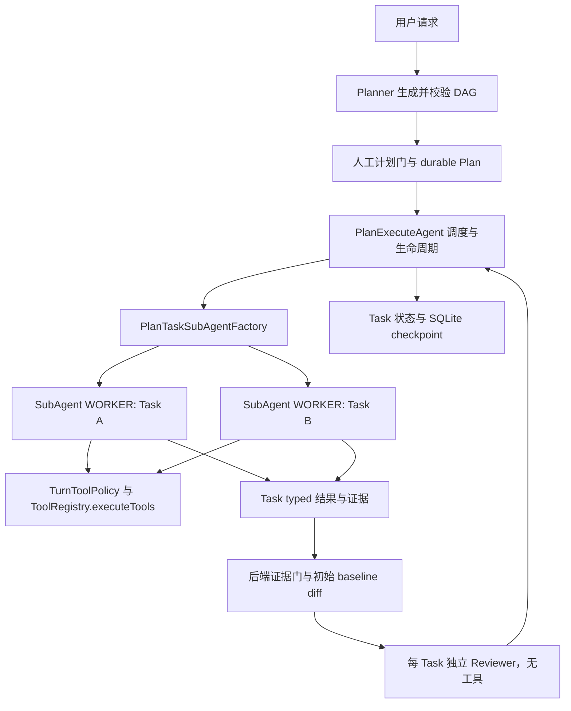
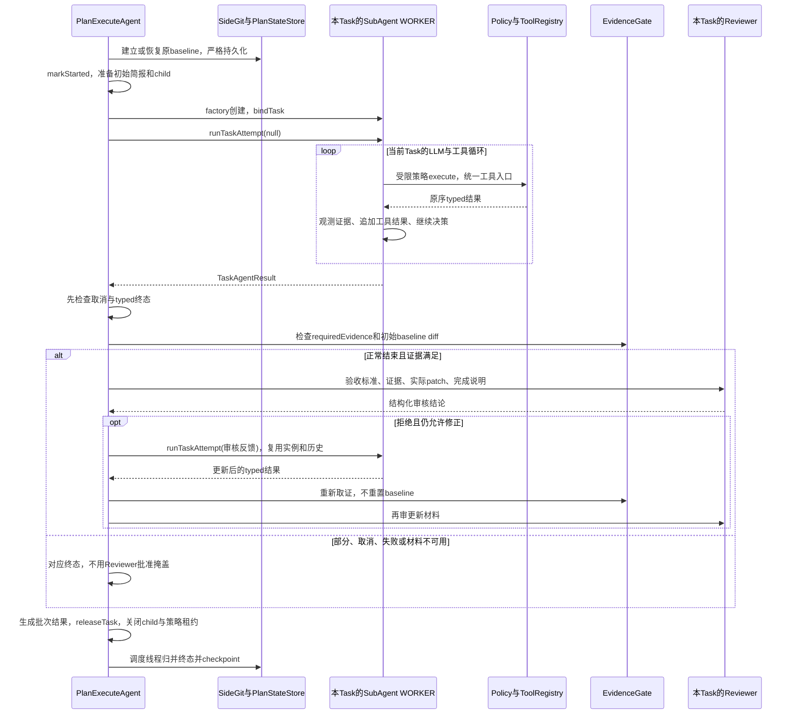

# Plan Task 独立执行子 Agent 重构方案

状态：设计待审，尚未实施。本文是本任务唯一的设计、实施计划及验收记录。

- 日期：2026-10-14。
- 源码基线：`origin/main@8a507990afd1be98f089f5685c5a7c604d12f767`；创建分支前已 fetch，本地 main 与远端 main 的差异为 0/0。
- 工作分支：`feat/plan-task-subagents`，通过 `git switch --no-track -c feat/plan-task-subagents origin/main` 创建，无 upstream。
- 用户要求：创建分支，先写方案；每个 Task 委派给独立的执行子 Agent。用户随后明确要求新建重构文档，因此不修改原多 Agent 分析文档。
- 本轮交付：只有本方案，不实现 Java、不提交或推送。下文类型、方法、状态约定和测试均为拟实施设计，不能据此宣称功能已落地。

## 1. 背景、目标与非目标

### 1.1 背景

当前 Plan 有 Planner、Task Executor、Reviewer 三种逻辑责任，但只有 Reviewer 实际创建 `SubAgent`。Task Executor 是 `PlanExecuteAgent.executeTaskWithPolicy` 中的独立消息与工具循环。隔离上下文、DAG 并发、证据门禁和审核已存在；本任务将执行责任真正迁移到每个 Task 独占的 `SubAgent(WORKER)`，而非在旧执行方法外包一层名义上的 Agent。

重构价值是明确执行实例、上下文和资源的生命周期，减少编排器承担的执行职责，并让执行子 Agent 能独立测试。它不保证模型能力、任务成功率或性能自动提升；这些效果需要另行评测。

### 1.2 目标和可观察行为

1. 每个实际启动的 Task 创建一个真实的 `SubAgent`，角色为 `WORKER`；不同 Task 不共享该实例、消息列表、压缩器、token tracker 或预算。
2. Task 的全部 LLM/工具迭代由该实例运行。`PlanExecuteAgent` 不再保留第二份 Task 工具循环，也不能让 SubAgent 回调旧循环完成实际工作。
3. 编排器仍唯一负责 DAG、SQLite checkpoint、diff baseline、审核重试和任务终态；Worker 无权自行完成 Task、解锁后继、重规划或派生新任务。
4. 保持真实工具证据、Task 原始 diff 基线、URL 继承、HITL、范围限制、流式输出和 child session 的现有保障。
5. 向 Worker 显式传达验收标准和所需证据，消除当前简报未渲染它们的落差。
6. 建议在同一次进程内运行中保留同一 Task 的 Worker 历史，用审核意见继续修正；跨进程仍按 Task 边界恢复，不恢复任意工具调用现场。重试上下文偏好已向用户提出可选问题，本文先采用“保留历史”的推荐方案，审阅时可调整，不作为用户已确认的偏好。

### 1.3 非目标

- 不把 Planner 改为 `SubAgent(PLANNER)`，不改变其结构化计划协议和简单任务快速路径。
- 不新增自由协商、Agent 间聊天、共享黑板、模型驱动调度、远程 Worker 或分布式消息队列。
- 不增加 `/team`、新 CLI 命令、Provider、多模型选择或配置开关；`PipelineOptions` 语义不变。
- 不接入 ReAct 自动 diff 审核，不新增 `read_diff` 工具，不抽取覆盖所有 Agent 的通用大内核。
- 不升级 LSP 为真实语言服务器，不解析测试报告或承诺断言充分性，不提供容器隔离、exactly-once 副作用或全局并发预算。
- 不改 plans.db schema，不把 Worker 对象、消息正文或源码写入计划表。

## 2. 现状分析（源码证据、已知约束）

### 2.1 架构位置与源码勘探基线

以下证据按上述基线核对；方法名作为稳定定位，行号仅为本次勘探提示。

| 文件与方法 | 当前事实 | 对方案的约束 |
|---|---|---|
| [Planner.createPlanInternal](../../src/main/java/com/codeagent/plan/Planner.java)，约 85 行 | 通过 StructuredJsonExecutor 生成计划，无工具 | 保持规划与执行分离，不重复实现 Planner |
| [PlanExecuteAgent.executeTaskBatch](../../src/main/java/com/codeagent/agent/PlanExecuteAgent.java)，约 1138 行 | 单 Task 直接执行；多 Task 批内最多 4 线程，传播取消和交互身份，输出各自缓冲 | Agent 实例不等于新线程；复用已有线程池与 drain |
| 同文件 executeTask，约 1238 行 | 每 Task 独立工具策略、collector、child session，调用执行循环后评证据和审核 | 把实例接入此生命周期，不另开一套调度 |
| 同文件 executeTaskWithPolicy，约 1412 行 | 组装 PLAN prompt/StepBriefing/Memory/Skill，创建 messages，直接调用 LLM/工具 | 这段职责必须迁入真正 Worker |
| 同文件 applyStepReview，约 1355 行 | 每 Task 创建 Reviewer；使用初始 baseline 的实际 patch，失败有限重试 | Worker 返回结果不能绕过这条链路 |
| 同文件 TaskRunResult/finalizePartialTask，约 78/1580 行 | 返回数据没有显式执行终态；部分结果依赖文本表述 | 新返回协议必须能区分正常结束、部分、取消和失败 |
| [SubAgent](../../src/main/java/com/codeagent/agent/SubAgent.java)，约 76/271/295 行 | 已有 WORKER、独立 history/压缩/token tracker、工具循环；通用入口自己建 team child；构造函数调用共享 ToolRegistry.setCurrentModel | 不能原样替换，否则重复 child、账本模式漂移及构造期共享重绑 |
| 同文件 shouldUseTools/executeToolCalls，约 575/591 行 | 仅 WORKER 有工具；经 TurnToolPolicy，但无 TaskEvidenceCollector 接口 | Reviewer 保持无工具；必须在工具结果回传前观测原始执行事实 |
| [StepBriefing.render](../../src/main/java/com/codeagent/agent/StepBriefing.java) | 总目标、当前 Task、依赖结果、可信 URL、重试意见；未输出验收标准/requiredEvidence | 扩充唯一简报渲染点，不在 Worker 另造模板 |
| [LspManager.flushPendingDiagnostics](../../src/main/java/com/codeagent/lsp/LspManager.java)，约 65 行 | pending 按文件保存，但 flush 消费全部；SubAgent 的 Reviewer 也会调用诊断注入 | 新 Worker 必须限定诊断消费范围，Reviewer 不得消费其他 Task 诊断 |
| [TaskWorkspaceDiffTracker](../../src/main/java/com/codeagent/agent/TaskWorkspaceDiffTracker.java) 与 [TaskEvidenceCollector](../../src/main/java/com/codeagent/agent/TaskEvidenceCollector.java) | baseline、patch 和 typed 命令证据已经实现 | 复用，不重新按写工具成功或摘要判断通过 |
| [Task](../../src/main/java/com/codeagent/plan/Task.java)、[PlanStateStore](../../src/main/java/com/codeagent/plan/PlanStateStore.java) | 已有 REVIEWING/UNVERIFIED/INTERRUPTED；恢复复用原 baseline | 优先使用现有状态，不迁移数据库 |

现有回归包括 SubAgentTest、PlanExecuteAgentTest、PlanExecuteRecoveryTest、PlanDiffEvidenceIntegrationTest、SubAgentStepReviewerTest、StepBriefingTest、AgentConversationLedgerTest、MainPlanAgentFactoryTest、RuntimeExecutionHostRecoveryTest 和 ExecutionShutdownQuarantineTest。本轮仅盘点，没有执行这些 Java 测试。

### 2.2 数据/状态模型与所有权

| 资源 | 重构后的唯一所有者 | 借用或共享规则 |
|---|---|---|
| Execution、Plan、Task 状态与 SQLite | PlanExecuteAgent / 既有 Runtime | Worker 只返回事实；不能持有可变 Task 并调用 markCompleted |
| Worker 实例与消息、压缩器、tracker、预算 | 一个 Task 的一个 SubAgent(WORKER) | Task 运行期内独占，不池化、不跨 Task 复用、不并发调用同一实例 |
| 初始 baseline、snapshot ref、collector | 编排器创建的 Task 生命周期 | baseline 不随审核重试重置；collector 供绑定 Worker 追加事实 |
| Task 工具策略和可信 URL 分支 | 编排器创建并持有的 taskToolPolicy | Worker 借用同一受限策略；不能从任务文本创建新授权 |
| child SessionHandle | executeTask 的生命周期 | Worker 借用 append 权限，不创建第二个 child、不关闭借用 handle |
| LlmClient、ToolRegistry、SkillRegistry | 当前 workspace 的既有基础设施 | 不为 Task 创建新 provider/注册表；构造 Worker 不重绑共享依赖 |
| parent conversation、MemoryManager、Skill buffer | Session / 编排器 | Worker 只接收准备好的上下文快照；不取得顶层历史写权限 |
| 每 Task 输出流 | 既有批次输出策略 | 单 Task 直接输出，多 Task 独立缓冲后按原顺序回放 |
| Reviewer | 每 Task 独立 REVIEWER 实例 | 继续使用原结构化响应和无工具边界，不共享 Worker history |

### 2.3 核心时序和已知失败路径

当前顺序是人工计划门 → durable Plan → 按资源选批 → 建 baseline → 启动 Task → 执行/证据重试 → Reviewer/修正 → Task 终态。保留这条链，只更换执行责任的载体。

必须显式防止：Worker 包装后仍运行编排器旧循环、两处重复写 child、错误结果被 RESULT 文本包装为成功、重试重建 URL 权限、并行 Worker 重绑共享 Registry、Reviewer 消费其他任务的 LSP、审核拒绝后重置 baseline、工具线程未停止就释放 workspace。

## 3. 方案设计

### 3.1 选型与模块边界

| 方案 | 优点 | 代价与判断 |
|---|---|---|
| 补齐 Task 契约后使用现有 SubAgent(WORKER)，推荐 | 每 Task 真实子 Agent；复用已有 Worker 工具循环、压缩、图片和 Reviewer 基础 | 需要 typed 结果、观测和借用 Session 协议；必须覆盖 legacy Reviewer 回归 |
| 新建另一种 PlanTaskAgent，保留 SubAgent 的 Worker 循环 | 可以完全隔离新接口 | 多维护一份相近循环；与本次统一 Worker 的目标相比收益不足 |
| 新建一个名为子 Agent 的壳，回调 executeTaskWithPolicy | 初始改动少 | 实际执行责任未迁移，不满足用户要求，拒绝采用 |

PlanExecuteAgent 继续负责 Planner、DAG、人工门、baseline、证据门、Reviewer 和终态。SubAgent(WORKER) 真正持有任务对话并执行 LLM/工具循环。Planner 和 Reviewer 的输入协议不改变。这里的多 Agent 是进程内、有明确父子委派关系的执行子 Agent 协作，不宣称多进程或自治调度。



### 3.2 接口与数据结构

以下新类型均放在 `src/main/java/com/codeagent/agent/`，限包内使用，不新增持久化格式或用户 API。

```java
record TaskAgentRequest(String planId, String taskId,
                        String systemPrompt, String initialInput) { }

record TaskAgentBindings(
        TurnToolPolicy toolPolicy,
        ContextProfile contextProfile,
        ConversationLedger ledger,
        SessionStore.SessionHandle childSession,
        TaskEvidenceCollector evidenceCollector,
        Supplier<LspDiagnosticReport> diagnostics,
        PrintStream out) { }

record TaskAgentResult(Status status, String result, boolean streamedOutput,
        TurnToolPolicy.TrustedUrlContext trustedUrls, Usage usage,
        String error, AgentBudget.ExitReason stopReason) {
    enum Status { COMPLETED, PARTIAL, CANCELED, FAILED }
    record Usage(int inputTokens, int outputTokens, int cachedInputTokens) { }
}

@FunctionalInterface
interface PlanTaskSubAgentFactory {
    SubAgent create(String planId, String taskId);
}
```

设计中的 `COMPLETED` 只表示 Worker 正常结束本次执行，不表示 Task 已审核完成。`PARTIAL` 必须带实际预算/停滞原因；`FAILED` 必须有错误，其他状态不得借 error 文本猜测。Usage 为该 Task Worker 的累计值，跨修正尝试不重置；同一累计值只能汇总一次。trustedUrls 从绑定策略取 typed 值，不解析正文。

TaskAgentRequest 必须校验非空身份和非 null prompt/input；所有字段是字符串快照，不能传入可变 Task。TaskAgentBindings 为可信 Java 内部绑定，不序列化、不暴露给 LLM；除可选 childSession 外，其余依赖不得为 null。diagnostics 可返回 EMPTY；没有 parent session 时借用 handle 为空，不临时创建用户目录。

在 SubAgent 增加以下包内入口，不改变现有 public execute/review 方法签名：

```java
void bindTask(TaskAgentRequest request, TaskAgentBindings bindings);
TaskAgentResult runTaskAttempt(String feedback);
void releaseTask();
```

- bindTask 只接受 WORKER，只允许绑定一次；绑定后 actor 固定为 `task:<taskId>`、mode 固定为 `plan`，完整身份含 planId。第一次调用 runTaskAttempt(null) 注入 initialInput，后续调用要求非空修正意见，追加为执行反馈。
- 已绑定 Task 的实例禁止调用 legacy execute/executeWithContext/review 入口，必须在创建任何替代策略或自动 child 之前拒绝；REVIEWER/PLANNER 禁止调用 Task 入口。这样不会因混用两套 API 重新解释任务文本或扩大权限。
- 一个实例不能换绑其他 Task，release 后不能再执行。使用执行中标志拒绝重入；同一实例并发调用在触碰 history/工具之前失败。release 只释放自己的状态，不关闭借用 handle、Registry、LlmClient 或输出流。
- 新入口使用已有 SubAgent 的工具循环；通过内部执行上下文参数区分 legacy 与绑定 Task，不能复制两份循环。legacy execute 保持原 AgentMessage 适配；Task 入口返回 typed TaskAgentResult。
- 工具调用仍经绑定策略的 execute。结果返回后先调用 evidenceCollector.observeTools，再按原顺序追加 tool messages。原 invocation ID/arguments 和最终 executedCommand 都保留；不按文本自行生成证据。
- 保留 Plan 原有空最终正文处理：若模型正常结束且正文为空，使用本 Worker 累积的工具结果作为展示结果；它仍是执行材料，不能代替 requiredEvidence 或审核。PARTIAL/CANCELED 不因存在该正文而升级状态。
- bindTask 不调用 legacy setParentSession/executeWithPolicy 的自动建 child 分支。借用 child 的每条消息只写一次，使用 `plan / task:<taskId>`，tool result 保留 invocationId。
- 默认工厂创建真正的 `new SubAgent(actor, AgentRole.WORKER, llmClient, toolRegistry)`。工厂只在开始运行前注入，不能由模型选择；返回 null、非 WORKER 或重复使用已绑定实例时失败关闭。生产代码不缓存该实例跨 Task 使用。
- 移除 SubAgent 构造期对共享 Registry 的模型重绑；模型信息沿用当前 workspace 入口建立的绑定。测试直建对象时显式设置必要的 Registry 模型信息。Reviewer 构造也不能再产生这类共享写入。

### 3.3 Prompt、上下文与重试

编排器准备一次 PLAN system prompt 和初始输入快照，保留 PromptAssembler、项目说明、MCP 索引、Skill 索引、Memory 召回及图片展开；不能让通用 SubAgent 的 refreshSystemPrompt 用缺少 taskType/taskDescription 的模板覆盖该快照。

StepBriefing.render 增加以下固定段，验收标准和证据与 Reviewer/Gate 使用同一份 Task 数据；资源段仅说明范围，不能授予权限：

```text
验收标准：
- 每条 acceptanceCriteria
所需执行证据：
- 每个 requiredEvidence（未声明时明确写“未声明”）
资源范围：
- readPaths / writePaths / workspaceWrite
```

初始输入仍含总目标、完整的直接依赖结果、经验证 URL 的展示、恢复安全提示和 Memory。真正 URL 权限只来自 taskToolPolicy 的 typed 继承。Worker/Reviewer 反馈、diff、Memory、历史与 Skill 正文均不能扩大权限。

同进程审核/证据重试复用该 Worker 的 history、压缩器和 tracker，只追加本次反馈，不重复注入初始 Memory/Skill。history 达到既有阈值时仍执行 child 级压缩；不得 durable compact Parent Session 或把其他 Task transcript 加入本 Task。历史图片仍按既有规则裁剪发送视图，不改 raw ledger。

预算明确调整为每 Task Worker 一个 AgentBudget，跨所有修正尝试累计；Reviewer 有自己的调用预算。保留当前两个“最多重试 2 次”的上限：证据修正阶段和 Reviewer 修正阶段分别计数，但它们共享 Worker 总预算。预算或停滞命中后只做一次无工具收尾并返回 PARTIAL，不允许下一次修正重新获得预算，不因未声明 requiredEvidence 而标记 Task 完成。默认预算数值本任务不修改。

Session 级 Memory 查询和启动 Skill 正文在编排准备阶段取快照，避免多个 Worker 并发消费同一启动缓冲。相同批次需要的既有 Skill 正文可用同一不可变快照，不把 session SkillContextBuffer 对象注入 Worker。运行期 load_skill 的即时正文传递仍属既有实现边界，本任务不重做该工具或声称已实现 Task 私有的 Skill 加载通道；必须保留现有结果与后续 Session 缓冲行为，不新增跨 Worker 消费。执行中加载 Skill 的即时生效如作为后续需求，应另做工具执行作用域设计。

Worker 的 usage 先局部累计；最终批次归并时由编排器向 MemoryManager 汇总一次，不在每次修正后重复提交累计值。流式显示中的 usage 使用局部快照，不引入共享可变 token tracker。

### 3.4 核心时序、结果映射和重试责任



Worker 运行态为 UNBOUND → READY → RUNNING → WAITING_FEEDBACK/STOPPED → RELEASED。READY 之前不能执行，RUNNING 期间不能再入或释放；PARTIAL/CANCELED/FAILED 后只能释放，不能接受修正。WAITING_FEEDBACK 只在该轮正常返回 COMPLETED 后进入；是否调用下一轮由编排器判断。

| Worker/审核结果 | 后端动作 | 是否解锁后继 |
|---|---|---|
| COMPLETED，证据满足且审核批准（或配置未启用审核） | Task.COMPLETED；发布 typed URL 凭据；checkpoint | 是 |
| COMPLETED，证据拒绝 | 有限证据修正；耗尽为 UNVERIFIED | 否 |
| COMPLETED，Reviewer 拒绝/不可用 | 保持现有有限修正次数；每次前检查取消和 Worker 预算；耗尽为 UNVERIFIED | 否 |
| 初始 baseline 保存/恢复失败 | 不创建或运行 Worker；沿用 DIFF 拒绝报告，Task.UNVERIFIED | 否 |
| patch 缺失/截断/二进制不可审 | 不请求 Reviewer 批准，不为缺材料重试 Worker；UNVERIFIED | 否 |
| PARTIAL（预算、硬轮数或停滞） | 保留结果，报告不可验证；UNVERIFIED，不重规划来补充新预算 | 否 |
| CANCELED 或运行后观察到 CancellationContext 已取消 | 未完成 Task 标记 INTERRUPTED；停止新审核/修正；复用既有 Plan 取消/Host 退出语义 | 否 |
| FAILED（模型 I/O、内部执行异常或证据记录失败） | Task.FAILED；保留既有最多一次失败重规划策略 | 否 |

PARTIAL 和 CANCELED 的处理在证据门之前，不能因 requiredEvidence 为空得到 NOT_REQUIRED 后误完成。Worker 的最终文本只是材料，不能用“已完成”“取消”等关键词推断状态。仍有异步输出、工具或 writer 时不能先返回可释放的结果。

Task 本身仍由批次结果归并线程写最终 COMPLETED/FAILED/UNVERIFIED/INTERRUPTED 状态。已有 Task.markReviewing 的局部工作线程 checkpoint 可以保留；Worker 不持有 Task，因此不能直接修改任一节点。不要为了类拆分改写批次选择、依赖解锁规则或重规划阈值。

### 3.5 策略、安全、并发与锁顺序

1. 创建 Worker 前，编排器从当前顶层授权 fork，并且只继承已批准直接依赖的 typed URL，再 restrictTo 当前 Task 范围。整个 Task 的修正共用此策略对象。Worker 禁止调用 `TurnToolPolicy.fromUserInput(taskText)` 或 `forExplicitTask(feedback)` 重建权限。
2. Worker/Reviewer 共用当前 workspace 的 ToolRegistry，但不调用 setProjectPath、setMemoryManager、setSkillContextBuffer、setCurrentModel 等全局重绑方法。独立 Agent 不意味着独立创建 MCP/Browser/索引/MemoryManager 后台线程。
3. 批内仍由 ConflictAwareBatchSelector 选最多 4 个无冲突 Task；workspaceWrite 独占。每个 Worker 内 executeTools 仍按本地 claim 组批，不改变审批可改参独占、硬链接识别、Browser 串行或结果原序。
4. Task 启动仍沿用 Host 已取得的 workspace mutationGate、Session lease 和共享资源租约；子 Agent 不重新申请顶层执行所有权，也不释放这些租约。工具执行必须处于既有 CancellationContext 和 ExecutionInteractionContext 中。
5. baseline/SQLite 写完才创建可执行 Worker；不在持有 SQLite monitor、SideGitManager synchronized 或 Session append 锁时调用 LLM、等待审批或等待 Future。工具全部物理停止 → Worker release → Task child 收尾 → 既有批次 drain → 顶层 snapshot drain/ExecutionFinalizer 收尾，不能倒置所有权释放。
6. 同实例运行保护只在开始/结束瞬间更新执行标志，不跨 LLM/工具调用持有 Java monitor。由现有 ToolRegistry 和 SideGit 保持各自并发约定，不引入 Agent 全局锁。

LSP 采取最小范围隔离：在 LspManager 增加 `flushPendingDiagnostics(Predicate<Path> accepts)`，只从 pendingByFile 移除被接受文件；保留无参方法给 ReAct/legacy 调用。ToolRegistry 增加 `flushPendingLspDiagnostics(ToolResourceScope scope)`，仅匹配所属 workspace 且位于 writableRoots 的路径，workspaceWrite 可以匹配整个 workspace，无写集则返回 EMPTY。Worker 的 diagnostics Supplier 绑定该 scope；Reviewer/Planner 不执行全局 flush。此接口不授予新的读写权限，不改变 JavaParser 诊断类型或默认开关。

注意：这能防止并行不相交 Task 相互消费诊断，但不能把“没有诊断”证明为完整 LSP 检查成功。TaskEvidenceCollector 仍只消费现有非空报告；不在本次扩大 LSP/PASSED 语义。

### 3.6 Session、账本、渲染与异常收尾

- executeTask 在 Worker 创建前建立唯一的 `plan / task:<taskId>` child；无 Session 时不建。绑定时清除 SubAgent 构造产生的通用 system 发送视图，再只向 ledger/child 追加实际 Task system prompt 一次。初始化前的通用 prompt 不进入 Task 账本。
- initialInput、assistant/tool/result、图片说明、诊断和修正意见由 Worker 统一追加。编排器不再逐消息双写，只在最终返回时记录 child result；legacy Reviewer 的输出仍不注入 Worker 或父级顶层历史，只把结构化 feedback 作为下一轮修正输入。
- 复用当前 Task 输出样式：`任务思考 [taskId]`、`任务输出 [taskId]`、补充思考；空白 reasoning 不产生标题。单任务流式即时输出，多任务独立缓冲后原序输出。通过 TaskAgentResult.streamedOutput 归并 Plan StreamState，最终汇总不重复已流式显示的正文。Reviewer 原有标签不变。
- 把必要的 TaskStreamRenderer 行为并入 SubAgent 的渲染实现并选择 Task 样式；不复制第二个执行循环，不新增裸 System.out。流式回调线程的同步要求按旧 TaskStreamRenderer 保留。
- Task child 最终原因按实际状态记录 completed/unverified/failed/interrupted；不把部分或取消标为 completed。进程退出中尚未完成的 child 不提前写 SESSION_END；借用 handle 的关闭仍由既有宿主/Task 收尾掌控。
- 收尾采用嵌套 finally：即使写 child result/markClosed 失败，也必须在物理执行停止后 release Worker、释放 Task 策略 lease 并关闭借用 child；记录失败不得吞掉原异常或让外层宣称成功。共享 Registry/Provider/parent handle 不在这条收尾路径中关闭。
- child/ledger append 失败必须中止当前 Worker 并走 FAILED，不能以继续执行文件修改替代持久化失败。写入已经产生的副作用保留，恢复时重新验证；不伪称事务回滚。
- raw ledger 始终 append-only。压缩只更新 Worker 发送视图；若向 child 发布压缩视图事件，复用已有 SessionEvent/SurfaceOperation 约定，不修改旧记录。图片/reasoning 回传继续走既有 Provider 契约。

### 3.7 中断恢复、兼容性、迁移与回滚

本次不改 Plan、Task 或 baseline JSON。已完成节点不创建 Worker、不重跑；旧 RUNNING/REVIEWING 转 INTERRUPTED，恢复时按当前 Task 边界创建新 Worker 和新 child，使用恢复安全简报并沿用 plans.db 的原始 baseline/snapshotCommitId。不得把当前文件当作新的初始版本。

同进程修正能保留 history；跨进程不重放旧工具调用或接续未完成 LLM 请求。Worker 对象和预算只在本次运行内存在，重启后按既有恢复边界重新建立预算，并明确这不是跨重启的全局成本上限。用户显式取消仍收敛到既有 CANCELLED Plan；EOF/shutdown 的非终态保留仍由 Host 控制，Worker 不能自行把 shutdown 写成普通完成。

默认 FULL_PRESET、PLAN_PRESET、TEAM_PRESET 的两个开关语义不变；CLI、TUI 和可信 headless 使用同一 Plan 实现，未接入 Host 的入口不获得额外恢复保证。legacy SubAgent.execute/review 和 AgentMessage 类型保留；只为 Plan Worker 增加内部 typed 入口，避免迫使 Reviewer 同步改协议。

计划行为差异只有明确列出的四项：真实 Worker 实例、同 Task 修正保留历史/累计预算、验收要求下发、部分/取消显式终态；LSP 的范围消费是迁移所需的隔离保障。故障回滚可以切回旧程序并读取原计划数据库，但旧程序会恢复原重试/部分结果语义。回滚前先停止并 drain 正在运行的任务，保留 SQLite/Side-Git 和 raw ledger，不删除恢复材料或重置工作区。禁止通过运行时双执行来验证新旧路径。

## 4. 实现任务与测试矩阵

### 4.1 预期文件落点

| 操作 | 路径 | 职责 |
|---|---|---|
| 新增 | `src/main/java/com/codeagent/agent/TaskAgentRequest.java` | 不可变任务身份及初始 prompt/input 快照 |
| 新增 | `src/main/java/com/codeagent/agent/TaskAgentBindings.java` | 可信借用依赖及观测边界 |
| 新增 | `src/main/java/com/codeagent/agent/TaskAgentResult.java` | 执行终态、累计 usage、结果和可信 URL |
| 新增 | `src/main/java/com/codeagent/agent/PlanTaskSubAgentFactory.java` | 每 Task 创建真实 Worker 的测试/生产接点 |
| 修改 | `src/main/java/com/codeagent/agent/SubAgent.java` | bind/执行/修正/release，复用实际循环，Task 证据/账本/预算/输出 |
| 修改 | `src/main/java/com/codeagent/agent/PlanExecuteAgent.java` | 只下发 Worker 请求并消费 typed 结果，删除旧 Task 执行循环与被迁移助手 |
| 修改 | `src/main/java/com/codeagent/agent/StepBriefing.java` | 显式渲染验收、证据和资源范围 |
| 修改 | `src/main/java/com/codeagent/lsp/LspManager.java`、`src/main/java/com/codeagent/tool/ToolRegistry.java` | 只增加按 scope 消费诊断的重载，不改变工具 schema |
| 修改 | `src/main/resources/prompts/modes/plan.md` | Worker 的委派边界与修正职责；工具能力仍由现有 schema 提供 |
| 新增测试 | `src/test/java/com/codeagent/agent/PlanTaskSubAgentTest.java`、`src/test/java/com/codeagent/agent/SubAgentTaskExecutionTest.java` | 集成委派与子 Agent 协议/执行隔离 |
| 修改测试 | `src/test/java/com/codeagent/agent/StepBriefingTest.java`、`SubAgentTest.java`（同目录） | 简报契约和 legacy 兼容 |
| 修改测试 | `src/test/java/com/codeagent/agent/PlanExecuteAgentTest.java`、`PlanExecuteRecoveryTest.java`、`PlanDiffEvidenceIntegrationTest.java`、`AgentConversationLedgerTest.java`（同目录） | 并行、恢复、diff、账本和 typed 终态 |
| 修改测试 | `src/test/java/com/codeagent/lsp/LspManagerTest.java`、`src/test/java/com/codeagent/tool/ToolRegistryTest.java` | scope 消费不会吞掉其他 Task 诊断 |
| 实施后同步 | `README.md`、`docs/implementation/01-runtime-and-agent-foundation.md`、`docs/implementation/06-skills-and-prompt-assembly.md`、本文 | 真实角色、重试与上下文行为、验证证据 |

原 `docs/dev/03-multi-agent-collaboration.md` 按用户要求保持不修改。本文独立承载重构，不另建实施计划。普通模块变化不追加 AGENTS；只有实施中实际发现全局边界变化才评估必要同步。

### 4.2 有依赖顺序的实施任务

#### 任务一：先钉住独立委派与简报契约

先在 PlanTaskSubAgentTest 增加两个 Task 的真实 factory 计数/对象身份观测，确认不是同一个 Worker；在 StepBriefingTest 增加验收、证据和资源显示。使用真实 SubAgent 和脚本 LlmClient，不能用完全替代执行循环的 mock 宣称已完成迁移。

```java
assertEquals(2, createdWorkers.size());
assertNotSame(createdWorkers.get(0), createdWorkers.get(1));
assertTrue(createdWorkers.stream().allMatch(w -> w.getRole() == AgentRole.WORKER));
assertTrue(workerInput.contains("验收标准："));
assertTrue(workerInput.contains("TEST"));
```

首次测试允许因新 factory/typed API 不存在编译失败，记录红灯；再实现上述四个内部类型和唯一 factory 注入点。Request 不保存 Task 对象；拒绝非法角色、重复绑定和重入。验证：`mvn test -DskipTests=false "-Dtest=PlanTaskSubAgentTest,StepBriefingTest"`；可观察通过条件为不同 Task 真实实例不同、当前任务字段都进入请求、父上下文或兄弟输入未进入请求。

#### 任务二：让 SubAgent 真正执行 Task，并保留 legacy Reviewer

先在 SubAgentTaskExecutionTest 编写脚本序列：写工具 → 下一轮看到原序 tool result → 最终正常结果；补 typed FAILED/PARTIAL/CANCELED、证据和图片/reasoning 测试。实现 bindTask/runTaskAttempt/releaseTask，让新入口和 legacy 入口复用现有 SubAgent 循环；去掉构造期共享模型重绑。只有正常类型结果才能进入待审核，不能对文本做成功判断。

验证：`mvn test -DskipTests=false "-Dtest=SubAgentTaskExecutionTest,SubAgentTest,SubAgentStepReviewerTest"`。通过条件：工具经过统一策略入口，真实 exit 7 证据仍失败；取消后不再执行工具/Reviewer；收尾请求无工具且只发生一次；legacy Reviewer 仍不暴露工具且 JSON 校验失败关闭。

#### 任务三：接入 Plan 生命周期，迁移执行责任

先扩展 PlanTaskSubAgentTest/PlanExecuteAgentTest：单 Task 与并行 Task 都走 factory；Worker 失败不能完成 Task，partial 在空 requiredEvidence 下也不能完成；两个独立任务用 CountDownLatch 证明重叠运行而非靠 sleep；同路径冲突仍不能重叠。

再在 executeTask 创建并绑定 Worker，原 collector、baseline、policy、child 生命周期保持在外层；把原 executeTaskWithPolicy 的 prompt 准备留为无副作用快照构造，把实际循环/图片/流式/消息追加迁入 SubAgent。删除旧循环、TaskStreamRenderer 及只服务旧循环的工具/诊断助手；保留 Planner 的必要压缩逻辑，不能误删其顶层上下文处理。

实现 typed 结果先于 Gate 的分支和批次 usage/streamedOutput 归并。工厂或 child 创建失败时零 Worker 工具调用；baseline durable 写入失败时 factory 不得运行。验证：`mvn test -DskipTests=false "-Dtest=PlanTaskSubAgentTest,PlanExecuteAgentTest,AgentConversationLedgerTest,PlanDiffEvidenceIntegrationTest,MainPlanAgentFactoryTest,PipelineOptionsTest"`。

#### 任务四：落实修正、诊断与上下文隔离

先增加：同 Task 第二次执行仍含第一次工具结果和审核反馈；不同 Task 看不到该历史；累计预算跨修正生效；原 baseline 的 diff 在修正后仍比较最初正文。加入两个文件同时产生诊断的用例，先消费 A 后 B，断言 B 的诊断仍存在；Reviewer 不得 flush B。再实现 scope 重载与绑定 Supplier，并完成同 Task history/预算持续和启动上下文一次性注入。

验证：`mvn test -DskipTests=false "-Dtest=SubAgentTaskExecutionTest,PlanTaskSubAgentTest,LspManagerTest,ToolRegistryTest,TaskEvidenceCollectorTest,PlanDiffEvidenceIntegrationTest,SubAgentStepReviewerTest"`。通过条件：A/B 消息、diagnostics、tracker、预算不交叉；每 Task Memory/初始 Skill 注入一次；拒绝不授权 URL，取消与预算不会被修正循环绕过。

#### 任务五：持久化恢复与输出收尾回归

先扩展 PlanExecuteRecoveryTest：完成节点不建 Worker；中断节点创建新 Worker，不重放旧 tool calls；沿用原 snapshotCommitId；旧 hash-only baseline 不可伪造 patch。扩展账本测试：只有一个 plan child、消息无重复、partial/cancel 不记 completed、Parent 只保留顶层结果。沿用执行器 quarantine 测试，确保 Worker/工具未物理停止时所有权不释放。

验证：`mvn test -DskipTests=false "-Dtest=PlanExecuteRecoveryTest,AgentConversationLedgerTest,SessionCompactionRecoveryTest,RuntimeExecutionHostRecoveryTest,ExecutionShutdownQuarantineTest,PlanExecuteAgentTest"`。通过条件：恢复状态与原数据库兼容、单任务即时输出/多任务原序回放/最终正文不重复；未新增 detached executor 或用户真实目录写入。

#### 任务六：同步说明并完成交付检查

把新角色及行为更新到本节列出的 README/implementation 文档；本文补实际命令、红绿记录、审查意见和验收结果，不增开实施文档。依次运行最终针对性、quick、全量、构建与 diff 检查；不得将 skip、clean 失败或仅构建成功当作测试通过。没有用户新授权时保持未提交，不推送。

### 4.3 最终测试矩阵与命令

| 验证边界 | 关键可观察断言 | 测试归属 |
|---|---|---|
| 真正子 Agent 委派 | 不同 Task 不同 WORKER 实例；全部 LLM 请求来自 Worker；Plan 无旧执行循环 | PlanTaskSubAgentTest、源码 diff 审查 |
| Task 请求 | 正确 taskType/description、验收、证据、依赖结果；无未展开模板变量 | StepBriefingTest、SubAgentTaskExecutionTest |
| 同 Task 修正 | 同实例/历史/预算，不重置 collector、policy 或 baseline | PlanTaskSubAgentTest、PlanDiffEvidenceIntegrationTest |
| 无冲突并行/冲突串行 | latch 证明并发；同文件/祖先重叠/workspaceWrite 仍隔离 | PlanExecuteAgentTest、ConflictAwareBatchSelectorTest |
| 执行证据 | 原 invocation、HITL 最终命令、非零退出、不同测试命令失败均保留 | ToolRegistryTest、TaskEvidenceCollectorTest、DeterministicEvidenceGateTest |
| URL/审批 | 兄弟结果文本不授权；仅批准依赖的 typed URL；拒绝不能换路径绕过 | PlanExecuteAgentTest、TurnToolPolicyTest、HitlToolRegistryTest |
| typed 终态 | partial/cancel/失败均不走 markCompleted；耗尽不启动新修正；无声明证据也不误通过 | SubAgentTaskExecutionTest、PlanTaskSubAgentTest |
| LSP 隔离 | scoped flush 不清空其他文件；Reviewer 无全局消费 | LspManagerTest、SubAgentStepReviewerTest |
| child/ledger | 一个 Task 一个 plan child；请求消息一次；顶层历史不混入子任务；不改旧 JSONL | AgentConversationLedgerTest、SessionCompactionRecoveryTest |
| 恢复与释放 | 已完成不建 Worker；中断建新实例并用原 baseline；子执行器未停不释放 owner | PlanExecuteRecoveryTest、RuntimeExecutionHostRecoveryTest、ExecutionShutdownQuarantineTest |
| 渲染/协议 | reasoning 回传、图片、无空标题、不重复输出、预算无工具收尾、legacy Reviewer JSON | SubAgentTest、PlanExecuteAgentTest、SubAgentStepReviewerTest |

最终命令（实施时 Java 17；下面不是本轮已运行记录）：

```powershell
mvn test -DskipTests=false "-Dtest=PlanTaskSubAgentTest,SubAgentTaskExecutionTest,SubAgentTest,StepBriefingTest,PlanExecuteAgentTest,PlanExecuteRecoveryTest,PlanDiffEvidenceIntegrationTest,SubAgentStepReviewerTest,AgentConversationLedgerTest,TaskEvidenceCollectorTest,DeterministicEvidenceGateTest,LspManagerTest,ToolRegistryTest,TurnToolPolicyTest,HitlToolRegistryTest,MainPlanAgentFactoryTest,PipelineOptionsTest"
mvn test -Pquick -DskipTests=false
mvn test -DskipTests=false
mvn clean package
git diff --check
```

Windows IDE 占用 target 导致 clean 失败时，应记录原命令与失败阶段；解决占用或用不删除用户状态的 Maven 编译验证后再 package，不能把非 clean 构建写为 clean 通过。所有测试用 CodeAgentPaths 支持的隔离临时根，属性在 finally 恢复；禁止写真实用户系统目录。

## 5. 验收清单

### 5.1 方案交付门禁（本轮）

- [x] 从最新 origin/main 创建功能分支，未继承 origin/main upstream。
- [x] 目标限定为每 Task 真实执行子 Agent，未扩大到自治调度或 ReAct diff。
- [x] 已勘探旧循环、SubAgent、状态、权限、证据、账本、诊断和输出边界。
- [x] 已明确接口、所有者、核心时序、并发、失败、恢复与回滚。
- [x] 已列依赖有序的实现任务、先写测试、验证命令和通过条件。
- [x] 文档静态检查、相对链接、格式及 git diff 检查完成并记录。
- [ ] 用户审阅本方案；重试保留历史的推荐选择得到确认或修订。

### 5.2 实施验收（全部尚未执行）

- [ ] 一个实际运行的 Task 对应一个真实 SubAgent(WORKER)，同进程修正复用，跨 Task 不复用。
- [ ] Task 的 LLM/工具循环已从 PlanExecuteAgent 删除，子 Agent 不回调旧循环执行任务。
- [ ] Worker 收到与 Gate/Reviewer 一致的验收和证据要求，未扩大权限。
- [ ] typed 终态先于证据判断；partial、取消、异常、缺失审核材料不解锁后继。
- [ ] Task 证据、HITL 最终命令、原 baseline、scope 和 Reviewer 结构化校验全部保持。
- [ ] 并行 Task 上下文、诊断、token tracker、预算隔离；共享 Registry 不在 Worker 构造/执行中重绑。
- [ ] 同 Task 修正保留历史且累计预算，raw ledger 不改写；无重复初始上下文与 child 消息。
- [ ] SQLite 无新 schema/源码正文；旧 Plan 可恢复，完成节点不重跑，中断节点不重置原始 baseline。
- [ ] CLI/TUI/headless 的既有边界、输出去重、取消与 drain/quarantine 回归通过。
- [ ] 针对性、quick、全量、构建、diff 检查及已知限制有真实命令和结果。

## 6. 设计评审与本轮记录

### 6.1 设计自审结论

评审重点：不以封装代替实际迁移；Task 的最终完成仍由后端控制；共享工具不意味着共享 history；恢复身份不使用 prompt；持久化只到现有 Task 边界；Partials 不以文本伪装成功；同 Task 修正的 history/预算变化已明确列为行为变化。

运行期 Skill 正文传递、跨重启累计预算、工具级 exactly-once、外部进程隔离和真正 LSP 均有明确边界，不能在实施或面试说明中写成已实现。若实施时发现现有 Provider 不支持所需并发，必须按实际 Provider 契约限制调用，而不能以子 Agent 名称假定 SDK 线程安全；该核对列为任务三接入前的检查项，不新增多模型或客户端连接架构。

### 6.2 本轮实际执行记录

- 已读取仓库 AGENTS、CODEAGENT、runtime/prompt 模块说明及相关源码和测试。
- `git fetch origin` 成功；main 与 origin/main 计数 `0 0`；基线为本文头部 SHA。
- 已创建并核对 `feat/plan-task-subagents`。`git rev-parse --abbrev-ref --symbolic-full-name '@{upstream}'` 报 no upstream configured，符合新功能分支要求，不是仓库错误。
- 按用户后续要求已撤回对旧 03 号文档的本轮入口编辑；`git diff -- docs/dev/03-multi-agent-collaboration.md` 无输出。
- 现有 docs/dev 最大编号为 44，因此新建 45 号文档；本任务不创建第二份设计/实施计划。
- Java 实现、测试、数据库、配置和提示词均未修改。Maven 测试与构建未运行，不能将本文的未来测试命令写为验证成功。
- 已执行文档静态检查：9 个相对链接目标存在、14 个代码块围栏成对、无行尾空白、无未填写设计占位；已核对测试矩阵引用的既有关键测试类存在。`git diff --check` 通过，旧 03 号文档 diff 为空。对新文件执行 `git diff --no-index --check -- <临时空文件> docs/dev/45-plan-task-subagents.md`，无空白错误；退出码 1 表示新文件与空文件存在差异，临时文件已清理。
- 未执行 commit/push/PR/merge；当前仅新增本文，不更改其他文件。
