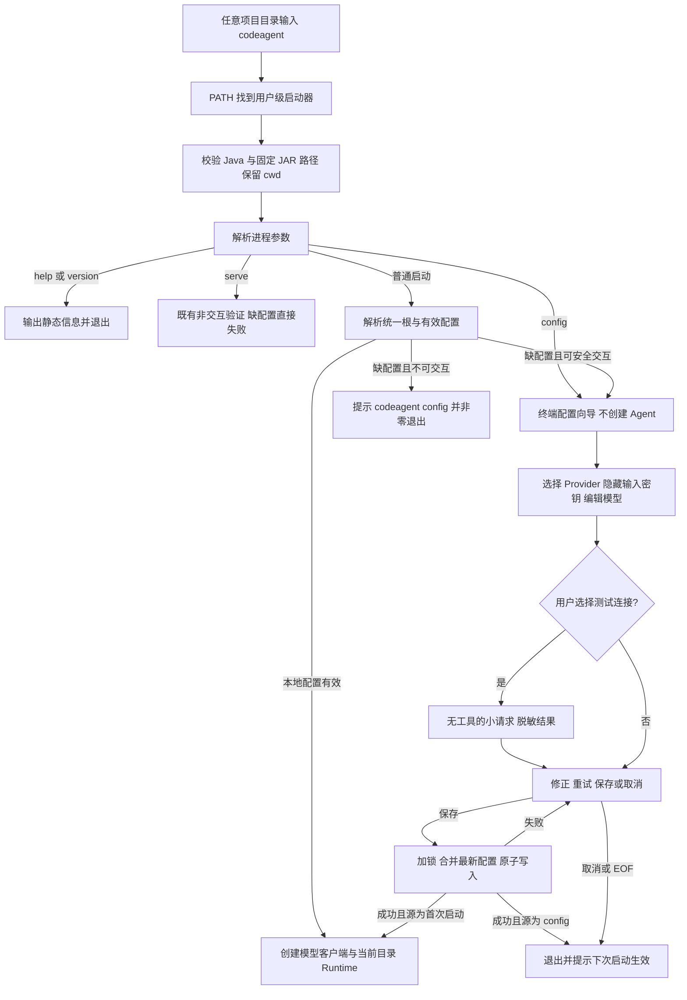
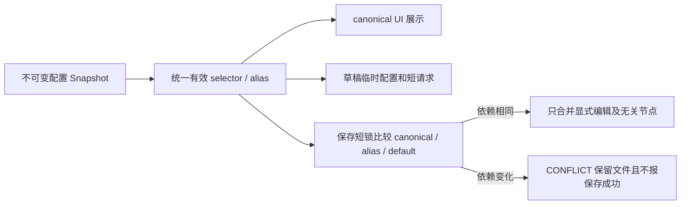

# 全局命令安装与首次模型配置

> 状态：用户已授权实施，按 T1–T6 推进；不安装到真实用户目录、不修改本机 PATH、不提交或发布。
> 基线：`origin/main` / `583b7ba`；分支：`feat/global-cli-onboarding`，以 `git switch --no-track -c` 创建，无 upstream。

## 1. 背景、目标与非目标

用户希望像使用其他 Agent CLI 一样，安装一次后在任意项目目录输入 `codeagent`，直接操作该目录。普通用户不下载源码和 `.env`，也不需要手工编辑环境文件；首次使用时应明确引导选择 Provider、填写密钥、验证并保存，之后跨目录复用。

### 1.1 目标与交付范围

1. 首期交付 Windows 用户级安装包，提供 `codeagent` 全局命令；不需要管理员权限。Windows PowerShell 与 cmd 都能调用，Windows Terminal 作为交互验收环境。
2. 分发 ZIP 只包含运行 JAR、安装/启动脚本、许可和使用说明；不含源码、任何 `.env*` 文件、开发者配置、真实密钥或历史记录，不额外附带 Qwen 等外部模型权重。既有 `langchain4j-embeddings-bge-small-zh-v15-q` 依赖内置的 BGE 资源保留在 JAR 中，不在本任务改造长期记忆模型依赖。Maven 只用于源码构建，最终用户仅需 Java 17+。
3. 启动器保留调用方当前目录和参数、终端输入输出与退出码；安装目录不是用户 workspace。两个不同目录启动的进程共享用户设置，保留已有各 workspace 隔离和互斥规则。
4. 无有效模型配置时，交互启动自动进入向导；已有有效本地配置时直接启动，不在每次启动时发送额外连接测试请求。
5. 提供不依赖 API Key 的 `codeagent config`、`codeagent --help`、`codeagent --version`。运行中的 `/config` 提供相同配置能力；密钥采用独立隐藏输入，不作为命令参数或普通消息。
6. 复用统一 `CodeAgentPaths` 与 `config.json`，保留用户已有配置；明确报告配置来源、保存失败和未验证状态。`.env` 保留给已有用户作为可选兼容入口，不要求普通用户创建或下载。

### 1.2 非目标

- 不增加新的 Agent 执行模式、工具、网络/路径授权、远程 Embedding 授权或 Runtime HTTP API 配置交互协议。
- 不在本任务实现 OAuth、账户登录、云端配置同步、系统凭据库、自动更新服务、Java 自动下载或 native image/JRE 捆绑。
- 不增加任意第三方 Provider 协议适配。首期向导覆盖工厂已支持的 8 家；可编辑地址的范围与实际客户端能力一致，不能把“自定义地址”宣传成已支持任意 Provider。
- 不删除已有 dotenv 读取能力，不暗改 JSON/环境优先级，不把项目配置复制到安装目录。
- 首期不承诺 macOS/Linux 全局安装体验；Java 核心继续保持可移植，后续可基于相同入口补 shell 启动器，不另造配置协议。

### 1.3 用户可观察的完成条件

```text
下载并解压 Windows 安装包
运行安装脚本一次
重新打开终端
cd D:\项目A
codeagent                 -> 首次配置后进入项目A
cd D:\项目B
codeagent                 -> 复用用户配置，进入项目B
codeagent config          -> 无有效密钥时也可以打开配置
```

## 2. 现状分析（源码证据、已知约束）

已读取 AGENTS、CODEAGENT、README、implementation/01、07，以及 43/44/45 号方案。以下是基线实际行为；第 3、4 节为拟实施设计，不代表已交付。

### 2.1 架构位置

| 证据文件/方法 | 当前行为与影响 |
|---|---|
| `pom.xml` 的 jar/shade 插件 | 产出含依赖的可运行 JAR，Main-Class 为 `com.codeagent.cli.Main`；尚无面向用户的安装包组装流程 |
| `scripts/` | 只有模型安装脚本 `install-qwen3-model.ps1`，没有全局命令启动器、PATH 安装或卸载入口 |
| `cli/Main.main` | 先 `CodeAgentPaths.initialize()`、日志和 `CodeAgentConfig.load()`，再 `createStartupClient()`；缺密钥时退出，之后才创建 Terminal/LineReader，因此目前无法先交互配置 |
| `Main.isRuntimeServeCommand` / `startRuntimeApiAndBlock` | 存在独立 `serve --http` 分支；缺密钥时失败，不应自动读终端或触发首次向导 |
| `Main.main` 的 workspace 初始化；`ToolRegistry.projectPath` | workspace 来自 `Path.of(".").toRealPath()`，工具默认根来自 `user.dir`；从其他目录用绝对 JAR 路径启动已经具备工作目录基础 |
| `config/CodeAgentPaths.root/initialize` | 系统根默认 `~/.codeagent`，仅整体 home 覆盖；最早设置日志/JVM/SQLite 临时路径，禁止在系统根内部作为 workspace 启动 |
| `config/ConfigurationValues.currentEnvironment/loadEnvironment` | 读取进程变量、当前项目 `.env` 和用户 `~/.env`；不读取 JAR 同目录的 `.env`，也不要求文件存在 |
| `config/CodeAgentConfig.load/getApiKey/getModel/getBaseUrl` | 从统一根下 `config.json` 加载；Provider JSON 显式字段优先于对应环境值；Provider 选择另由 `codeagent.provider` / `CODEAGENT_PROVIDER` 覆盖 JSON 默认项 |
| `CodeAgentConfig.save(Path)` | 直接将对象写入文件；IOException 仅打印，调用方收不到失败；当前忽略未知 JSON 字段的读取不能用来保证全量重写时保留未来字段 |
| `Main.handleConfigPalette`；`tui/config/TuiConfigPanel` | 目前主要是只读配置概览，未提供完整密钥向导 |
| `Main.handleConfigCommand/parseProviderConfigUpdate` | 已支持部分 `/config provider ... --api-key ...` 更新；命令进入普通输入和历史流程，不能作为新增密钥输入方式；`save()` 失败后仍可能显示“已保存” |
| `cli/CliCommandParser.parse` / `ExecutionControlPolicy` | `/config` 已分类为运行时修改；忙碌时应拒绝，不能绕过顶层 Execution 的控制边界 |
| `llm/LlmClientFactory.create/createFromConfig` | 只构造显式所选 Provider；支持 glm/deepseek/hunyuan/step/kimi/freellmapi/xfyun/agnes。GLM、DeepSeek 工厂分支不向客户端传递用户 baseUrl，不能在 UI 无差别展示可编辑地址 |
| `llm/AbstractOpenAiCompatibleClient.chatInternal/httpClient/retryPolicy` | 共用 HTTP、请求体、usage/retry 约定；默认整体 call timeout 为 600 秒，不能直接作为配置向导的短时探测契约 |
| `llm/LlmHttpException` | 已携带 HTTP 状态码，但类型和 accessor 是包可见；配置 UI 不应解析异常字符串推断鉴权失败或输出响应正文 |

主要源码入口：[Main](../../src/main/java/com/codeagent/cli/Main.java)、[CodeAgentPaths](../../src/main/java/com/codeagent/config/CodeAgentPaths.java)、[CodeAgentConfig](../../src/main/java/com/codeagent/config/CodeAgentConfig.java)、[ConfigurationValues](../../src/main/java/com/codeagent/config/ConfigurationValues.java)、[LlmClientFactory](../../src/main/java/com/codeagent/llm/LlmClientFactory.java)、[共同客户端](../../src/main/java/com/codeagent/llm/AbstractOpenAiCompatibleClient.java)、[TUI 配置面板](../../src/main/java/com/codeagent/tui/config/TuiConfigPanel.java)、[已有安装脚本](../../scripts/install-qwen3-model.ps1)、[构建配置](../../pom.xml)。

### 2.2 数据/状态模型

现有 `config.json` 主要包含 `defaultProvider`、`providers`、`embedding`、`autoIndex`、`webTools`。`providers.<name>` 已支持 `apiKey/baseUrl/model/loraId/temperature/maxTokens`。来自环境的派生字段不会自动保存，此契约继续保留。

本任务不增加配置文件种类，不引入认证数据库或自动保存长期记忆。模型设置和用户主动填写的密钥存于 `CodeAgentPaths.resolve("config.json")`；首期这是本机明文配置，必须按当前用户收紧访问权限，不能宣称已加密。未来凭据库可单独设计，当前不写无效的凭据引用字段。

向导只在内存维护草稿及其基础配置指纹。草稿不进入对话、JSONL、输入历史、Memory、AuditLog、日志异常或安装包；仅显式保存后写入用户设置。

### 2.3 核心时序与失败路径



需同时覆盖：JAR/Java 不存在、Java 版本不符、PATH 命令冲突、非交互输入、用户取消、凭证错误、网络超时、配置来源覆盖、配置损坏、写失败、并发更新和活跃任务期间修改。

## 3. 方案设计

### 3.1 接口与数据结构

#### 3.1.1 分发、安装和启动器

采用“用户级脚本安装 + 可运行 JAR”。相比只让用户手工加 PATH，这能提供可重复安装/升级；相比捆绑 JRE 或编译原生安装器，首期体积、构建和维护成本较低，但保留 Java 17+ 前置要求。

拟新增文件：

| 文件 | 职责 |
|---|---|
| `scripts/package-distribution.ps1` | 从当前 Maven 成功产物和 POM 版本组装 Windows ZIP；使用显式白名单，不打包整个仓库 |
| `scripts/install-codeagent.ps1` | 校验 Java/JAR、解析安装根、写入启动器与 JAR、幂等更新用户 PATH，提供 `-JarPath`、`-CodeAgentHome`、`-JavaHome`、`-NoPathUpdate` 参数 |
| `scripts/codeagent-install-common.ps1` | 安装根规范化、PATH 去重及可注入的读写适配，供安装器与隔离测试复用；禁止 `Invoke-Expression` |
| `scripts/codeagent.cmd.template` | 最小 Windows shim；用带引号的 Java/JAR 绝对路径执行，关闭 delayed expansion、按 cmd 规则转发参数，返回真实退出码 |

安装布局由统一根派生：`root/bin/codeagent.cmd`、`root/lib/codeagent.jar`、`root/config.json`。不增加模块独立系统目录配置。安装器 `-CodeAgentHome` 对应 Java 的整体根覆盖，解析顺序、空值遮蔽、`~/` 展开及 Windows 完整绝对路径校验须与 `CodeAgentPaths` 和既有模型安装脚本契约一致；测试共享根输入矩阵，不能各自猜测路径。

安装器只在安装/升级时解析上述根，并将已校验路径写入启动器。启动时从自身位置找到固定 JAR，不能根据当前项目中的同名 JAR 或脚本执行其他程序。运行时系统数据仍由 `CodeAgentPaths` 按当前配置解析；安装位置与以后显式设置的运行时数据根可以不同，启动器不私自注入 `-Dcodeagent.home` 固定运行数据根。

Java 选择：显式 `-JavaHome` 优先，其次有效 `JAVA_HOME`，再查找 PATH 中的 `java`；显式参数无效直接失败，自动候选低于 17 时继续下一个候选。均不可用时说明需安装 Java 17+ 或指定路径。将验证成功的 Java 可执行文件绝对路径写入 shim；不修改用户 JAVA_HOME，不自行下载 JDK。Java 后续被删除时提示重新安装/指定 Java，而不是悄悄换到旧版本。

PATH 只修改当前用户值，按 Windows 规范化和不区分大小写去重，保留其他条目及顺序；不使用有长度截断风险的 `setx PATH`，不写机器级 PATH，不改 PowerShell profile。发现其他来源的 `codeagent` 命令时报告冲突和解析路径，不覆盖其他程序。脚本子进程无法改变父终端环境，成功后明确提示重新打开终端；`-NoPathUpdate` 仅安装，供便携用法和隔离测试。

更新采用同目录 staging + 校验 + 替换：先验证下载/构建包的本地 SHA-256 一致性、ZIP 内容和 JAR Main-Class，再写目标。SHA-256 只证明与所给包清单一致，不宣称发行者签名认证。保存旧 JAR/shim 后替换，失败恢复旧文件；正在运行导致 JAR 被占用时保持旧安装并提示退出后重试。对安装根加独占文件锁，记录不含秘密的安装事务标记及旧资产清单，完成后删除标记；中断后下次安装须先按标记恢复旧资产，再重试，不能将半安装状态报成功。PATH 更新失败时恢复本次资产变更和原用户 PATH 值。任何递归清理前验证绝对目标在该根下；只删除安装器创建的 staging，不删除用户 config/history/models。

ZIP 内容固定为 `codeagent.jar`、安装脚本及其 helper/template、校验清单、项目维护者提供的许可文本、入门说明。无 `.env` 或 `.env.example`，不收集本机 `config.json`。当前基线根目录未发现 LICENSE 文件，正式分发前需维护者确定随包许可文本，打包脚本不能虚构许可或把缺项标成已通过；这是发布材料门槛，不阻碍本次方案交付。从仓库构建与从 ZIP 安装两条路径都提供示例，最终用户不需要 Maven、Git 或源码。

#### 3.1.2 启动参数与初始化顺序

新增 `cli/StartupCommandParser`，与会话内的 `CliCommandParser` 分开；只处理进程级入口。

| 输入 | 行为 | 无 API Key 时 |
|---|---|---|
| `codeagent` | 普通交互启动；本地模型配置缺失时向导 | 可配置后继续 |
| `codeagent config` | 独立配置流程，保存后退出 | 可用 |
| `codeagent --help` | 展示安装、运行、配置帮助，不包含敏感配置值 | 可用，不建 Runtime |
| `codeagent --version` | 从构建资源输出产品版本 | 可用，不建 Runtime |
| `codeagent serve --http ...` | 保留既有本机 API 行为 | 非零退出，不询问 |
| 未知子命令/参数 | 静态用法错误，退出码 2 | 不回退为 Agent 任务 |

首期不新增 `codeagent <自然语言任务>` 或 `--api-key`；已有脚本参数若涉及 serve，解析器须明确保留已支持的 `--http/--port`，不要误拒绝合法旧入口。

顺序为：先纯参数解析和 help/version；其余入口保留最早 `CodeAgentPaths.initialize()` 与日志初始化；交互入口再建立唯一 Terminal/LineReader、渲染器和配置服务；最后才能创建常规 LLM Client、MCP Manager、索引维护、Session、ExecutionHost。TUI 首次配置先复用终端向导，保存成功才进入 Lanterna；不在两种 UI 同时读 stdin。

配置入口在 `CodeAgentConfig.load()` 前先经 UserConfigStore 检查原始文件；损坏配置不能借助旧 load 的默认值回退被向导覆盖。本地检查只判断已支持 Provider、所需密钥非空、模型/地址格式，不把一次“客户端对象构造成功”当成服务可用证明。未知 Provider 可在交互向导明确修正；非交互仍失败，任何路径都不按其他家的密钥自动换 Provider。

进程退出约定：成功/显示帮助/显式 config 用户取消为 0；配置或安装失败为 1；参数错误为 2；首次启动未完成配置就 EOF/取消为 1；Ctrl+C 为 130。shim 不掩盖子进程结果。

#### 3.1.3 配置组件与领域对象

以下接口以契约测试约束。UI 依赖 config/llm，config 存储层不依赖 CLI、Renderer 或 Agent。

| 包/类型 | 接口与责任 |
|---|---|
| `config/ProviderDescriptor` | 不可变 `id/displayName/defaultModel/endpointPolicy/requiresKey/supportsLoraId`；描述信息由 LLM 工厂已有默认值统一提供，避免 UI 复制另一套默认模型列表 |
| `config/ResolvedProviderSettings` | 有效 Provider、模型、地址及每项 `SettingSource`；来源为 USER_CONFIG/PROCESS_ENV/PROJECT_ENV/USER_ENV/DEFAULT/JAVA_PROPERTY。密钥只显示“已配置/未配置、来源”，不显示前后缀 |
| `config/ProviderSettingsDraft` | 用户选择的 Provider、可选 model/baseUrl/loraId、`SecretUpdate`、`makeDefault`、基础文件指纹。密钥更新区分 KEEP/REPLACE；已有密钥按回车保留，首期不加入隐式清空操作；秘密对象不生成含值的 toString/equals 调试输出 |
| `config/UserConfigStore` | `readSnapshot()` 取得原始 ObjectNode 和 SHA-256；`saveProvider(draft)` 加锁重读、检测字段冲突、合并并原子写入，返回明确结果或抛出受控错误；错误不携带配置正文 |
| `config/ProviderConfigurationService` | 从现有解析规则读取来源、校验草稿、构造待验证的临时配置、提交草稿；只持久化用户主动修改的字段，环境密钥不得被全量展开回写 |
| `cli/ProviderSetupController` | 共享流程与状态机；通过抽象 UI 收集选择、隐藏密钥、重试/保存/取消；不持有 Agent 工具权限 |
| `cli/TerminalProviderSetupUi` | JLine 的非历史秘密输入与 Renderer 输出；无法关闭回显/禁止历史时拒绝读取密钥，给出真实终端启动说明 |
| `tui/config/TuiConfigPanel` | 同一服务与状态机的 Lanterna UI 适配，复用规则；保存后提示重启会话生效，避免当前任务/Session 隐式换模型 |

内置 Provider 选择器完整展示现有 8 家和工厂的有效默认模型；`LlmClientFactory.providerDescriptors()` 返回不可变描述列表，客户端默认值与描述统一来自 llm 包中的 ProviderCatalog，避免 UI 和实际请求各自维护默认值。GLM、DeepSeek 地址仅展示实际使用的内置地址，不保存当前不会生效的 baseUrl。其余允许地址覆盖的 Provider 显示对应字段；xfyun 保留 loraId。FreeLLMAPI 可配置其现有兼容地址/模型，仍按该客户端协议执行，不新增虚构的 `custom` Provider。

#### 3.1.4 用户流程与配置来源

向导顺序：选择服务商 → 查看默认模型/可选地址并编辑 → 隐藏填写/保留密钥 → 显示不含密钥的摘要 → “测试连接 / 保存但暂不测试 / 返回修改 / 取消”。普通用户无需理解变量名、JSON 或存储布局；保存后只显示“配置已保存，下次启动自动使用”。高级来源/路径信息放在配置详情中。

每次选择测试前显示 Provider、模型及目标主机，说明会发送一个短测试请求且可能产生少量调用费用。只有用户在当前向导中选择测试才发送；不自动把源码、项目路径、历史或对话发送给 Provider。网络错误可选择保存但暂不测试，显示“已保存，尚未验证”，不能显示“连接成功”。密钥或模型编辑后，原草稿测试成功状态失效。

保留现有优先级：Provider 选择仍为 Java/环境选择项覆盖 JSON 默认；Provider 字段仍是 JSON 显式值优先，再取既有环境来源；其他功能配置规则不变。保存时编辑用户层，不编辑项目/用户 `.env` 或进程变量。若当前 `CODEAGENT_PROVIDER` 覆盖新的默认选择，保存前明确说明“本次环境指定了另一服务商，修改默认设置不会覆盖它”；不显示已切换当前 Provider。

首次配置保存后重新按同一来源链解析有效配置，再决定能否进入 Runtime。若强制来源仍导致无效，不重复弹出同一向导形成无限循环；显示具体来源类型及可选配置入口后退出。测试临时配置仅按用户正在编辑的草稿构造，摘要明确是“测试这份配置”，不得用其他有效密钥回退掩盖失败。

#### 3.1.5 独立连接检查

`llm/ProviderConnectionChecker.check(config, options)` 通过 `LlmClientFactory` 和既有客户端请求构建发送无工具短 chat；CLI 不手写 HTTP。交互调用 `newCheck(config, options)` 取得一次性 `CheckSession`，在 worker 上 `execute()`，输入/关闭事件调用 `cancel()/close()` 直接取消已注册的 HTTP Call；取消标记同时覆盖 Call 注册竞态。返回不含原始异常/响应的 `ConnectionCheckResult`，状态为 OK、AUTH_FAILED、MODEL_OR_ENDPOINT_INVALID、RATE_LIMITED、NETWORK_ERROR、TLS_ERROR、TIMEOUT、CANCELED 或 UNKNOWN_ERROR。

为此在 llm 层增加不可变 `LlmClientOptions`：普通 `DEFAULT` 保持现有 transport/retry；`CONFIGURATION_CHECK` 使用实例级 connect timeout 5 秒、整体 call timeout 15 秒、maxAttempts=1、禁止跨主机重定向。工厂增加显式 options 重载，已有构造器委托默认选项；所有 Provider 通过同一父类消费，不能修改共享 SHARED_HTTP_CLIENT 或临时改 JVM 全局属性。测试客户端输出限制目标为 16 token；Provider 对输出参数、reasoning 的差异由原客户端适配，若某家不支持该限制，必须在该家契约测试中明确策略后才开放探测，不能猜测支持。

请求固定为简短测试消息，不带 tools、images 或项目内容，UI 不展示模型原文。成功条件为一次合法 chat 响应，不要求模型准确返回某个单词。连接测试仅证明当时该地址/模型可调用，不证明工具调用、多模态或全部权限可用。

配置检查使用 one-shot request body，禁止 OkHttp 在 503/Retry-After 等 transport follow-up 中悄悄重发；仅检查模式校验 SSE chat 的字段类型和合法终止原因，不能用普通兼容解析的 `asText` 将数字正文或未知终止标记当作成功。普通客户端的请求与解析策略保持原行为。Provider metadata 通过不可变 `modelEndpointPrefixes` 和 `endpointForModel` 表达 GLM vision/coding 的既有地址差异，确认目标使用所选模型的实际地址。

HTTP 分类在 llm 包内基于 LlmHttpException 状态码及类型完成：401/403 不笼统断言密钥必错，提示“凭证或访问权限失败”；404 提示模型/地址需检查；429 提示限流或额度；其他状态给脱敏静态说明。不输出响应 body、请求 header、完整 endpoint query 或异常 message，不用错误文本判定具体余额。带凭据的 URL、userinfo、fragment/query 一律拒绝；远端要求 HTTPS，明确的 localhost/loopback 本地服务允许 HTTP。目标地址就是当前用户明确选择的配置地址，重定向不得把凭据带到另一主机。

### 3.2 策略、安全、并发与恢复

#### 3.2.1 密钥输入和历史边界

- 复用 CLI 唯一输入所有者；秘密读取时关闭自动历史、普通输入回显、补全和事件展开。密钥不能通过 `/config ... --api-key` 或进程 `--api-key` 传入；旧密钥参数入口改为静态错误并提示使用配置向导，参数原文不回显。
- 除了拒绝解析，还须在普通提交回显和 JLine 自动历史保存之前识别旧密钥参数；不能在它已经进入 input.history 后才拒绝。历史只允许保留脱敏命令类别，既有含敏感参数的旧记录不自动改写/导出。
- 上述边界覆盖程序自身的输入历史与回显；用户在外部 shell 手工输入错误的 `codeagent --api-key ...` 时，shell 可能先于程序保存历史，程序不能声称能清理外部 shell 历史。正式帮助不展示这种用法，只引导隐藏输入。
- `/config` 只是一条静态命令，向导字段不形成 user/tool 消息、不写 raw session、不进入 Memory、审计参数或模型 context。秘密控件用完尽力清理 char[]；Java/HTTP 必要字符串不能保证内存零残留，文档不声称可完全擦除。
- TUI 使用隐藏输入组件且不写对话面板；无法安全输入时提示使用独立 `codeagent config`，不降级成普通文本输入密钥。
- 项目源码和配置包样例只使用合成密钥夹具；测试捕获 stdout/stderr、日志、raw ledger 与输入历史，断言夹具值没有泄露。

#### 3.2.2 保存、锁和失败恢复

`UserConfigStore` 是新增交互更新的统一入口；旧 `/config provider` 非密钥更新、TUI 写入与 `/model` 的默认 Provider 保存也迁移到该存储边界，避免一条路径使用旧 save 吞错/整文件覆盖。其他调用逐项检索，不悄悄把所有失败行为改成假成功；`CodeAgentConfig.save()` 兼容接口可委托同一存储并显式传播失败，由现有调用方处理。

保存时只持有 config 根下锁文件的 FileChannel 锁，非阻塞 tryLock，冲突即提示稍后重试。锁内重读 JSON，检测目标 Provider 和 defaultProvider 自草稿基线后的变化；目标冲突要求重新加载，其他 Provider/其他设置的并发更新以最新文件合并保留。用原始 JSON 节点 patch，保留未知字段和未编辑字段；损坏 JSON 不回退空配置覆盖，先报告并保留原文件。

基线必须在选择 Provider 后、采集字段前取得；展示通过 `resolve(snapshot, provider)` 读取同一不可变快照。不能等用户采集完成后才读取新基线，否则采集期间其他进程的更新会被静默覆盖。

用同目录唯一临时文件写入并设置文件权限，完整 flush/force 后 atomic replace；不支持原子替换时失败并保留旧文件，不靠“删旧文件再重命名”模拟成功。Windows 使用当前用户限制 ACL、POSIX 使用 owner read/write；权限无法收紧则拒绝保存密钥。锁文件/临时文件必须位于实际配置根，不能跟随符号链接逃出根；失败清理仅本次临时文件。

锁顺序：会话内 `/config` 先经过现有 busy/pending 检查，空闲才进入向导；采集和网络测试阶段不占 config 文件锁；提交阶段短暂取得 config 锁，不在持锁区等待用户、网络或 Session/Workspace lease。独立 `codeagent config` 不取得 workspace execution lease，也不创建 Runtime；另一个进程的现有模型实例不被热改。

运行中 `/config` 保存成功仅更新未来启动配置，清楚提示重启生效；保持当前客户端和上下文，避免跨多个 Session 的半更新。新启动进程读取已提交配置；当前进程退出重启后生效。TUI 同样遵守，不利用 UI 对话框绕过忙碌/审批门。

#### 3.2.3 取消、非交互与错误

- Ctrl+C/EOF/取消关闭草稿和探测请求，不覆盖旧配置，不创建 Session、Execution 或 MCP/索引后台服务。
- 仅向导有可控终端/密钥隐藏输入能力时自动进入；检测不得仅依赖 `System.console()!=null`，需兼容现有 JLine PTY，具体能力通过 UI adapter 探测和测试注入表达。
- 管道/重定向或 serve 缺配置时立即失败，提示在交互终端执行 `codeagent config`；不等待 stdin，不自动选默认项，不把管道正文当成密钥。
- 无有效终端的静态帮助、版本和错误用独立入口输出；主交互输出仍走 Renderer.stream，不能在 Agent 中新增裸打印。
- 配置读取失败、磁盘只读、ACL 不支持、并发写入冲突、探测超时均有不同的静态提示，任何失败都不能显示“已保存/已连接”。

### 3.3 兼容性、迁移与回滚

1. 继续支持 `java -jar ...`；它与全局命令使用同一进程参数解析器。`serve --http --port`、默认 inline、显式 Lanterna/plain 和已有用户级配置路径不变。“任意目录”指正常用户 workspace，保留 CodeAgentPaths 禁止在系统数据根内部作为 workspace 启动的现有保护，不承诺将安装/数据根当作任务项目。
2. 不要求移走原 `.env` 或自动导入环境密钥。已配好的环境用户可直接运行；配置界面显示来源，只有用户主动替换的密钥才写入 JSON。
3. `/config` 从只读概览扩展为可编辑入口，保留其他只读信息及现有 embedding 配置子命令；`/config provider` 的非秘密字段更新保持支持。旧 `--api-key` 参数入口退出并提示隐藏输入，这是有意的安全兼容性变化，必须同步帮助、README 与测试。
4. 配置不增加 schema version，既有 Provider 字段保持兼容；原始节点 patch 保留未知项。不通过老 CodeAgentConfig 的未知字段丢弃行为对未来配置做降级覆盖。
5. 首期密钥为受文件权限保护的明文，升级不修改用户值。回滚程序可继续读取现有 JSON；卸载全局命令仅删除拥有清单中的 shim/JAR 和对应 PATH 项，保留 config、会话、模型和其他用户数据，不做根目录递归删除。首期提供手动卸载说明，自动卸载器不列入必须交付。
6. 不自动改系统级 PATH、PowerShell profile 或 Java 安装；安装脚本被组织执行策略拒绝时展示可审查的本地安装说明，不修改永久执行策略或下载后直接管道执行远程代码。

## 4. 实现任务与测试矩阵

本文件合并设计、实现顺序、测试、实施证据和验收；后续只更新此文件，不另建计划。用户已授权按表实施；实际进度与验证证据见第 5.3 节。

| 顺序/依赖 | 文件落点和先写的测试 | 红灯与实施内容 | 可观察的通过条件 |
|---|---|---|---|
| T1 无依赖 | 新增 `config/UserConfigStoreTest`、`ProviderConfigurationServiceTest`；修改 `CodeAgentConfig/CodeAgentProviderConfigTest` | 先复现 save 吞错、损坏 JSON 覆盖、并发丢字段；实现来源模型、草稿、锁、权限、原子 patch 和明确错误；补旧配置读取回归 | 磁盘/权限/冲突失败不变更旧文件；并发改另一 Provider 和未知字段不丢失；环境夹具密钥不自动写入；所有根/临时夹具隔离 |
| T2 T1 | 新增 `cli/StartupCommandParserTest`、`StartupOnboardingTest`；修改 Main、`MainConfigBootstrapTest`、`MainDataDirectoryStartupTest` | 先验证无密钥也能解析 config/help/version、未知参数拒绝、普通交互进入向导而非退出、非交互不读 stdin；接入统一入口和终端生命周期 | 配置入口不创建 LLM/MCP/索引/Session；正常启动只在配置有效后建 Runtime；serve 原失败语义保留；取消/EOF 有确定退出码 |
| T3 T1 | 新增 `llm/ProviderConnectionCheckerTest`、`LlmClientOptionsTest`；修改工厂、共同父类和各 Provider 构造重载 | 用 MockWebServer/可注入客户端先写 401/403/404/429/timeout/redirect/返回非 chat 的失败测试；实现实例级短时探测，不改变普通调用默认参数 | 请求无工具/无项目正文，单次尝试，总体限时可取消；跨主机不转发凭证；typed 错误分类不泄露原文；原 provider/retry/usage 契约仍通过 |
| T4 T1–T3 | 新增 `cli/ProviderSetupControllerTest`、`SecretInputHistoryTest`、`tui/ProviderConfigurationPanelTest`；修改 Main/Completer/Parser、TUI panel/controller 和既有配置测试 | 先写密钥不入历史/回显/ledger、旧参数拒绝、来源覆盖提示、草稿修改使验证失效、忙碌/pending 不进入流程；实现共享向导、两种 UI 和 restart-only 保存语义 | 首次用户无 .env 完成选择/隐藏输入/测试/保存；/config 可重配但不隐式换当前客户端；日志及持久化会话无合成秘密；配置失败不报成功 |
| T5 T2 | 新增 `cli/GlobalLauncherInstallationTest` 与共享原生 `launcher/install-smoke.ps1`；新增 4 个分发/安装脚本文件 | 先用临时用户根与 Java fixture JAR 验证不存在的全局安装能力；实现白名单 ZIP、根解析、Java 检查、幂等 PATH 适配和 cwd 保持 | 在两个不同临时目录通过 PATH 调用同一 shim，fixture 记录各自 cwd、带空格参数与真实非零退出码；Java 8/缺 JAR 失败；安装失败恢复旧版本，用户配置 hash 不变 |
| T6 T1–T5 | 新增 `cli/DistributionContentTest`；同步 README、implementation/01/07/09 和本文件；检查 AGENTS 命令/路径边界是否需最小同步 | 先检查 ZIP 不能包含源码/.env*/密钥/历史，复验单 ZIP 离线安装路径；执行完整针对性和回归、构建、内容审计及真实终端演练 | 源码用户与下载包用户的步骤独立清楚；无 .env 下载要求；命令帮助/补全和行为一致；实际结果与未测平台逐项记录 |

### 4.1 安装和 UI 验证细则

- 安装脚本测试用 `-CodeAgentHome <TempDir>` 和真实测试 JVM 的 JavaHome，PATH 持久化经 helper 的可注入读写 adapter 验证；不写真实注册表/UserProfile/真实 PATH。专门的真实 PATH 手测只在之后用户授权的临时测试账号/可还原环境执行，记录旧值并只移除本次新增条目。
- fixture JAR 在临时目录编译/组装，只记录 cwd/普通参数/退出码；从不启动真实 Provider 或使用开发者密钥。检查跨盘、中文、空格、`&`、括号路径和调用方正常引号参数；百分号/感叹号等 cmd 特殊字符必须有边界测试，不能用 shell 字符串拼接假装支持。
- 安装测试覆盖已有同名其他命令、重复安装 PATH 不重复、已有配置权限保留、父终端不受脚本子进程环境更新、JAR 锁定升级失败、根越界/链接拒绝。
- 向导输入和 Ctrl+C/EOF 使用可注入 UI 单测；真实 PTY 验证密钥隐藏、历史跳过与 Windows Terminal 的启动体验，截图仅是显示证据，合成秘密扫描才是泄露断言。
- 网络测试仅 MockWebServer 或可控 fake；真实 Provider 测试显式 opt-in，不使用会话/项目正文。尚未验证的 Provider 输出限制与错误映射在开放该项连接测试前必须有契约测试，无法证明则显示“该 Provider 暂不支持连接测试”，允许本地校验后保存，不能假成功。

### 4.2 计划执行命令（实现后）

以下命令是未来验收入口，不是本次执行记录；测试使用 Java 17+，恢复所有修改的系统属性。

```powershell
mvn test -DskipTests=false "-Dtest=UserConfigStoreTest,ProviderConfigurationServiceTest,CodeAgentProviderConfigTest,ConfigurationValuesTest,DotEnvConfigurationIntegrationTest,UnifiedDataDirectoryTest"
mvn test -DskipTests=false "-Dtest=StartupCommandParserTest,StartupOnboardingTest,MainConfigBootstrapTest,MainDataDirectoryStartupTest,ProviderSetupControllerTest,SecretInputHistoryTest,ProviderConfigurationPanelTest,CliCommandParserTest,CodeAgentCompleterTest"
mvn test -DskipTests=false "-Dtest=ProviderConnectionCheckerTest,LlmClientOptionsTest,LlmClientFactoryTest,LlmRetryPolicyTest,ProviderBenchmarkCompatibilityTest"
mvn clean package
powershell -NoProfile -File scripts/package-distribution.ps1
mvn test -DskipTests=false "-Dtest=GlobalLauncherInstallationTest,DistributionContentTest"
mvn test -Pquick
mvn test -Pphase16-smoke
git diff --check
```

脚本打包前必须确认目标 JAR 由当前源码构建成功；安装测试和 ZIP 内容测试在打包产物存在后执行。若实际仓库测试类型名称与上表不同，实现时在本文件同步精确命令，不能用 surefire 忽略无匹配测试来伪造成功。全量 `mvn test -DskipTests=false` 是否追加由实际公共 config/LLM 改动范围和回归结果决定；不把 quick 排除/live 跳过计为通过。

### 4.3 设计自审与实施门槛

- 边界：安装器只处理发行资产和用户 PATH；配置层只处理用户设置；UI 不拼 HTTP；LLM 不依赖 Renderer；Agent/Tool/Policy 的执行授权保持原链。
- 数据流：密钥只从隐藏输入或既有受信配置进入内存草稿/用户设置/明确选择的 Provider 请求，普通任务与历史没有接收通道。
- 并发：先收集和测试，再短锁重读/合并保存；不占 config 锁等网络，也不把运行时修改插入 Execution。
- 兼容性：保留来源顺序、统一根、8 家工厂及旧 JSON；删除命令行密钥输入是唯一明确的破坏性命令变化；Java/JAR 启动方式可继续使用。
- 待核实实现条件及门槛：① Windows 文件 ACL/原子替换及 JAR 占用行为以隔离进程测试证明，无法限制密钥文件访问则拒绝保存；② JLine masked input 的 history 时序以夹具证明，无法保证时不得上线向导；③ 各 Provider 的最小探测参数以现有请求构建契约证明，未验证者不提供在线探测；④ cmd 特殊字符和 PATH 冲突以真实 shim 子进程证明，未满足者不宣称全局启动器可发布。
- 这些是实施前后必须验证的外部/库行为，当前不写成既定成功事实。实现按 T1→T2/T3→T4→T5→T6 顺序推进；每个边界先红灯再最小实现，发现失败先回到设计对应章节修订。

## 5. 验收清单

### 5.1 本次方案交付

- [x] 从已 fetch 的 `origin/main` 创建不继承 upstream 的功能分支；未创建 worktree。
- [x] 明确用户目标、首期平台、非目标、基线证据、模块边界、数据结构、初始化/状态时序和失败路径。
- [x] 明确安装布局、PATH/Java/cwd、配置来源、秘密输入、存储权限、并发锁、恢复、兼容和回滚。
- [x] 将有依赖顺序的实施任务、预期文件、先写测试、验证命令和通过条件合并在本文件。
- [x] 完成文档 diff、格式与引用自检，记录真实结果；未实施的功能不标记完成。

### 5.2 实现验收

- [x] 单个 Windows ZIP 白名单检查通过，不含源码、`.env*`、真实配置或密钥，下载用户不依赖 Maven/Git；使用测试许可验证，正式发行仍须维护者提供 LICENSE。
- [x] 隔离用户级安装后，子终端可从两个目录经 PATH 输入同一 `codeagent` 命令，workspace 分别等于调用目录；启动器不 cd，不吞参数/退出码；未修改真实用户 PATH。
- [x] 全新用户不准备 `.env` 就能完成首次配置；密钥缺失时仍能运行 config/help/version，非交互不挂起。
- [x] 所有支持 Provider 的默认模型和可编辑字段与工厂实际能力一致；无未经实现的 custom Provider 宣传。
- [x] 隐藏输入、命令拒绝、历史/账本边界与静态错误回归通过；真实 PTY 假密钥只出现在隔离 config.json；未收紧文件权限时拒绝保存。
- [x] 显式连接测试有限时、可取消、无工具/项目数据；失败和未测试均不显示连接成功，不切其他 Provider；使用本地 HTTP 夹具，未调用真实账号。
- [x] 保存失败/损坏文件/并发冲突保留原文件；未编辑字段、未知字段和其他 Provider 更新不丢失。
- [x] `/config` 在忙碌/pending 时拒绝，保存只影响未来启动；现有 serve、Provider 选择、JSON/环境优先级和统一根回归通过。
- [x] 升级失败恢复、用户配置保留、PATH 幂等/冲突/失败路径通过原生隔离测试与 adapter 注入验证；未执行真实用户卸载。
- [x] 针对性测试、quick、终端 smoke、构建/ZIP 检查和全量回归有真实证据，跳过与未验证平台明确列出；正式许可仍为发行门槛。

### 5.3 本次实施记录

#### 最终审查修复设计（P1 / P2）

- 目标：旧密钥参数在 parser 接受的任意前导横杠/引号形式下，提交显示、普通脱敏、历史与 TUI 都在解析前整条保护；canonical Provider 选择应展示与短请求完全相同的 alias-only 配置，保存必须拒绝实际 alias 依赖在采集/验证后的并发变化。
- 复审补充：空白判断与 `Main.splitArgs` 的 `Character.isWhitespace` 对齐，使用 `\p{javaWhitespace}`，覆盖 U+2003/U+1680/U+001C 前后分隔符；不以默认 ASCII `\s` 或 Unicode White_Space 替代。新增全通道用例先运行 5 项中 1 失败，确认原规则漏口；旧局部脱敏断言同步更新为整条静态隐藏。
- 源码证据：`SecretCommandGuard.CONFIG` 原只接受最多两个横杠，而 `Main.normalizeConfigKey` 循环移除全部横杠；`Main.redactSensitiveInput` 原局部替换会残留多词值。`ProviderConfigurationService.resolveSnapshot` 原先覆盖 selector，`temporaryConfig` 却保留同 Provider alias；`UserConfigStore.saveProvider` 原只比较 canonical 节点和默认选择。
- 设计与边界：前置 guard 保留既有引号归一化和 multiline 匹配，横杠改为任意数量，普通脱敏入口复用整条静态遮罩。配置服务集中计算有效 selector（Java 属性→环境→JSON 默认），显式 canonical 选择在同 Provider 时保留其 alias；展示、临时探测和保存使用同一不可变 snapshot 与规则。保存已有短锁内除 canonical/default 外保守比较该 configured alias 的整个 JSON 节点，alias 不属于无关 Provider；不复制、删除 alias 密钥或展开环境密钥写回，不在锁中调用网络/UI。
- 兼容/失败/回滚：维持 canonical 优先和已选 alias 的原 fallback、默认 selector 与未编辑字段；不同 Provider/未知字段仍差量合并。依赖变化抛出既有 `CONFLICT`，保留磁盘并阻止 controller 报保存/验证成功；无 schema 或迁移，回滚只撤回相应 guard/selector/冲突比较改动。
- 任务/验收矩阵：先补 `SecretInputHistoryTest` 横杠/quoted/multiline 全通道回归；补 `ProviderConfigurationServiceTest` canonical 来源、`UserConfigStoreTest` alias 各字段冲突、`ProviderSetupControllerTest` 展示/探测/保存一致及验证后冲突；红灯后分别最小实现并运行对应测试，再运行 config/CLI/TUI 针对性回归。可观察条件为整条静态遮罩、历史零条、TUI mask、静态 parser 拒绝、来源一致、冲突不改文件、无关节点仍可合并。最终 quick/full/build 与 PTY 由主任务验证，本修复任务不重复执行。



- 首轮红灯：Java 17 下 `mvn test -DskipTests=false "-Dtest=SecretInputHistoryTest,ProviderConfigurationServiceTest,UserConfigStoreTest,ProviderSetupControllerTest"` 实际运行 34 项，5 failures、0 errors、1 symlink 条件跳过，失败均对应上述保护/展示/冲突缺口。
- 首轮修复后 config/CLI/TUI 41 项、0 失败、1 symlink 条件跳过；Unicode 补充后执行 `mvn test -DskipTests=false "-Dtest=SecretInputHistoryTest,CliCommandParserTest,ProviderConfigurationServiceTest,UserConfigStoreTest,ProviderSetupControllerTest,ProviderConfigurationPanelTest"`，96 项、0 失败、1 条件跳过。两项最终独立复审结论为 Approved，无未解决的 Important。

实施进度（上下文恢复以本节为准）：

- T1：实现与独立复审通过。修复别名草稿测试/保存目标不一致，补严格 URL 校验；新增 GLM 模型相关地址 metadata 也已复审。跨任务关注项：旧配置中的非法地址在 UI 展示、KEEP 与有效性判定前仍必须校验。
- T2/T4：实现与任务级独立复审通过，启动参数、唯一终端生命周期、共享向导、终端/TUI 与秘密输入合并接线；13 类最终针对性测试 118 项、0 失败、0 跳过。整分支审查发现的额外边界修复与最终验证见下文。
- T3：实现与独立复审通过。LLM + config 针对性回归 105 项、0 失败、1 symlink 权限条件跳过；评审补 one-shot/畸形响应的语义红灯（15 项中 2 失败）后，修复回归 47 项全部通过。每次检查独立可取消会话，取消直接作用于 HTTP Call。
- T5：安装器、启动器、原生隔离测试实现与独立复审通过；新增 JUnit 入口曾运行通过，最终代码随集成再验证。原生测试使用 standalone PowerShell，不与其他任务的 Maven 执行竞争。
- T6：README、`.env.example` 与 implementation/01/07/09 已同步；整体回归、真实 JAR/PTY、许可门槛检查与整分支审查修复复验通过，正式发行许可仍待维护者提供。
- 授权边界：实施验收时按要求保留未提交；用户随后明确要求“分批次详细提交当前修改”，本轮据此仅执行本地分批提交。正式分发所需许可文本尚待维护者提供，不替用户选许可证。
- T5 首轮：先运行 `powershell -NoProfile -ExecutionPolicy Bypass -File src/test/resources/launcher/install-smoke.ps1 -Repository <repo> -JavaHome <jdk17>`，因安装入口尚不存在失败；实现后同命令通过。覆盖重复安装、配置保持、两个目录经 PATH 启动、空格/中文/特殊路径、参数/退出码、无效 JAR、JAR 占用升级恢复及真实 PATH 不变。发现 PowerShell/.NET Replace 的 null backup 路径绑定问题，改为安装 staging 内明确 backup 路径后复验通过。
- T5/T6 扩展：同命令加 `-CheckPackage` 通过。新增缺失 JAR、模拟 Java 8、无效显式 JavaHome、同名命令、非法根与父目录 junction 拒绝；PATH 读写 adapter 的并发冲突/写失败通过注入验证，真实用户 PATH 保持不变。ZIP 使用合成许可夹具，精确白名单 7 项，解压后独立安装及启动通过；这不是正式发行包。
- T1 评审修复先有 7 项中 2 失败（alias 保存仍为旧密钥、未测试即保存非法 URL），修复后全部通过。随后 config + launcher wrappers 33 项、0 失败、1 条件跳过；T3 最终正常 Maven 编译回归也覆盖 4 个 config 契约类。
- T5 评审修复：复现 journal 前/提交后的 orphan staging 导致重试永久失败；仅在完整验证已知平面安装资产后清理无 journal staging，未知用户文件保持。对齐 dotenv 键大小写、重复/空值及 C1 控制字符语义；补完整资产校验和与模板损坏拒绝。最新原生 `-CheckPackage` 通过，并验证 JAR 内 `.env` 也拒绝分发、内容验证失败保留旧 ZIP。
- T5 复审修复：journal 先写 staging 下 `transaction.pending`，FileStream 完整写入、`Flush(true)`、关闭后同卷 Move 原子发布，再修改目标资产。部分 pending 夹具先红后绿；完整原生测试退出 0。旧的/外部损坏的 active journal 保留并明确失败，不猜测恢复，需人工核对。
- T5 补充：同一 shim 从 C 盘安装根到 D 盘临时 workspace 启动通过。dotenv BOM 用例先复现与 Java 的 UTF-8 Reader 不一致，再关闭 StreamReader 的 BOM 自动检测，对齐首行处理；完整原生 `-CheckPackage` 退出 0。清理跨盘夹具只处理已核验的 `target/launcher-workspace-<UUID>` 与预期 `probe.txt`。
- 2026-10-17 继续实施：上轮 T2/T4 子任务因执行额度中断，未留下完成报告；以工作树和上述进度为准接续，不重做已通过的 T1/T3/T5，不把未完成 UI 或尚未执行的整体回归标记通过。
- 秘密格式补充：含控制字符/非 ASCII 的密钥可能使 HTTP header 构建抛出含原值的异常。新增共享 `ApiKeyValidation.isHeaderSafe`，秘密替换、有效配置和客户端工厂在此之前以静态错误拒绝；普通合法密钥不变。先复现 24 项中 2 失败，修复后 config/factory/store/checker 48 项、0 失败、1 symlink 条件跳过。`.env.example` 同步明确其可选性与不随发行包/JAR 发布。
- T2/T4 中间结果：Main/parser/bootstrap、非交互不读 stdin、基线并发冲突、model/embedding 保存失败回滚、秘密读取恢复、真实 HTTP Call 取消和 TUI 空闲门/未来启动保存语义的 13 类针对性测试合计 112 项、0 失败；TUI 晚到成功覆盖取消的回归补充后，相关 13 项通过。仍待最终集成轮及评审，不以这些中间结果代替最终交付验证。
- 分发基线纠正：检查 POM 的 BGE 依赖与现有 shaded JAR，确认原本已包含 `bge-small-zh-v1.5-q.onnx`。第 1.1 节原“不含模型权重”过于笼统，改为不额外分发外部 Qwen 权重、保留既有 JAR 依赖；没有为了缩小安装包删除现有长期记忆能力。

#### 集成验证与交付边界

- Java 使用 `C:\Program Files\Java\jdk-17`，通过子进程 `JAVA_HOME`/PATH 指定，未修改系统 Java。`mvn test -Pquick` 已运行 1550 项、0 失败、20 跳过；随后新增的审查回归由最终 full 覆盖。
- 最终修复后的 `mvn test -DskipTests=false`：1631 项、0 failures、0 errors、26 skipped，BUILD SUCCESS；`mvn test -Pphase16-smoke`：106 项、0 failures、0 errors、0 skipped，BUILD SUCCESS。跳过项保留 Maven 的条件限制，不将其计为已执行通过。
- 最终 `mvn clean package`：BUILD SUCCESS（41 秒），重新生成 `target/codeagent-1.0-SNAPSHOT.jar`；构建本身跳过测试，上述独立 full/smoke 才是测试通过证据。`git diff --check` 通过，全部 70 个变更文件 UTF-8/无 BOM/无替换字符检查通过。
- 使用临时测试脚本对实际 shaded JAR 验证两个目录的 help/version、参数错误、重定向 config/正常启动/serve 缺配置及时退出，静态命令不创建系统根、配置入口不启动 Runtime。实际 JAR 打成白名单 ZIP（仅合成测试许可），解压、独立安装后在两个子终端经 PATH 启动通过，真实用户 PATH 保持不变。
- Windows 原生 PTY 设置 `TERM=xterm-256color`，实际 `java -jar ... config` 选择 Step、本地地址与假密钥，输入只显示星号；保存提示“未验证”，假密钥仅存在隔离 config.json，未创建 Runtime 历史；再次进入向导输入 0，退出码 0。工具环境默认 `TERM=dumb` 时按设计拒绝隐藏输入，不绕过该限制。
- 默认打包在缺少维护者 LICENSE 时退出 1，包含明确的许可缺失说明；未生成正式发行 ZIP、未替项目选许可证。测试许可和解压安装夹具均在临时目录使用并清理。
- 未验证真实 Provider 账号连通性与全部外部模型参数能力；网络测试使用本地 HTTP 夹具。Lanterna 经过自动化 smoke、秘密控件、取消和忙碌门测试，未声称完成视觉人工验收。首期全局安装仍仅支持 Windows，Java 17+ 由用户安装。
- 实施验收时保留 `feat/global-cli-onboarding` 的未提交工作树；后续用户授权本地提交，按配置基础、LLM 连接检查、CLI/TUI 向导、Windows 安装分发、文档五批提交，每批说明目标、行为、边界与验证证据。分支无 upstream，未 push、PR 或合并，未向真实用户系统根安装或变更其 PATH。
- 提交阶段未修改产品代码，复核既有 full/smoke/build 日志与每批 staged diff；前四批为 `108f98d`、`e5983a6`、`fd3e35e`、`f081723`。验证结果针对最终联合实现，不将其声称为各中间提交的隔离检出验证。

方案阶段历史记录（2026-10-16，获得实施授权前）：当时只完成源码/文档勘探、分支创建与本方案编写，没有修改产品实现、运行安装器、写入用户配置/环境、发送连接测试请求、执行 Maven 验证或提交/推送。后续实施与验证以上方记录为准。

方案阶段文档验证：当时 `git diff --check` 无错误；新方案另通过 UTF-8 静态检查，5 个必需章节、Mermaid/代码围栏配对、9 个本地源码引用、行尾空白及占位符检查均通过。当时 `git status --short --branch` 确认唯一变更为本文件，分支 `feat/global-cli-onboarding` 无 upstream；该阶段未运行 Maven，未将其作为验证证据。
