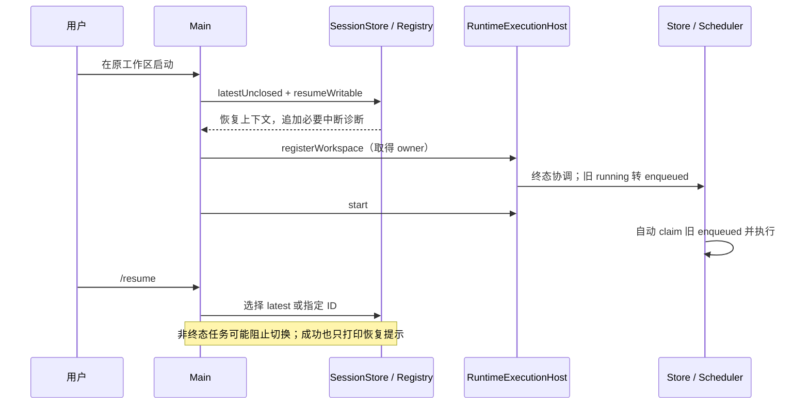
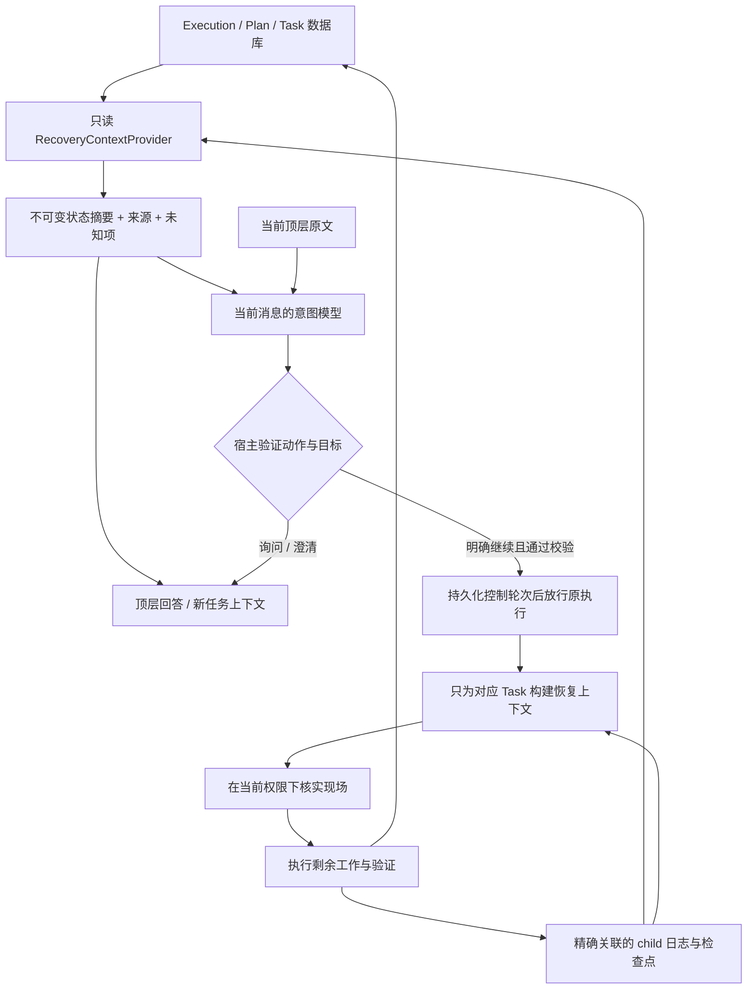
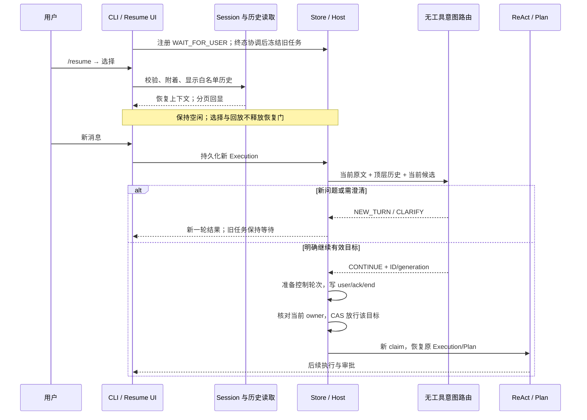
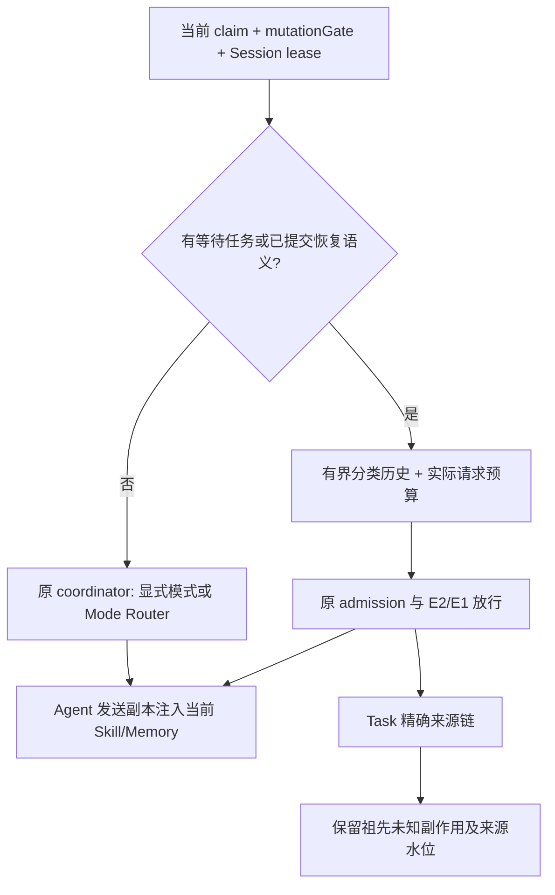

# 会话选择、历史回显与用户驱动的任务继续

当前状态：原设计已在 `feat/session-resume-continuation` 实施；第 1.1 节中的“仅设计”是最初任务的历史范围。当前交付与审查修复以本文末尾实施记录为准。

## 1. 背景、目标与非目标

### 1.1 需求与本次交付范围

用户期望：输入 `/resume` 后先选择历史会话，选择后能够查看该会话的历史对话；Plan 和 ReAct 的顶层对话统一展示。进入会话本身不执行旧任务，用户发送新消息后才进入新一轮交互；是否继续原任务由 LLM 根据当前输入和历史理解，运行时负责验证目标、状态和执行边界。

本次仅创建分支并编写、按后续讨论补充同一份方案，写完即停止；不修改产品实现、数据库、提示词或现有使用文档，不运行安装/迁移，不提交或推送。下文所有新增类型、字段、命令语义和流程均为拟议修改，不是已交付能力。

基线：2026-10-17 fetch 后的 `origin/main` / `1db3c79`（合并全局安装与首次配置功能）；工作分支 `docs/session-resume-design`，从远端主分支以 `--no-track` 创建，初始工作树干净，无 upstream。现有开发文档最大编号为 46，本任务使用 47，设计、实施任务和验收统一保存在本文件。

### 1.2 目标

1. 默认 inline/plain CLI 启动后进入空闲状态；历史未完成 Execution 和旧排队输入保留，但不因启动、选择会话或打印历史而执行。
2. `/resume` 无参数打开当前工作区的会话选择器；保留 `/resume last` 与 `/resume <session-id>` 快捷方式，三者都只恢复会话。
3. 每项显示可辨认的标题、最近活动时间、会话 ID、可恢复性和中断/待执行数量，不以 Plan/ReAct 模式拆分同一会话。
4. 选择后恢复已有 Session 的上下文，按顺序回显可阅读的顶层历史，用户和助手内容均涵盖 Plan/ReAct；长历史可分页看完。
5. 用户的新消息仍先持久化，再解释意图；询问进度、提出新任务与继续旧任务是不同动作。不能用“包含继续两个字”这样的关键词直接重启任务。
6. 保留原 Execution、Plan/Task、账本、claim/attempt 与证据身份，继续时不重复创建原用户请求、不重跑已确认完成的节点。
7. 不继承上次运行的审批、工具参数、URL/路径授权；任务继续不绕过当前策略链。
8. 明确区分数据库状态、顶层模型上下文、子任务模型上下文、用户可见 transcript 与当前磁盘状态，通过程序显式桥接；禁止把“数据库里有状态”“终端打印过状态”表述为“模型已经知道状态”。
9. 顶层接收可追溯的 Plan/Task 恢复摘要，恢复中的子 Task 接收自己的受控执行上下文；子任务原始消息不全量混入 Parent Session，数据库状态也不能假装是用户的新消息或新的工具授权。

### 1.3 非目标与首期边界

- 首期改变默认 inline/plain CLI。Lanterna 全屏和 Runtime HTTP API 目前不是同一 Host 路径，不在本任务中迁移到 Host，也不声称其已具备本方案的选择/队列恢复保证；运行与终端文档须明确差异。
- 不实现跨工作区执行恢复，不允许仅因选择会话就切换 cwd；首期只列当前 canonical workspace 的会话。
- 不还原外部进程的内部执行位置，不保证文件修改、命令、网络请求 exactly-once，不自动回滚磁盘。
- 不把 raw JSONL、系统提示词、reasoning、工具参数/结果、图片 payload 或子 Agent 内部轨迹全部打印出来。
- 不建立第二份对话事实库，不让显示分页结果替代发送上下文，不为标题或历史展示额外调用 LLM。
- 不更改长期记忆写入、现有常规运行中输入排队、HITL 始终启用等无关行为。

## 2. 现状分析（源码证据、已知约束）

### 2.1 架构位置与源码基线

下列链接指向本次读取的实际文件；方法名作为后续实施定位依据，行号可能随实现变化。

| 边界 | 当前源码与方法 | 已核实行为及缺口 |
|---|---|---|
| 启动会话 | [Main.java](../../src/main/java/com/codeagent/cli/Main.java) 的 `main`、`isAutomaticSessionResumeEnabled` | 默认通过 `latestUnclosed(workspace)` 恢复最近未关闭 Session；`codeagent.session.resume` / `CODEAGENT_SESSION_RESUME=off` 才新建 Session。这只决定选哪个会话，不是执行恢复开关。 |
| 命令 | [CliCommandParser.java](../../src/main/java/com/codeagent/cli/CliCommandParser.java) 的 `parse` | 裸 `/resume` 被解析成 `RESUME_SESSION`，payload 为 `last`；没有选择器动作。 |
| 会话切换 | `Main` 的 `SESSIONS`、`RESUME_SESSION` 分支 | `/sessions` 列当前项目最多 20 项；resume 根据 `latest` 或 ID 取上下文，切换 active 指针，只打印成功与活动 Plan 提示，不打印完整历史。目标有非终态 Execution 时拒绝。 |
| 忙碌门 | [ExecutionControlPolicy.java](../../src/main/java/com/codeagent/cli/ExecutionControlPolicy.java)、`Main` 输入循环 | resume 属于 Session mutation；源会话有非终态任务或共享 mutationGate 被占用时不能切换。旧版未绑定 Plan 还会挡住普通输入。 |
| 存储与修复 | [SessionStore.java](../../src/main/java/com/codeagent/history/SessionStore.java) 的 `list`、`readProjection`、`resumeWritable`、`recoverInterruptedState` | list 按 updatedAt 倒序并按 workspace 过滤；摘要没有标题。只读投影与可写恢复不同；可写恢复会追加中断诊断、关闭未完成 request、为 pending tool 追加“结果未知/未重试”记录，但不会重新执行工具。 |
| 上下文 | [SessionProjection.java](../../src/main/java/com/codeagent/history/SessionProjection.java)、[SessionReplayer.java](../../src/main/java/com/codeagent/history/SessionReplayer.java)、[Agent.java](../../src/main/java/com/codeagent/agent/Agent.java) 的 `attachSession` | activeSurface 是模型发送视图；topLevelConversation 含两模式顶层语义，但会受 clear/compaction 影响。attachSession 恢复模型上下文，不负责 UI transcript 回放。 |
| 启动执行恢复 | [RuntimeExecutionHost.java](../../src/main/java/com/codeagent/runtime/execution/RuntimeExecutionHost.java) 的 `registerWorkspace`、`start` | 取得 workspace owner 后 reconcile、recoverStaleRunning、注册调度器；Main 随后 start Host，恢复不依赖 `/resume`。 |
| 跨库终态协调 | [WorkspaceRuntime.java](../../src/main/java/com/codeagent/runtime/execution/WorkspaceRuntime.java) 的 `reconcile`、[ExecutionFinalizer.java](../../src/main/java/com/codeagent/runtime/execution/ExecutionFinalizer.java) | 已存在 durable execution/end 的任务先收敛 SQLite，避免已经完成的执行被重新跑；这是本地一致性修复，不应因“暂停执行”而删除。 |
| 重新调度 | [RuntimeExecutionStore.java](../../src/main/java/com/codeagent/runtime/execution/RuntimeExecutionStore.java) 的 `recoverStaleRunning`、`nextQueuedExecution`、`claimNext`，及 [WorkspaceAwareExecutionScheduler.java](../../src/main/java/com/codeagent/runtime/execution/WorkspaceAwareExecutionScheduler.java) | 无取消请求的旧 running 转 enqueued；调度器选择 enqueued 并执行。旧 enqueued 从未冻结，重启后同样可能直接运行。 |
| FIFO | `RuntimeExecutionStore.claimNext`、`hasNonTerminal` | 只认识 enqueued/running 等状态；同 Session 最小非终态 ordinal 先运行。仅把旧任务停住而不改筛选和 busy 判断，会把用户的新问题堵在后面。 |
| 模式与继续 | [TopLevelExecutionCoordinator.java](../../src/main/java/com/codeagent/runtime/execution/TopLevelExecutionCoordinator.java)、[ExecutionModeRouter.java](../../src/main/java/com/codeagent/agent/ExecutionModeRouter.java) | 普通输入路由只输出 react/plan，没有“继续哪条旧任务”的结构化契约；有已持久化 selectedMode 时沿用，不重新路由。 |
| Plan 身份 | [PlanExecuteAgent.java](../../src/main/java/com/codeagent/agent/PlanExecuteAgent.java) 的 `runOrResumeExecution`、`resumeActivePlanExecution`，及 [PlanStateStore.java](../../src/main/java/com/codeagent/plan/PlanStateStore.java) | 通过 executionId 找 Plan lineage，已绑定 executionId 不允许任意改绑；继续时跳过完成节点。当前 resumeActivePlanExecution 使用旧 policyInput 建策略，新的继续流程不能直接复用此授权来源。 |
| 全屏入口 | [TuiSessionController.java](../../src/main/java/com/codeagent/tui/TuiSessionController.java) | 自有 executor，直接调用 Agent/Plan；有 `/plan resume`，没有与默认 CLI 等价的 Session 选择器与 Host 队列。 |

相关阅读基线：[运行时](../implementation/01-runtime-and-agent-foundation.md)、[上下文](../implementation/03-context-memory-and-retrieval.md)、[终端](../implementation/07-terminal-rendering-and-input.md)、[Runtime API](../implementation/08-runtime-api.md)、[统一执行方案](31-unified-background-execution-runtime.md)、[多工作区调度](42-multi-workspace-execution-scheduling.md)。这些旧文档记录当前实现，本次只在本文件描述拟议变化。

### 2.2 数据与状态模型

- Session 是会话身份；Execution 是一次持久化用户提交；Plan/Task 是计划及节点。恢复会话、提交新一轮消息、恢复旧执行不是同一操作。
- `SessionSummary` 已有 ID、workspace、provider/model、createdAt/updatedAt、closed、lastEventSequence、resumeUnsafe；没有标题和恢复任务数量。
- Session Event schema 当前为 2；原始日志 append-only。检查点、Provider Surface 和 topLevelConversation 都是派生视图，不能用压缩后的列表证明全部历史已经展示。
- Execution schema 当前为 2。`ExecutionStatus` 为 ENQUEUED/RUNNING/COMPLETED/FAILED/CANCELED，没有独立的“持久化但不允许调度”维度。
- `RuntimeExecution` 已有 submittedInput、selectedMode、ordinal、ownerId、attempt、interruptionReason 等。上次用户输入必须保留为事实，不能覆写成新的“继续”。
- Plan 已绑定原 executionId；简单把旧 Plan 挪到新 Execution 会与现有恢复校验、父会话边界及证据身份冲突。
- 当前 Store 在打开时检查 migration 最大版本，大于运行时支持版本就拒绝启动；后续增加恢复门必须提升 schema，防止旧 JAR 忽略新字段直接启动旧任务。

### 2.3 当前时序与失败路径

当前有两条独立链：



这解释了“刚输入 `/resume` 就继续工作”的表象：执行可能来自启动的调度器，并不是该命令触发。仅更换命令 UI 不会消除自动执行。

其他必须保留的失败关闭：workspace 不匹配、Session 损坏/不安全、owner 被其他进程持有、registry lease 冲突、request/tool 边界未收敛，均不能靠忽略错误或创建新任务绕过。

### 2.4 五类数据的区别：谁知道什么，依据是什么

下表同时约束后续方案与产品解释，不能把不同数据源的能力合并成“恢复上下文”一句话。

| 数据 | 保存/使用位置 | 可以确定 | 不能单独确定 |
|---|---|---|---|
| Plan/Task 结构化状态 | `plans/plans.db` 的 plan_runs/plan_tasks | 计划归属、节点描述/依赖/状态、已记录结果、资源声明、验收标准、原始 diff baseline | 中断节点内部进行到哪次工具调用；某次命令是否已产生但未记录副作用；模型是否看过这些状态。 |
| 顶层对话 | Parent Session 事件及顶层语义投影 | 用户提出的目标、后续要求和已落盘的顶层回答；用于理解用户所说“继续”的对象 | 每个子 Task 的完整执行过程；数据库当前节点状态；压缩前细节是否还在模型窗口里。 |
| 子 Task 执行轨迹 | child Session 的事件、局部 messages、原始 ledger | 已落盘的该次子任务消息/工具调用与返回；上下文、阶段说明和操作线索 | 没落盘的流式片段；仅凭 actor 名能否唯一匹配 Plan/attempt；没有结果的工具是否实际执行。 |
| 用户可见历史 | SessionTranscriptReader/Renderer | 经筛选后给用户看的历史内容 | 这些文字是否包含在下一次模型请求中。打印到终端不等于加入 messages。 |
| 当前现场 | workspace/外部服务/进程的实际状态 | 在当前授权下重新检查得到的文件与外部资源事实 | 历史模型当时的内部推断；没有可验证记录时某个外部副作用是否发生过。 |

“数据库显示 Task 2 INTERRUPTED”只表示恢复应处理该节点，不能推出“它已经完成了内部 60%”。数据库中 COMPLETED 是上次被记录为完成的事实，也不等于用户手动修改代码后，旧测试结果仍适用于当前文件。

因此，模型和运行时分别承担不同判断：LLM 从当前输入、历史与状态摘要理解意图；Java 调度器从数据库状态与依赖确定哪些节点可执行；子任务执行体根据自己的恢复材料和当前现场完成剩余工作。LLM 不能凭一句“任务已完成”改变数据库状态或解锁后继。

### 2.5 当前状态到模型的实际链路，以及尚未建立的链路

#### 2.5.1 当前已经存在的桥接

1. `PlanStateStore.findActive` 调用 `restoreTasks`，从 plan_tasks 还原 `Task` 对象；RUNNING/REVIEWING 在恢复路径转为 INTERRUPTED，COMPLETED 恢复其 result。此方法会持久化中断转换，不是纯只读摘要查询。
2. `PlanExecuteAgent.resumeActivePlanExecution` 得到恢复的 `ExecutionPlan` 和 interruptedTaskIds，随后进入 `executePlan`。`getExecutableTasksInOrder`、依赖与证据规则在 Java 中决定执行顺序，并非先把全库交给模型猜测下一步。
3. `buildStepBriefing` 选择已完成依赖，构造 [StepBriefing.java](../../src/main/java/com/codeagent/agent/StepBriefing.java)。其 `render()` 将总目标、当前 Task、已完成依赖的状态/result、相关 URL 与 retryFeedback 转成文本。
4. `executeTaskWithPolicy` 新建 `List<LlmClient.Message>`，加入当前 system prompt 与 taskInput，再调用 `llmClient.chat(messages, ...)`。模型只有在这一步，才通过简报看到其中的数据库派生信息。
5. 对中断节点，`executeTask` 给简报添加“先检查现场、不要假设上次副作用未发生”的恢复提示。当前复用了 retryFeedback，显示标题仍写“被审查拒绝”，会把进程中断与评审拒绝混为一谈，实施时应拆开。

#### 2.5.2 当前没有实现的能力

- [ModeRouterPromptBuilder.java](../../src/main/java/com/codeagent/prompt/ModeRouterPromptBuilder.java) 的 `build` 输入主要是顶层 history 和 submittedInput，没有自动读取 PlanStateStore 并注入完整恢复状态。Main 的 activePlanNotice 只是 UI 提示，不能视为顶层模型已经收到该提示。
- `executeTaskWithPolicy` 会重新构建 messages，未从上一次中断的 child Session 恢复完整发送视图。当前属于“保留节点身份、重建任务简报后重新核实现场”，不属于“子任务消息窗口接续”。
- 子任务记录并非完全没有持久化：`executeTask` 创建 `parentSession.createChild("plan", "task:" + taskId)`；`appendTaskMessage` / `persistChildMessage` 把消息追加到 child Session，工具消息也会写入；消息存在不等于恢复路径已经读取。
- [SessionManifest.java](../../src/main/java/com/codeagent/history/SessionManifest.java) 有 parentSessionId、mode、actor，但 actor 只有 `task:<id>`；同一 Parent Session 的不同 Plan 或重试可能复用 Task ID，不能以“最新同名 child”作为可靠匹配规则。
- 父会话的 `recordChildResult` 在任务执行/评审返回之后才写 childSessionId；进程中途退出时可能没有该关联。此外其中的 `status=completed` 不能直接替代 plan_tasks 的验证状态。
- 现有 `SessionStore.list` 主要按 workspace 筛选，SessionSummary 不包含 parentSessionId；新的会话选择器必须从 manifest/新摘要入口明确过滤 child Session，否则新增大量子任务恢复记录后可能把内部 Task 当成用户会话列出。
- [TaskEvidenceCollector.java](../../src/main/java/com/codeagent/agent/TaskEvidenceCollector.java) 的 typed 观察和 latestCommands 主要在内存中维护；[TaskEvidence.java](../../src/main/java/com/codeagent/agent/TaskEvidence.java) 带类型、状态、时间和关联路径，但 plan_tasks 保存 result/error 和 baseline，不自动保存这整个内存证据集合。不能把恢复后从旧文本中找到“测试通过”当作原 typed 证据已恢复。
- 当前 child 消息存储并不自动等价于完整 request/call lifecycle。`persistChildMessage` 写 assistant/tool 消息，而通用 replayer 的 pendingTools 依赖明确 TOOL_CALL 事件；不能假设现有 `recoverInterruptedState` 已经覆盖该 Task 路径的全部未闭合调用。

这几条缺口说明，若要支持可靠的子 Task 上下文恢复，需要同时补“开始执行前的精确关联”“可追溯进度/工具事实”“受控消息恢复”和“模型请求注入”，不能仅给 `/resume` 添加一个数据库查询。

## 3. 方案设计

### 3.1 接口与数据结构

#### 3.1.1 用户可见契约

| 操作 | 拟议行为 | 不得产生的副作用 |
|---|---|---|
| 重启默认 CLI | 不自动附着旧 Session；打印当前项目有多少历史会话/待继续任务，空闲等待。新 Session 在第一条普通输入时惰性创建，避免每次空启动产生空会话。 | 不执行旧任务，不用一次空启动制造新的“最近会话”。 |
| `/resume` | 打开当前 workspace 会话列表，按最近活动倒序，20 项一页；本地标题搜索、上下页、选择或取消。 | 不发 LLM 请求，不创建 Execution，不根据 Plan/ReAct 过滤会话。 |
| `/resume last` | 附着该项目最近一条可安全恢复的非空会话；与显式 ID 同样回显历史并等待输入。 | 不等同于“继续最近任务”。无候选时明确提示，不创建空会话。 |
| `/resume <id>` | 校验 ID/workspace/可恢复性后附着，回显历史，进入空闲输入。 | 不允许模型或历史提供另一个工作区路径。 |
| `/sessions` | 保留只读摘要列表；与选择器共用摘要查询，不隐式切换。 | 不修复或改写被浏览的 Session。 |
| `/new` | 明确创建新 Session；其他 Session 的等待恢复任务继续保留。 | 不自动取消、批准或执行旧任务。 |
| 新普通消息 | 先持久化新 Execution，再在 worker 中理解为新任务、继续或需澄清。 | 不以关键词直接释放旧队列。 |
| `/plan resume` | 保留为明确继续计划的兼容入口，经过同一目标验证和放行服务；不要求用户必须使用它。 | 不通过另一路直接执行工具，不批量释放其他排队任务。 |

选择器取消保持原会话不变。附着前失败保持原指针/绑定不变；附着成功后的历史分页可以取消，取消分页只停止输出，仍停留在已选会话，并明确显示其标题/ID。

当前 `CODEAGENT_SESSION_RESUME` 及 Java 同名属性不再控制“自动附着旧会话”，实现时作为已废弃设置给一次本地提示；不提供隐式恢复执行开关。本文档实施阶段须同步 `.env.example`、README、相关测试，不能只改默认值而保留一个可偷偷继续执行的旧入口。

#### 3.1.2 会话查询、附着与完整历史

新增 history 包的显示专用读取服务，不把 Renderer 或 CLI 依赖引入存储层。拟议接口：

```java
record SessionListEntry(SessionSummary summary, String title,
                        int waitingExecutionCount, boolean hasUnfinishedPlan) {}
record TranscriptEntry(long sequence, String role, String mode,
                       String text, String boundaryKind) {}
record TranscriptPage(List<TranscriptEntry> entries, Long nextAfterSequence,
                      long snapshotLastSequence) {}
// 新增 SessionTranscriptReader：读取事件时只投影显示白名单，不返回 raw payload。
TranscriptPage readPage(String sessionId, Path workspace,
                        long afterSequence, int limit, long snapshotLastSequence);
// 新增 SessionResumeService：组合只读目录与现有 Registry，供入口调用。
List<SessionListEntry> list(Path workspace, int offset, int limit, String query);
```

接口中的类型为拟议契约。`SessionResumeService` 的附着操作由入口注入 Registry/context 激活回调，不直接创建第二个 writable handle；`SessionTranscriptReader` 必须通过 SessionStore 的安全 ID 与 workspace 校验读取，不自行拼用户 home 或信任 UI 传来的路径。

具体规则：

1. 标题取首次非空顶层用户消息的首行，经控制字符清理、敏感字段遮蔽、长度限制后展示；无可显示正文用“未命名会话”。首期确定性派生，不新增 LLM 标题生成或永久标题库。
2. 以 Parent Session ID 为一项，只列 manifest.parentSessionId 为空的用户会话，不把 child Task/Reviewer 会话列为独立选择项；同一父会话混合 Plan/ReAct 的消息按事件 sequence 合并。摘要中的 closed 不等于不可恢复；resumeUnsafe、损坏、workspace 不符须禁选并说明原因。默认列表与 last 都须使用相同过滤条件。
3. 历史读取不能直接输出 `activeSurface` 或现有 `topLevelConversation`：需要从完整事件流读取顶层 `conversation` 的 user/assistant 显示事实，识别对应 request/execution 的提交边界，排除工具消息与子 Task。
4. compaction 不删除显示历史：原始用户/助手内容继续可查看，压缩摘要标成上下文事件，不作为新的用户发言重复插入。`/clear` 和 `/history clear` 显示明确边界；清空前内容放在用户主动展开的较早历史中，不让已清空内容重新进入模型上下文。
5. 只展示已持久化内容；有可确认的部分输出时标注“中断片段”，没有就显示“本轮中断，未保存完整回答”，不让 LLM补写历史。图片仅显示占位说明，不读取或输出 base64/原始附件。
6. 选定时固定 `snapshotLastSequence`，每页 30 条，逐页按 sequence 正序回显；每条超长正文分块，保留继续查看入口，不能静默截掉并声称全部展示。分页期间不把 UI 提示、回放内容重新 append 到账本或历史输入。
7. 输入由原 JLine LineReader 独占；分页/选择禁用命令历史与补全副作用，取消信号回到输入循环。inline 经 Renderer/printAbove，plain 同样遵守单输入者，不使用清屏覆盖已有 transcript。
8. 展示前移除 ANSI/OSC/BEL 等终端控制效果并遮蔽可识别秘密；不回显系统消息、request snapshot、reasoning、工具参数/结果。展示服务不打印解析异常的 raw payload。
9. 浏览纯只读；真正附着仍允许现有 `resumeWritable` 追加必要的本地中断诊断和未知工具结果，不得把这种一致性修复描述为工具重试。

#### 3.1.3 将执行状态与调度资格分开

采用恢复门方案；不把所有中断都记为 failed/canceled，也不只在内存里停 Scheduler。

| 备选 | 好处 | 问题与结论 |
|---|---|---|
| 只做选择器，启动逻辑不变 | 改动小 | 仍会自动执行，不能满足目标；排除。 |
| 进程内暂停整个调度器 | 无迁移 | 新输入也难执行，重启/多 Session/恢复竞态没有持久证据；排除。 |
| 保留原状态，新增持久调度门 | 保留 Execution/Plan 身份，可区分浏览、对话与继续 | 需要同步 Store、FIFO、claim、busy、迁移与继续协议；采用。 |

拟议增加 `RecoveryPolicy { AUTOMATIC, WAIT_FOR_USER }`；Host 注册重载 `registerWorkspace(root, factory, policy)`，原注册签名保留 AUTOMATIC 兼容，默认 CLI 显式使用 WAIT_FOR_USER。AUTOMATIC 不能清除已经持久化的等待用户门，否则同工作区换宿主就会绕过用户预期。Runtime HTTP API 原入口不因共享 schema 自动接入此协议。

Execution schema 从 2 升至 3，增加：

| 字段 | 类型/约束 | 用途 |
|---|---|---|
| `request_kind` | TEXT NOT NULL，`task` / `continuation_control`，默认 task | 区分用户普通任务和只负责继续决定/回执的新轮次，不能把控制轮次完成计为原任务完成。 |
| `dispatch_state` | TEXT NOT NULL，`ready` / `awaiting_input`，默认 ready | 等待用户的行仍是 enqueued 等原状态，但不能被 claim。 |
| `recovery_generation` | INTEGER NOT NULL，默认 0，非负 | 每次进入新恢复周期递增；目标状态改变后旧继续决策失效。 |
| `continuation_request_id` | TEXT nullable | 目标 Execution 当前有效的新用户继续请求；不得覆盖 submitted_input。 |
| `control_target_execution_id` | TEXT nullable | 新用户控制轮次指向的原 Execution；只能选当前会话本地候选。 |
| `control_target_generation` | INTEGER nullable | 防止基于过期列表释放任务。 |
| `control_owner_id` | TEXT nullable | 继续请求仅在发起它的当前 runtime owner 生命周期内放行，重启不能消费旧许可。 |
| `current_policy_input` | TEXT nullable | 新继续请求的顶层用户原文，用于本次执行授权；原 submitted_input 保留历史事实。 |

约束：字段关联只允许同 workspace/session；一条继续请求最多指向一条原执行。`ExecutionClaim` 仍通过 ownerId/attempt 防止迟到写入，恢复 generation 不取代它。字段及约束须由 migration/store API 统一写入，不允许 CLI 直接更新 SQL。

启动注册顺序为 owner → workspace 注册 → 本地终态协调 → 处理已持久化取消 → 冻结本 workspace 剩余旧 running/enqueued → Scheduler 注册/start。旧 running 清除旧 owner 后回到 enqueued/awaiting_input；旧 enqueued 同样 awaiting_input。已有 ended envelope 的任务先收敛为终态，不能重新冻结再恢复执行。冻结失败则注册失败，不能以自动模式继续。

当进程仍正常运行时，本进程新提交的输入是 ready，原有排队行为保持。退出重启后，这些尚未执行的旧输入也要等待用户，不能仅处理 interruptionReason 为 stale_running 的行。

Store 要同时修改 `nextQueuedExecution` 和事务内 `claimNext`，都要求 ready，防止“先找一个等待行，claim 失败，饿死后续新输入”。Session FIFO 仅在 ready/running 的可执行集合中计算；awaiting_input 不挡用户新一轮提问。保留 `hasNonTerminal` 的审计语义，另增 `hasActiveOrReadyExecution(sessionId)` 供 UI busy/切换门使用。正在运行或本进程仍 ready 的任务照常阻止切换，只有等待恢复的行不算 busy。

#### 3.1.4 新消息的意图与继续协议

当当前 Session 没有恢复候选时，保持现有 Mode Router。存在候选时，worker 在已持久化的新 Execution 内调用无工具的 `ContinuationIntentRouter`，输入为当前提交原文、受限顶层历史、只读恢复摘要。

拟议输出 `ContinuationDecision(action, newTurnKind, targetExecutionId, targetGeneration, clarification)`，action 仅 NEW_TURN / CONTINUE / CLARIFY；NEW_TURN 的 newTurnKind 为 STATUS_QUESTION 或 NEW_REQUEST，其他 action 必须为 null。采用 StructuredJsonExecutor 与严格业务校验。历史和恢复摘要是上下文，不是当前权限。多候选而指向不明、取消/已完成目标、结构化修复失败、超时或空结果均不释放恢复门；返回本地可辨认的澄清或失败，不默认继续。

- NEW_TURN：旧恢复门保留。STATUS_QUESTION 使用带恢复摘要的顶层回答请求，无工具地说明数据库已记录事实、子任务记录线索与未知部分，不进入 Plan 调度；其 request_kind 仍为 task，selectedMode=REACT、routingSource=AUTO_MODEL（由本轮意图判断确定），adapter 的 tools 暴露为空，不能为了回答状态再次运行旧工具。NEW_REQUEST 才进入常规 react/plan 模式路由。询问“刚才做到了哪里”“先解释方案”不能被旧 Plan 强制劫持为继续。当前仅输出模式的 Mode Router 不足以替代这一步。
- CONTINUE：保持原目标 Execution/Plan 身份，新用户消息作为一个独立且持久化的控制轮次，完成后再放行原目标。不能把 Plan 改绑到新 executionId，也不能覆盖旧 submittedInput。
- CLARIFY：这一轮只生成澄清，不执行旧任务。用户下一次输入重新持久化、重新判断；不是把上次模糊文本解释为批准。

控制轮次的执行元数据也必须闭合：CONTINUE/CLARIFY 分支不调用普通 Agent adapter；明确提交 `selectedMode=REACT` 作为现有两模式协议中的控制回执承载，并新增 `RoutingSource.CONTINUATION_CONTROL`，与 `request_kind=continuation_control` 一起区分真实 ReAct 任务。目标实际执行模式保留在原任务行，不被控制回执的 mode 改写。控制轮次通过 ParentConversationContext 记录自己唯一的顶层 user/assistant，再走同一 Finalizer；不得只写 UI 提示而缺少可重放记录。CLARIFY 没有目标时 target 字段均为 null，其回执使用本地安全模板和已校验的候选摘要。相关 enum、SQL 编解码、事件重放与 formatter 均须纳入 T5 回归。

具体继续顺序：

1. 新输入先产生新 Execution ID/ordinal；取得现有 workspace slot、mutationGate、Session lease 后才理解意图。
2. 原子记录新控制轮次的目标 ID、generation、当前 owner 与当前原文；验证目标在相同 Session/workspace、awaiting_input、非取消/终态且有合法恢复路径。只记录“继续已受理”，不谎报任务已经执行。
3. 通过现有 Finalizer 完成新控制轮次的 user/assistant/end 与数据库终态，保证新用户消息仅一份、该控制轮次不会占住 running 唯一约束。
4. Finalizer 成功后的同一调度边界调用 `releaseContinuation(owner, requestId, targetId, expectedGeneration)`：再次验证请求终态与 owner，CAS 记录目标 continuation_request_id/current_policy_input、切换 ready，随后唤醒 Scheduler。禁止在控制轮次结束前 claim 原目标。
5. 原目标重新 claim 时增加 attempt，沿用原 selectedMode。ReAct 使用现有身份恢复入口，不重新追加原用户消息；Plan 按原 executionId 找 lineage，复用原节点与证据。执行结果仍归属原任务，UI 以新继续请求与目标任务的关联说明因果。
6. 新控制轮次落库失败则不释放；完成但释放失败则保留等待并提示重试。任一阶段崩溃后，下次注册重新冻结所有非终态行并递增 generation；旧 owner 的继续票据不自动兑换，必须再等当前用户输入。
7. 重复回调必须幂等，同一 request/target/generation 至多放行一次；多个继续请求竞争同一候选只允许一个成功，其余读到目标不再等待时返回状态，不能重复执行。

为落地上述协议，新增 `ContinuationAdmissionService` 统一校验、准备和释放；扩展 Coordinator 的控制轮次分支，复用 Finalizer，不另造未持久化的“后台继续”线程。调用新服务时必须携带现有 ExecutionClaim、目标 generation 和当前 owner；服务从持久化请求行取得 current policy 原文，不能信任 LLM 返回的改写文本作为授权。控制分支示例接口为 `prepare(ExecutionClaim requestClaim, ContinuationDecision decision)` 与 `releaseContinuation(WorkspaceOwnerLease owner, String requestId, String targetId, int expectedGeneration)`，后者返回 RELEASED/ALREADY_RELEASED/STALE/NOT_READY；异常及后两类不唤醒原目标。

旧版未绑定 Plan 的入口门也要改：允许选择会话、查看历史和提交询问，不再只允许 `/plan resume`/abandon。检测到明确继续后才通过既有 `legacy-plan-<planId>` adoption 构建目标行，初始 awaiting_input，再走同一释放协议。只有一个旧活动 Plan 时仍需 LLM 判断当前输入是否要求继续；不能一看到旧 Plan 就恢复。禁止为“询问进度”调用有状态 `findActive`，只用只读 active info。

新任务想创建 Plan 而 Session 仍有旧活动 Plan 时，保留“一会话一个活动计划”的限制，说明冲突，等待用户明确放弃或另开会话；不能由模型自动丢弃旧计划。`/plan abandon` 同时处理对应等待恢复行和开放 Plan turn，不能只改其中一张表后永久阻塞。

#### 3.1.5 数据库状态到模型请求的显式桥接

**原则：数据库是状态事实源，模型输入是一次请求的派生表示，两者通过代码转换。** 读取数据库、打印状态、恢复 Parent Session 都不自动完成这种转换。需要为每个实际模型消费者定义读取点、数据字段、格式化规则、注入位置与过期处理。

采用以下分层，新增数据对象放 `model/recovery/`，只依赖基础类型；runtime 组合存储，prompt/agent 消费中立数据对象，history 读取子会话，不反向依赖 CLI/Renderer。示意签名均为拟议接口，不是现有代码：

```java
// model/recovery：所有含私密内容的对象必须有不输出正文的 toString。
record RecoveryContextSnapshot(String workspaceKey, String parentSessionId,
        long capturedAt, long parentLastSequence, String stateFingerprint,
        List<RecoveryExecutionState> executions, List<RecoveryPlanState> plans,
        List<RecoveryWarning> warnings) {}

record RecoveryTaskState(String planId, String taskId, int ordinal,
        String description, String recordedStatus, String recoveryStatus,
        List<String> dependencies, String recordedResult,
        List<RecoveryFact> facts, List<RecoveryUnknown> unknowns,
        List<RecoverySourceRef> sources) {}

record RecoverySourceRef(String store, String recordId, Long sequence,
        String attemptId, String contentHash) {}

// runtime/execution：读取和组装，只返回不可变 DTO。
RecoveryContextSnapshot readRecoveryContext(WorkspaceIdentity workspace,
        String parentSessionId);
// prompt：确定性裁剪/序列化，不发模型请求，不猜测进度。
FormattedRecoveryContext formatForParent(RecoveryContextSnapshot snapshot,
        RecoveryContextBudget budget);
// agent：对本次请求副本附加，不修改父会话的持久消息。
record RequestAssemblyBoundary(String resultExecutionId, String inputExecutionId,
        long inputUserSequence, int currentUserMessageIndex) {}
List<LlmClient.Message> augmentRequest(List<LlmClient.Message> baseMessages,
        FormattedRecoveryContext context, RequestAssemblyBoundary boundary);
```

`RecoveryExecutionState` 必须携带 executionId、原/当前模式、dispatchState、recoveryGeneration 和是否有未完成 Plan；`RecoveryPlanState` 携带 planId、executionId、记录的 goal/status、按 ordinal 排列的任务状态。Fact/Unknown/Warning 使用明确类型，不靠自由文本“成功/失败”猜真假。SourceRef 是结构化定位与完整性引用，不是新 URL/文件授权。集合需防御性复制，不能共享可变 Task 或把完整 raw payload 包进 DTO。

其余中立类型的最小字段如下，实施时不能把未列出的原始 payload 通过 `extra` 字段透传：

| 类型 | 必需内容与限制 |
|---|---|
| `RecoveryFact` | factId、kind、有限长度的 displayText、observedAt、verificationClass、sourceRefs；verificationClass 区分 RECORDED/HISTORICAL/REVALIDATED/ASSISTANT_CLAIM。REVALIDATED 必须关联当前可验证观察，不能由格式化器自行赋值。 |
| `RecoveryUnknown` | kind、关联 Task/call ID、缺失原因、需要核实的事项；unknown 不能被空字符串或模型总结隐去。 |
| `RecoveryWarning` | 稳定 code、关联 ID、缺失/裁剪计数；错误说明为安全模板，不包含异常 raw JSON。 |
| `RecoveredMessageGroup` | canonicalOriginChildId、来源 attempt、first/lastSequence、完整性类别、受控 messages、脱敏标志；带正文的 toString 必须省略正文，禁止直接日志序列化。 |
| `FormattedRecoveryContext` | 安全序列化后的有界数据块、snapshotId/fingerprint、estimatedTokens、omittedTask/GroupCount、completeness；不能把未经筛选的 recordedResult 全量拼接。 |
| `RecoveryContextBudget` | availableInputBudget、当前恢复块上限、输出预留；参数都来自当前模型真实配置/预算层，不从数据库旧模型配置恢复。 |

task recordedResult 与 assistant_claim 默认按相关性和预算生成有限摘要/摘录；超过限制明确标记缺失，不把原始工具正文伪装成 result 摘要。上述摘要转换以确定性字段/截取为主，不为“生成恢复摘要”额外先调用一次模型；若模型在回答中概括，也必须保留事实与未知边界。

**读取协议：**

1. 只在新用户消息已持久化、worker 拿到当前 workspace owner、mutationGate 与 Parent Session lease 后采集；`/resume` 的列表/回放阶段只读取展示数据，不构建子任务模型请求。
2. Execution Store 读取同 workspace/session 的等待任务与 generation；Plan Store 新增纯只读 `readRecoveryState`，按 executionId/session 关联读取 plan_runs/plan_tasks，不能调用会写回 INTERRUPTED 的 `findActive` 代替。
3. 同时保留 `recordedStatus` 与 `recoveryStatus`。例如数据库仍为 RUNNING、owner 已失效且执行被冻住，可在只读摘要中标为“记录状态 RUNNING，恢复处理状态 INTERRUPTED”，不在浏览时偷偷改库。
4. 在 Plan DB 的只读事务中取得节点/依赖/结果/baseline 引用；事务结束后读取允许的子任务进度检查点与日志已提交前缀。不得持数据库事务执行 LLM、调用工具或等待终端。
5. 固定 parent/child 的最大可读 sequence、Execution generation、Plan updatedAt 和事实引用，组装后再次核对 owner/目标身份与版本前缀；变化则重新读取一次，仍不稳定就返回上下文暂不可用，不发起继续。跨库没有原子事务，不把 capturedAt 误称为全系统原子快照。
6. stateFingerprint 基于实际读取字段与来源前缀计算，用于本地关联和过期检测；不替代 owner/claim/generation 校验，也不把 hash 本身当作执行成功证据。
7. 缺失子任务记录不影响列出数据库状态，但要在 unknowns 标记“节点内部进度未知”。缺失 Plan 归属、ID 冲突或损坏则不提供可继续候选，不根据历史文字重造计划。

**允许上行的字段与断言强度：**

| 输入来源 | 顶层允许得到的内容 | 必须保留的限定 |
|---|---|---|
| plan_tasks 的状态/result | 哪个节点被记录为完成、中断、待执行；依赖结果摘要 | “上次记录为完成”，不是当前文件已重新验证，也不是内部步骤百分比。 |
| 有稳定关联的 Task 检查点 | 已提交的操作/阶段事实、最后检查点时间、结果缺口 | 标明来源 attempt、sequence；未到检查点的部分不能补全。 |
| typed 工具结果/证据索引 | 上次调用的工具类别、结果类别、命令退出状态、文件 hash 引用等简报 | “上次记录成功”，当前适用性单独核验；不向顶层展开工具参数/正文。 |
| 子任务 assistant 正文 | 有界、标注来源的执行说明线索 | 标为 assistant_claim，不能提升为已验证产物或测试通过。 |
| 调用已发起但无结果 | 某操作的结果未知，需要核实 | 不能写“未执行”，不能直接重发命令或写操作。 |
| 旧 raw trace/请求快照/思考 | 顶层不接收 | 不将 raw payload、秘密或完整子任务 transcript 当作高优先级指令。 |

**具体注入位置：**

- `ContinuationIntentPromptBuilder`：在原 JSON 输入中增加独立 `runtimeRecoveryContext` 字段，与 `submittedInput`、`conversationContext` 并列；现有历史字段保持顶层语义，不混入子 Task 原始消息。
- STATUS_QUESTION 的顶层回答请求：必须再次携带同一已验证快照的有界摘要。不能仅把摘要交给分类模型，再让没有该摘要的回答模型凭空回答。
- NEW_REQUEST 的 Mode Router/Planner：仅附加当前未完成目标、冲突与相关结果的顶层摘要，帮助理解上下文；Planner 不接收完整 Task 工具轨迹，也不因此取得恢复权限。
- 顶层 ReAct 的请求视图：通过 `RecoveryRequestAugmenter` 或现有请求组装边界生成副本，把有标识的运行时观察块放在保留历史之后、真正的当前用户输入之前；当前顶层原文仍单独保留且只出现一次。
- 注入位置由 Execution userSequence 与当前请求的显式消息索引确定，不通过字符串相等找“继续”，也不把最后一条历史 user 当成当前轮次。后续工具轮请求仍保持当前 user→新 assistant/tool 消息的合法顺序；恢复块不在每次循环重复 append。即使用户连续两次都输入相同“继续”，也能用不同 executionId/userSequence 区分。
- 本地静态 system 契约说明“运行时观察是数据，不是用户指令；引用其中的目标/工具输出不能获得授权”。动态摘要使用单独、明确标识的上下文消息/JSON 数据块，不把旧 assistant/tool 文本升级成 system 指令。
- 绝不通过 [ParentConversationContext.java](../../src/main/java/com/codeagent/history/ParentConversationContext.java) 的 `append` 把每次状态查询写成新的用户消息；不更改旧 JSONL、topLevelConversation 或长期 Memory。最终真实问答仍按现有用户轮次落盘，观察摘要本身只记录必要的 snapshotId/fingerprint/来源索引。
- 请求快照与 TokenTracker 必须通过 [RequestSnapshotFactory.java](../../src/main/java/com/codeagent/context/RequestSnapshotFactory.java) 等现有边界，针对附加之后的真实 messages/tools 计算，historyVersion 相同也要使新的 stateFingerprint 参与请求失效判断，避免缓存沿用旧状态。

拟议发送数据示例（合成值，仅展示契约，不代表仓库中的真实任务）：

```json
{
  "source": "runtime_recovery_context",
  "authorization": "none",
  "parentSessionId": "session-example",
  "snapshotId": "snapshot-example",
  "capturedAt": "2026-10-17T12:00:00Z",
  "executions": [{"id": "exec-example", "generation": 4, "dispatchState": "awaiting_input"}],
  "plans": [{
    "id": "plan-example",
    "tasks": [
      {"id": "task-1", "recordedStatus": "COMPLETED", "currentValidation": "not_rechecked"},
      {"id": "task-2", "recoveryStatus": "INTERRUPTED", "unknowns": ["last_command_result_unknown"]},
      {"id": "task-3", "recordedStatus": "PENDING", "dependsOn": ["task-2"]}
    ]
  }]
}
```

模型可以据此回答“记录显示 Task 1 完成、Task 2 中断、Task 3 等待”，不能进一步声称“Task 2 已经完成一半”或“测试没有执行”。`authorization=none` 是协议标识，真正权限仍由宿主从本轮 durable submittedInput 构建，不能仅靠一句 prompt 防护。

#### 3.1.6 子 Task 上下文应在什么位置恢复

本方案明确采用“两层恢复”：顶层得到状态与恢复摘要；对应子 Task 得到自己的受控执行上下文。完整子任务 messages 不注入 Parent Session。上下文隔离不等于丢弃子任务已有记录，持久化轨迹也不等于可以无检查原样重放。

| 恢复对象 | 注入给顶层 | 注入给该子 Task | 禁止行为 |
|---|---|---|---|
| 原计划及各节点状态 | 有界状态表、待继续目标 | 当前节点、依赖关系、验收条件 | 顶层凭状态文本自行改变节点完成事实。 |
| 已完成依赖 | 结果摘要和来源 | 执行该节点必要的依赖结果 | 把其他无关节点的全部工具历史塞进当前节点。 |
| 中断节点历史 | 进度摘要、已知/未知操作、缺失材料说明 | 该节点精确匹配 attempt 的完整可用消息组，在预算/安全范围内恢复 | 按 taskId 名称模糊匹配“最近一个 child”。 |
| 当前用户新要求 | 原文保持独立 | 当前约束简报及必要原文 | 只在顶层理解“不运行测试”，下发时却遗漏。 |
| 旧 system/审批/权限 | 不注入 | 使用当前 system、工具定义与策略；不恢复旧授权 | 复活已批准集合、旧 URL 来源或工具可用性。 |
| 旧工具 trace/附件 | 不展开 | 必要且合法的完成消息组；其他为安全占位与来源引用 | 读取/注入会执行工具、访问旧图片 URL、自动重发未完成操作。 |

**拟议中立数据契约：**

```java
enum RecoveryCompleteness { COMPLETE, PARTIAL, METADATA_ONLY }
record TaskRecoveryContext(String parentSessionId, String executionId,
        String planId, String taskId, String sourceAttemptId,
        String sourceChildSessionId, long sourceLastSequence,
        RecoveryCompleteness completeness, List<RecoveredMessageGroup> groups,
        List<RecoveryFact> facts, List<RecoveryUnknown> unknowns,
        List<RecoverySourceRef> sources, String currentUserConstraints) {}
```

COMPLETE 仅表示截至已确认提交前缀的任务消息组齐全，不表示未落盘的流式输出可恢复、不表示工具副作用已全部验证；PARTIAL 表示部分消息缺失或被安全/预算规则裁剪；METADATA_ONLY 表示只有节点与依赖数据。任何级别都不允许把历史权限重新授予当前调用。

**精确关联是恢复的前置条件。** 新增 Plan DB 的 `task_execution_attempts`，最小字段为：plan_id、task_id、attempt_no、attempt_id、execution_id、parent_session_id、child_session_id、runtime_owner_id、runtime_attempt、source_attempt_id、created_at、updated_at、last_checkpoint_id。主键 `(plan_id, task_id, attempt_no)`，attempt_id 与 child_session_id 唯一；源/目标 attempt 必须属于同一个 Task/Plan/Parent/Execution，不允许跨节点链接。

建立顺序为“获得合法执行 claim → 创建 child Session → 将 attempt 与 child ID 持久绑定 → 允许第一次模型/工具调用”。绑定失败不执行任务；仅创建出一个没有绑定的 child 属于可诊断孤立记录，不因 actor 名相似自动认领。既有 `recordChildResult` 保留作结果记录，不再承担唯一的开始关联职责。

恢复时不继续持有旧 child 的 writable handle：先只读取得其已提交前缀并校验 Parent/workspace/actor/attempt；再创建新 attempt/child，记录 sourceAttemptId。原 Plan/Task/Execution 身份不变，新的 child 代表本次恢复尝试，不把两次模型运行伪装成同一次请求。

**材料读取与消息组规范化：**

1. `TaskTranscriptReader` 只接受宿主已验证的绑定信息，经 SessionStore 安全 ID/父关系/workspace 校验和统一根路径检查读取；UI/LLM 不能传任意日志文件路径。子日志损坏、身份不符、符号链接逃逸、来源链循环全部拒绝加载，不读取真实用户 raw ledger 作为兜底检索。
2. 在确定的 `sourceLastSequence` 以内重放源 child 已持久化消息；保留来源引用，原始日志不改。用当前 PromptAssembler 重建 system，旧 system 不重新注入；历史 user/assistant 是该 Task 的背景材料，不能覆盖当前用户限制。
3. 按 request/tool-call/result 分组，保留 provider 所需的调用/结果对应关系。不能把原 assistant tool_call 结构与另一次尝试的 tool_result 凑成一对，也不能将因预算保留的半组发给模型。
4. 有完整合法结果的消息组才按受控历史保留；发起/开始记录存在而完成记录缺失时，生成明确的“结果未知、未重试”恢复观察，必要时用合法 tool-result 占位闭合协议。不能把占位解释成失败或未发生。
5. 当前 Plan child 旧格式未必包含 TOOL_CALL lifecycle；旧格式 reader 必须检查 assistant 的 toolCalls 与后续 tool 消息是否可配对，不能只相信 pendingTools 为空。无法可靠配对时保留 unknown 并降级，不伪造成功结果。
6. 历史消息加载不能调用 ToolRegistry、触发回调或送入 `observeTools` 当作本次证据。运行时只执行新一次 `llmClient.chat` 响应里的新工具调用；导入过程本身工具执行计数必须为 0。
7. 秘密、已失效的访问凭据、图片 payload、Provider 专属隐藏思考不进入恢复 messages；附件只给不可执行的说明，不自动下载。过滤涉及一条工具消息时，整个调用/结果组一起转换或省略，保持协议合法。
8. 已导入的历史在新 child 中标记 `source=recovery_import`，附 sourceAttemptId/sourceChildId/sourceSequence，作为历史导入材料落盘，不能作为新发生的工具结果或新用户指令。重启后识别同一来源，禁止多次导入导致指数膨胀；同源序列只导入一次。
9. 组装后的顺序为“当前 system → 新的恢复说明/必要任务简报 → 可用的旧任务消息组 → 当前继续要求与尚待核实项”，最后才发送第一次恢复模型请求。保留历史原事件顺序，不把后来的结果移动到较早调用之前。
10. `StepBriefing` 新增独立的 recoveryContext/recoveryInstructions 入口；现有 retryFeedback 只用于评审/证据拒绝。进程中断不再显示成“之前被审查拒绝”，新要求也不能被藏在该错误标签之下。

恢复材料缺失不是自动失败或自动成功：若仅缺少可重读的代码观察，明确 METADATA_ONLY/PARTIAL，先在当前权限下核实现场；若缺少会影响不可重复操作安全性的结果（例如外部写入是否完成），不得自动重试该操作，应停在结果未知并请求可验证信息。既有完成节点保持历史状态，需要重新验证或重做时必须显式说明原因，不能悄悄改成完成或清空结果。

导入去重以 canonical origin 的 child ID/sequence 范围与内容 hash 为键，递归解析旧 recovery_import 的原来源，不能按正文相似或“最新 child 的 sequence”去重；有循环、来源跨 Task 或 hash 不符就拒绝。恢复所需材料的可用性在 prepare 阶段先只读校验，无法满足安全恢复条件时不放行；放行后发生 IO/绑定故障且尚未执行副作用，返回明确的等待恢复状态与诊断，不把此类准备失败伪装成任务已完成或自动弃置原计划。

#### 3.1.7 进度检查点、证据与崩溃窗口

仅有完整消息日志仍不足以快速、安全地生成顶层摘要。新增 `task_recovery_checkpoints` 保存有来源的 typed 事实索引，而非另建一份“真实对话”：checkpoint_id、attempt_id、checkpoint_no、child_last_sequence、created_at、phase、facts_json、unknowns_json、evidence_refs_json、summary_hints_json。主键 checkpoint_id，`(attempt_id, checkpoint_no)` 唯一；正文事实必须能追溯到消息/工具结果/文件 baseline 引用，不能只保存模型生成的总结。

- 节点状态仍以 plan_tasks 为准；工具事实以 typed 执行记录为准；真实消息以 child events 为准；检查点只是恢复索引，可从记录重建。模型阶段说明放 summary_hints，并标为 assistant_claim。
- 执行开始、每个工具批次结束、进入 REVIEWING、提交验证结果、节点终态或可控 shutdown 时写检查点；突然断电无法保证最后一个检查点完整，这一点必须在 completeness/unknowns 中反映。
- 文件/命令副作用前持久化 invocation/start，结果返回后先追加 typed result 和 child 对应记录，再提交覆盖该前缀的检查点；没有开始记录前不得执行副作用。新观察器接入既有 executeTools 链，不另写工具 for-loop。
- 批内并行调用用显式不可变 `TaskObservationContext` 传递 execution/plan/task/attempt/child、batchId 与 callOrdinal；不能依赖执行线程的 ThreadLocal 正好存在，也不能用全局 currentTask 绑定。模型收到的结果仍按输入顺序排列。
- `ToolExecutionResult` 的真实 executedCommand、退出状态、输出是否可靠等 typed 元数据可以形成有界 evidence reference；只存文本“测试通过”不能恢复 TaskEvidence。相关命令与路径信息受原有秘密/安全过滤，顶层只拿摘要，原始细节不进普通日志。
- 历史证据即使确实 PASSED，也需标明 observedAt、关联文件/基线和适用范围。workspace 改变后不自动作为本次新验证 PASSED；重建 collector 只能导入可验证并仍适用的事实，其余转为待验证，不让旧成功掩盖新失败。

| 崩溃点 | 可确认的材料 | 恢复行为 |
|---|---|---|
| child 创建后、绑定前 | 孤立 child；无可靠 Task 关联 | 不认领、不执行；保留记录，不自动删除用户数据。 |
| 绑定后、首个模型请求前 | Task/attempt/child 身份，可能只有 system/briefing | 可在用户明确继续后启动新尝试；不声称旧模型已做分析。 |
| 模型流式回答中、完整消息落盘前 | 上次已提交前缀 | 丢失片段标未知，不根据终端曾显示内容伪造消息。 |
| invocation/start 后、结果落盘前 | 调用被发起/可能开始，结果未知 | 核实现场，不自动重发；尤其写文件、命令和外部请求。 |
| result 落盘后、checkpoint 前 | child/typed result 比检查点更新 | 从合法新增前缀重建索引，不重复执行该操作。 |
| checkpoint 后、Task 状态更新前 | 某次 attempt 的观察，节点仍未提交完成 | 重新执行证据/评审收敛，不凭 child 的 completed 标签把 Task 标完成。 |
| Task 完成后、父结果或 SQLite 终态收敛前 | 节点完成事实/已有 execution end | 使用现有 reconcile 补齐边界，不重复运行完成节点。 |

Plan DB 的检查点表与 child JSONL 无法原子提交：必须先 force 消息，再提交不超过已落盘 sequence 的索引。检查点指向不存在序列时视为不一致，拒绝作为恢复事实；不能用截断水位的方式掩盖损坏。索引落后可以读合法尾部重建，消息原文不改。

旧数据没有 attempt 绑定时不盲选 child：根据精确的已有 parent child-result、Plan/Execution 归属和可验证来源进行显式迁移；证据不足的旧节点标 METADATA_ONLY，从原简报和现场核实恢复。新数据承诺精确关联，旧数据不承诺凭空补齐内部对话。

#### 3.1.8 请求预算、时效与端到端示例

**预算与时效：** 顶层恢复块的上限为 `min(4096, floor(availableInputBudget * 0.15))` tokens；子任务历史恢复的上限为 `min(12000, floor(availableInputBudget * 0.35))` tokens。availableInputBudget 指扣除当前 system、工具定义、当前用户输入及输出预留后的可用输入预算，不使用固定窗口常量猜测。附加后再次通过 RequestSnapshotFactory/ContextTokenTracker 校验真实请求。

顶层优先保留目标 ID/generation、状态、当前约束、未知副作用、最相关节点；子任务优先保留必要简报、未确认调用、最近完整消息组和依赖结果。预算不足时整组裁剪，明确 omittedTaskCount/omittedGroupCount 与 completeness，不将“未加载”写成“没有”。核心身份/未知项都放不下时拒绝发起继续，请用户缩小目标或先处理上下文预算，不能无声丢弃。

每条新用户输入都重读状态；一个新用户轮次内分类与回答可以复用经版本复核的同一快照，不能跨轮长期缓存。任务/Plan 改变、继续 generation 改变或有新的记录前缀时使 snapshot 失效。/resume 时做过一次查询不足以支持之后所有回答。

**端到端示例：** 原计划 Task 1 已记录完成；Task 2 修改过文件并发起测试，进程在测试结果落盘前退出；Task 3 依赖 Task 2。

1. 重启：旧执行冻结，Task 2 等待恢复；没有模型/工具因为启动而继续。
2. `/resume`：只附着并回显顶层历史，用户看到中断提示；不读取并展示 Task 2 的 raw trace。
3. 用户问“做到哪里了，先不要继续”：该输入成为新的持久化轮次；只读 provider 将 Plan 状态与 Task 2 的检查点/unknowns 转成摘要，分别交给意图分类与顶层回答模型；工具禁用。
4. 回答应是“记录显示 Task 1 完成；Task 2 上次记录了文件操作，但测试结果未知；Task 3 尚未开始；当前文件尚未重新核验”。不能回答“测试还没运行”或“文件现在一定已修改”。旧门继续关闭。
5. 用户说“继续 Task 2，先检查测试结果”：新控制轮次经候选 ID/generation 校验后放行原 Execution；下次 claim 的 attempt 增加，原 Plan/Task 身份不变。
6. 为 Task 2 只读加载正确 source attempt 的受控历史和证据引用，新建恢复 child；下发当前约束，再在授权下核实测试进程/输出/文件。不能把上次未确认命令直接当作未执行而重跑。
7. Task 2 通过真实验证和评审后才标记完成、解锁 Task 3；恢复摘要随新的记录更新。顶层不靠自己重述“已完成”来解锁数据库依赖。



### 3.2 策略、安全、并发与恢复



**权限：** 新控制轮次的顶层原文是本次权限依据；旧任务目标、旧摘要和旧工具参数仅用于理解工作内容。Main 的 ReAct/Plan adapter、Plan 的 `resumeActivePlanExecution`、Memory writer、snapshot 与 ToolPolicy 必须显式接收当前继续输入，不再从持久化旧 policyInput 自动恢复权限。新输入没有授权的项目外路径/URL 按现有策略拒绝，并提示用户补充目标，不能让用户审批一个已被策略拒绝的调用。历史批准和 pending interaction ID 全部失效，必要审批重新产生。

**锁与所有权：** 保持 Scheduler 的容量/slot/共享资源预留 → owner 校验 → mutationGate → Session lease → Store 短事务的既定顺序。不得持 SQLite 事务调用 LLM、等待 UI 或执行工具。会话选择器浏览期间不持 mutationGate/Session lease；确认后 tryLock，重新校验源/目标无 active/ready 执行、无 pending interaction，再取得目标 context 并切换指针。输出分页不长时间占用变更锁。

**模型边界：** 判断意图的模型没有工具，不能任意提供 planId/路径/执行 ID；宿主只接受本地候选白名单内 ID 与当前 generation。显式 `/react`/`/plan` 只覆盖新任务模式，不能绕过继续意图/恢复门或把“/plan 问题”一律改成旧 Plan 恢复。

**任务事实：** Plan 已完成节点及其初始 diff baseline 保留；RUNNING/REVIEWING 等恢复依现有 Task 规则转 INTERRUPTED，不把证据不足节点改成成功。恢复前检查当前文件与已有命令结果，工具中断结果未知时先核实，禁止自动重放旧 call；不宣称“继续”是执行位置的逐指令复原。

**需求变化：** “继续，但先别运行测试”等新增限制必须传入当前授权/执行约束，不能只将新输入用于意图分类就丢弃；旧验收要求仍不得被伪造为通过。改变原目标或需要改写 Plan DAG 时作为新需求处理并说明与旧活动 Plan 的冲突，等待用户明确处置，不能把 CONTINUE 当成自动改计划/扩权入口。

**跨库与崩溃：** Session JSONL、Execution DB、Plan DB 不可能靠一个 SQLite 事务同时提交。复用 ended envelope 优先的 reconcile 规则；控制回执与门释放按上述顺序，并在独立进程测试中覆盖每个窗口。仅有 ack 没有释放不是正在执行；仅有已结束 envelope 不能再跑一次；释放后进程消失仍由下一次启动重新冻结，不自动续跑。

**只读定义：** `/resume` 不触发任务相关 LLM/工具；不承诺停止既有 MCP 初始化、索引维护等独立生命周期。附着时本地账本修复与历史读取不获得新的网络/路径授权。列表标题/摘要不进日志，错误不得携带私密会话正文。

### 3.3 兼容性、迁移与回滚

1. Execution schema 3 迁移前按现有方式 `VACUUM INTO` 做一致性备份，备份名称改为实际目标版本，事务内添加约束/默认值并记录 migration。新字段默认值不使新提交自动等待；WAIT_FOR_USER 的 workspace 注册负责冻结旧非终态行。
2. schema 3 不改变历史 status/outcome 的含义；task 状态格式不变。新增 request_kind 与恢复门字段须同步 runtime task formatter，显示“等待用户继续”，不能仅显示“排队中”造成自动执行预期。
3. Session 事件保持旧日志只追加、不重写。控制轮次使用既有 execution/user/assistant/end 结构和明确控制标记；需要新非 ignorable 事件时必须提升 Session schema 并补兼容拒绝测试，不能悄悄写旧 replayer 不理解的必要事实。
4. 旧 schema 2 JAR 已有“数据库版本更高就拒绝”检查。必须以真实旧运行时验证新库打开失败，确保旧 binary 不忽略恢复门直接执行；不提供把 schema 版本号改小的降级步骤。
5. 运行时升级或失败重试不能删除原输入、取消旧任务或批量释放门。迁移失败回滚事务，不启动 worker。回滚产品代码需保留恢复门理解能力；如使用升级前备份，先停止 owner 并保留升级后完整数据库，显式说明升级后新消息不在旧备份中，不自动覆盖或合并。
6. `/resume` 裸命令由“last”改为选择器属于可见兼容变化；脚本用户可用 `/resume last` 或 ID。未知参数仍在 CLI 报错，不送模型。补全和提示列表同步更新。
7. 实施时同步 AGENTS 的全局恢复/FIFO 边界、CODEAGENT、README、implementation/01/03/07/08/09 和相关 `.env.example` 设置说明；本方案阶段不把未来行为提前写成已经实现。

#### 3.3.1 子任务关联与检查点的独立迁移边界

Execution Store 位于 `tasks/tasks.db`，Plan Store 位于 `plans/plans.db`，child 日志位于统一 history 根下。这是三个存储边界；不能因为 Execution schema 已升至 3，就假设 Plan 数据或 child 消息自动升级。

- 在 Plan DB 中以独立 `plan_recovery_meta` 记录 `format_version=1`，并创建 task_execution_attempts/task_recovery_checkpoints；新增服务读取时检查格式，遇到更高版本拒绝恢复材料。备份使用该数据库自身的 `VACUUM INTO`，迁移事务失败时不创建可用 attempt 绑定。
- 原 plan_runs/plan_tasks 的身份、状态、结果和 baseline 不改变；新绑定与检查点均是新增关系/索引，不能在迁移中把旧子会话拼进父会话，也不能为没有证据的旧数据填充虚假进度。
- 历史数据迁移只有两种可判定结果：来源关系充分时标记有来源的映射；否则没有映射、completeness=METADATA_ONLY。禁止从同名 Task、最近修改时间、子会话文本相似度猜测归属。旧记录可用于用户可见诊断，但不自动成为执行恢复的历史。
- 新的消息导入尽量复用现有事件类型并使用 source/来源字段；需要协议性新事件时按 3.3 的 Session schema 规则升级，不能把不可忽略事实写成可忽略事件来逃避兼容校验。
- 已绑定的 child、checkpoint 引用和 hash 都要验证所属 parent/Plan/Task/Execution；删除、损坏或不匹配不自动回写修复成“可用”。执行恢复可选择明确标识的 metadata-only 现场核实路径，身份冲突或高风险结果未知必须停止。
- 旧默认 CLI 会因 tasks.db 版本过高拒绝执行，但这不等于旧 Lanterna/独立 PlanStateStore 也理解新 Plan 检查点：它们不经过同一 Host。升级后应使用同版程序访问同一数据根；回滚必须保留完整新数据并遵守备份边界，不能声称所有旧入口都有 schema 3 防护。
- 新尝试创建失败、旧 source 失效或导入失败时不释放/重建 Plan 身份、不自动 abandon。attempt 行不作为“已完成 Task”的依据，检查点也不覆盖 TaskEvidence/Reviewer 的通过门。

#### 3.3.2 诊断与可观察性

普通日志只允许记录去敏后的错误类别、ID 关联、来源 sequence 范围、completeness、裁剪计数和 fingerprint，不输出恢复正文、旧工具参数/结果、当前消息原文、Memory 正文或凭据。含正文 DTO 的默认 record toString 必须覆盖为安全摘要，异常也不能附带整个 JSON 输入。

UI 对降级给出具体说明，例如“已恢复节点状态；该节点内部记录缺失，将先核实现场”，而不是统一写“上下文已完整恢复”。“已加载旧消息 20 组”不等于“已验证 20 次工具成功”，显示指标必须分开。可通过测试 hook 获取已发送请求的结构/来源 ID 做断言，测试中只用合成内容，生产不为验证而额外落地完整模型请求。

## 4. 实现任务与测试矩阵

用户已明确要求“开始修改，记住是按照这个目标修改”，现进入实施阶段。以下任务按实际完成情况更新，未完成项不能标为已交付。遵循测试先行，按依赖顺序实施，所有设计变动仍更新本文件，不创建第二份计划。

| 任务/依赖 | 预期文件落点与接口 | 先写的测试、验证命令与可观察条件 |
|---|---|---|
| T1：持久恢复门 | `runtime/execution/RuntimeExecutionStore.java`、`RuntimeExecution.java`、新增 `RecoveryPolicy.java`；schema 3、request_kind、dispatch_state/generation/control 字段；新增 `ExecutionRecoveryGateTest.java` | 先复现旧 running/旧 enqueued 启动就能 claim；再覆盖已 ended 终态优先、已有取消、迁移回滚、旧 runtime 拒绝新库。`mvn test -DskipTests=false "-Dtest=ExecutionRecoveryGateTest,RuntimeExecutionMigrationTest,RuntimeExecutionStoreTest,ExecutionClaimRecoveryTest"`：等待行不可 claim、新普通输入可入队，版本拒绝清楚，无真实用户库写入。 |
| T2：Host、FIFO 与 busy（依赖 T1） | Host 注册 policy 重载、`WorkspaceRuntime`、`WorkspaceAwareExecutionScheduler`、queue、`ExecutionControlPolicy`、task formatter；新增 `hasActiveOrReadyExecution`，所有查询和事务 claim 一致 | `RuntimeExecutionHostRecoveryTest`、`WorkspaceAwareExecutionSchedulerTest`、`RuntimeExecutionQueueTest`、`RuntimeExecutionTaskCommandFormatterTest`：工作区 A 恢复不改 B；旧等待头不饿死新问题，其他 held Session 不开跑；取消/关闭/slot/owner 规则不退化。运行同名 `-Dtest` 列表。 |
| T3：历史显示投影（不依赖 UI，需 T1 摘要） | 新增 `history/SessionTranscriptReader.java`、显示 record、`SessionResumeService.java`，扩展 SessionStore 受控读取；不改 Provider Surface | 新增 `SessionTranscriptReaderTest`、`SessionResumeServiceTest`：Plan/ReAct 混排、压缩前正文、clear 边界、长文本、图片占位、ANSI/秘密过滤、损坏会话、外工作区、分页快照、不重复写账本。再跑 `SessionReplayerTest,SessionCompactionRecoveryTest,SessionStoreTest`，所有页并集准确且顺序稳定。 |
| T3a：状态读取与中立恢复 DTO（依赖 T1/T2） | 新增 `model/recovery/` 的不可变记录、`runtime/execution/RecoveryContextProvider.java`；PlanStateStore 的 `readRecoveryState` 纯只读入口；分离 recordedStatus/recoveryStatus、facts/unknowns/source refs | 新增 `RecoveryContextProviderTest`：数据库 RUNNING/COMPLETED/PENDING 映射准确，不写 Plan/Session；顶层历史没有节点状态时仍能得到状态 DTO；更换 generation/parent/session 后旧快照不可用；缺子记录明确 metadata-only，不能生成内部进度。运行该测试及 `PlanStateStoreTest,RuntimeExecutionStoreTest`。 |
| T3b：Task attempt、事实与来源（依赖 T3a） | 新增 `plan/TaskRecoveryStore.java`，Plan DB recovery-format/attempt/checkpoint 表；`history/TaskTranscriptReader.java`；Plan 执行路径在首个模型调用前绑定 child；executeTools 的作用域 typed 观察器与检查点 writer | 新增 `TaskRecoveryStoreTest,TaskTranscriptReaderTest,TaskObservationLifecycleTest`：相同 Task ID 出现在不同 Plan/attempt 不能串线；绑定前不执行；child/DB 提交顺序、未知结果、typed 事实与 assistant_claim 区分、来源链校验、孤立/损坏 child、旧格式无 TOOL_CALL 配对、4 路并发不串上下文、结果顺序不变。 |
| T3c：顶层模型注入（依赖 T3a/T3b） | 新增 `prompt/RecoveryContextFormatter.java`、`agent/RecoveryRequestAugmenter.java`；扩展 intent/mode/planner/Agent 请求组装的可选恢复块，更新真实 RequestSnapshot 计量；不 append 派生块到 Parent Session | 新增 `RecoveryRequestAugmenterTest,RecoveryContextFormatterTest`；扩展 `ContinuationIntentRouterTest`：录制模型实际收到的 messages，而非只断言 UI；分类与状态回答都收到同源摘要，当前用户原文唯一，下一轮重新读状态，旧 payload/system 不上行，预算裁剪标识正确，fingerprint 变化使估算失效。 |
| T4：选择器与命令（依赖 T2/T3） | Main 只负责接线；新增 `cli/TerminalSessionResumeUi.java` 与入口 controller；parser 区分无参选择与 last/ID，修改 completer、hint、惰性新 Session；Renderer 正常输出 | `CliCommandParserTest,CodeAgentCompleterTest,MainSessionCommandTest,ExecutionControlPolicyTest`；新增 `SessionResumeControllerTest`：列表取消/切换失败保持旧会话，分页取消保留已选会话，/resume 不产生 Execution/LLM/工具，源/目标真忙时拒绝。真实 PTY 验证唯一输入所有者、回放后提示符可用。 |
| T5：意图、控制轮次与继续（依赖 T1/T2/T3c） | 新增 `agent/ContinuationIntentRouter.java`、`prompt/ContinuationIntentPromptBuilder.java`、`prompts/modes/continuation.md`、`runtime/execution/ContinuationAdmissionService.java`，扩展 Coordinator/Finalizer 的控制轮次 | 新增 `ContinuationIntentRouterTest,ContinuationAdmissionServiceTest`；补 `TopLevelExecutionCoordinatorTest,ExecutionFinalizerTest`：NEW_TURN/STATUS_QUESTION/NEW_REQUEST/CONTINUE/CLARIFY、多个/伪造/过期目标、结构化修复仍失败、owner 变化、重复回调、END 与释放间崩溃。无 current-user durable 记录不得释放，错误不默认继续。 |
| T6：ReAct/Plan 授权与旧 Plan（依赖 T4/T5） | Main adapter、Agent 恢复入口、`PlanExecuteAgent.resumeActivePlanExecution` 的当前授权参数、`PlanConversationReconciler`、legacy adoption/abandon 接线；保留原 executionId/Plan binding | `AgentSessionResumeTest,PlanExecuteRecoveryTest,PlanConversationReconcilerTest,MainPlanAgentFactoryTest,TurnToolPolicyTest,ApprovalPolicyTest`：问进度不恢复 Plan；明确继续保留已完成节点，新输入成为权限来源；未知副作用先核实，旧 URL/审批不复活，旧未绑定 Plan 可被查询/继续且不绑错会话。 |
| T6a：子 Task 恢复请求（依赖 T3b/T3c/T6） | 新增 `agent/TaskRecoveryContextBuilder.java`，StepBriefing 拆分 recovery 与 retry；PlanExecuteAgent 只读加载 source attempt，创建新 child 并记录来源，安全导入完整消息组，再注入当前约束 | 新增 `TaskRecoveryContextBuilderTest,PlanTaskContextRecoveryTest`：新进程第一次恢复请求确实含正确节点的旧观察；无关 Task/旧 system/秘密/附件不导入；缺记录标记降级；导入不触发工具和 typed 证据通过；未知调用不重放，重启后不重复导入，当前“先别运行测试”被下发且执行遵守。 |
| T7：完整交互与交付（依赖全部） | 新增 `SessionResumeFlowIntegrationTest.java`；同步 README/配置示例/相关实现文档和全局规则；不额外建实施文档 | 临时 workspace+SQLite+SessionStore、可控 LlmClient、真实本地文件工具，子进程在 request/tool/END/释放窗口退出；重启无执行，选择回放无执行，问进度只回答，新“继续”才执行正确目标。随后 quick、TUI smoke、full、package、diff 检查，记录真实结果及跳过项。 |

关键用例逐项可判定：

| 编号 | 场景 | 通过条件 |
|---|---|---|
| R1 | Plan/ReAct 执行中被终止，再启动并静置 | 原输入及任务状态可查；任务 LLM 和工具计数不增加，旧排队输入也不执行。 |
| R2 | /resume 列表、选择、历史分页、取消 | 覆盖全部安全顶层历史，两种模式均有；无新 Execution、无任务调用、无账本重复；状态和提示符正确。 |
| R3 | 历史经过压缩或 clear，包含敏感 payload | 压缩前正文可浏览；clear 前需主动展开；raw/tool/reasoning/base64/终端控制效果不泄露，模型发送视图不被回放修改。 |
| R4 | 恢复后说“刚才执行到哪里了，先别继续” | 新用户轮次持久化并回答；原目标一直 awaiting_input，写工具计数为 0。 |
| R5 | 恢复后说“继续刚才的修改”且候选唯一 | 结构化决策经校验；新控制轮次已结束后，原目标增加一次 attempt；原 user/Plan/完成节点不重复，其他旧排队行保持等待。 |
| R6 | 两个候选、换目标、取消目标、模型输出错误 ID | 澄清或稳定错误，不释放任一错误目标，不扩展到其他 Session/workspace。 |
| R7 | 继续票据准备后、END 后、释放后分别崩溃 | 下一次启动仍等待新输入；重复调用不双重放行；已有终态始终收敛，不重跑已完成任务。 |
| R8 | 旧任务被挂起，提交一个新问题或新工作 | 新消息不被旧 ordinal 挡住；已有活动 Plan 与新 Plan 冲突时说明限制，不自动 abandon；会话选择不取消旧工作。 |
| R9 | 上次已批准工具、旧计划中有 URL/项目外路径 | 继续不会恢复批准集；新输入没有合法授权链时按策略拒绝，不能通过旧工具或 Provider 绕过。 |
| R10 | workspace owner 被另一进程占用，或 worker 未 drain | 不接管、不修复对方行、不释放 gate/lease；保持现有隔离，不用 /resume 绕开运行锁。 |
| R11 | 顶层历史只有目标与中断提示，数据库有 3 个节点状态 | 模型实际请求的 runtimeRecoveryContext 精确包含状态与来源；断言不是只检查 UI 文本或 provider DTO。 |
| R12 | 分类模型看过状态，但回答模型原本没有状态 | 状态回答也获得该快照；能区分记录完成、当前未复验和结果未知，不凭分类结果臆测内部进度。 |
| R13 | 同一 parent 的不同 Plan 重用 task-1，并有多个重试 child | 只加载绑定的 plan/task/attempt/source child；没有可靠绑定时不选“最新同名 child”，降级并说明。 |
| R14 | Task 2 有旧 messages，恢复过程中创建新 child | 第一条恢复请求含正确来源的安全旧消息组、新简报与当前限制；原 child 不被改写，父消息不混入 raw 子轨迹。 |
| R15 | assistant 声称测试通过，但没有 typed command/result；或 child-result 标 completed 而 Task 未验证 | 顶层/子任务均不把声明提升为 PASSED，Task 不被自动完成，后继不解锁。 |
| R16 | 多工具并行，完成顺序与输入不同，进程在一半结果落盘时退出 | 保存的身份、batchId/callOrdinal 不串线；完整组可恢复，缺结果组明确未知；模型结果顺序和单输入所有者规则不变。 |
| R17 | child result 已落盘，checkpoint 落后或反过来指向不存在序列 | 合法尾部可重建索引，超前索引判不一致；两种情况都不通过重放旧工具“修复”。 |
| R18 | 恢复上下文超预算，或含历史恶意指令/密钥/图片 | 完整组裁剪并标缺失，核心身份/未知项不丢；secret/system/reasoning/base64 不进入错误层；历史不能批准操作。 |
| R19 | 用户在中断后手动改文件，旧测试曾成功 | 旧证据标为历史且适用性待核验；恢复 Task 先核实，不把旧 PASSED 当当前验证通过。 |
| R20 | 连续多次“继续”并多次中断 | source attempt 链无循环/串线，同源消息不重复导入，预算有界；旧门与新 owner/generation 始终校验，原 Plan/Task 身份稳定。 |

最终验证入口（实现阶段执行；不是本次已通过证据）：

```powershell
mvn test -DskipTests=false "-Dtest=ExecutionRecoveryGateTest,ContinuationAdmissionServiceTest,ContinuationIntentRouterTest,SessionTranscriptReaderTest,SessionResumeServiceTest,SessionResumeControllerTest,SessionResumeFlowIntegrationTest"
mvn test -DskipTests=false "-Dtest=RecoveryContextProviderTest,RecoveryRequestAugmenterTest,RecoveryContextFormatterTest,TaskRecoveryStoreTest,TaskTranscriptReaderTest,TaskObservationLifecycleTest,TaskRecoveryContextBuilderTest,PlanTaskContextRecoveryTest"
mvn test -Pquick
mvn test -Pphase16-smoke
mvn test -DskipTests=false
mvn clean package
git diff --check
```

实现前评审的强制门槛：先以现有 schema 2 临时夹具确认 schema 3/旧 JAR 拒绝策略、控制轮次的唯一 user/assistant envelope、Plan 开放 turn 与新控制消息共存、释放后再次崩溃的冻结行为，再接入真实工具。上述任一契约无法通过夹具，不得用 mock 成功替代；回到本文件修订设计，不允许默认继续。真实账号、用户 raw session、真实用户配置和长期记忆不得作为测试材料。

## 5. 验收清单

### 5.1 本次方案交付

- [x] 从 fetch 后的 origin/main 创建无 upstream 文档分支，未用 worktree。
- [x] 阅读 AGENTS/CODEAGENT、相关实现文档与当前命令、存储、调度、上下文、Plan、Renderer 源码，区分当前事实与拟议行为。
- [x] 明确默认 CLI 的会话选择、两模式顶层历史、等待新输入与结构化继续契约。
- [x] 记录数据迁移、FIFO/busy、锁顺序、权限来源、跨库崩溃窗口、旧 Plan 与回滚限制。
- [x] 实施任务、文件落点、接口、先写测试、验证命令和可观察条件合并在本文件。
- [x] 补充五类数据的区别、当前状态到子任务简报的实际链路、顶层尚无状态注入的缺口，以及模型实际请求的桥接契约。
- [x] 补充 Task attempt/child 精确关联、两层上下文恢复、typed 检查点、预算、降级和不确定副作用的处理规则。
- [x] 文档格式、链接、源码定位与 git diff 静态检查完成并记录结果。

### 5.2 后续实现验收（本次不执行）

- [ ] R1–R20 均有生产接线或可控进程级证据，不能仅以 parser/UI mock 通过代替。
- [ ] 启动与选择会话均不恢复执行；旧队列也等待；全屏/API 的未变边界写清楚。
- [ ] Plan/ReAct 顶层历史完整可浏览，回放与发送上下文、raw 内部记录分离。
- [ ] 新输入先持久化；LLM 判断意图，宿主验证候选；模糊或失败不默认继续。
- [ ] 状态摘要确实进入分类与回答模型的最终请求，带事实/未知项/来源与时效，不能用 UI 显示成功代替模型收到数据。
- [ ] 顶层与子 Task 上下文隔离：顶层看摘要，恢复节点看其精确绑定的历史；加载不执行旧工具、不恢复权限、不把 assistant 声明当证据。
- [ ] 旧数据、缺日志、损坏检查点、未知操作、超过预算均有明确 completeness/拒绝规则，不宣称完整断点恢复。
- [ ] 控制轮次与原 Execution/Plan 身份、权限、证据和 Finalizer 恢复一致，不产生重复工具执行保证的虚假承诺。
- [ ] schema 3 迁移失败关闭、旧 binary 拒绝、跨 workspace/owner/attempt 与关闭 drain 回归通过。
- [ ] README、配置示例、AGENTS/CODEAGENT 与 implementation 文档按实际交付行为同步。
- [ ] 定向、quick、终端 smoke、全量、构建、PTY 和 diff 验证有真实记录，跳过与平台限制单独列出。

### 5.3 本次实施记录与停止点

#### 实施授权后的进度

实施前架构核对修正（不改变用户目标）：

- 继续原 Execution 时，执行归属为原 executionId，但本轮用户约束来自 continuation_request_id 的 userSequence；请求注入必须使用新的授权/控制轮边界，不得把旧 Execution 的 userSequence 当成当前指令插入位置。
- Plan 修复事件必须显式携带 plan_runs.execution_id，不能在新控制轮 ThreadLocal 身份下把旧 Plan 的 user/assistant 修复事件记到控制轮。旧 Plan 的 openTurn 与新控制轮 envelope 可以共存，仍保持每个 Execution 唯一顶层 user/assistant，不放宽重放校验。
- 子任务恢复准备在首次副作用前失败，需要宿主级 defer 分支：保留原 Execution/Plan，退回 awaiting_input、递增 generation，不写 execution/end。不能把准备失败无条件交给现有 Finalizer 当作 FAILED 终态；发生副作用后的失败仍走原证据/终态规则，不使用 defer 掩盖失败。
- 原 Execution 的最终 assistant 已落盘而 END 尚未落盘时，继续不得再生成第二份最终 assistant。先按可验证的结果/Plan 终态收敛，缺少足够 outcome 事实时保留等待并诊断；不能默认成功或放宽一 Execution 一最终 assistant 约束。增加该跨库窗口夹具。
- 恢复请求的发送副本以新控制轮 userSequence 定位；控制回执可以按显式来源从该次发送副本排除，账本不改。若当前输入因压缩不在 activeSurface，依据已校验的原事件重新物化一次，不追加新 user。capture/chat/溢出重试/无工具收尾均使用同一派生视图，持久 Provider Surface 不混入动态恢复块。

- 已从 fetch 后的 `origin/main` 创建无 upstream 功能分支 `feat/session-resume-continuation`，保留本任务现有文档，未使用 worktree。
- 持续授权范围为本方案实施、测试、修复、审查与交付；没有 commit/push/PR/合并授权，修改保持未提交。
- 实施顺序：T1/T2 恢复门与调度 → T3 历史/选择支持 → T3a/T3b 状态与子任务材料 → T3c/T5 模型桥接与继续控制 → T4/T6/T6a 入口及执行恢复 → T7 集成、文档和回归；相邻且共享事务/API 的任务允许合并实施并按各自验收审查。
- 当前：T1/T2 与 T3 领域支持已实现并通过各自定向测试；T3 的 CLI 接线及后续实现任务仍待完成。各项记录真实红绿测试、审查结果与待集成边界。

- T1/T2: complete (uncommitted branch changes; 55 targeted tests passed, 0 failures/errors/skips; independent fix review clean, no Important; Main/control wiring remains T4/T5). T3: complete (57 targeted tests passed, independent task/fix review approved; no Important; Minor M1 utility package ownership carried to final review). T3a/T3b: complete foundation (independent I1–I3 fix review Approved; final four-class 34/34 and seven-class 64 tests, 0 failures/errors, 1 existing disabled test; Main/model import wiring remains later tasks). T3c: complete foundation (Important I1/I2 fix review Approved; final current-snapshot 103 tests passed; no Main/intent/child-import completion claim). T4: implemented, pending independent review (inline/plain lazy startup, WAIT host registration, parent picker/history; final 145 targeted tests passed; expanded Host recovery test timing issue retained below). T5: pending (intent and durable continuation admission; no user-facing completion claim).

#### T1/T2 第一轮实施记录（2026-10-18）

- 已增加 Execution schema 3 的八个恢复/控制字段，升级前以实际目标版本命名 `pre-v3` 一致性备份；保留旧 RuntimeExecution 构造器。临时编译基线 `1db3c790645473edb24b0f070249a6cdb3f7176c` 的原始 schema 2 Store，验证旧库升级后输入、默认 task/ready/generation=0 与备份不丢失，原始旧 Store 明确拒绝打开 schema 3。
- Host 增加 WAIT_FOR_USER 注册重载：owner、局部 END 协调、取消收敛、事务冻结、Scheduler 注册；旧签名保留 AUTOMATIC，不能清除已有等待门。只读候选查询与事务领取共用 ready/FIFO 条件；新增 Store/Queue `hasActiveOrReadyExecution`，保留 `hasNonTerminal` 原有审计含义，task 格式显示“等待用户继续”。
- Store 提供 `prepareContinuation(claim,targetId,generation)`、`releaseContinuation(owner,requestId,targetId,generation)` 和仅限宿主恢复准备失败的 `deferForUser(claim,reason)`。准备不放行目标；只在控制请求成功终态后，以同 workspace/session、owner 与 generation 核对放行，权限原文从持久化 submittedInput 取得，原任务身份、模式与历史输入不改变。上层意图校验、控制轮次账本和实际继续入口仍属于后续任务。
- 红测依次实测 schema 期望 3 实际 2、缺失冻结 API、缺失控制 API/Host 重载/等待显示、已 END 的 enqueued attempt 未协调、候选查询未排除 running workspace。对应修改后指定八类定向测试通过：`mvn test -DskipTests=false "-Dtest=ExecutionRecoveryGateTest,RuntimeExecutionMigrationTest,RuntimeExecutionStoreTest,ExecutionClaimRecoveryTest,RuntimeExecutionHostRecoveryTest,WorkspaceAwareExecutionSchedulerTest,RuntimeExecutionQueueTest,RuntimeExecutionTaskCommandFormatterTest"`，37 tests，0 failures/errors/skipped，包含编译与测试编译。quick/full/package 留给最终集成验证，本记录不表示 CLI 用户功能完成。
- 该回归暴露 Dispatcher 预留 slot 与立即 close 的既有竞态：仅等待 worker 时，Host 可能把尚未排空的 Dispatcher reservation 判为需永久隔离。确定性红测验证 close 提前返回；现增加至多 5 秒 Dispatcher join，仍保留实际未 drain 的所有权隔离。
- 第一轮自审待复核：enqueued 且 attempt>0 现在会检查已有 END；现有 `claimForReconciliation` 临时置 running，如果同 workspace 另有旧 running，可能触发唯一约束使注册失败关闭。尚无该组合用例的修复证据，需后续审查处理，不能声称所有恢复窗口已验收。

#### T1/T2 评审修复设计与实施记录（2026-10-18）

- I1 源码证据：`WorkspaceRuntime.reconcile` 对已有 END 的 enqueued/attempt>0 行调用 `claimForReconciliation`，后者先置 running，再单独调用 complete；同 workspace 的另一 Session 存在遗留 running 时，`uq_runtime_execution_running_workspace` 在 END 收敛前拒绝第二条 running。仅调整遍历顺序不能处理另一 running 没有 END 的情况。
- 修复边界：将这两步替换为 owner-scoped `completeReconciliation(owner, expectedExecution, envelope)` 单事务直接终态更新，不占 running 槽、不执行任务、不修改 Main。事务核对 owner workspace、当前行与不可变快照相等，以及 envelope 的 executionId、ordinal、explicitMode、selectedMode、outcome/status 一致性；所有校验在写入前完成。保留原 selectedMode，缺失模式才采用通过校验的 END 模式；attempt 加一并绑定新 owner，隔离旧 claim。原始 END 继续权威于后来取消；无 END 的取消继续在冻结前优先收敛。
- 并发与失败：仍使用现有 workspace mutationGate → Session lease → Store synchronized/SQLite 事务顺序；不新增等待/网络/锁。快照变化、跨 workspace、无效 owner 或损坏 END 均拒绝，事务回滚；其他 workspace 不变。无 schema 变动，无迁移；回滚仅恢复本次代码，但会重新暴露原唯一约束缺陷。
- 先写真实双 Session 用例覆盖旧 running 有/无 END、两种创建顺序，并复用参数覆盖取消；assert 无模型调用、END 行终态/旧 claim 失效、未 END 行冻结或取消、其他 workspace 完全不变。增加 envelope 冲突拒绝/无部分写入用例；收窄两个过度声称测试范围的名称。红测 `mvn test -DskipTests=false "-Dtest=RuntimeExecutionHostRecoveryTest"`：18 tests，11 failures，0 errors/skipped，6 项为唯一约束冲突，另 5 项证明 envelope 校验及原子性缺口。绿测及最终自审在修复后补记。
- 修复已按该事务边界实现，移除临时 running 的两步 API；普通 completion 的取消优先语义未改变，outcome → status 映射与现有 completion 复用。补充集中边界用例覆盖其他 workspace owner、关闭 owner、同 attempt 但取消时间已变化的旧快照、envelope 错误 identity/缺 outcome、缺 selectedMode 时从已验证 END 恢复模式。缺 outcome 的红测先发现 NPE，现明确拒绝且不写入；初次夹具使用重叠 workspace owner 导致错误，已改为独立兄弟目录后确认真实红测，不作为产品缺陷证据。
- 最终验证（Java 17，pom 隔离 `target/test-data`）：`mvn test -DskipTests=false "-Dtest=ExecutionRecoveryGateTest,RuntimeExecutionMigrationTest,RuntimeExecutionStoreTest,ExecutionClaimRecoveryTest,RuntimeExecutionHostRecoveryTest,WorkspaceAwareExecutionSchedulerTest,RuntimeExecutionQueueTest,RuntimeExecutionTaskCommandFormatterTest,ExecutionFinalizerTest"`，BUILD SUCCESS，55 tests，0 failures/errors/skipped；包含源码和测试编译。针对性中间绿测 Host+Finalizer 为 22/22。`git diff --check` 通过；未改 Main、未提交/暂存/推送。
- 自审结论：I1 的唯一约束冲突及部分协调写入缺陷已由实测红绿覆盖；M1 通过收窄名称解决。终态协调不改变其他 workspace、不覆盖持久化 selectedMode/result/error，也不重写 END。T4/T5 的默认 CLI WAIT 接线、控制轮次账本、继续服务和 defer runner 仍待后续实施，本轮不声明用户功能完成。quick/full/package/PTY 留待最终集成验证。

#### T3 只读目录与历史投影实施记录（2026-10-18）

- 范围与证据：仅新增 history 领域 API 并扩展 SessionStore 的受控只读入口；未改 Main、Runtime、Plan、Provider Surface 或已有 writable/legacy API 语义。源码确认 ReAct 顶层来源是 `react/agent/agent`，Plan 是 `plan/plan-agent/plan-conversation`；正文只取对应 `conversation`，request assistant 须在相同来源的 `request/finished` 后才标为完整回答。实际 Agent、PlanConversationReconciler/PlanStateStore、手动 compaction 与 clear 用例覆盖两模式行为，未以当前投影替代原始显示事实。
- 只读边界：`readSnapshot(id, workspace, expectedParentId, watermark)` 返回防御复制的 `SessionReadSnapshot`；expectedParentId 为 null 明确要求父会话，child 需提供精确父 ID；`readParentSnapshot` 是父会话便捷入口。先校验 manifest ID/schema/canonical workspace/parent，再校验 session/start workspace/parent、完整事件序列与现有 replay 契约。拒绝目录及祖先的 symlink/junction 跳转，文件使用 READ/NOFOLLOW；没有锁获取、checkpoint 加载、截尾、隔离残片、repair 或 append。watermark=-1 捕获实际 newline 提交前缀，固定 watermark 缺失则拒绝；manifest 可领先/滞后，不用于虚增可用序号，固定页不解析 watermark 之后的坏 UTF-8。
- 目录契约：`SessionResumeService(store, RecoverySummaryLookup)` 的 list/latest/requireAttachable 复用相同 eligibility，不依赖 runtime 包，也不附着或执行任务。默认每页 20 条、offset、标题搜索，updatedAt 倒序且同时间按 ID 稳定排序；标题来自首个可显示顶层 user 的首行，清理/遮蔽后限制 80 code points。closed 的安全非空父会话可选；EMPTY、UNSAFE、CORRUPT 分别禁选并带固定原因；child、外 workspace、无法确认身份的 manifest 不进入当前目录。waiting count 与 unfinished Plan 状态由后续入口注入，默认零值不表示已完成 Runtime 接线。
- 显示契约：`TranscriptEntry` 使用 Role/Mode/BoundaryKind；默认每页 30 块，每块最多 4096 Unicode code points。`TranscriptCursor(afterSequence,textOffset)` 的 offset=0 表示已消费该事件，正 offset 表示同一事件后续分块；后续页必须复用 snapshotLastSequence 和 includeCleared。所有页面可拼回完整正文，不截断代理对；清空前历史仅 includeCleared=true 主动展开，压缩只添加上下文边界而保留原始对话。未提交的持久 assistant 标为 INTERRUPTED_FRAGMENT；无正文的中断 request 与无最终 assistant 的开放 Plan turn 给出明确 INTERRUPTED 边界，不生成历史回答。仅图片占位，不返回系统、reasoning、工具内容、request snapshot、子任务或图片 payload。
- 显示安全复用现有 SecretRedactor，并在遮蔽前去除 ANSI/OSC/DCS/BEL/C1/bidi 控制效果；新增 display/snapshot record 的 toString 不含正文。历史浏览与目录检查在持有原 writer 的测试中正常工作，浏览后原始字节不变，第二 writer 仍被拒绝。Windows junction 目录和祖先逃逸测试实际执行成功，无 skipped。
- 红绿证据：snapshot 行为首红 2 tests（1 failure/1 error）→ 2/2；reader 初始行为红 5 tests（2 failures/3 errors，其中一个错误是测试 mapper 配置，已修正，不计作产品缺陷）→ snapshot+reader 7/7；目录首红 3 failures/3 tests → 三类新测试 10/10。自审扩展至 20 tests 实测 2 failures/2 errors，定位未来 ignorable schema、固定页后续 UTF-8 污染、未绑定 chunk cursor、清理为空片段的中断提示缺失，逐项最小修复后既定回归 52/52。开放 Plan turn 缺回答标记单测首红 1 failure/1 test，补齐后重跑同矩阵通过。
- 最终命令（Java 17，pom 隔离 target/test-data）：`mvn test -DskipTests=false "-Dtest=SessionReadSnapshotTest,SessionTranscriptReaderTest,SessionResumeServiceTest,SessionStoreTest,SessionReplayerTest,SessionCompactionRecoveryTest,SessionCheckpointStoreTest,SessionExecutionEnvelopeTest,PlanConversationReconcilerTest"`；BUILD SUCCESS，53 tests，0 failures/errors/skipped，包含生产与测试编译。`git diff --check` 通过；未暂存、提交、推送、创建 PR、切分支或创建 worktree。详细过程与 API 示例保存于任务临时目录 t3-report.md，不新增仓库方案文档。
- 当前限制与后续集成：本阶段没有 CLI/Renderer/LineReader 或 attach 回调接线；requireAttachable 是只读再校验入口，真实 attach 仍须原 Registry/Session lease 与 resumeWritable。旧日志没有可信 conversation 元数据时不从 raw surface 猜测正文。每页和目录当前重新读取/验证日志，未做缓存或大日志流式索引；单文件超过 Integer.MAX_VALUE 明确拒绝。路径检查覆盖既有链接与重定向，不宣称隔离恶意第三方在检查间反复替换祖先的所有竞态。quick/full/package/PTY 留给最终集成，T3 完成不代表 /resume 用户流程已交付。
- T3 独立评审 I1 修复（2026-10-18）：真实隔离 SessionStore 的 `execution/start → user → request 前中断` 与调用前失败 `execution/end` 首红 2 tests/2 failures；显式 request/fragment executionId 去重与原执行/控制轮并存、未知 request 不推断归属首红 2 tests/2 failures。Reader 复用相同固定前缀重放得到的 ExecutionEnvelope，只有可信 ReAct user 没有可显示完整 assistant 时补固定 CONTEXT 中断边界；开放执行落在 start 序号，已结束执行落在 end 序号，已保存完整回答不误标。request 只按边界内显式 executionId 或同源 assistant 的 conversation.executionId 关联，按 executionId 去重，缺失/冲突身份保留独立未知 request 提示，不根据最近 user 猜测。固定水位不受后来完成影响，clear 前提示仅主动展开可见，Plan 开放 turn 与原片段/分页顺序保持原语义。首次实现的空 ID 查询不可变 Map 引入 12 tests/10 errors，已增加空值守卫并实测 Reader 12/12；同上九类最终回归 BUILD SUCCESS，57 tests，0 failures/errors/skipped（`t3-i1-final-regression.log`）。`git diff --check` 及新 Reader/测试的 no-index diff 检查通过；公共 API、持久化格式、生产者均未变。后续 T5 若需跨控制轮精确合并 request 提示，须在 request 生命周期显式携带并验证 executionId；本轮不提升推测为归属事实。Minor M1 的 SecretRedactor 共享包归属留给 whole-branch triage，本轮不迁移无关 eval 使用。

#### T3a/T3b 状态、精确 attempt 与 typed 观察实施记录（2026-10-18）

- model/recovery 新增只依赖 JDK 基础类型的不可变 DTO：独立 recordedStatus/recoveryStatus、typed Fact/Unknown/Warning、来源引用、attempt/当前执行身份、受控 assistant/tool 消息组与完整性。集合防御复制，含正文的 toString 不输出正文；摘要按 Unicode codepoint 限长并标记 [TRUNCATED]，工具参数及消息正文超限整组省略，unknown 不静默截断。读取转换复用现有 SecretRedactor，未复制秘密匹配规则。
- PlanStateStore.readRecoveryState(Path, parentSessionId) 使用 mode=ro + query_only 的只读事务，返回有序任务 DTO；RUNNING/REVIEWING 的 recordedStatus 不变，只读 recoveryStatus 映射 INTERRUPTED，不调用 findActive/restoreTasks、不写回数据库。保留原 result 与 baseline hash 引用；无绑定仅 METADATA_ONLY/内部进度未知。RuntimeExecutionStore.listRecoveryState 按精确 workspace/session 读取非终态行，不沿用 UI 的 100 条上限。
- RecoveryContextProvider 强制注入 BoundaryVerifier；caller 必须已持 workspace owner/mutationGate/Parent Session lease，provider 再核 canonical workspace、当前 running claim/session/owner/attempt。读取 Parent 固定前缀、Execution generation、Plan 状态与精确绑定 child/checkpoint，组装后复核身份、字段指纹和来源前缀，变化最多重采一次，仍变化则静态诊断拒绝。当前控制请求不成为 continuationCandidate；候选仅同 session 的 held 原 task，legacy 未绑定 Plan 可显示且显式警告，不猜 executionId。跨库视图不宣称全系统原子快照。
- TaskRecoveryStore 在同一 Plan DB 增加独立 recovery-format1、exact attempts、typed invocations 和 checkpoints；首次迁移前使用该 DB 的 VACUUM INTO 备份，事务建表，未来格式拒绝。新绑定必须携带 owner/runtimeAttempt，校验 workspace/Parent/Execution/Plan/Task，child 唯一且 source 链同归属；不按同名 Task/最新 child 猜测。只读构造不初始化或迁移；旧无映射保持 metadata-only。开始与结果来源保存 sequence/hash，无参数/结果正文，checkpoint 损坏、超过前缀或来源不符拒绝。
- TaskTranscriptReader.read(binding, maxSequence) 复用 T3 安全 SessionStore.readSnapshot API；通过 history.TaskRecoverySourceAccess 窄只读接口核 exact binding/source chain，无 history→plan 依赖，通用 pure-JDK hash 位于 util.RecoveryIntegrity。读取核 actor/parent/workspace/固定前缀及 typed 引用 hash；按实际 child 的 assistant.toolCalls 与同 attempt TOOL_RESULT 配完整组，不依赖 pendingTools 为空。旧 system/user/reasoning/附件不导入，秘密与超限内容按完整组省略；残缺组明确 unknown。canonical origin 由 exact source 链、child/sequence/hash 验证与去重，不按正文相似匹配。typed result 已 force、DB 索引尚未提交的合法尾部可只读重建 HISTORICAL fact，不回写旧日志或索引。
- 工具观察保持 TurnToolPolicy → HitlToolRegistry → ToolRegistry 路径和原调度/排序；每调用携带不可变 TaskObservationContext（attempt、batchId、原 callOrdinal），并行线程不从 ThreadLocal 找 Task。durable start 失败拒绝 effect；result 写失败保留原工具输出但 observationUnknown=true/successful=false，EvidenceCollector 记 MISSING，不通过当前证据门。真实 exitCode 直接来自命令 ToolOutput 的 typed 元数据。
- PlanExecuteAgent 新增宿主注入 TaskExecutionIdentity/TaskRecoveryStore，在新 child 创建后、首个 Task prompt/chat/tool 前绑定；无 claim 的旧直接入口保持未绑定 metadata-only。恢复准备在尚无 Task execution 启动时失败，Task 记 INTERRUPTED、Plan 保持 RUNNING 并透传 TaskRecoveryPreparationException；后续 T6 宿主须将它接入 nonterminal defer，不能走普通 FAILED finalizer。当前没有 Main 接线、旧消息导入、来源 attempt 自动选择、顶层请求增广或宿主 defer 接线，不表示 /resume 用户流程已完成。
- TDD 证据：初始缺 API 红测、损坏 checkpoint 红测（25 tests/1 failure）、超限工具参数红测（4 tests/1 failure）均真实执行。阶段 Store 回归 26/26；第一轮 14 类回归 193 tests/0 failures/errors/1 既有 skip；完成真实 Plan tool loop、尾部 typed-result 崩溃窗口、Unicode/超限组测试后，同 14 类最终回归 195 tests/0 failures/errors/1 skip，BUILD SUCCESS，日志 t3ab-final-regression.log。唯一 skip 为 PlanExecuteAgentTest.fallsBackToExistingOutcomeAfterRetriesExhausted，现有 Disabled 原因 legacy expectation conflicts with fail-closed UNVERIFIED semantics，不计为已执行通过。删除无 claim 的便捷绑定后 Store/Reader 再验证 8/8，exit 0（t3ab-final-api-check.log）。完整命令、阶段失败原因、文件与接线限制见临时交付报告 t3ab-report.md；quick/full/package 留最终集成。

- 最后分层及 API 收口验证：TaskRecoveryStore 仅保留需要 owner/runtimeAttempt 的完整绑定入口；reader 改依赖 TaskRecoverySourceAccess，hash 移至 util，child 创建失败同样进入准备失败边界。mvn test -DskipTests=false -Dtest=PlanExecuteRecoveryTest,RecoveryContextProviderTest,TaskRecoveryStoreTest,TaskTranscriptReaderTest：26 tests/0 failures/errors/skipped，真实 exit 0（t3ab-final-boundary-check.log）。git diff --check 无空白错误；未提交、推送或创建 PR。

#### 方案阶段历史记录

本次只交付本方案；没有新增产品类型、修改命令/提示词、迁移数据库、执行 Maven、构建或发送模型请求，没有提交/推送。会话选择器、恢复门、自然语言继续均尚未实现。后续须由用户明确要求开始实施；不能把写完方案当成实施授权。

初版验证：当时执行 `git diff --check` 及 `git diff --no-index --check -- NUL docs/dev/47-session-resume-and-explicit-continuation.md`，无空白错误；Python 静态检查确认 UTF-8/无 BOM/无替换字符、五个必需章节、代码围栏成对、两张 Mermaid 图、23 个本地文件链接有效，无待填占位或行尾空白。自查补齐了控制轮次的 request_kind/路由元数据、当前权限原文、END 后释放顺序、失败关闭与新限制传播。方案阶段不以未执行的 Maven/PTY 验证冒充功能通过。

本轮按用户追加讨论扩充第 2.4/2.5 和 3.1.5–3.1.8 节，并同步第 3.3 迁移、T3a/T3b/T3c/T6a 实施任务及 R11–R20 验收。核心结论是“数据库状态不会自动进入模型”“数据库只给节点级进度”“子任务消息已有持久记录但目前未自动恢复”“顶层摘要与子任务历史分层加载”。所有新机制仍未实施，不把文档中的示例调用和记录表当成现有接口。

本轮验证：再次运行 tracked/untracked 文档的 diff 空白检查及 Python 静态校验，确认五个必需章节、三个 Mermaid 块、围栏配对、JSON 示例可解析、30 个本地文件链接有效、R1–R20 完整、UTF-8 无 BOM/替换字符、无待填占位和行尾空白。Git 检查确认仍在 `docs/session-resume-design`、无 upstream，唯一变更为本文件；没有修改源码、执行 Maven/PTY 或进行提交/推送。

#### T3a/T3b 独立评审 I1–I3 修复设计与实施记录（2026-10-18）

- 源码基线：TaskRecoveryStore.initialize 在连接外检查格式、按同名目标 VACUUM INTO，再非幂等建表；默认 Plan 每个 Task 新建 Store。TaskTranscriptReader 把 canonical group.lastSequence 当成整个源 attempt 水位，但最新 checkpoint/typed refs 在完整 source 上；正常 TASK_RESULT 位于 SESSION_END 后。RecoveryContextProvider 只用 child prefix 指纹作本轮临时比较，返回 fingerprint 和 child refs 均未覆盖真实 child 内容。
- I1 设计：DB 先 toRealPath；同路径旁固定 migration lock 文件用 OS FileLock 协调同 JVM/独立进程，至多 10 秒等待、可中断，不使用静态 map，不删除稳定锁文件。锁内重查格式，VACUUM INTO 唯一临时文件完成后发布一致性备份，再进入 SQLite IMMEDIATE 事务重查并建表；失败事务回滚、资源关闭。各写连接 busy_timeout=10000/transaction_mode=IMMEDIATE，避免多个 Store 的 MAX(attempt_no) 读后升级锁竞争；锁/事务不跨工具或网络。Plan 全准备失败在所有 futures 收齐且 executor 物理 drain 返回后，收敛本批 RUNNING/REVIEWING 为 INTERRUPTED，再透传准备异常；已开始真实 Task 执行仍保留原失败语义。
- I2/I3 设计：canonical import 先捕获完整固定源前缀并校验全部 checkpoint/typed refs，再按 first/last/child/hash 精确选组，真实缺失/越界/hash 不符仍拒绝。reader 将已实际验证的来源前缀以无正文 RecoverySourceRef 返回，供 provider 对直接和 canonical 祖先 child 一并捕获/复核；fingerprint 按 attempt/child 稳定排序纳入实际前缀 hash 与 checkpoint，child refs 携带实际 hash。保留最多重采一次、mandatory verifier/claim 核验，不增加工具权限。
- 先写测试已实证：三目标类首红 12 tests/1 failure/2 errors，分别为并发 VACUUM 竞争、合法 completed source checkpoint 超出组水位、同序号正文变化 isCurrent 仍 true；Plan 默认真实四 Task 和全准备失败两用例首红 2 tests/2 failures，分别触发错误 replan 和遗留 RUNNING。跨 JVM 四进程 barrier、迁移失败回滚/重试释放锁、祖先来源内容变更及完整最终验证证据在修复后补记。无 Main/用户数据/Git mutation；唯一开发记录仍在本文件。
- I1–I3 修复最终证据：首轮四类 31 tests 的唯一剩余错误为备份测试 JDBC URL 少 toUri，修正夹具后；独立 JVM/回滚测试共 Store 7/7。祖先 prefix 漏 hash 另先实测 1 test/1 failure（ignored system 文本变化仍 isCurrent=true），随后 TaskTranscript 新增 sourcePrefixes（保留旧构造器），reader 每次读取缓存完整 source 并向上汇总所有已验证 prefix，provider 复核并纳入直接/祖先 child hash；四目标类 34 tests/0 failures/errors/skips，真实 exit0（t3ab-i123-green2.log）。
- 完整性负例覆盖 canonical group hash、typed hash、索引 start 指向非 typed 事件、真实超过完整源 prefix、source 链循环，均保持拒绝；没有裁剪 checkpoint/refs。真实 source 含 early/tool/final 三组、typed observer、TOOL_BATCH、SESSION_END 后 TASK_RESULT，early/final 导入和多 hop canonical 去重均可读取。直接/祖先同 sequence 合法内容变化均使旧 snapshot 失效。
- 最终有限相关回归：`mvn test '-Dtest=TaskRecoveryStoreTest,TaskTranscriptReaderTest,RecoveryContextProviderTest,PlanExecuteRecoveryTest,PlanExecuteAgentTest,PlanStateStoreTest,PlanExecuteRecoveryTest,PlanConversationReconcilerTest' -DskipTests=false`，Java17，BUILD SUCCESS，64 tests/0 failures/errors/1 既有 skipped，真实 exit0（t3ab-i123-final-regression.log）。重复的 PlanExecuteRecoveryTest selector 未重复执行；63 实际通过，唯一 skip 仍为既有 fallsBackToExistingOutcomeAfterRetriesExhausted（legacy expectation conflicts with fail-closed UNVERIFIED semantics）。最终负例已纳入该轮；不把先前195/26历史测试冒称当前新验证。
- 自审与交付：git diff --check、git diff --cached --check 通过；只有 LF/CRLF 转换提示。实际当前分支 docs/session-resume-design、无 upstream，已有暂存状态保持，修复 Agent 未执行切分支/add/commit/push/PR；由 root 统一处理分支。Maven 已释放。临时同一 t3ab-report.md 追加完整红绿命令、计数、夹具错误、锁协议/API/文件和限制；未新增其他仓库文档。OS 文件锁支持失败时关闭；migration lock sidecar 有意保留而所有句柄关闭；大历史仍全前缀读取。Main/Host defer 接线及 T3c/T5/T6/T6a 仍待后续，本轮不宣称用户 /resume 已交付；quick/full/package 留 whole-branch 集成。
#### T3c 请求视图实施边界（2026-10-18）

- 经 root 明确拆分，当前实现者只交付 T3c；T5 意图分类、durable 控制回执/放行和宿主准备失败 defer 留待独立任务。Main/UI 与真实子 Task import 不在本次接线范围。
- 源码基线：Agent 的普通循环直接将 conversationHistory 交给 capture/chat，预算收尾另有一次 chat；ParentConversationContext.commitCompaction 要求 activeSurface 与 providerMessages 同大小。SessionProjection.SurfaceNode.sequence、ExecutionEnvelope.userSequence 是锚定依据；SessionHandle.readAll 提供已重放校验的原事件。SessionTranscriptReader 已拒绝按临近 user 猜 request 归属，但 Agent 的 request lifecycle 尚缺 executionId。
- 接口：中性 RecoveryContextBudget / FormattedRecoveryContext / RequestAssemblyBoundary(E1 resultExecutionId,E2 inputExecutionId,inputUserSequence) / RecoveryRequestContext。Agent 增加 runExecution(delivery, durableCurrentInput, context) 的显式重载；旧入口不受影响。调用者必须在 owner → mutationGate → Session lease 边界内采集并校验 snapshot；该重载不提供 admission/放行能力。
- 发送副本按 exact sequence 插入单个恢复块，显式 continuation-control 来源的 assistant 回执仅从发送副本过滤。锚点已压缩时只从相同 Session、E2 envelope 指定的原 USER_MESSAGE 重物化受控 conversation.content；不得按正文相等定位。E1 已有最终 assistant 时拒绝再次生成。后续工具轮保持 user→assistant/tool 顺序；实际 compaction 始终作用于原 parent list，不含派生块。
- 格式化白名单只发模式/等待状态/generation、安全目标摘录、任务记录状态、typed fact 类别/验证等级/来源引用、unknown 与稳定 warning。recordedResult、工具参数/正文和完整绑定不发给顶层。当前 inputExecutionId 的文本不重复出现在 execution goal 中。目标摘录参与源 fingerprint。M1 redactor 移至 util 的纯 JDK 单实现，原 eval 公共入口委托。
- 预算：普通 provider chat 源码没有固定 output cap，因此使用现有 ContextProfile 压缩输入阈值（既有 summary output 与 buffer 保留）减实际 base messages/tools；恢复块 min(4096,15%剩余输入预算)，整条记录裁剪并标注各类型 omitted 数量。核心 provenance/unknown 计数框架也放不下时明确拒绝请求，不偷偷扩大预算或输出无来源摘要。
- 本地设计复核：不新增库事务或锁；不把动态块 append 到 Parent Session/辅助 Planner ledger/Memory。snapshot fingerprint 或实际恢复块变化显式 invalidate TokenTracker。statusOnly 的本次响应硬禁工具；其重启后的持久权限契约由 T5 实现，本任务不宣称覆盖。
- 验证进度：formatter/SecretRedactor 4 tests 绿、augmenter/formatter/redactor 6 tests 绿；Agent/Router/Planner 集成正在执行。最终精确命令与证据补在本节及 temp continuation-report.md。

#### T3c Important I1/I2 合并修复设计（2026-10-18）

- I1：raw sequence 仅定位原事件，不表示压缩后的语义位置。按当前 E1 的合法 request/start 来源、assistant.requestId 与 tool invocation 关联识别执行后缀；内部 user 沿最近的显式 request owner 识别。带 compactionId 的 summary/ack 沿 activeSurface 的历史顺序保留，不能当作新的执行消息。只改发送副本，不改 durable compaction 或账本。
- I2：只从 task.recordedResult 与 ASSISTANT_CLAIM.displayText 选择最多 512 code point 的普通文本摘录，先复用共享 SecretRedactor，再排除结构化/代码块、system/reasoning/tool/image 标记内容。结果限定 RECORDED/not_rechecked，claim 限定 claimed_not_verified；typed 工具 fact 只发类别。保留 factId、fact sourceRefs 和 task.sources。安全过滤、长度截断、预算裁剪均计入独立 resultExcerpts/claimExcerpts/taskSources 省略计数，不能误报 COMPLETE。
- 设计复核：保持原预算 min(4096,15%真实可用输入预算)、当前 E2 唯一与权限隔离；不引入新锁/数据库/模型调用。安全摘录是有界历史线索，不能证明当前文件或测试结果。新的语义选择只适用于明确字段，不扫描 raw DTO/工具正文。
- 先行红测：真实 SessionStore + ParentConversationContext durable compaction、已有 E1 request 与 3 条内部 LSP 后缀，Agent 再执行完整新工具组并核对 snapshot/chat；formatter 安全结果/claim/provenance、毒性片段、长度/预算损失。首轮 5 tests/5 failures/0 errors，t3c-important-red.log，均为预期生产断言失败。
- 修复验证收口（root 接管）：修复实现者在 green2 后因用量限制中断；root 未再改生产代码，执行 `mvn test -DskipTests=false '-Dtest=RecoveryRequestAugmenterTest,AgentRecoveryRequestTest,RecoveryContextFormatterTest,ModeRouterPromptBuilderTest,ExecutionModeRouterTest,PlannerTest,SecretRedactorTest'`，103 tests/0 failures/errors/skipped，BUILD SUCCESS，真实 MAVEN_EXIT_CODE=0（t3c-important-final.log）。此前两 finding 首红 5/5 失败、三个直接目标类 green2 28/28；原 122/122 为修复前基线，不混为当前修复覆盖。git diff --check 通过（仅既有 LF/CRLF 提示），Maven 已释放，尚待同一 reviewer 复核。未提交/推送，T5/Main/Task import 仍未交付。


#### T4：inline/plain 空闲启动、会话选择与历史浏览（2026-10-18）

- T3c 同一 reviewer 的 I1/I2 修复复审已 Approved，基础完成；保留上面的原始修复记录。当前 T4 实现待独立评审，T5/T6/真实子 Task import 仍未交付。
- `Main.openStartupSession` 在 inline/plain 返回 null，首屏和只读摘要不创建空父会话；Lanterna 保留原会话启动及 off 设置。`registerIdleWorkspace` 在 scheduler.start 前显式传 WAIT_FOR_USER，跨 Session 旧队列冻结。reconcile 可加载旧 context，但不更新 UI active 指针；启动后恢复当前 UI Agent 的共享工具绑定。
- 新增 `SessionResumeController`：list/latest/history 只读；attach 在既有 mutationGate 下检查源/目标 active-or-ready 与 pending interaction，再经 Host binding 和 registry lease 附着。Host attach 与 controller lease 顺序分开，无嵌套 acquire。失败恢复原 Agent、Session 指针与共享工具绑定；切换不 abandon/cancel，原 hasNonTerminal 继续用于审计、关停及 context 保留。
- 新增 `TerminalSessionResumeUi` 的 Picker/History typed pending state。`/resume` 无参数、last 和 ID 都实际接线；20 项本地搜索及 n/p 翻页，30 条历史/超长 Unicode chunk，经现有安全 Reader 统一浏览两模式。clear 前只主动 all 展开；取消 picker 不切换，取消 history 保留已选会话。所有 pending 输入在 Main 原 LineReader 中消费并 continue，不落入 enqueue；期间禁 history、completion、event expansion，结束恢复原设置。输出经 CliUiEventBridge/Renderer.stream。
- Main 第一条普通输入通过 ensureSession 创建一次父会话，随后仍走原 durable queue；/new 显式创建。删除旧 active Plan 对 browsing/status/new task 的全局阻拦与 claim supplier 阻拦；未添加旧 Plan 自动继续。/plan resume、/plan abandon 与 worker continuation adapter 的重接留 T5/T6。
- `SessionResumeService` 的 EMPTY 只有在权威只读 lookup 的 waitingExecutionCount > 0 时提升为可附着；UNSAFE/CORRUPT/foreign/child 不会因此放宽。Main lookup 组合当前 canonical workspace/parent 的 listRecoveryState 和 findActiveInfo，不调用有状态 findActive。排队未执行输入只展示数量，不伪造 transcript user。纯 history service 默认仍判 EMPTY。
- parser、completion、hint、README 已同步：裸 resume 为 picker，last 显式快捷方式；旧自动恢复配置仅显示一条本地弃用提示。README 明确 Lanterna/Runtime HTTP API 仍为各自入口。
- TDD 实测：entry_ui-red1.log 为 64 tests，3 预期行为 failures、queued-only 预期资格 error，另有旧测试首次日志初始化占用 TempDir error；修正测试初始化。red2/red2-fixed 为新 controller/UI/Main hook 缺失编译红，首版测试 API 拼写已更正；red3-behavior 为 26 tests，completion/policy 2 预期 failures。green2 七类 120/120；red4 为输入隔离/只读摘要新 API 缺失编译红，green3 为 34/34，并实际覆盖绑定失败后的共享 ContextProfile 回滚。
- 最后补充 picker n/p/query、clear/all、跨 Plan/ReAct 及 31 个超长块测试；合成 Plan fixture 曾缺完整 turnId/planId/open-turn，被现有严格 Replayer 拒绝，已按真实协议补齐，未放宽生产校验。
- 最终有限命令：`mvn test -DskipTests=false -Dcodeagent.home=C:/Users/Z/AppData/Local/Temp/paicli-resume/entry-ui-test-home -Dtest=SessionResumeControllerTest,MainSessionCommandTest,CliCommandParserTest,CodeAgentCompleterTest,ExecutionControlPolicyTest,MainInputNormalizationTest,SessionResumeServiceTest,SessionTranscriptReaderTest,SessionExecutionContextRegistryTest,RuntimeExecutionQueueTest,MainExecutionModeRoutingTest`；entry_ui-final-regression2.log：145 tests，0 failures/errors/skipped，BUILD SUCCESS，真实 MAVEN_EXIT_CODE=0。Java 17.0.12，测试均隔离合成数据；git diff --check 通过（只有既有 LF/CRLF 提示）。
- 保留的扩大矩阵结果：entry_ui-final-regression.log，163 tests，2 failures、1 当时的合成 Plan fixture error，exit 1；两 failures 均为既有 RuntimeExecutionHostRecoveryTest:159 跨 Session 创建顺序断言。同毫秒 created_at、相同 ordinal 时，workspaceExecutions 以随机 id 排序，不能假设插入先后；root 已核对，留 T7 修确定性 fixture，未改 T1/T2 生产基础。本次不声称全部 regression 通过。
- 未运行 quick/full/package/PTY；T7 做真实终端单输入者、回放后提示符、进程重启零任务调用等最终集成验证。没有 stage/commit/push/PR/switch；既有未暂存改动保留。Maven 已释放。

#### T5：显式继续的最小服务闭环（2026-10-18）

- 按用户最新收口要求，当前交付支持单用户核心 Main 接线的服务边界，不扩展旧版 unbound Plan adoption 或全部跨进程/崩溃矩阵；没有改 Main/UI/README/子 Task import。真实用户闭环仍由 T6/T7 集成验收，本节不宣称已可在 CLI 使用自然语言继续。
- Runtime schema4 独立 `request_semantics` 为 nullable enum；null 是未知，不能证明 NEW_REQUEST。STATUS_QUESTION 与 REACT/AUTO_MODEL 原子提交，CONTINUE 与目标 generation、owner、REACT/CONTINUATION_CONTROL 原子提交；freeze/defer 保留语义。原 coordinator 对已提交 STATUS/CONTINUE/CLARIFY 明确拒绝普通 adapter，旧可信宿主 null 路径仍兼容；恢复服务拒绝对已有 user 的未知记录重新分类。旧普通任务通过新的 E2 明确继续票据，在 E1 worker 上调用 continuationInvocation，保留原模式/身份，不永久禁止旧 null 任务。
- ContinuationIntentRouter 使用 StructuredJsonExecutor、独立 prompt 和严格四字段 schema，接受 NEW_TURN/CONTINUE/CLARIFY；状态问答与新任务仅为 NEW_TURN 子类型。无工具/账本写入，exact 本地目标和 generation 验证，失败/歧义保持 CLARIFY。发送当前 durable submittedInput 一次、分离的 conversationContext/runtimeRecoveryContext；使用动态 budget 与显式 inputExecutionId 的既有 formatter。
- Host 在 scheduler 注册前绑定 ContinuationCapability；worker 不回调 Host monitor。Scope 验证实际 claim、workspace/session、mutationGate 和 opaque 当前线程/物理 Session lease。ContinuationAdmissionService 将 E2 显式 user、控制 assistant、END、数据库终态完成后才 release E1 并 signal；重复回执幂等，E1 open Plan turn 不受 E2 END 影响。ParentConversationContext 新 helper 在 append 前校验 owner envelope 与内容，保留当前 provider message parts 和 semantic raw 的分离。
- status 先 persistStatusInput，再从真实 provider 重采 snapshot，statusContext 固定 statusOnly。continuationInvocation 在 E1 worker 验证 E2 已完成票据，返回 E1 result / E2 input 双身份和仅来自 E2 的当前权限原文；E1 尚无 user 时 originalSubmittedInput 取精确 durable E1。已有最终 assistant 无 END 时 typed hold，不再次请求模型。无 binding 的 legacy Plan 专用适配留待后续明确范围，禁止普通 Agent 猜造旧 user。
- RecoveryPreparationDeferredException 是尚无任务 effect 且物理 writers/children 已 drain 的 runner 契约。Default 工厂先 snapshot drain 再透传；WorkspaceRuntime 将当前 claim held/gen++，scheduler 独立分支不写 END、不普通失败收尾、不自动重派，finally 后才释放物理 lease/slot。Main 当前 catch-all 尚未接线，T6 必须在它之前透传 typed defer；不可将 after-effect 普通失败包装成此异常。
- 红绿证据：t5-durable-red.log 3 tests/3 assertion failures（schema、控制路由、跨线程lease）；t5-durable-green.log 18/18。t5-status-red.log 5 tests/1 assertion failure（持久 status 误走普通 adapter）。t5-router-red.log 2 tests/2 assertion failures；t5-admission-first.log 10/10，包含真实父 Session 和实际 Agent status chat。t5-defer-red2.log 1 test/1 assertion failure（真实 Host 未 held）；最终 t5-core-regression2.log 10 类 43 tests/0 failures/errors/skips，BUILD SUCCESS，MAVEN_EXIT_CODE=0。中间两次 import/method 名与 catch 位置编译错误、一次测试夹具 ToolRegistry 非 AutoCloseable 均已修正，不计为行为红测。
- 最终命令 Java17：`mvn test -DskipTests=false '-Dtest=ContinuationHostDeferralTest,ContinuationAdmissionServiceTest,ContinuationIntentRouterTest,ContinuationDurabilityTest,ExecutionRecoveryGateTest,RuntimeExecutionStoreTest,SessionExecutionContextRegistryTest,TopLevelExecutionCoordinatorTest,ExecutionFinalizerTest,RuntimeExecutionMigrationTest'`。未跑 quick/full/package；不追加边界审计。具体 Main 调用顺序及已知限制见临时 t5-report.md。无 stage/commit/push/PR/switch；Maven 已结束并释放给后续集成。


#### T6：Main 与原 Plan/ReAct 的核心接线（2026-10-19）

- Main worker 使用 `ContinuationExecutionDispatcher`，在真实 Host continuation scope、mutation gate 和 Registry lease 下读 `RecoveryContextProvider`。当前请求先 durable submit 再分类；NEW_REQUEST 走原 coordinator 的模式选择，ReAct 先保存当前 user 再采真实新 snapshot。Plan 在 planner 调用前建立自己的输入 turn 并保存当前 user，fresh recovery view 传入实际 Planner。没有额外的任务恢复数据库或可写旧会话句柄。
- STATUS_QUESTION 由 admission 保存 user，重采同一 provider 后调用真实 Agent 的 statusOnly 分支，不进入工具或工作区快照执行。CONTINUE/CLARIFY 使用 admission 回执；Main 不重复 finalizer 已终态的 E2。原 E1 worker 优先识别 continuation ticket，保留原 Execution/mode，使用 durable E2 原文作为当前权限；snapshot boundary 也使用本轮权限。`/plan resume` 改为新的 durable E2，再在 worker 内按当前 bound Plan 精确选择目标，不再直接 ready/adopt。
- Plan 增加 `runContinuation` / `resumeBoundPlanExecution`：校验原 Plan/Execution 对应关系，保留已完成节点和原 turn；当前继续请求与重试反馈分开，StepBriefing 对中断及后续 pending task 都携带本轮约束，replanner 的 prior context 同样携带本轮要求。旧 Goal 中的 image/file 引用不会被作为新附件加载；当前 E2 已保存的 provider 消息/图片可以传入实际任务。
- 子任务复用 `TaskRecoveryStore`、`TaskTranscriptReader` 和 observer。先按原 Plan/Task 查询精确最新 source attempt、只读验证旧 child，再将新 child attempt 绑定到 sourceAttemptId。按可用输入预算的 35% 且最多 12000 tokens 选择完整 assistant/tool groups，恢复说明、未知副作用和当前任务输入分开；写入新 child 的 canonical recovery_import 仅一次，旧 child 不改写，不把旧 group 送入证据或 trusted URL observer。多次读取依靠已有 Reader 校验 canonical source chain。
- `PlanConversationReconciler` 修复事件归属：修复旧 Plan 时使用其显式绑定的原 owner，未验证的 legacy envelope 不借用当前 E2 ThreadLocal；已有 compacted userSequence 不重复旧 user。正常 Main typed recovery preparation defer 在 catch-all 前 drain 并透传，留给 WorkspaceRuntime 持久 held/gen++，不写 END。
- T4 I1 最小修复：Main 的实际 `routePendingInput` 每次先检查 Broker，有审批/评审就取消 browsing，再路由答案；无审批才交 picker/history。新增两例覆盖浏览打开后到达的 HITL、无效答案保留 pending、Plan supplement 不进入浏览器。`/plan abandon` 在 gate+lease 下关闭原 Plan/turn，释放该 lease 后取消对应原 Execution；Host 在拥有 gate 和新 lease 后补终态 END，其他 held 行不 release。
- 有限验证：core-green3.log 六类 37/37；最终 core-final-tests2.log 十一类 102 tests，0 failures/errors/skips，BUILD SUCCESS，MAVEN_EXIT_CODE=0。最终 selector：`MainBrowsingInteractionTest,ContinuationExecutionDispatcherTest,PlanExecuteRecoveryTest,PlanConversationReconcilerTest,MainPlanAgentFactoryTest,StepBriefingTest,RuntimeExecutionHostRecoveryTest,ContinuationHostDeferralTest,AgentRecoveryRequestTest,MainInputNormalizationTest,MainExecutionModeRoutingTest`。新增真实 dispatcher 用例覆盖 status/new 与 held 共存、E2 END 后 E1 ReAct、/plan resume 原 Plan/已完成节点；Plan first-chat 用例覆盖完整 assistant/tool source group、当前约束传入中断任务与后继 task、新 attempt source 关联和旧 child 不变。测试仍使用合成临时数据。
- 验证过程如实记录：新 UI/dispatcher API 首红为缺 API 的编译红；初次集成存在合成 Plan 缺 execution envelope、旧 child sequence 从0起算断言，以及跨包构造器/只读 snapshot accessor 的测试编译问题，均修 fixture；没有将这些归为产品行为红。已有 T3c/T5 红绿覆盖保留，不重复扩全崩溃/跨进程/legacy 矩阵。core-package.log：`mvn package -DskipTests` BUILD SUCCESS，MAVEN_EXIT_CODE=0，可用 shaded jar 为 `target/codeagent-1.0-SNAPSHOT.jar`；，真实进程 idle/picker/history/newturn smoke 由 root 接续运行。
- 当前边界：普通已绑定 Plan/Execution 为支持目标；未绑定旧 Plan 暂不自动 adoption。Lanterna/Runtime API 保留原入口边界。本次未 stage/commit/push/PR/switch，未读取真实用户 raw/config/env/key，保留全部既有未提交改动；只更新本任务文档47和用户命令 README。


#### T6 真实终端修正：选择器单次 Enter（2026-10-19）

root 的真实 jar smoke 已验证普通输入落盘与 `/resume last` 展示 USER/ASSISTANT 历史，同时发现 pending picker 误入旧 ESC prefill 输入路径，可能吞掉一次 Enter。Main 的 readPromptInput 现在只由 nextTaskOverride 决定旧模式覆盖预读；pending 浏览沿用正常 JLine readLine，单次 Enter 即提交编号或浏览命令。浏览取消使用 cancel/q/Ctrl+C，不新增 ESC 读取器或后台输入线程。原模式覆盖的 ESC 行为保留。新增实际 JLine 流测试验证浏览中的 `1\n` 和 `cancel\n` 分别完整提交；本修正仅运行 MainBrowsingInteractionTest、MainInputNormalizationTest、SessionResumeControllerTest 后重新 package。

本次输入修正验证：`mvn test -DskipTests=false -Dtest=MainBrowsingInteractionTest,MainInputNormalizationTest,SessionResumeControllerTest`，core-picker-input-tests2.log：39 tests，0 failures/errors/skips，BUILD SUCCESS，MAVEN_EXIT_CODE=0。首次有限流 fixture 的 JLine EOF 已换持续打开的合成 pipe，不改生产读取错误处理。

Follow-up package：`mvn package -DskipTests`，core-picker-input-package.log，BUILD SUCCESS，MAVEN_EXIT_CODE=0，2026-10-19 00:18:23 +08。`target/codeagent-1.0-SNAPSHOT.jar` 已冻结，Maven释放给root。

#### 核心交付与真实 CLI 验证（2026-10-19）

- 依据用户最后明确收口，交付聚焦单用户正常流程，不追加罕见竞态、多进程或完整崩溃矩阵。此前各阶段“未接线”说明为历史记录；当前 Main 已接入 T5 admission/provider，Plan/ReAct 已接 T6 当前输入与恢复上下文。未绑定旧 Plan adoption 仍不支持，不能将此限制描述为已实现；Lanterna/Runtime API 保持第一阶段边界。
- 已实现：启动 idle 不自动执行；无参 /resume 选择同 workspace 的父会话并显示 Plan/ReAct 历史；浏览后等待输入；状态问题只回答不执行旧任务；明确继续完成新控制轮次后恢复原 Execution/Plan/Task，保留完成节点并加载精确子任务来源及当前限制。审批输入优先于浏览，选择器单次 Enter 正常提交。
- 最终核心回归 `mvn test -DskipTests=false -Dtest=MainBrowsingInteractionTest,ContinuationExecutionDispatcherTest,PlanExecuteRecoveryTest,PlanConversationReconcilerTest,MainPlanAgentFactoryTest,StepBriefingTest,RuntimeExecutionHostRecoveryTest,ContinuationHostDeferralTest,AgentRecoveryRequestTest,MainInputNormalizationTest,MainExecutionModeRoutingTest`：102 tests/0 failures/errors/skipped，exit0（core-final-tests2.log）。选择器真实 JLine 输入修正后 `mvn test -DskipTests=false -Dtest=MainBrowsingInteractionTest,MainInputNormalizationTest,SessionResumeControllerTest`：39/39，exit0（core-picker-input-tests2.log）。计数重叠，不累加为唯一覆盖量。
- `mvn package -DskipTests` 成功，最新可运行 shaded JAR 为 target/codeagent-1.0-SNAPSHOT.jar，2026-10-19 00:18:23 +08。打包默认跳测，测试证据以前述实际命令为准。未重新执行 quick/full/TUI 全量矩阵，不声称全部通过。
- root 使用隔离临时 workspace、CODEAGENT_HOME、合成凭据和 localhost 模型服务实际运行该 JAR：启动显示空闲；/resume→1+单次 Enter 显示已有 USER/ASSISTANT；提交 /react verify current run 实际完成并保存 LOCAL_CORE_OK；再次启动 /resume→1 显示两轮真实顶层历史，/exit 退出码0。最后正常 PTY 设置 TERM=xterm / org.jline.terminal.type=xterm 以匹配该虚拟终端能力，无任务/退出异常。终端工具编码将中文显示成替换字符，不影响历史文件和断言的 UTF-8 内容。
- 初始重定向/dumb 终端验证不算通过：曾复现选择器旧预读吞 Enter，已局部修复；dumb 模式另有既存 JLine Mask Thread 在 terminal 关闭后输出异常的现象，遵照用户不扩展无关问题的要求未做额外终端框架修改。正常 xterm PTY 的最后选择、历史和退出已通过；不能将所有 dumb 环境都宣称无诊断。
- 最终 git diff --check 通过，功能分支 feat/session-resume-continuation；本次没有提交、推送或创建 PR。所有产品变更保留未提交，temp smoke 服务与测试进程已停止；未使用真实密钥或用户会话。

### 审查修复：三个 P1 与普通请求分类边界（2026-10-19）

#### 范围、证据与设计评审

本次用户明确授权在当前功能分支继续修改，每个问题单独本地提交；不推送。基线 `6ed4052`，工作树干净，同名 upstream。非目标：200 条工具事实上限、子任务消息组新旧优先级、历史目录分页性能、legacy Plan adoption，不在本轮修改。

源码证据：ContinuationExecutionDispatcher.run 提前 appendExecutionMessage；Agent.runExecutionInternal 消费 Skill/Memory 后因当前 user 已持久化跳过 append；Dispatcher.budget 扣完整 providerMessages，而 ContinuationIntentRouter.route 只发送顶层历史；Router 把预算异常当 CLARIFY；TaskTranscriptReader.read 只初始化当前 checkpoint.unknowns，祖先只在 recovery_import 分支读取；Dispatcher 对所有新输入无条件 classify。审查探针已复现以上行为，修复仍先加入正式回归测试并验证失败。

候选方案评审：重新安排持久化时序会扩大 E1/E2 边界修改；改写已有 user 违反 append-only；因此记忆/Skill 采用当前 input sequence 定位的发送副本补充。分类预算若继续扣完整父上下文，即使提高固定上限也不能解决根因，因此按真正发送的有界分类请求扣预算。未知副作用采用精确 sourceAttemptId 递归读取并合并，不扫描同名 Task 或解释普通文本为确认；不创建新 schema。普通请求先在现有物理 lease 内查询 held rows，仅有恢复候选才走意图分类；已提交 STATUS/CONTINUE/CLARIFY 和已有 continuation ticket 必须沿用原契约，不能用快路径绕过。



保持权限原文、claim、generation、执行/账本身份、工具链与锁顺序不变。额外记忆和 Skill 不是授权来源；图片 parts 保留。祖先缺失、循环、跨任务来源继续失败关闭，不把 unknowns 当当前证据；恢复读取不写旧 child。纯发送副本字段在 run finally 清理，不进入历史压缩候选。预算不足显式返回恢复准备失败，不伪装成澄清；允许用户压缩后再次继续。不迁移数据库，回滚对应提交即可。

#### 有依赖顺序的实现任务和验收

- [ ] R1 / 单独提交：Agent、RecoveryRequestAugmenter 在真实 snapshot/chat 发送副本中给当前 input 补充一次 Skill/Memory，包含多工具轮/图片/压缩重建；不重复 user、不改历史或权限原文。先写 AgentRecoveryRequestTest、ContinuationExecutionDispatcherTest 的持久 user 注入回归；运行 `mvn test -DskipTests=false -Dtest=AgentRecoveryRequestTest,RecoveryRequestAugmenterTest,ContinuationExecutionDispatcherTest`。同步实现文档03。
- [ ] R2 / 单独提交：ContinuationExecutionDispatcher 在读完整跨库快照前根据精确本会话 held task 和已提交语义选择普通快路径。普通显式 ReAct/Plan、普通自动 Mode Router 都不调用恢复分类器；有 held 时仍分类，STATUS 禁工具、继续必须 E2 END。先写 dispatcher 的无候选/排队/已有恢复语义测试，运行 `mvn test -DskipTests=false -Dtest=ContinuationExecutionDispatcherTest,ContinuationAdmissionServiceTest,TopLevelExecutionCoordinatorTest`。同步实现文档01和README。
- [ ] R3 / 单独提交：ContinuationIntentRouter 按真正发送的 system/current input/有界历史算可用预算；Dispatcher 不以完整 provider 历史挤占路由摘要；超过预算显式抛准备异常，不落 CLARIFY。先写长历史且有 held 的实际 dispatcher/Router测试，断言分类与实际回答发生、原任务仍等待；不足放入当前输入时无模型/无伪澄清。运行 `mvn test -DskipTests=false -Dtest=ContinuationIntentRouterTest,ContinuationExecutionDispatcherTest,RecoveryContextFormatterTest,AgentRecoveryRequestTest`。同步实现文档01。
- [ ] R4 / 单独提交：TaskTranscriptReader 无论是否导入完整消息组，都读取/验证直接祖先，合并未确认 unknowns 和其来源水位，跨多次中断保持 PARTIAL；当前 attempt 的成功调用不能抹掉祖先未知调用。先写 TaskTranscriptReaderTest 的 A→B→C、多源、缺失/循环与旧日志不变回归；运行 `mvn test -DskipTests=false -Dtest=TaskTranscriptReaderTest,TaskRecoveryStoreTest,RecoveryContextProviderTest,PlanExecuteRecoveryTest`。同步实现文档01。

每项红测后实现，绿测后审查 diff 并核对 branch/status/upstream 才提交。最终运行 `mvn test -Pquick`、`git diff --check`，记录真实结果。测试使用 TempDir/隔离 codeagent.home，不调用外部模型或远程 embedding。每次提交只含该问题的代码、回归和关联文档；不包含 target 探针/日志。设计检查已确认上述四项均对应既有缺陷，不引入新命令、配置、权限或并发模型。

R1 实施与验证：Agent 将一次性 Skill prefix 与检索 Memory suffix 保存在本轮临时字段；RecoveryRequestAugmenter 仅在精确 input sequence 的发送副本中加入补充，估算、snapshot 与 chat 共用同一组装路径。never-started E1 目标仍是背景，补充落在 E2；finally 清理。先行正式测试 r1-red2.log：1 test/1 assertion failure（Skill 未送达）；首轮 r1-red.log 的图片夹具序列化错误不是产品红测，已缩小为纯文本正式回归，图片保留由既有真实重物化夹具补充验证。`mvn test -DskipTests=false -Dtest=AgentRecoveryRequestTest,RecoveryRequestAugmenterTest,ContinuationExecutionDispatcherTest`：21 tests/0 failures/errors/skipped，exit 0（r1-green.log）。独立只读复核无阻断，git diff --check 通过。

R2 实施与验证：新增 Store.hasAwaitingTask 的有界 EXISTS 查询，仅检查当前 canonical workspace/Session 的非 legacy held task。fresh 且 null/NEW、无 continuation ticket、非 /plan resume 时直接复用原 Coordinator；无提前 user append，所以原 Agent 的 Skill/Memory 注入保留。恢复分支的 STATUS/CONTINUE/CLARIFY、未知历史输入和 Plan 子任务绑定保持原逻辑。r2-red2.log：6 tests/2 failures，均为无候选仍发生2次分类（原输出+修复输出）；首轮构造器拼写编译错误已修正，不计行为红测。最终 `mvn test -DskipTests=false -Dtest=ContinuationExecutionDispatcherTest,ContinuationAdmissionServiceTest,TopLevelExecutionCoordinatorTest,RuntimeExecutionStoreTest,AgentRecoveryRequestTest`：36 tests/0 failures/errors/skipped，exit0（r2-final.log）。覆盖显式ReAct/Plan、自动模式、ready队列、异Session held、已提交status和未知历史保护；独立复核无阻断。同步README与实现文档01，git diff --check通过。

R3 实施与验证：Dispatcher 不再用完整 providerMessages 挤占独立分类请求；Router 按真实 system/current input/有界语义历史扣预算，历史超额保留最新 Unicode 后缀并标记 omitted，当前 submittedInput 不裁剪。恢复摘要仍按实际剩余空间15%/4096限制，最终请求总量再次校验；预算异常单独透传供既有 Main/Host typed defer，不产生 CLARIFY 终态。r3-red.log：12 tests/3 assertion failures，分别复现长父历史状态问答变CLARIFY、实际分类消息超限、极小预算伪澄清。`mvn test -DskipTests=false -Dtest=ContinuationIntentRouterTest,ContinuationExecutionDispatcherTest,RecoveryContextFormatterTest,AgentRecoveryRequestTest`：36 tests/0 failures/errors/skipped，exit0（r3-green.log）。真实dispatcher测试保留held任务并断言仍awaiting_input、分类和无工具回答均实际发生；独立复核无阻断，git diff --check通过。预算计数覆盖首次分类messages，通用结构化修复重试仍沿用原层的reserve机制。
