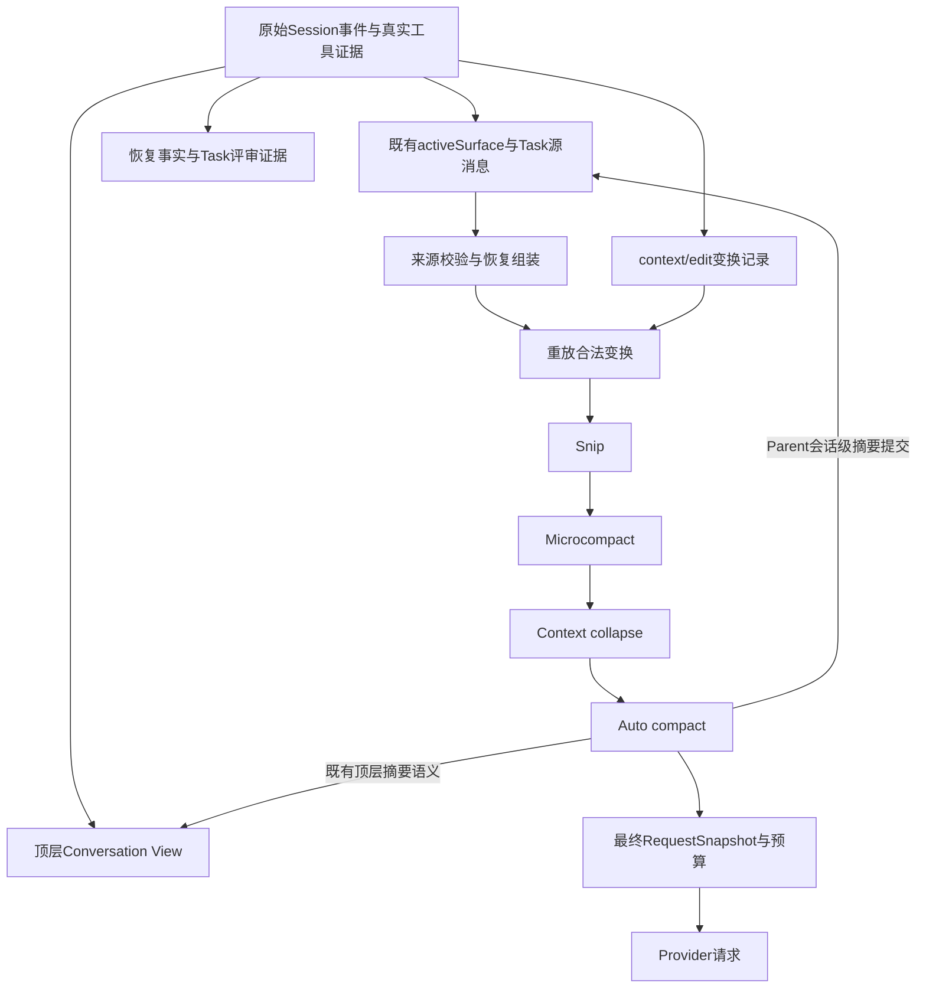
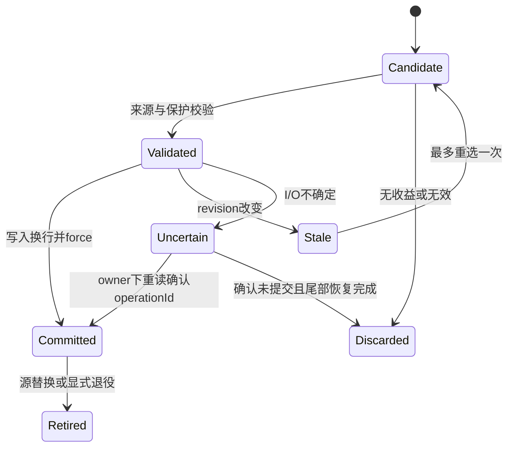

# 四层上下文管理实施方案

当前状态为实施中。本文统一维护 Snip、Microcompact、Context collapse、Auto compact 的设计、实施任务和验收。2026-11-04 按用户要求，将原“完全重复 read_file 去重”方案扩展为完整四层机制；方案已提交为 `a4b694b`。下文接口、事件和行为按设计实施，实际完成状态以第5.4节及测试证据为准。

## 1. 背景、目标与非目标

### 1.1 需求、基线与交付范围

参考 Claude Code 恢复版的分层机制，让 CodeAgent 在长任务、多工具调用、跨轮对话和多 Agent 协作中持续管理发送上下文。重复结果去重属于确定性裁剪的一条规则；唯一旧工具结果清理、单轮局部摘要、会话级摘要与持久恢复均属于本任务的实施目标。

本次交付范围已由方案编写推进到四层机制实现。分支沿用 `codex/context-microcompaction-plan`，创建方式为 `git switch --no-track -c codex/context-microcompaction-plan origin/main`，基线为 fetch 后的 `9f2daa32836ca939676116cb63393c18598542c4`，无 upstream。文档沿用编号48和现有文件名，后续设计修订、实施记录与验证统一追加到本文；实现改动保留未提交，前次提交授权仅涵盖方案。

### 1.2 目标与预期效果

1. 每次普通模型请求先重放已提交变换，再按 Snip → Microcompact → Collapse → Auto compact 处理新增压力，每层后重新计量。
2. Snip 裁剪可确定性证明冗余或已被替代的片段，Microcompact 缩减旧工具正文，Collapse 摘要化已闭合的局部过程，Auto compact 对更早会话做最终摘要。
3. 连续读取不同文件、长命令输出、同一用户轮次内大量工具批次和长多轮会话均有处理路径。
4. 原始 Session 保持 append-only。真实执行证据、可恢复历史、发送视图和顶层 Conversation View 职责明确，摘要不能产生执行成功、路径或URL授权。
5. ReAct、Plan Task、普通 SubAgent 共用规则，Session及每次Task执行独立持有预算与变换状态。恢复在来源校验后重放合法变换。
6. `ctx`、`/context`、请求快照和实际请求使用一致口径。收益统计包含各层节省、摘要额外调用、缓存损失、耗时与任务质量。
7. 四层全部属于最终交付。分阶段实施便于验证，只有去重或工具清理的中间版本不能作为完整目标验收。

预期场景为一个任务读取30个不同文件并运行多次命令后，最近工具批次保留详细正文，旧读取结果保留定位与状态记录，早期闭合过程形成局部摘要。继续交互接近窗口上限时，更早会话再形成整体摘要。实际压缩率、完成率和总费用以固定样本验证为准。

### 1.3 范围与选型

选择“完整四层策略、统一发送视图、持久变换记录”。现有重复去重规则并入Snip；现有完整摘要器作为Auto基础；新增Micro和Collapse支持不同内容及单轮长链。

- 支持文本工具结果、普通助手过程消息、具有可信来源标记的合成上下文及符合条件的会话前缀。
- 当前请求、权限契约、未完成工具链、pending审批、恢复控制信息、未知副作用和Reviewer必要证据必须受保护。
- 图片沿用既有裁剪路径。含图片、未知ContentPart和Provider专有思考签名的消息组初期没有通用有损规则。
- Provider服务端缓存编辑属于可选优化，通用四层实现须能在现有Provider上独立工作。
- 长期Memory、索引、工具权限与Side-Git保持既有职责，历史清理不自动写长期事实或重跑命令。

## 2. 现状分析（源码证据、已知约束）

### 2.1 阅读基线与架构位置

已读取 AGENTS、CODEAGENT 及 [运行时基础](../implementation/01-runtime-and-agent-foundation.md)、[工具与恢复](../implementation/02-tools-policy-and-recovery.md)、[上下文与记忆](../implementation/03-context-memory-and-retrieval.md)、[Prompt装配](../implementation/06-skills-and-prompt-assembly.md)、[验证与评测](../implementation/09-verification-and-evaluation.md)。恢复身份同时参照 [会话恢复方案](47-session-resume-and-explicit-continuation.md)。

下表Java路径均相对于 `src/main/java/com/codeagent/`。

| 源码证据 | 当前行为 | 设计落点 |
|---|---|---|
| Agent主循环、assembleRequest、maybeCompactHistory | 组装预测后摘要，恢复请求还含前置预算处理 | 汇聚四层入口，重排恢复预算与最终组装 |
| Agent.getContextStatus、logRequestContext | 部分统计直接使用完整history | 改为实际发送视图的分类估算与预测 |
| PlanExecuteAgent.executeTaskWithPolicy | messages局部，tracker/historyVersion实例共享；同一child存在多次调用 | 每次具体执行隔离状态和scope |
| SubAgent.executeLoop | 普通调用及Reviewer结构化执行共用入口 | 显式RequestPurpose决定保护与压缩资格 |
| context/RequestSnapshotFactory、ContextTokenTracker | 消息与tools完整估算，usage anchor带符号delta | 使用最终发送内容，变换代次变化时失效anchor |
| history/ParentConversationContext.commitCompaction | 前缀替换为两条摘要消息与公共后缀 | 保留会话级提交，局部变换使用覆盖层 |
| history/SessionProjection、SessionReplayer | activeSurface与topLevel独立；未知required事件拒绝 | 新增按scope保存的contextState，局部edit不改topLevel |
| history/SessionCheckpointStore | checkpoint按版本及事件前缀加载 | v3完整保存新状态，验证全部projection字段往返 |
| history/SessionStore.SessionHandle.append | 当前写入并force后replay | 新事务增加写前校验与不确定写入恢复 |
| agent/RecoveryRequestAugmenter.compose | 使用原Surface长度与sequence校验输入、插入恢复块 | 先验证源，再用显式身份映射生成发送副本 |
| history/TaskTranscriptReader | 原事件与typed事实构造恢复组 | 摘要/edit不能成为真实执行或未知副作用证明 |
| ToolRegistry.ToolExecutionResult | 已有successful、exitCode、executedCommand、timedOut、observationUnknown | 原Message仅存字符串，补可靠描述符与输出完整性 |
| ToolRegistry.runNativeCommand/readProcessOutput/getCommandOutput | 输出最多保留前8000字符；读取超时可与exitCode=0并存，failureKind未完整传播 | 区分进程结果与输出捕获完整性 |
| memory/ConversationHistoryCompactor | 常规保留最近3条user轮次，单轮跳过；60000字符输入截断；非空摘要即提交 | 真用户边界、有界全覆盖输入、净收益验证 |
| memory/SessionMemoryCompactor | 按history列表身份保存预计算状态 | 保持scope稳定列表身份与代次，不能把共享实例直接当污染证据 |
| llm/StructuredJsonExecutor | 统一JSON校验及至多一次修复，usage聚合 | 摘要复用该约定，修复成本计入摘要预算 |

### 2.2 外部参考与证据边界

参考检出提交为 `a8a678cb6244e6770e1e421767ff0987a1d95549`。query.ts可核实结果预算 → Snip → Microcompact → Collapse → Autocompact的顺序，以及超限时尝试已暂存折叠、再reactive compact的调用。[参考调用链](https://github.com/ChinaSiro/claude-code-sourcemap/blob/a8a678cb6244e6770e1e421767ff0987a1d95549/restored-src/src/query.ts)

microCompact.ts可核实按时间间隔清空旧结果、保留近期结果、调用ID关联、主线程/子Agent差异和可选缓存编辑。服务端编辑依赖模型支持与feature gate。[参考Microcompact](https://github.com/ChinaSiro/claude-code-sourcemap/blob/a8a678cb6244e6770e1e421767ff0987a1d95549/restored-src/src/services/compact/microCompact.ts)

autoCompact.ts可核实会话记忆摘要优先路径。检出目录缺少snipCompact.ts和contextCollapse/index.ts，不能核实完整算法。本文阈值、候选、保护与持久协议是CodeAgent设计，不能写成Claude已验证默认行为。[参考Auto compact](https://github.com/ChinaSiro/claude-code-sourcemap/blob/a8a678cb6244e6770e1e421767ff0987a1d95549/restored-src/src/services/compact/autoCompact.ts)

### 2.3 数据与状态模型



原始事件为事实源。activeSurface保持现有恢复和Parent会话摘要职责；Task同时维护当前scope明确的源消息列表。新增contextState保存发送变换，裁剪、工具正文替换和局部摘要从覆盖层生成。顶层Conversation View继续包含用户请求、最终回答和Parent全局摘要，局部工具摘要不自动进入Planner历史。

### 2.4 核心失败路径

必须覆盖无效摘要、超大单组、来源失效、陈旧候选、不确定写入、退出恢复、旧reader、Provider超窗及保护内容本身超预算。任一失败不得扩大权限、推断成功或省略未总结历史；回退后请求仍须满足完整预算。

## 3. 方案设计

### 3.1 接口、作用域与来源模型

新增 `context/ContextWindowManager.java` 编排四层，复用既有LlmClient、RequestSnapshotFactory、ContextTokenTracker及摘要服务。策略类为HistorySnipper、ToolResultMicrocompactor、ContextCollapseManager；全局摘要改造AutoCompactionManager和ConversationHistoryCompactor。context底层不依赖Agent、CLI或Renderer，持久化通过ContextEditSink注入。

拟议模型集中在 `context/ContextWindowState.java` 与 `ContextEdit.java`。

| 类型 | 必需字段与职责 |
|---|---|
| NodeId | 带tag的RAW(scopeId, sourceSequence)、EDIT(scopeId, editId, ordinal)、REQUEST(requestAssemblyId, ordinal)三种身份；不能使用列表下标或toolCallId代替 |
| ContextNode | NodeId、原Message、sourceKind、executionId、taskAttemptId、toolBatchId、可选ToolResultDescriptor |
| ToolResultDescriptor | invocationId、toolName、outcomeSource、processOutcome、successful、exitCode、executedCommand、failureKind、observationUnknown、captureCompleteness、资源定位、contentHash、evidenceRefs |
| ProtectionSet | 完整保护节点、不可跨越边界、未完成工具、恢复控制与证据来源，全部由宿主构造 |
| ContextWindowState | scopeId、sourceRevision、contextGeneration、稳定源消息、activeEdits、protection、tracker、固定Options与摘要预算 |
| ContextEdit | editId、layer、kind、orderedSourceIds及digest、replacementNodes、retiredEditIds、dependencies、算法版本 |
| ContextEditBatch | operationId、scopeId、expectedSourceRevision、expectedContextGeneration、expectedProtectionDigest、baseDigest、edits；一次原子提交 |
| PreparedContextRequest | immutable messages/tools、snapshot、prediction、sourceRevision、contextGeneration、各层统计 |
| RequestPurpose | NORMAL、FINALIZATION、RECOVERY、REVIEW、STATUS、PREVIEW |

接口契约如下。

```java
PreparedContextRequest prepare(ContextWindowState state,
        List<LlmClient.Tool> frozenTools, RequestPurpose purpose);

PreparedContextRequest preview(ContextWindowState state,
        List<LlmClient.Tool> frozenTools);

CommitResult commit(ContextEditBatch batch);
```

commit属于ContextEditSink，history提供durable实现，临时SubAgent提供内存实现。CommitResult取APPLIED、ALREADY_APPLIED、STALE；I/O不确定、校验失败抛异常并停止当前请求。PreparedContextRequest.messages必须原样用于chat。

preview只重放已提交变换并计算预算，无写入、无LLM。显示口径为“当前已提交发送视图”；下一次prepare若提交新压缩，显示再更新。不能把仅估算的候选节省先显示成已生效。

Parent scope采用Session ID。Task scope采用 `(childSessionId, 本次executeTaskWithPolicy首条system事件sequence)`，因为证据及Reviewer重试可能在同一child内多次重建messages。临时SubAgent用本次执行UUID。persistChildMessage需返回append身份；不能用child全量activeSurface替代某次Task消息。恢复import使用本次新sequence，旧来源只保存为provenance。

Task首条system事件声明新的scope起点，由append返回sequence后建立完整scopeId，后续消息payload携带该起点引用，重放时建立scope成员索引。旧child缺少这些字段时不猜测跨重试分段，保留原恢复路径并在新执行scope内重新规划。

首条system的payload字段为contextScopeStart=true及executionId/attemptId/sourceKind。后续消息在同一事件payload保存scopeId和上述来源字段，checkpoint持久化scope成员索引、sourceRevision和编辑状态。tracker、运行时Options和ProtectionSet由宿主重新建立，不将整个运行态对象写入checkpoint。临时恢复块使用REQUEST身份并始终完整保护，不得作为持久edit目标；其内容指纹参与最终请求和ProtectionDigest。

新增descriptor与原Message写在同一TOOL_RESULT事件，来源为真实ToolExecutionResult。processOutcome取SUCCEEDED/FAILED/TIMED_OUT/CANCELLED/DENIED/UNKNOWN，captureCompleteness取COMPLETE/TRUNCATED/READ_TIMEOUT/UNKNOWN。outcomeSource区分TYPED与LEGACY_INFERRED；缺失为UNKNOWN，禁止由“成功/exit code”字符串升级可信度。

结构化descriptor中的定位与计数只来自实际执行器记录，无法确定时显式unknown；不把模型参数中的声明当成执行后的事实。保护和编辑摘要均从可信宿主字段派生。

内置文件/搜索生产者需改为typed ToolOutput；命令传播failureKind、真实进程退出状态和输出读取完整性。现有输出已只捕获前缀时，Micro的“尾部”只能取已捕获文本尾部，不能宣称拿到进程真实输出末尾。exitCode=0不等同测试执行或验收通过，继续由既有EvidenceCollector判断dry-run/skipTests等。

完整工具批次为一条assistant tool_calls及全部唯一匹配结果，按ID匹配、保留消息原顺序，下一非tool消息或EOF闭合。重复、孤立ID、缺结果、未知签名使相关组受保护。消息来源从事件和真实调用路径赋值，不能仅由role=user或正文推断真实用户/阶段成功。

### 3.2 共同保护、预算与停止条件

保护规则适用于四层全部入口。

1. system与权限契约、当前顶层目标、真实当前输入、pending审批/计划门及未完成工具批次完整保留。Snip/Micro/Collapse保持所有真实用户原文，Auto保留最近3个真实用户轮次及工具边界。
2. 最近2个完整工具批次保留正文。当前scope中的最新失败批次、未解决UNKNOWN副作用、EvidenceGate显式引用组额外保护。旧的已知失败可在离开近期窗口后局部摘要，宿主必须保留失败状态、命令和诊断摘录；不能永久pin所有失败日志导致无进展。
3. Reviewer必要证据、实际命令/退出码、完整diff及验证材料完全保护。其修复请求继承同一约束。
4. 恢复的inputUserSequence、重建输入、控制块及当前执行suffix完整保护。图片、未知ContentPart和专有签名组按保守规则保留。

保护节点和边界只能由宿主更新。保护内容本身超过预算时返回明确不足结果并保持可恢复状态。统计protectedTokens、ineligibleTokens、noProgressReason，不把无变化当压缩成功。

令T为ContextProfile.compressionTriggerTokens，继承模型窗口、输出预留与缓冲。以下数值是本项目初始设计值。

| 层 | 触发条件 | 目标与界限 |
|---|---|---|
| Snip | 预测达到0.65T | 最旧合法候选优先，低于0.60T或无候选停止 |
| Microcompact | 预测达到0.75T；overflow可强制尝试 | 目标低于0.65T；结果至少2048估算tokens，每条净省至少512 |
| Collapse | 预测达到0.90T；overflow可强制尝试 | 目标低于0.80T；每次prepare最多2个区间，净省至少512且区间长度减半 |
| Auto compact | 预测达到T或Provider超窗 | 目标低于0.80T；预算内无法降至T则受控失败 |

每层后重新capture完整组装请求，含system、tools、恢复块及图片预算。contextGeneration变化时失效usage anchor，用全量本地估算加既有余量重算；主请求成功才建立新的anchor。savedTokens仅统计，禁止再次从预测中扣除。摘要调用usage单独计入本次执行预算，不能校准主请求tracker。

Snip/Micro每候选最多处理一次，每层一次prepare最多一批编辑。摘要请求自身必须先预算，包含提示词、源正文、输出预留和修复空间；超出则缩小完整候选组，不能递归压缩摘要请求。

主模型请求剩余执行预算与摘要预算同时满足才可启动摘要。调用StructuredJsonExecutor前为生成和一次修复预留2个调用额度，不足2个时不启动新候选；完成后按实际次数结算并释放未用额度。成功返回和StructuredOutputException中的聚合usage都记入执行成本，取消后已消费usage仍保留。累计上限不能因内部修复被绕过。

### 3.3 第一层 Snip

职责为无需LLM、可以确定性证明冗余的消息级裁剪。初版实现两条规则。

- 完全重复的只读工具批次。限定同一真实顶层Execution，仅包含read_file/list_dir/glob_files/grep_code/search_code，typed结果已知成功，参数JSON树相等、全部正文逐字节相同，assistant无额外正文/reasoning。存在后续保留的完整等价批次后，删除旧整批调用和结果，以固定来源说明替代，保留最新证明。近期保护仍优先。
- 显式可替代的合成上下文。生产者声明sourceKind、contextKey、generation和completeReplacement=true，例如同资源的新完整诊断快照。现有LSP注入须补充该契约，元数据缺失则跳过。真实用户、Skill规则、Memory正文不参与。

每个动作记录精确orderedSourceIds及保留证明。后续Collapse覆盖证明时，必须在同一事务退役相关Snip并纳入全部来源。不能仅以时间久、模型说不重要或路径相同裁剪正文。该算法属于CodeAgent的明确设计，参考Snip完整源码尚缺。

Snip证明依赖固定为NodeId、contentDigest和requiresFullBody=true。Micro必须跳过活跃Snip的完整证明节点；节点虽存在但正文被缩减也属于证明失效。Collapse/Auto覆盖证明须原子退役或重建依赖，保护旁路时沿依赖闭包一并旁路相关Snip。

### 3.4 第二层 Microcompact

职责为缩减旧工具正文，支持不同文件和唯一结果，不要求重复副本。调用、ID、role和位置保持，tool content换成确定性的短记录；最旧合法组优先，保护规则优先。

| 类别 | 可缩减内容 | 必须保留的短记录 |
|---|---|---|
| read_file | 旧文件正文 | 原path/offset/limit、历史结果状态、结果hash、原长度、完整性 |
| list_dir/glob_files/grep_code/search_code | 列表与命中片段 | 查询和范围、原计数或unknown、分页/截断信息、hash |
| web_search/web_fetch | 已知成功的旧搜索/网页正文 | 原查询/URL、历史来源类型、hash和状态；不产生URL授权 |
| execute_command | typed成功、exitCode=0、无未知副作用的旧stdout/stderr | 审批后真实命令、退出码、执行时间、captureCompleteness、hash |
| 写入/恢复/Memory/Skill/Browser/MCP/未知工具 | 初版不做Micro有损清理 | 保留结果，可由符合条件的闭合区间摘要处理 |

读取和搜索保留最多256个Unicode码点头部、256个尾部，命令各512，明确标注中间正文省略及原始捕获完整性。目标短记录至多768估算tokens；实际命令或关键定位字段本身超过目标时保留原结果，不能截断这些字段伪造完整事实。

短记录采用固定“历史工具正文已缩减”标记，使用安全JSON序列化。正文原文仍存在于已校验源中。模型需要当前文件/网页信息时通过既有工具重新请求并走当前策略；历史命令不能为找回输出自动重跑。Reviewer由宿主从真实证据源组装完整材料。

descriptor缺失或LEGACY_INFERRED时跳过Micro，后续Collapse仍可携带UNKNOWN宿主事实做摘要。通用实现按预算触发，不假设Provider缓存TTL相同。服务端缓存编辑后续作为能力适配，不能阻塞本地四层。

### 3.5 第三层 Context collapse

职责为把局部已闭合过程转换成摘要。闭合表示所有工具调用已有结果，不意味着任务成功。候选为至少2个连续完整工具批次及邻接助手过程消息，位于保护尾部之外；不能跨system、真实user、恢复控制或其他完整保护组。按源顺序从最旧候选扩展至输入上限。

因此一个user轮次内大量不同文件读取也可折叠。单个组超过摘要输入上限则跳过并报告原因。包含旧Snip/Micro的候选必须取其完整原始来源，在同一事务退役被覆盖edit；部分交叉拒绝。已提交局部摘要作为候选边界，首版不对同段反复摘要，降低漂移。

新增 `prompts/context/collapse-summary.md`，经PromptRepository/PromptAssembler装配，使用LlmClientFactory既有客户端选择和重试约定，工具为空。StructuredJsonExecutor解析以下固定结构。

```json
{
  "summary": "区间内工作、发现和当前结论",
  "decisions": [{"text": "决策", "sourceIds": ["节点ID"]}],
  "openItems": [{"text": "未完成事项", "sourceIds": ["节点ID"]}],
  "evidenceRefs": ["节点ID"]
}
```

宿主另行附加sourceRange、真实命令/退出码、失败/UNKNOWN、资源定位和当前未解决事实引用，模型字段不能覆盖。检查未知字段、长度、引用归属与净收益；摘要空白、引用越界、膨胀或状态冲突则拒绝。结构通过不证明语义无遗漏，需任务质量评测。

每区间输入上限 `min(16000, floor(T/2))` 估算tokens，且完整摘要请求须满足§3.2预算；输出上限 `min(2000, floor(inputTokens/2))`。无可靠Provider输出限制时仍检验实际结果大小，超限弃用。每个候选最多一次格式修复，单次prepare最多2个区间。

替换为一条带“历史过程摘要”标记的普通assistant文本，sourceKind=LOCAL_SUMMARY，不伪装成用户、system或真实工具结果。原调用与结果整组从发送视图移除。同步摘要时取不可变快照、释放短锁、调用LLM、复核sourceDigest和generation后提交。陈旧候选丢弃，至多重新选择一次。

### 3.6 第四层 Auto compact 与超限恢复

沿用会话级摘要职责，常规保留最近3个真实用户轮次及工具边界。新增元数据后以真实用户身份切分，合成诊断、局部摘要和恢复块不增加保留轮次。

摘要输入来自待替换前缀的完整源消息，包括前三层隐藏的正文。替换现有60000字符静默截断逻辑，按完整消息组分块，每块至多 `min(24000, floor(T/2))` 估算tokens且满足完整摘要请求预算。整个Auto最多16次LLM调用，格式修复也计入。合并摘要超限时，在剩余额度内递归汇总，覆盖引用与宿主事实保留。

会话摘要采用与Collapse相同的结构化校验，并包含顶层用户目标、约束、当前状态与未完成事项。SessionMemory预计算只有scope、完整覆盖范围、sourceDigest、保护集合及输出预算均匹配才可用，否则回退。每个块无遗漏才允许提交全局摘要；部分失败、超额、覆盖不全或无净收益则整体弃用。

全局JSON采用Collapse的四个字段，并增加goals、constraints、currentState三个数组，每项固定为text和sourceIds。所有引用限制在待替换前缀，UNKNOWN和失败等宿主事实由程序附加；用户当前原文及最近轮次作为保护尾部保留。source覆盖由宿主维护的分块成员集合验证，不能把模型返回全部ID等同语义完整。

Parent全局摘要沿用durable compaction事务思路，提交成功后同步activeSurface和顶层摘要，原子失效被替换源上的overlay。必须修正范围识别为显式orderedSourceIds及coveredConversationNodeIds，避免摘要新sequence插入旧位置后按数字区间删错历史。使用v3 compaction事件契约，v2保持原解析，新增字段必须校验连续成员与真实顶层身份，不能从LLM生成。

v3的compaction/start保存transactionId、scopeId、expectedSourceRevision、expectedContextGeneration、expectedProtectionDigest、orderedSourceIds、coveredConversationNodeIds和sourceDigest；摘要及确认消息引用同一transactionId并暂存，compaction/end保存完整事务摘要并提交。只有所有成员校验通过的END才能同时替换两类视图和退役overlay，缺END保持旧视图。payload沿用compactionId作为transactionId的序列化键，以兼容现有分组代码。未完成compaction期间禁止生成checkpoint，避免丢失暂存状态。

Task的现有Auto只改局部messages而未持久化，需补齐。Task Auto统一提交 `context/edit` 的AUTO层REPLACE_SPAN，携带当前scope前缀完整来源及结构化摘要，原子退役包含的旧edit；child原证据消息和topLevel保持原值。Task发送由该scope源加AUTO覆盖层生成。后续Auto包含旧AUTO时从其完整来源重新选择并整体替换，禁止部分交叉。内存SubAgent采用同协议的内存实现。

单轮不存在可替换用户前缀时，Auto返回NO_ELIGIBLE_PREFIX，由Collapse承担单轮长链缩减；若仍无法降到T则明确失败。不能把保护内容直接丢弃。

Provider超窗时失效anchor，强制尝试合法Snip/Micro、尚未尝试的Collapse和Auto。主请求只有在最终fingerprint改变且确实变短时重发，每次最多一次恢复重试，再失败保留执行状态。摘要usage不建立主请求anchor。

`/compact`继续显式请求全局摘要并保留手动最近1轮约定，增加完整覆盖与预算校验；`/clear`在同一回放转换中清空全部contextState、摘要缓存及anchor，原始事件继续保留。

### 3.7 持久化、重放与冲突

新增 `context/edit`，event schemaVersion=3、ignorable=false，一条完整换行JSON事件提交ContextEditBatch，放在既有events.jsonl中。SessionProjection新增按scope保存的contextState和contextGeneration。Snip/Micro/Collapse及Task AUTO只改变发送覆盖层，不改ExecutionEnvelope和真实证据。

原节点身份为RAW，durable使用实际append的sequence，内存scope使用单调序号；合成替换为EDIT，恢复临时插入为REQUEST。sourceDigest按原Message和descriptor规范序列化计算SHA-256，范围按当前源列表中的有序连续成员判断，不能按数值sequence区间判断。edit的orderedSourceIds只允许RAW来源，已有EDIT通过其完整sourceRefs展开，REQUEST永不进入持久编辑。expectedRevision/baseDigest只用于提交CAS；普通append不使所有旧edit失效。

活动edit互不重叠。新Snip/Collapse完全包含旧Micro等操作时，在同一batch退役旧edit；部分交叉拒绝重选。标记依赖被移除时同事务重定向或退役，最终投影必须无环、引用可达、配对完整。单事件payload上限1MiB，超过时缩小候选或拒绝，不能拆开原子替换关系。

保护集改变后，旧edit若覆盖完整保护节点，则本次请求旁路整个相关操作并递归旁路依赖项，零改写原日志；之后重新capture，不复用旧预算。需要永久退役时只能追加合法事务。Parent compaction成功、clear及其他源替换在同一状态转换里失效相交edit及其依赖，普通append保留。



SessionHandle.append在写盘前预计算并校验候选projection，非法操作不得先污染日志。提交方在当前执行所有权下重建ProtectionSet并比对expectedProtectionDigest，逐节点重验范围，防止摘要期间新增证据保护却sourceRevision不变。通过后追加并force，再发布内存状态。相同operationId和内容返回ALREADY_APPLIED，同ID不同内容拒绝。I/O不确定先停止请求，持有owner重读确认，禁止直接发送未确认的压缩视图。

SessionProjection保存session级committedOperationDigests索引，键为operationId，值为不含物理事件序号和时间戳的规范payload摘要。已退役操作仍保留索引；clear只清活动编辑，不能清幂等历史。checkpoint持久化该索引，完整回放可从原事件重建，内存scope同样保留至生命周期结束。先查幂等索引再判断CAS，重复已提交事务即使generation已推进仍可返回ALREADY_APPLIED。

统一readEvents和readSnapshot的换行提交语义。当前readEvents可能接受JSON完整但无末尾换行的行，新v3协议必须把该尾部当未提交，沿用隔离恢复机制处理。中间损坏拒绝恢复。force后内存发布前退出，则重新回放得到已提交状态。

首个v3事件之后checkpoint使用版本3，完整保存contextState、scope、generation、来源索引、executionEnvelopes及事件前缀hash。旧v2 checkpoint只可作为新协议之前的起点，tail重放补齐。旧reader跳过v3 checkpoint后必须遇到required v3事件而拒绝；不能在已含v3的前缀上写v2 checkpoint，也不能仅靠manifest新字段拒绝旧版本。

### 3.8 请求入口、恢复、隔离与展示

| 入口 | 行为 |
|---|---|
| 普通ReAct/Task/SubAgent | 四层prepare，固定tools，提交后capture，同一messages发送 |
| 无工具收尾 | 沿用本执行变换，允许确定性处理；有剩余预算才生成新摘要，收尾指令完整保护 |
| 恢复 | 先核对源事件与owner/attempt，再重放可用edit，保护恢复信息后运行四层 |
| Reviewer及修复 | 完整证据包独立请求，材料超窗返回unavailable，禁止摘要推断通过 |
| 状态专用请求 | 使用已提交视图与状态信息，不为查询新增变换 |
| `/context`和状态栏 | preview无写入/LLM，分类本地估算与含余量预测分别标明 |
| Planner/Router | 继续消费topLevel，局部edit不自动进入跨模式历史；顶层压力经适配Auto处理 |

RecoveryRequestAugmenter新增带来源的composeNodes，先用原activeSurface验证source sequence、输入和Execution envelope，再返回带NodeId的发送副本，最后应用可变长overlay。原compose可包装为messages视图。禁止直接把Snip后列表传入当前按activeSurface长度对齐的接口。

恢复预算先计算已提交视图和formatter必需信息，再prepare，最后按实际余量补可选恢复细节，最多重组一次。必需元数据放不下则失败，不能删owner、attempt、未知副作用或用户输入。最终snapshot、chat、展示都捕获同一组装结果。

TaskTranscriptReader继续读取真实工具组与typed事实，明确忽略context/edit及合成摘要。跨child导入edit仅在全部source组已导入、canonicalOrigin/hash/保护全部校验通过时，以新scope和新sequence重新提交；否则弃用旧edit并重新预算。来源缺失可能扩大恢复请求，必须有受控失败测试。

Plan新增局部TaskRequestContext，持有每次executeTaskWithPolicy的scope、稳定source list、tracker、historyVersion、generation、Options与摘要预算，经appendTaskMessage、LSP/图片注入、maybeCompactHistory和finalize显式传递。当前共享tracker/version必须迁入；SessionMemory保留共享manager时按稳定scope历史身份管理，clear只作用于对应scope，后台结果复核scope/generation。

### 3.9 锁、安全与可观测性

- 摘要无工具、无长期Memory写入。短记录/摘要不能提供URL或路径授权，所有重新取证仍经TurnToolPolicy → HITL → ToolRegistry → Guard。
- 宿主owner → workspace mutationGate/Session lease → ContextWindowState → SessionHandle，按此方向获取必要锁。取不可变快照后释放短monitor再请求LLM，提交时重新检查owner/revision。现有Parent同步摘要入口须相应拆分，执行lease仍由任务持有。
- 取消丢弃未提交摘要，已提交edit保留合法上下文状态，不代表任务完成。晚到结果因attempt/generation不匹配拒绝。
- 记录layer、节点数、估算before/after、摘要次数与usage、耗时、cache usage、protectedTokens/ineligibleTokens及固定错误类别。禁止日志输出完整正文、参数、路径、raw Session和secret，展示走Renderer。
- 稳定重放避免每轮正文展开和清空。请求缩短可能失去前缀缓存，成本评测须计入缓存损失及摘要费用。

### 3.10 配置、迁移与回滚

新增config/ContextManagementConfig，经ConfigurationValues读取 `codeagent.context.layered.enabled` / `CODEAGENT_LAYERED_CONTEXT_ENABLED`，沿用系统属性、进程环境、项目.env、用户.env优先级。接受true/false、1/0，非法值关闭并仅报告固定诊断。开发验证默认false，完成全四层和质量门禁后再以独立发布变更默认开启。

开关只控制新变换生成，已提交required编辑始终重放。阈值按ContextProfile派生，测试可注入Options；暂不暴露大量未经评测的用户调参项。旧micro开关尚未实现，无需兼容该配置名；已有SessionMemory开关保留。

旧Session缺contextState取空，缺descriptor为UNKNOWN，不改旧JSONL。新reader接受v2/v3混合事件；v3编辑及使用显式成员的compaction事件要求schema3且required。旧二进制不能写入已经使用v3的Session。

运行时回滚关闭开关并继续重放既有edit。二进制回退可继续使用未升级会话或新会话，v3历史须由兼容reader访问。不能删除required事件、重写历史或静默展开。显式恢复全文将来可由追加retire实现，开关不能隐式触发。

实施时同步.env.example、README、实现文档01/02/03/06/09、摘要Prompt和context-management说明。`/context`、`/compact`、`/clear`接线按AGENTS检查Main、CliCommandParser及测试。AGENTS只在全局边界或阅读入口确有变化时更新。工具返回typed契约的变化同步工具实现、Policy/HITL、审计及回归。

## 4. 实现任务与测试矩阵

### 4.1 按依赖实施

每项先写失败测试并确认失败原因，再实施最小改动。Java路径均以src/main/java/com/codeagent为根，对应测试位于src/test/java/com/codeagent。下列新测试尚未实现。

| 任务 | 文件与具体内容 | 先写测试及通过条件 | 验证命令 |
|---|---|---|---|
| T1 来源与保护 | context/ContextWindowState、ContextEdit；ToolRegistry typed状态及三入口结果描述符 | ContextProtectionTest、ToolRegistryTest；ID/EOF正确，伪造成功不改descriptor，进程状态与capture完整性独立 | `mvn test -DskipTests=false "-Dtest=ContextProtectionTest,ToolRegistryTest,TurnToolPolicyTest"` |
| T2 提交与重放 | ContextEditSink；SessionEvent/Projection/Replayer/Store/CheckpointStore、ParentConversationContext | ContextEditReplayTest及既有Session测试；写前拒绝、单事件原子、幂等、无换行恢复、v2/v3全/增量一致、topLevel无局部污染 | `mvn test -DskipTests=false "-Dtest=ContextEditReplayTest,SessionReplayerTest,SessionStoreTest,SessionCheckpointStoreTest,SessionCompactionRecoveryTest"` |
| T3 Snip/Micro | context/HistorySnipper、ToolResultMicrocompactor、固定短记录 | HistorySnipperTest、ToolResultMicrocompactorTest；重复整批裁剪、唯一结果缩减、保护证明与typed状态保留、净收益达标 | `mvn test -DskipTests=false "-Dtest=HistorySnipperTest,ToolResultMicrocompactorTest,ContextProtectionTest"` |
| T4 Collapse | context/ContextCollapseManager、prompts/context/collapse-summary.md | ContextCollapseManagerTest；单user长链折叠，输入完整有界，未知引用/膨胀拒绝，源变更弃用，旧edit原子退役 | `mvn test -DskipTests=false "-Dtest=ContextCollapseManagerTest,StructuredJsonExecutorTest,PromptAssemblerTest"` |
| T5 编排与Auto | ContextWindowManager、config/ContextManagementConfig、ContextProfile/InvalidationReason、三个memory摘要类 | ContextWindowManagerTest及compactor测试；逐层重计量，分块全覆盖，净收益，Task AUTO持久身份，调用预算真实累计 | `mvn test -DskipTests=false "-Dtest=ContextWindowManagerTest,ContextManagementConfigTest,AutoCompactionManagerTest,ConversationHistoryCompactorTest,SessionMemoryCompactorTest,ContextTokenTrackerTest,RequestSnapshotFactoryTest"` |
| T6 入口与恢复 | Agent、PlanExecuteAgent、SubAgent、RecoveryRequestAugmenter、TaskTranscriptReader | AgentLayeredContextTest、PlanLayeredContextTest及恢复测试；chat等于snapshot，同child重试和跨Task隔离，恢复/收尾无突变 | `mvn test -DskipTests=false "-Dtest=AgentLayeredContextTest,PlanLayeredContextTest,SubAgentTest,AgentRecoveryRequestTest,RecoveryRequestAugmenterTest,TaskTranscriptReaderTest,AgentBudgetFinalizationTest"` |
| T7 展示文档评测 | Agent显示、Main/Parser接线检查、配置与§3.10文档、固定合成夹具 | preview无副作用，八组场景有记录，Reviewer证据与用户约束正确 | `mvn test -DskipTests=false "-Dtest=AgentLayeredContextTest,CliCommandParserTest,MainSessionCommandTest,PromptAssemblerTest,DeterministicEvidenceGateTest,PlanDiffEvidenceIntegrationTest"` |

依赖为T1 → T2 → T3 → T4 → T5 → T6 → T7。每个边界接受独立评审，接口缺陷回到前序修订，完整四层验收之前保持任务未完成。

### 4.2 必须覆盖的场景

| 场景 | 可判定断言 |
|---|---|
| 完全重复只读批次 | Snip删除完整组，最新证明存在，工具协议合法 |
| 30个不同文件的大正文 | Micro缩减旧唯一结果，最近2批完整，定位和历史状态保留 |
| 同文件修改前后 | 不按路径判重复，不把旧结果描述为当前状态 |
| 单user内20个工具批次 | Collapse产生局部摘要，当前输入及近期组完整 |
| 长多轮与连续两次Auto | 前缀覆盖完整，显式源成员正确，摘要新序号不导致删错topLevel |
| 乱序/孤立/重复ID及EOF | 正确闭合，畸形组受保护或拒绝发送 |
| exit1打印BUILD SUCCESS、exit0但skipTests | descriptor与EvidenceGate保持真实结论 |
| 超时、输出读取失败、已有8000字符截断 | processOutcome与captureCompleteness独立，不能补造输出尾部 |
| 最新失败与旧已知失败 | 最新失败保护，旧失败可摘要但状态和诊断线索持续可见 |
| 超大单工具组、全部保护、无候选 | 明确noProgressReason或预算失败，不丢用户输入、不无限重试 |
| Snip证明被Collapse覆盖 | 同事务退役依赖，无环且无悬空引用 |
| Snip后追加多批次，Micro尝试缩减原证明 | 活跃证明保持完整，不能只靠ID可达认定引用有效 |
| 同operationId重试、同ID不同内容 | 前者幂等，后者写前拒绝且文件字节数不变 |
| force不确定、有效JSON无换行、半行、中间损坏 | 不发送未确认视图，尾部恢复一致，中间损坏拒绝 |
| 摘要时追加/clear/切换attempt | stale丢弃，最多重选一次，晚到结果不能提交 |
| 源正文未变但新增证据保护 | ProtectionDigest变化，旧候选提交被拒，重新规划遵循新保护 |
| operationId已退役或clear后重复提交 | 保留幂等索引，相同内容不会再次应用，不同内容拒绝 |
| 摘要空白、坏JSON、越界引用、膨胀 | 修复有界，整候选弃用，按预算继续或失败 |
| Auto中间块失败或16次耗尽 | 不删除未覆盖源，保持原edit状态 |
| v2/v3及checkpoint+tail | 全量和增量projection所有字段一致，包含executionEnvelopes；旧reader必拒绝required |
| 恢复输入被旧edit隐藏、late goal重排、导入缺源 | 原身份先校验，相交edit旁路，unknown受保护，重算最终预算 |
| 同child多次executeTaskWithPolicy、并行Task同call ID | scope、tracker、version、摘要状态互不串用 |
| Reviewer结构化修复与超窗 | 证据原文完整，超窗unavailable，不能猜通过 |
| 收尾、clear、开关关闭、反复/context | 收尾重放稳定，clear原子重置，关闭仍读旧edit，查询零写入/LLM |
| Provider超窗恢复 | fingerprint改变且变短才重发，最多一次主请求重试 |
| 摘要携带无授权URL/路径 | 当前TurnToolPolicy仍拒绝访问 |

测试使用Fake LLM、MockWebServer和隔离目录，系统属性finally恢复。禁止读取真实用户Session或连接远程Embedding。增加完整工具组排列、编辑组合的参数化测试，比较全回放和checkpoint增量回放等价性。

### 4.3 效果评估与发布门禁

固定样本包含重复文件、不同文件、长命令、单轮工具长链、多轮需求变更、Plan并行、失败证据和跨进程恢复八组。对照legacy与四层，记录每层候选数、估算token、实际usage、摘要额外usage、cache命中、总耗时、重新取证次数和最终任务断言。

确定性要求为配对100%保持，保护节点100%完整，编辑重放100%一致，旧reader100%拒绝required新协议。带合法候选的四层样本分别产生正收益，只有重复文件获益不能通过完整目标验收。

模型评测要求任务断言无新增失败，失败测试仍阻止评审通过，用户约束没有丢失；记录模型、样本量及失败项。缓存损失和摘要成本计入总费用，未取得可信usage时标为估算。默认开启须T1—T7、恢复全量验证及八组评测完成；Provider缓存编辑另设能力契约测试，不影响通用四层交付。

### 4.4 验证与联动

针对性命令显式加-DskipTests=false，因为pom默认跳过。各边界通过后运行 `mvn test -Pquick`。实施涉及Session协议与恢复，交付必须执行 `mvn test -DskipTests=false` 和 `mvn clean package`，构建不能替代测试证据。

交付执行git diff --check、git diff --stat、git diff、当前分支/status/upstream检查。未暂存新文件额外使用 `git diff --no-index --check -- /dev/null docs/dev/48-context-microcompaction.md`。本次只验证方案、源码依据和现有基线，不能把拟议测试列为已通过。

## 5. 验收清单

### 5.1 本次方案

- [x] 原文档改为完整四层目标，涵盖唯一结果、单轮长链与全局摘要。
- [x] 区分已验证源码、参考缺失内容和本项目设计。
- [x] 明确身份、typed描述符、保护、预算、层顺序、持久化与恢复。
- [x] 明确v3 required、checkpoint、Task作用域和二进制回滚限制。
- [x] 按依赖给出文件落点、失败测试、命令和可观察条件。
- [x] 独立评审意见已纳入，文档校验和本轮基线结果完成记录。

### 5.2 后续实施

- [ ] Snip完整裁剪合法冗余组且保留证明。
- [ ] Micro可缩减不同文件/搜索/成功命令的旧唯一正文。
- [ ] Collapse处理单轮闭合区间并保留宿主事实，失败不提交。
- [ ] Auto有界全覆盖、连续提交正确，Task摘要具有持久身份。
- [ ] 四层共享来源、保护和预算，实际chat与snapshot一致。
- [ ] edit原子、幂等、可重放，旧reader正确拒绝。
- [ ] 恢复、Reviewer、收尾、clear、并行与超限路径满足矩阵。
- [ ] 全量、构建、八组评测和联动文档完成。

### 5.3 评审与验证记录

2026-11-04 前版针对性基线32项全部通过。前版quick为1715项、0断言失败、2错误、20跳过；两个Windows安装测试在GlobalLauncherInstallationTest.runSmoke的Files.readString(log)抛MalformedInputException，单独重跑复现。该历史记录只说明基线，不证明四层功能。

本轮独立审查已纳入typed状态与输出完整性、写前校验、required协议与checkpoint防绕过、恢复来源映射、同child多次执行scope、Task Auto持久化、连续Parent Auto范围识别。复审进一步补齐RAW/EDIT/REQUEST身份、ProtectionDigest、已退役operation幂等索引和Snip完整正文依赖。代码实现尚未开始，文件改动范围为本方案。

本轮执行 `mvn test -DskipTests=false "-Dtest=ContextTokenTrackerTest,RequestSnapshotFactoryTest,AutoCompactionManagerTest,ConversationHistoryCompactorTest,SessionCompactionRecoveryTest,SessionReplayerTest,SessionCheckpointStoreTest,TaskTranscriptReaderTest,RecoveryRequestAugmenterTest"`，退出码0，47项、0失败、0错误、0跳过。该命令验证现有基线，未执行本文尚未实现的新测试。

本轮再次执行 `mvn test -Pquick`，退出码1，1715项、0断言失败、2错误、20跳过。错误仍为DistributionContentTest.whitelistArchiveInstallsWithoutRepositoryOrEnvFiles和GlobalLauncherInstallationTest.installedCommandPreservesWorkspaceArgumentsAndConfiguration，均在读取子PowerShell日志时MalformedInputException。quick未通过，错误位置和前版一致，当前未修改产品源码。

文档检查已执行 `git diff --check`，退出码0；未暂存文件使用 `git diff --no-index --check -- /dev/null docs/dev/48-context-microcompaction.md`，退出码1表示新增文件差异，输出只有Git的LF/CRLF提示，无空白错误。独立检查确认6个相对链接均存在、2个Mermaid块及全部代码围栏闭合、尾随空白0处。最终分支为codex/context-microcompaction-plan，无upstream，工作区仅本方案未提交文件。

### 5.4 实施记录

2026-11-04 用户授权开始实现。沿用已提交方案及当前功能分支，不创建额外工作树或实施文档。按测试先行、分边界实现及独立评审推进；以下中间记录不代表完整功能已交付。

| 边界 | 当前状态 | 证据与待办 |
|---|---|---|
| T1 来源、保护、typed工具结果 | 实施中 | 模型和命令状态已接入；真实ReAct测试发现五种读取/搜索生产者仍落入legacy，正在补齐 |
| T2 持久提交与重放 | 已接线，补边界测试 | 写前校验、换行提交、scope、幂等、v3及checkpoint；补显式退休与保护锁顺序 |
| T3 Snip/Micro | 已实现，集成验证中 | 确定性候选、完整批次、近期保护及证明依赖；真实生产者门禁待通过 |
| T4 Collapse | 已实现，集成验证中 | 有界结构化摘要、完整raw区间、校验引用、退休依赖与净收益 |
| T5 配置 | 已实现并通过切片审查 | 配置与ConfigurationValuesTest共9项通过，非法值固定诊断 |
| T5 编排与Auto | 已实现，集成验证中 | 逐层计量、全覆盖分块与归并、实际调用预算、预览和受控超限 |
| T6 入口/恢复 | 已接线，补真实入口测试 | ReAct/Plan/SubAgent/Reviewer/恢复与收尾接线；摘要逐次计入执行预算 |
| T7 展示/文档/评测 | 部分完成 | /context使用已提交视图，配置和实现文档同步；回归与场景门禁待完成 |

配置验证命令：`mvn test -DskipTests=false "-Dtest=ContextManagementConfigTest,ConfigurationValuesTest"`，退出码0，9项、0失败、0错误、0跳过。覆盖默认关闭、true/false和1/0、非法属性优先关闭且不泄露值、属性/进程/项目/用户配置优先级。

2026-11-05 基础验证 `mvn test -DskipTests=false "-Dtest=ContextProtectionTest,ToolRegistryTest,TurnToolPolicyTest,StructuredContextSummarizerTest,SummaryCallBudgetTest,SessionDurabilityBoundaryTest,SessionStoreTest,SessionCheckpointStoreTest,SessionReplayerTest,SessionCompactionRecoveryTest"` 退出码0，130项全部通过。新增durability测试先复现写后校验、无换行尾部、未结束checkpoint及执行envelope丢失，修复后通过。Parent并发测试先复现摘要占锁导致超时，再验证释放锁和源变化时丢弃旧候选。

2026-11-06 集成验证 `mvn test -DskipTests=false "-Dtest=Context*Test,HistorySnipperTest,ToolResultMicrocompactorTest,StructuredContextSummarizerTest,SummaryCallBudgetTest,MemoryContextEditSinkTest,Session*Test,ParentConversationCompactionConcurrencyTest,AgentRecoveryRequestTest,RecoveryRequestAugmenterTest,SubAgentTest,PlanExecuteAgentTest"` 退出码0，175项、0失败、0错误、1跳过。随后真实ReAct读取用例发现native producer仍提供legacy描述符，按测试继续修复，不能据前述175项宣称完整入口验收。

测试环境诊断已确认旧Windows安装失败由继承的PowerShell 7 PSModulePath污染Windows PowerShell 5.1模块发现导致，错误日志为系统码页936而被Java按UTF-8读取，掩盖了Get-FileHash未找到。隔离子进程移除PSModulePath后两模式返回0；常规回归以临时移除此变量并恢复的方式运行，不修改真实用户配置。部分早期独立javac验证曾让logback打开默认用户日志，后续独立验证均显式使用隔离codeagent.home，未读取真实Session。

2026-11-06 用户授权阶段性保存提交，然后继续实施。提交前执行 `mvn test -DskipTests=false "-Dtest=AgentLayeredContextTest,ContextDurableReplayTest,RecoveryRequestAugmenterTest,ContextWindowManagerTest,ContextCollapseManagerTest,ContextAutoCompactorTest,StructuredContextSummarizerTest,ToolRegistryTest"`，退出码0，83项全部通过。真实ReAct用例现已验证不同文件的工具正文缩减、原始工具证据保留、重启重放和preview零日志写入。阶段提交包含当前实现及未完成边界的回归用例，并不代表全部验收完成。

阶段提交后的明确待办为恢复formatter必需/可选两阶段接线与测试、摘要传输内部retry/fallback计数约束（SummaryTransportBoundaryTest待实现通过）、历史收尾解除保护回归、Plan及完整恢复评测、quick/全量/构建与最终审查。默认开关继续为false。
