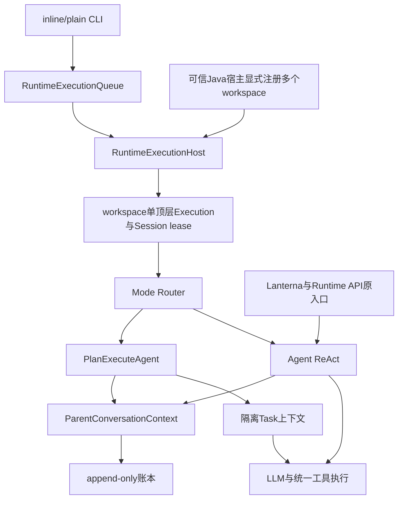

# 01. 从入口到可恢复的 Agent 执行

本系列按当前源码重新组织核心实现过程。章节顺序表示从零搭建时的依赖顺序，不代表真实提交时间；旧方案中尚未落地的能力不作为实现成果。模块的具体变更与实验仍保留在 [dev](../dev/)。

## 1. 背景、目标与非目标

第一步要解决的不是增加工具，而是让一条用户请求能够安全进入执行、跨多轮使用工具、返回结果，并在取消或崩溃后保留可解释的状态。以Java 17为基础，把CLI、模型、工具、上下文和持久化拆成边界明确的组件。

执行模式保留ReAct与统一Plan-and-Execute。普通inline/plain输入由Mode Router选择，`/react`和`/plan`只覆盖本轮。Runtime API与Lanterna保持各自入口，不能把交互式队列的恢复保证直接套到它们身上。

### 阅读与实施顺序

| 次序 | 记录 | 先建立的能力 |
|---|---|---|
| 01 | 本文 | 模型契约、执行循环、账本、路由与队列 |
| 02 | [工具、安全、诊断与快照](02-tools-policy-and-recovery.md) | 统一执行边界与修改恢复 |
| 03 | [上下文、记忆、代码索引与图片](03-context-memory-and-retrieval.md) | 有预算的请求上下文 |
| 04 | [MCP与Web](04-mcp-and-web-integration.md) | 外部工具协议与联网授权 |
| 05 | [浏览器](05-browser-session-and-guard.md) | 页面状态与登录态隔离 |
| 06 | [Skill与Prompt](06-skills-and-prompt-assembly.md) | 可覆盖的指令与按需加载 |
| 07 | [终端交互](07-terminal-rendering-and-input.md) | 输入所有权与输出生命周期 |
| 08 | [Runtime API](08-runtime-api.md) | 非交互适配与事件回放 |
| 09 | [验证与评测](09-verification-and-evaluation.md) | 单元、集成、手测与质量证据 |

## 2. 现状分析：架构与状态模型



Session是会话身份，Execution是一次顶层请求，Plan和Task是计划的执行身份。原始输入保存在Execution中，不用prompt文本充当恢复主键。Session Context Registry独占writable handle、Agent、Parent Context、MemoryManager和Skill buffer；UI当前会话指针不等于资源所有者。

## 3. 从零开始的实现步骤

### 3.1 先定义模型通信契约

通过LlmClient统一Message、Tool、Response、streaming和usage，LlmClientFactory负责Provider创建。先让纯文本请求可用，再加入工具调用与reasoning回传。Provider能力、重试和超时放在LLM层，Agent不直接拼HTTP请求。未验证的usage保持不可信，不能把缺失字段视为零成本。

规划、路由与评审使用StructuredJsonExecutor校验JSON。首次格式或业务结构失败只允许一次修复，总尝试最多两次；端点明确拒绝结构化参数时才降为普通请求，本地验证继续执行。Reviewer失败不能靠“同意”等文本关键词猜测批准。

### 3.2 再闭合ReAct工具循环

Agent先构造本轮请求，流式消费模型输出；有工具调用时进入统一工具入口，按原顺序追加结果，再请求模型。模型不再返回工具调用时结束。预算或连续相同调用停滞命中后，禁用工具进行一次部分结果收尾，不能再开启另一个无限循环。

工具执行结果与模型发送视图分离于原始账本。会话消息、工具调用、结果和边界追加到ConversationLedger，压缩和清空只改变发送视图，不能改写旧JSONL。

### 3.3 加入共享顶层上下文与Plan

ParentConversationContext维护顶层语义连续性；SessionProjection分成实际Provider发送视图和只含顶层输入、最终回答、压缩摘要的Top-level Conversation View。Planner读取后者，不读Task工具轨迹或临时注入。

Planner产出DAG，ExecutionPlan校验身份、依赖与环；PlanStateStore先严格持久化，再进入计划执行和Parent Conversation。人工计划门通过后，按资源声明选择就绪批次，Task使用独立messages。完成须同时通过确定性证据门和可用Reviewer，重试耗尽进入UNVERIFIED，不解锁后继。

写任务的步骤评审使用 Task 初始 baseline 到最终结果的 unified patch，并显式携带验收标准和命令输出证据。即使 Planner 未要求 DIFF，开启 stepReview 的写任务也须捕获 baseline。旧正文通过 SideGitManager 的独立 task ref 保存；plans.db 只有路径、SHA-256 和可选 snapshotCommitId，恢复不重置初始 baseline。单文件文本 2 MiB、初始缓存总量 16 MiB、patch 48 KiB；不完整 patch 不调用 Reviewer 批准，也不重试 Worker 去掩盖缺失，直接保留 UNVERIFIED。Reviewer 保持无工具，源码和输出均为不可信材料。详见 [实际 DIFF 与审核扩展](../dev/30-plan-real-diff-evidence.md#11-2026-10-12-扩展reviewer-实际-patch-与命令证据)。

TEST/BUILD 证据以 typed 工具状态为准，相同完整命令重跑替换旧结果，不同命令的失败不能被其他 PASSED 掩盖。命令输出摘要仅帮助 Reviewer 审查；退出码成功不等同于运行了足够的测试。

### 3.4 最后把交互式运行收口到队列

输入先持久化submittedInput。Host 的 Dispatcher 先预留顶层容量、workspace slot 和已声明共享资源租约；Worker 核验 owner 与目录身份，取得 workspace mutationGate 和 Session lease 后，才以 SQLite 短事务领取并递增 attempt。随后展开本地引用和MCP resource、读取当时顶层上下文、完成durable routing ack并执行。inline/plain CLI 仅注册启动目录，因此仍只有一个顶层Execution；可信 Java 宿主可显式注册多个独立 workspace，默认并发2、可配置1～4。Plan内部仍可执行无冲突任务。Lanterna与Runtime HTTP API没有接入Host。

inline/plain 的恢复意图分类仅处理当前 Session 确有 awaiting_input Task 的新输入，以及已有状态/控制语义或继续票据的请求。没有等待任务的新请求直接进入原 Coordinator，由显式模式或 Mode Router 选择 Agent；不读取完整恢复快照、不调用恢复分类器。此路径仍记录 NEW_REQUEST，保留 Plan 子任务恢复身份。已有 user 的未分类历史记录不走普通快路径，不能借此重新解释或授权旧输入。

恢复分类预算按实际发送的 system、完整当前 submittedInput 和有界顶层历史计算，不扣并未发送的完整 Provider Surface。历史正文超过分类预算时保留后缀并标明省略，不裁剪当前输入；恢复摘要仍受剩余空间的15%及4096 tokens限制。连必要身份/省略计数也放不下时显式抛出准备预算异常，由 Main/Host 保留等待状态，不能记为用户需要澄清。实际 Agent 请求继续使用自身完整快照与自动压缩。

审批与计划回答交给InteractionBroker，CLI是唯一终端输入者。CLI/TUI 和 Java Workspace Runtime 的 HITL 始终启用，不提供全局关闭入口；具体会话批准和无交互适配器时的拒绝行为见 [工具与安全边界](02-tools-policy-and-recovery.md#32-将hitl与审计置于共享执行链)。普通运行中输入排队；等待交互时优先回答交互，非法审批不能自动批准或变成任务。待交互时必须先完成当前审批或评审再提交新任务，显式 `/react` 与 `/plan` 新任务入口也拒绝；`/task` 仅查询、取消和日志。结束通过ExecutionFinalizer和持久化终态收敛账本与SQLite的崩溃窗口。

每个 workspace 拥有局部 Session Registry、ToolRegistry、Broker 和可变运行依赖；单终端由InteractionPresentationQueue顺序展示，Host回答核对workspaceKey、executionId、interactionId。owner目录catalog和本机文件锁先于所属workspace恢复，Git common-dir用整轮粗租约；未知外部副作用资源须明确声明租约。默认headless工厂不自动创建MCP Manager或后台索引，CLI工厂复用已有服务。Tool/Plan内部executor退出时等待物理停止，SnapshotService执行`runTurnAndDrain`；Finalizer跨库失败或关闭超时保持隔离与owner，不让后继进入。schema v2迁移前使用`VACUUM INTO`一致性备份。Windows的`fileKey`为空时，目录核验退化为file store名称加创建时间，其身份强度有限。详见[多工作区执行调度方案](../dev/42-multi-workspace-execution-scheduling.md)。

### 3.5 统一配置与启动模型选择

系统文件统一通过 `config.CodeAgentPaths` 定位。默认根为用户主目录 `.codeagent`，仅 `codeagent.home` / `CODEAGENT_HOME` 可以整体覆盖，原各模块存储路径设置停用。Main 的 CLI/serve 在日志/native library 初始化前创建 root/tmp 并设置 JVM、SQLite 临时路径，后续模块与用户级配置使用同一根。MCP/命令子进程标准临时变量、npm 缓存跟随该根；项目配置和用户任务产物不改变位置。旧默认目录兼容复用，旧外部目录不自动合并或删除。详见 [统一数据目录](../dev/44-unified-data-directory.md)。

`ConfigurationValues` 是无线程、无缓存的基础读取层，按 Java 属性、进程环境变量、项目 dotenv、用户 dotenv、默认值的顺序取值。文件按 UTF-8 解析简单 KEY=value，首个赋值生效，保留值中的等号和井号；不执行 shell 或变量替换。项目空值遮蔽用户 dotenv，再使用默认值，空密钥不能意外继承用户密钥。

`CodeAgentConfig.load()` 使用环境/文件合并快照；`load(Path,Map)` 保持隔离注入入口，Provider 与 Embedding 的 JSON 显式字段仍优先；环境密钥保存在忽略序列化的派生字段，不随配置保存写入 JSON。Provider canonical 键留空时阻断旧环境别名回退；工厂仅保留显式 JSON 别名密钥。启动选择由 `CODEAGENT_PROVIDER` 或 `codeagent.provider` 覆盖 JSON defaultProvider，未设置时用 JSON 或 glm。`LlmClientFactory.createFromConfig()` 只构造所选 Provider，名称非法或密钥缺失时抛出不包含配置原值的错误，不尝试其他家的密钥。普通交互启动可先完成配置向导，非交互和 serve 仍立即失败。`/model` 的显式切换契约保留，下一次启动再次按配置选择。旧只填其他家密钥的配置需补选择项，来源迁移见 [43号方案](../dev/43-env-example-cleanup.md)，安装与首次配置见 [46号方案](../dev/46-global-cli-installation-and-onboarding.md)。

交互配置通过 `ProviderConfigurationService` 解析各字段及 `SettingSource`，以 `ProviderSettingsDraft` 表达未编辑字段与 `SecretUpdate.KEEP/REPLACE`；不将环境派生字段展开保存。`UserConfigStore` 读取原始 JSON 快照，短暂取得非阻塞文件锁，重读并检查目标 Provider/defaultProvider 冲突，合并其他字段；同目录临时文件收紧当前用户权限、force 后原子替换。损坏 JSON、并发冲突、权限或原子替换失败均明确失败并保留旧文件。旧 `CodeAgentConfig.save()` 通过相同存储边界差量更新，错误显式传播，调用方不能假报保存成功。API Key 是权限保护的明文，不是加密凭据库。

Windows 全局命令由 `scripts/install-codeagent.ps1` 安装到统一根的 `bin/codeagent.cmd` 与 `lib/codeagent.jar`，只追加用户 PATH；shim 使用安装时验证的 Java 17+ 和固定 JAR，保持调用 cwd、参数与退出码。运行时数据根仍按既有配置解析，shim 不固定 `codeagent.home`。安装事务锁、资产备份和 journal 处理失败/中断；无 journal 的已知 staging 资产可安全清理，未知文件保留并报错。安装和卸载都不删除用户配置、会话或模型。ZIP 由 `package-distribution.ps1` 白名单组装，正式许可必须由维护者提供。

## 4. 实现任务与测试矩阵

| 边界 | 应先验证的失败场景 |
|---|---|
| 结构化输出 | 非法JSON、结构错误、修复仍失败、Provider拒绝参数 |
| ReAct | 空回答、工具失败、取消、重复调用、reasoning回传 |
| Plan | 环依赖、同Session双活动计划、评审不可用、证据不足 |
| 队列 | 排队不进入对话、Session FIFO、路由确认失败、退出恢复 |

执行到边界中断不保证外部副作用exactly-once。恢复时旧RUNNING/REVIEWING节点转为INTERRUPTED，从Task边界继续；EOF/shutdown停止进程内工作，保留非终态记录，不让任务脱离进程继续运行。

## 5. 验收清单与源码定位

- 请求从提交、路由、工具执行到最终回答都有确定身份与状态。
- ReAct与Plan共用基础设施，Planner只读取顶层语义，Task轨迹隔离。
- 结构化失败关闭、评审不可用及取消恢复有测试覆盖。

源码：[Agent](../../src/main/java/com/codeagent/agent/Agent.java)、[PlanExecuteAgent](../../src/main/java/com/codeagent/agent/PlanExecuteAgent.java)、[StructuredJsonExecutor](../../src/main/java/com/codeagent/llm/StructuredJsonExecutor.java)、[SessionExecutionContextRegistry](../../src/main/java/com/codeagent/runtime/execution/SessionExecutionContextRegistry.java)、[ConversationLedger](../../src/main/java/com/codeagent/history/ConversationLedger.java)。

```powershell
mvn test -DskipTests=false "-Dtest=StructuredJsonExecutorTest,ExecutionModeRouterTest,PlanExecuteAgentTest,RuntimeExecutionQueueTest,SessionExecutionContextRegistryTest"
```

持久化与恢复细节见 [统一执行Runtime](../dev/31-unified-background-execution-runtime.md)。本文列出的验证命令是模块验收入口，不表示本次文档重写逐项执行过所有命令；本次实际结果见 [重组验收记录](../dev/41-document-consolidation-and-channel-cleanup.md)。
